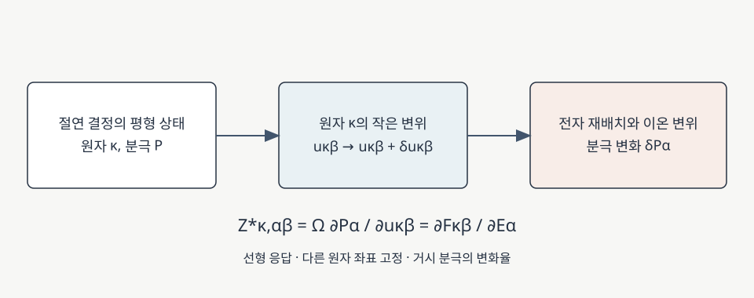

# Born effective charge

Born 유효전하(Born effective charge, BEC)는 원자의 형식 산화수와 같은 정전기적 전하가 아니다. 결정에서 원자 하나를 조금 움직였을 때 거시 분극이 얼마나 변하는지를 나타내는 텐서이며, 전기장에 대한 원자 힘의 응답으로도 정의할 수 있다. [1, §V; 2, §§II.C.2, II.D.2]

<figure markdown="span">

  

  <figcaption markdown="1">
  이 위키에서 제작한 개념도. 원자 변위에 따른 거시 분극의 변화율로 Born 유효전하를 정의한다. 원자 변위와 전기장에 대한 선형 응답의 관계는 본문의 참고 문헌 [1, 2]를 따른다.
  [도식 크게 보기](images/born-effective-charge-response.svg)</figcaption>
</figure>

## 1. 무엇을 나타내는가

분극 \(\mathbf P\)는 단위 부피당 전기 쌍극자 모멘트이며 SI 단위는 C/m²다. 절연 결정에서 원자 하나를 조금 이동시키면 이온 자체가 움직이고 전자 분포도 새 위치에 맞추어 반응한다. Born 유효전하는 이 **결합된 분극 변화의 기울기**를 원자와 이동 방향별로 표현한다. [1, §V; 2, §§II.C.2, II.D.2]

주기 결정에서 원자 하나의 변위는 단위 셀마다 그 원자와 주기적으로 같은 위치의 원자를 동시에 움직이는 \(q=0\) 섭동이다. BEC는 해당 평형 구조 근처의 미소 변위에 대한 선형 응답으로 이해해야 한다. [2, §§II.C.2, II.D.2; 4, §II.A]

## 2. 텐서 정의와 전기장에 대한 힘

### (1) 분극 변화에서 정의

셀 부피를 \(\Omega\), 원자 \(\kappa\)의 \(\beta\) 방향 변위를 \(u_{\kappa\beta}\), \(\alpha\) 방향 분극을 \(P_\alpha\)라 하자. 격자와 나머지 원자 좌표를 고정하고 거시 전기장 \(\mathbf E=0\)에서 평가하는 SI 정의는

\[
Z^{*}_{\kappa,\alpha\beta}
=\Omega\left.\frac{\partial P_\alpha}{\partial u_{\kappa\beta}}\right|_{\mathbf E=0}.
\]

\(\alpha\)는 분극 방향이고 \(\beta\)는 원자 변위 방향이다. 한 원자의 BEC는 일반적으로 \(3\times3\) 텐서이므로, \(x\) 방향 변위가 \(y\) 방향 분극 변화와 결합하는 비대각 성분도 결정 대칭이 허용하면 가능하다. 해당 원자 자리의 대칭을 확인하지 않은 채 모든 물질에서 대각 텐서라고 가정하지 않는다. [1, §V; 5, Eqs. (1)–(4)]

위 정의의 \(Z^*\)는 전하 차원(C)을 갖는다. 계산 출력은 보통 기본 전하 \(e\)로 나눈 \(Z^*/e\)를 무차원 수치로 표시한다. 원자별 텐서의 지표 순서는 코드마다 다를 수 있어, 힘의 방향을 첫 지표로 두는 출력과 비교할 때 전치 여부를 확인해야 한다. [2, §§II.C.2, II.D.2; 5, Eqs. (2)–(4); 6, “How to calculate Born Effective Charges?”]

### (2) 왜 힘으로도 계산할 수 있는가

고정된 셀에서 전기적 엔탈피를 \(\mathcal F(\{u\},\mathbf E)\)라 두면, 각 원자에 작용하는 힘과 거시 분극의 정의는 각각

\[
F_{\kappa\beta}=-\frac{\partial\mathcal F}{\partial u_{\kappa\beta}},\qquad
P_\alpha=-\frac{1}{\Omega}\frac{\partial\mathcal F}{\partial E_\alpha}
\]

이다. 같은 평형점에서 혼합 미분 순서를 바꿀 수 있다면

\[
Z^{*}_{\kappa,\alpha\beta}
=-\frac{\partial^2\mathcal F}{\partial E_\alpha\partial u_{\kappa\beta}}
=\left.\frac{\partial F_{\kappa\beta}}{\partial E_\alpha}\right|_{\mathbf E=0}
\]

가 된다. 변위가 분극을 얼마나 바꾸는지와 전기장이 힘을 얼마나 바꾸는지가 같은 혼합 응답을 두 방식으로 읽은 것이다. 이 등식은 같은 고정 셀, 다른 원자 좌표와 전기적 경계 조건을 사용하는 미분을 비교할 때 성립한다. [4, §II.A; 5, Eqs. (2)–(4)]

### (3) 단위 계산 예제

셀 부피가 \(100\,\text{Å}^3=10^{-28}\,\mathrm{m}^3\), 어떤 원자의 대각 성분이 \(Z^*_{xx}=2e\)라고 가정하자. 다른 좌표를 고정하고 그 원자를 \(+x\) 방향으로 \(0.01\,\text{Å}=10^{-12}\,\mathrm m\) 이동시키면 선형 근사에서

\[
\Delta P_x\simeq\frac{2e\,\Delta u_x}{\Omega}
\simeq 3.2\times10^{-3}\,\mathrm{C/m^2}.
\]

여기서 \(e\simeq1.602\times10^{-19}\,\mathrm C\)다. 숫자는 단위를 확인하기 위해 선택한 가상 예제로 특정 물질의 계산값이 아니다. 미소 변위에 대한 근사이므로 큰 이동의 분극 변화를 이 값으로 보장하지 않는다.

## 3. 형식 산화수와 합 규칙

형식 산화수는 화학적 전자 계수를 정하기 위한 정수 규약이고 BEC는 결합된 전자와 이온의 동적 응답이다. 전자 재배치의 크기와 방향은 결합 환경에 따라 달라질 수 있다. 따라서 BEC가 비정수이거나 형식 산화수와 다른 값을 갖는 것만으로 전하 계수에 오류가 있다고 판단할 수 없다. BEC는 특정 원자 주변에 실제로 고정된 순전하를 직접 측정한 값도 아니다. [1, §V; 2, §§II.C.2, II.D.2]

전하 중성인 절연체를 전체적으로 병진시키면 분극 변화가 없어야 하므로 각 성분에 대해

\[
\sum_\kappa Z^*_{\kappa,\alpha\beta}=0
\]

이라는 acoustic sum rule이 성립한다. 합은 선택한 주기 셀의 모든 원자를 포함해야 한다. 수치 잔차는 k점·기저·전자 수렴 등의 영향을 받을 수 있으므로, 합 규칙을 강제로 보정했다면 보정 전 잔차와 함께 기록한다. 금속이나 비중성 계에서는 절연체의 거시 분극 정의와 조건을 그대로 가져오지 않는다. [1, §VII; 2, §§II.C.2, II.D.2]

## 4. 포논과 유전 응답에 어떻게 들어가는가

모든 원자의 작은 변위가 동시에 있을 때 선형 분극 변화는

\[
\Delta P_\alpha=\frac{1}{\Omega}
\sum_{\kappa\beta}Z^*_{\kappa,\alpha\beta}u_{\kappa\beta}
\]

로 더해진다. 원자들이 같은 비율로 움직이는 포논 모드에서는 각 원자의 BEC를 그 모드의 변위에 가중하여 **모드 유효전하**를 만든다. 그러므로 큰 원자별 BEC가 있어도 모드 안의 기여가 상쇄되면 해당 모드가 만드는 분극은 작을 수 있다. [1, §§VII–VIII; 2, §II.D.2]

조화 근사에서 이온 유전 응답은 각 적외선 활성 모드의 유효전하와 주파수에 의존한다. 다른 조건이 같으면 분극과 강하게 결합하고 주파수가 낮은 모드가 큰 이온 응답에 기여할 수 있다. 전체 정적 유전율에는 고정 이온의 전자 응답도 더해야 한다. 구체적인 정규화와 응답식은 [DFPT 유전 응답](dfpt-dielectric-response.md)과 [유전 응답](dielectric-response.md)을 참고한다. [1, §§IV, VIII; 2, §II.D.2]

BEC는 또 극성 결정의 장파장 포논과 장거리 전자–포논 퍼텐셜에도 들어간다. 이때 고주파 전자 유전 텐서와 포논 모드가 함께 필요하며, BEC 하나만으로 결합의 전체 세기를 정하지는 못한다. [전자–포논 결합](../electron-phonon-coupling/electron-phonon-coupling.md)에서 이 행렬원소의 정의를 확인할 수 있다. [1, §§III–V; 3, “Long-range contributions”]

## 5. 계산 결과를 읽을 때

DFPT는 전기장과 원자 변위에 대한 응답을 직접 계산한다. 다른 방법으로는 양·음의 미소 변위에서 분극을 계산해 중앙차분을 취할 수 있다. 주기계의 Berry-phase 분극은 분극 양자만큼 다른 가지로 표현될 수 있으므로, 양쪽 계산이 연속된 같은 가지에 있도록 맞춘 뒤 차이를 취해야 한다. 변위 크기, k점·기저·전자 수렴에 대해 결과를 비교하고, 변위에 따라 절연 갭이 유지되는지도 확인한다. [2, §§II.C.2, II.D.2; 5, §§1–3; 6, “How to calculate Born Effective Charges?”]

!!! note "함께 기록할 조건"

    구조와 격자, 원자 순서, 고정 전기장과 변형률 조건, 텐서 지표 및 \(e\) 단위 사용 여부를 명시한다. 선형 응답의 수치 수렴과 선택한 구조의 물리적 안정성은 각각 다른 확인 항목이다. [4, §II.A; 6, “How to calculate Born Effective Charges?”]

## 6. 참고 문헌

1. X. Gonze and C. Lee, *Physical Review B* **55**, 10355 (1997), https://doi.org/10.1103/PhysRevB.55.10355.
2. S. Baroni et al., *Reviews of Modern Physics* **73**, 515 (2001), https://doi.org/10.1103/RevModPhys.73.515.
3. EPW project, “Theory: Long-range contributions,” https://docs.epw-code.org/Theory.html#long-range-contributions.
4. X. Wu, D. Vanderbilt, and D. R. Hamann, “Systematic treatment of displacements, strains, and electric fields in density-functional perturbation theory,” *Physical Review B* **72**, 035105 (2005), [§II.A](https://arxiv.org/abs/cond-mat/0501548).
5. exciting developers, [Born Effective Charges of Zincblende-Structure Crystals](https://www.exciting-code.org/uploads/exciting/tutorial-notebooks-sodium/born_effective_charges_of_zincblende_structure_crystals.html), §§1–3.
6. FHI-aims developers, [Calculating polarization of solids](https://www.fhi-aims.org/uploads/manual/Ch3/S42.html), “How to calculate Born Effective Charges?.”
