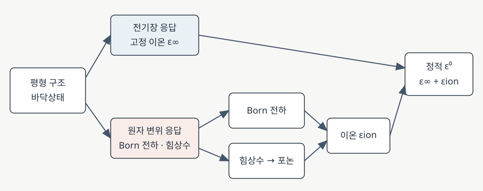

# DFPT dielectric response

밀도범함수 섭동이론(density-functional perturbation theory, DFPT)은 평형 상태 주변에서 원자 변위와 전기장에 대한 전자계의 선형 응답을 계산한다. 이 응답으로 전자 유전 텐서, Born 유효전하, 동역학 행렬과 포논을 일관된 제일원리 틀 안에서 얻는다. [1, §§III–V; 2, §§II.3.2, II.4.2–4.3]

<figure markdown="span">

  

  <figcaption markdown="1">
  이 위키에서 제작한 흐름도. 고정 이온 전자 응답과 Born 전하·포논에 의한 이온 응답을 결합한다. 조화 절연체의 정적 응답을 나타내며 본문의 참고 문헌 [1, 2]를 따른다.
  [도식 크게 보기](images/dfpt-dielectric-workflow.svg)</figcaption>
</figure>

## 1. 무엇을 섭동하고 무엇을 계산하는가

DFPT는 바닥상태를 매번 다른 구조로 다시 계산하지 않고, 바닥상태 주변에서 작은 섭동에 대한 1차 전자 응답을 구한다. 원자 위치를 조금 바꾸는 섭동은 원자 간 힘상수와 포논에, 균일 전기장을 가하는 섭동은 전자 유전 응답에 연결된다. 두 섭동을 섞은 응답에서 [Born 유효전하](born-effective-charge.md)를 얻는다. 이들은 같은 평형 구조와 교환상관 근사에서 계산할 수 있다. [1, §§III–V; 2, §II.C]

섭동 크기를 \(\lambda\)라 하면 전자 밀도는 평형점 근처에서 \(n_\lambda=n_0+\lambda n^{(1)}+O(\lambda^2)\)로 전개된다. \(n^{(1)}\)은 \(\lambda=0\)에서의 미분이다. 응답이 선형이라는 말은 작은 섭동에서 이 항이 지배적이라는 뜻이며, 임의로 큰 전기장이나 구조 변화까지 선형이라는 뜻은 아니다. [2, §II.C]

### (1) Sternheimer 방정식과 자기일관 응답

고립된 비축퇴 Kohn–Sham 상태를 예로 들면, 바닥상태 \(\hat H^0_{\mathrm{KS}}|\psi_n\rangle=\epsilon_n|\psi_n\rangle\)를 1차 미분해 다음 선형 방정식을 얻는다.

\[
(\hat H^0_{\mathrm{KS}}-\epsilon_n)|\delta\psi_n\rangle
=-\bigl(\delta\hat V_{\mathrm{SCF}}-\delta\epsilon_n\bigr)|\psi_n\rangle.
\]

\(\delta\psi_n\)은 궤도함수의 1차 변화, \(\delta\epsilon_n\)은 고유값 변화, \(\delta\hat V_{\mathrm{SCF}}\)는 외부 섭동과 유도된 Hartree·교환상관 퍼텐셜의 변화를 포함한다. 유도 퍼텐셜이 밀도 변화에 의존하고 밀도 변화가 다시 \(\delta\psi_n\)에 의존하므로, 이 선형 응답에도 자기일관성이 필요하다. 구현은 점유 공간과 직교성 조건을 처리해 선형계를 풀며, 비축퇴 상태 예시의 식은 퇴화 상태와 수치적 gauge 처리의 모든 세부사항을 생략한다. [1, §III; 2, §II.C, Eqs. (23)–(27)]

이 선형계는 비점유 상태를 하나씩 모두 더하는 표현을 직접 계산하지 않고도 응답을 얻는 길을 제공한다. 위 식은 고정된 직교 표현의 설명용 형태다. 원자 위치에 따라 기저나 overlap 행렬 \(S\)가 변하는 비직교 기저에서는 \(\delta S\)와 기저 변화에 따른 항도 처리해야 한다. [2, §§II.C, III.B–C, Eq. (150); 6, §2, Eqs. (12)–(13)]

### (2) 원자 변위와 거시 전기장

원자 변위 섭동은 평형 구조의 특정 원자·방향 또는 파수 \(\mathbf q\)의 집단 변위에 대한 응답을 구한다. 주기 결정의 DFPT는 하나의 \(\mathbf q\)에 대한 응답을 그 주기에 맞춰 계산할 수 있다. 균일 전기장의 경우 위치 연산자를 주기 경계에 그대로 넣을 수 없어서, 구현은 전기장 응답에 맞는 별도 표현을 사용한다. 전기장 및 원자변위 응답은 적용된 경계 조건과 일치하게 비교해야 한다. [1, §§III–V; 2, §§II.C.1–2]

## 2. 전자 유전 텐서와 Born 유효전하

### (1) 고정 이온 전자 응답

SI에서 작은 거시 전기장 \(E_\beta\)에 대한 분극 \(P_\alpha\)의 변화는, 원자 좌표와 셀 변형률을 고정할 때

\[
\left.\frac{\partial P_\alpha}{\partial E_\beta}\right|_{u,\eta}
=\varepsilon_{\mathrm{vac}}\bigl(\varepsilon^\infty_{\alpha\beta}-\delta_{\alpha\beta}\bigr)
\]

로 쓴다. \(\varepsilon_{\mathrm{vac}}\)는 진공 유전율, \(\delta_{\alpha\beta}\)는 단위 텐서, \(\varepsilon^\infty\)는 진공 항을 포함하는 무차원 상대 유전 텐서다. 상첨자 \(\infty\)는 격자 이온이 움직이지 않는 *고정 이온* 응답을 가리키며, 모든 전자 공명보다 높은 임의의 주파수를 뜻하지 않는다. [1, §IV; 2, §§II.C.2, II.D]

### (2) 혼합 응답으로 얻는 Born 전하

셀 부피 \(\Omega\), 원자 \(\kappa\)의 변위 \(u_{\kappa\beta}\), 힘 \(F_{\kappa\beta}\)에 대해 전하 단위를 갖는 SI Born 텐서는

\[
Z^*_{\kappa,\alpha\beta}
=\Omega\left.\frac{\partial P_\alpha}{\partial u_{\kappa\beta}}\right|_{\mathcal E,\eta}
=\left.\frac{\partial F_{\kappa\beta}}{\partial E_\alpha}\right|_{u,\eta}
\]

이다. 즉 원자 변위가 분극을 바꾸는 응답과 전기장이 원자 힘을 바꾸는 응답이 같은 혼합 미분에 연결된다. \(\mathcal E\)는 여기서 거시 전기장이다. 원문이나 코드가 전하 \(e\)로 나눈 무차원 \(Z^*/e\)를 출력할 수 있으므로 식에 넣기 전에 규약을 확인한다. 형식 산화수와의 차이는 [Born 유효전하 문서](born-effective-charge.md)를 참조한다. [1, §V; 2, §§II.C.2, II.D]

## 3. 힘상수에서 포논과 이온 유전율까지

### (1) 힘상수와 동역학 행렬

평형 셀 \(0\)의 원자 \(\kappa\)와 셀 \(\mathbf R\)의 원자 \(\kappa'\) 사이 힘상수는 고정된 전기적·변형률 경계 조건 아래

\[
\Phi_{\kappa\alpha,\kappa'\beta}(\mathbf R)
=\frac{\partial^2 E_{\mathrm{tot}}}
 {\partial u_{0\kappa\alpha}\,\partial u_{\mathbf R\kappa'\beta}}
=-\frac{\partial F_{0\kappa\alpha}}{\partial u_{\mathbf R\kappa'\beta}}
\]

로 정의한다. \(E_{\mathrm{tot}}\)은 총에너지이고 \(\Phi\)의 SI 단위는 \(\mathrm{N\,m^{-1}}\)이다. 질량 \(M_\kappa\)로 가중한 Γ점 동역학 행렬은

\[
D_{\kappa\alpha,\kappa'\beta}(\Gamma)
=\frac{\sum_{\mathbf R}\Phi_{\kappa\alpha,\kappa'\beta}(\mathbf R)}
{\sqrt{M_\kappa M_{\kappa'}}},\qquad
D(\Gamma)\mathbf e_\nu=\omega_\nu^2\mathbf e_\nu.
\]

여기서 \(\omega_\nu\)는 모드 각주파수이며 rad/s로 쓴다. 아래 모드 합에서는 Γ점의 고정 거시 전기장 조건에 맞는 힘상수와 실수 고유벡터를 사용하고 \(\sum_{\kappa\alpha}|e_{\kappa\alpha,\nu}|^2=1\)로 정규화한다. Hz로 출력된 주파수 \(f_\nu\)는 \(\omega_\nu=2\pi f_\nu\)로 변환해야 한다. 힘상수에서 포논과 전자–포논 행렬원소로 이어지는 과정은 [전자–포논 결합](../electron-phonon-coupling/electron-phonon-coupling.md)에서 다룬다. [1, §§III, VI; 2, §§II.B–D; 4, §IV.A–B]

### (2) 모드 유효전하와 정적 이온 응답

BEC와 질량 가중 고유벡터를 결합한 모드 유효전하 \(\widetilde Z\)를 사용하면 조화 절연체의 정적 상대 유전 텐서는

\[
\widetilde Z_{\nu,\alpha}
=\sum_{\kappa\beta}
\frac{Z^{*}_{\kappa,\alpha\beta}\,e_{\kappa\beta,\nu}}{\sqrt{M_\kappa}},\qquad
\varepsilon^{\mathrm{ion}}_{\alpha\beta}(0)
=\frac{1}{\varepsilon_{\mathrm{vac}}\Omega}
\sum_{\nu}\frac{\widetilde Z_{\nu,\alpha}\widetilde Z_{\nu,\beta}}{\omega_\nu^2},\qquad
\varepsilon^0=\varepsilon^\infty+\varepsilon^{\mathrm{ion}}
\]

로 나타낼 수 있다. 합은 Γ점 광학 모드가 양의 주파수를 갖는 안정 조화 구조에 적용하며 병진 acoustic 영모드는 제외한다. 분극과 결합하는 광학 모드가 0에 접근하는 임계점에서는 이 조화 정적 응답이 발산할 수 있다. 위 정규화에서 \(\widetilde Z\)의 단위는 \(\mathrm{C\,kg^{-1/2}}\), 유전 텐서는 무차원이다. Gaussian 단위의 \(4\pi/\Omega\) 형태나 \(Z^*/e\), amu 정규화 고유벡터를 쓰는 수치식의 계수를 이 SI 식에 그대로 섞으면 안 된다. [1, §§VII–VIII; 2, §II.D; 4, §IV.B, Eqs. (6)–(10)]

이 식은 모드가 낮은 주파수라고 해서 반드시 큰 유전 응답을 만든다는 뜻은 아니다. 전기장과 결합하는 모드 유효전하도 커야 한다. 예를 들어 다른 양을 고정한 단일 모드의 주파수를 10% 크게 계산하면 \(1/\omega^2\) 기여는 원래의 약 0.826배가 된다. 이는 식의 민감도를 보여주는 산술 예시이지 특정 재료 계산값이 아니다. [1, §VIII; 4, §IV.B]

## 4. 수치 계산과 결과 확인

구조를 완화하고 전자 바닥상태를 수렴한 다음, 전기장 및 원자 변위에 대한 응답을 구한다. 이어 힘상수·BEC·\(\varepsilon^\infty\)를 조합해 Γ점 모드와 이온 유전율을 평가한다. 결과를 재현하거나 비교할 때는 다음 항목을 함께 확인한다. [1, §§III–VIII; 2, §§II.C–D]

- **구조와 경계 조건:** 결정상, 원자 좌표, 셀 변형률과 전기적 경계 조건을 기록한다. 위의 합은 고정 변형률 유전 응답이다. 압전성 결정에서 기계적 변형까지 허용한 자유 응력 응답과 혼동하지 않는다.
- **전자 및 응답 수렴:** 전자 바닥상태뿐 아니라 1차 응답도 수렴해야 한다. k점, 기저 또는 평면파 cutoff, pseudopotential, 전자 및 응답 수렴 기준을 바꿔 \(\varepsilon^\infty\), BEC, 포논과 최종 \(\varepsilon^0\)를 각각 확인한다.
- **병진 대칭:** 힘상수와 BEC의 acoustic sum rule 잔차, 보정 전후 값, Γ점 병진 모드를 점검한다. 수치 보정이 임의로 실제 불안정 모드를 지우는 데 쓰이지 않도록 한다.
- **작은 주파수와 불안정성:** 낮은 광학 모드는 \(1/\omega^2\) 때문에 수치 오차에 민감하다. 허수 주파수는 선택한 구조에서 해당 조화 모드의 불안정성을 뜻하며 단순히 그 모드를 버리고 안정한 상의 유한 정적 유전율로 해석하면 안 된다.
- **방향과 비해석 항:** 극성 결정에서 \(\mathbf q\to0\) 포논은 장거리 전기장에 따라 방향 의존적인 LO–TO 분리가 생길 수 있다. 주파수와 유전 응답을 비교할 때 고정 거시 전기장 모드와 장거리 보정·방향을 확인한다.

Γ점 안정성 확인은 그 한 점의 조건이다. 다른 파수의 불안정성이나 열역학적 안정성을 입증하려면 별도 분석이 필요하다. 응답 계산이 수치적으로 수렴해도 선택한 상의 합성 가능성이나 소자 적합성이 보증되는 것은 아니다. [1, §§VI–VIII; 2, §§II.C–D, V.F; 3, §§2–3]

## 5. 적용 범위와 논문 사례

위 유전율의 모드 합은 주기적인 절연체의 고정 변형률, 미소 전기장 및 조화 정적 응답을 설명한다. 강한 비조화성, 온도 의존 상전이, 분극 이력, 결함·계면 및 박막의 효과에는 추가 모델이 필요하다. 금속은 점유수 변화와 차폐 때문에 절연체의 거시 전기장·분극 공식을 그대로 적용할 수 없다. [1, §§III–VIII; 2, §§II.C.4, V.F]

[유전 응답 개요](dielectric-response.md)는 텐서와 모드의 의미를 정리하고, [Takigawa 등 2026 논문](takigawa-2026-prx-ionic-dielectric-ml.md)은 Born 전하와 힘상수를 별도 모델로 예측해 이온 응답을 구성한 사례를 다룬다. 최종 high-κ 선별에는 유전율 이외의 조건도 필요하다. [4, §§II, IV; 5, §§1–2]

## 6. 참고 문헌

1. X. Gonze and C. Lee, “Dynamical matrices, Born effective charges, dielectric permittivity tensors, and interatomic force constants from density-functional perturbation theory,” *Physical Review B* **55**, 10355 (1997), [원문](https://harvest.aps.org/v2/journals/articles/10.1103/PhysRevB.55.10355/fulltext), https://doi.org/10.1103/PhysRevB.55.10355.
2. S. Baroni, S. de Gironcoli, A. Dal Corso, and P. Giannozzi, “Phonons and related crystal properties from density-functional perturbation theory,” *Reviews of Modern Physics* **73**, 515 (2001), [저자 원고](https://arxiv.org/abs/cond-mat/0012092), https://doi.org/10.1103/RevModPhys.73.515.
3. M. Stengel, N. A. Spaldin, and D. Vanderbilt, “Electric displacement as the fundamental variable in electronic-structure calculations,” *Nature Physics* **5**, 304–308 (2009), https://doi.org/10.1038/nphys1185.
4. A. Takigawa, S. Kiyohara, and Y. Kumagai, “Physics-Based Factorized Machine Learning for Predicting Ionic Dielectric Tensors,” *Physical Review X* **16**, 021006 (2026), [§IV](https://journals.aps.org/prx/pdf/10.1103/28wr-w896).
5. J. Robertson, “High dielectric constant gate oxides for metal oxide Si transistors,” *Reports on Progress in Physics* **69**, 327–396 (2006), https://doi.org/10.1088/0034-4885/69/2/R02.
6. B. Shpiro et al., “Forces from Stochastic Density Functional Theory under Nonorthogonal Atom-Centered Basis Sets,” *J. Chem. Theory Comput.* **18**, 1458–1466 (2022), [§2, Eqs. (12)–(13)](https://pmc.ncbi.nlm.nih.gov/articles/PMC8908760/).
