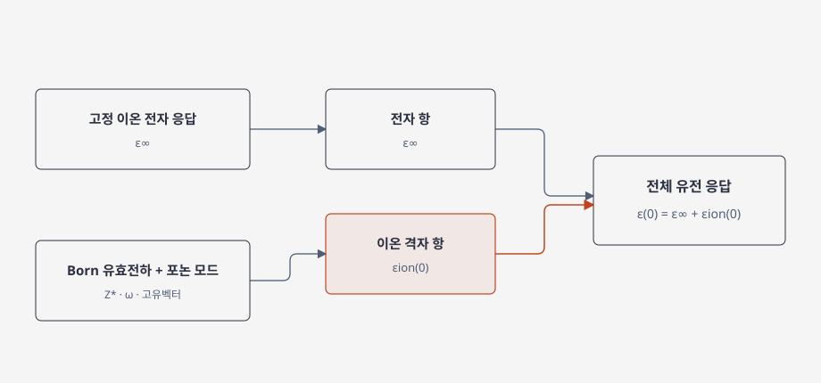

# Dielectric response and dielectric tensor

유전 응답은 전기장이 유도하는 분극의 선형 관계다. 결정에서는 결정축에 따라 응답이 다를 수 있으므로 상대 유전율은 스칼라보다 텐서 \(\varepsilon_{\alpha\beta}(\omega)\)로 쓰는 것이 일반적이다. 절연체의 조화·선형 응답에서 전자 분극은 이온을 고정한 고주파 유전 텐서 \(\varepsilon^\infty\)에, 이온 이동은 진동 모드의 주파수와 유효 전하를 포함하는 이온 기여에 나타난다. 여기서 \(\varepsilon^\infty\)는 진공 기준값을 포함한 상대 유전 텐서다. 표기 convention에 따라 이를 \(1+\varepsilon^{\mathrm{ele}}\)로 나누기도 하며, Takigawa 등은 2026년 논문에서 이 표기를 사용한다. [1, §§III–IV, VIII; 2, §§II.3.2, II.4.2; 5, §I]

## 1. 전자 응답과 이온 응답

전자 분극은 이온 좌표가 고정된 상태에서 전자 밀도가 전기장에 반응한 결과다. 이 응답을 \(\varepsilon^\infty\)로 표시한다. 저주파에서 격자가 움직일 수 있으면 원자 변위에 따른 분극 변화도 더해져 정적 유전율이 된다. 결정의 유전 응답을 계산할 때는 주파수, 이온 완화 여부, 결정 구조와 전기장 방향을 함께 지정해야 한다. [1, §§IV, VIII; 2, §§II.3.2, II.4.2]

이 식은 Γ점에서 동역학적으로 안정한 조화 구조의 정적 응답에 적용한다. 병진 acoustic zero modes는 제외하며, 구조에 허수 포논 모드가 있으면 이를 단순히 합에서 빼고 유한 유전율을 해석해서는 안 된다. 조화 근사에서 이온 기여는 단위 정규화한 질량 가중 동역학 행렬의 고유벡터 \(\mathbf e_{\kappa\nu}\)와 Born 유효전하로 만든 모드 유효전하를 통해 쓸 수 있다.

\[
\widetilde Z_{\nu,\alpha}
=\sum_{\kappa\beta}
\frac{Z^{*}_{\kappa,\alpha\beta}e_{\kappa\beta,\nu}}{\sqrt{M_\kappa}},
\qquad
\varepsilon^{\mathrm{ion}}_{\alpha\beta}(0)
=\frac{1}{\varepsilon_0\Omega}
\sum_{\nu:\,\omega_\nu>0}
\frac{\widetilde Z_{\nu,\alpha}\widetilde Z_{\nu,\beta}}{\omega_\nu^2}.
\]

여기서는 SI 단위, 셀 부피 \(\Omega\), 고유벡터 정규화 \(\sum_{\kappa\alpha}|e_{\kappa\alpha,\nu}|^2=1\), 그리고 무시 가능한 감쇠의 정적 조화 응답을 가정했다. \(\widetilde Z\)의 단위는 \(\mathrm{C\,kg^{-1/2}}\)이고, 따라서 \(\varepsilon^{\mathrm{ion}}\)은 무차원이다. 구현마다 포논 고유벡터 또는 전하에 \(\sqrt{\mathrm{amu}}\), 전자 전하 \(e\), 단위 셀 부피를 흡수하는 규약이 달라질 수 있으므로 수치식을 비교할 때 단위를 확인해야 한다. [1, §VIII; 2, §II.4.2]

이 분해는 [Born 유효전하](born-effective-charge.md)와 [DFPT 계산](dfpt-dielectric-response.md)에서 계산량별로 이어진다. 관련 논문 사례는 [high-\(\kappa\) 탐색](high-k-screening.md)에서 확인한다.

## 2. 유전율이 큰 이유와 해석의 한계

저주파 이온 유전율은 전기장과 잘 결합하는 모드가 낮은 주파수를 가질 때 커질 수 있다. 위 식에서 유효 전하의 제곱에 비례하고 \(\omega_\nu^{-2}\)에 반비례하기 때문이다. 이 때문에 유전율이 큰 결과를 Born 유효전하 하나의 크기로 설명하면 불완전하며, 해당 모드의 주파수·방향·전하와 구조 안정성을 함께 확인해야 한다. [1, §VIII; 2, §II.4.2]

이 식은 조화 결정의 선형 응답을 설명한다. 강한 비조화성, 상전이 근처의 온도 의존 격자, 유한 주파수 감쇠, 유한한 파수의 비국소 응답은 이 단순한 정적 모드 합으로 완전히 표현되지 않는다. [1, §VIII; 2, §§II.4.2–4.3 and V.6]

## 3. high-\(\kappa\) 탐색과의 관계

게이트 절연막에서 높은 상대 유전율은 같은 정전용량을 더 두꺼운 막으로 구현할 가능성을 제공하지만, 실제 재료 선택에는 밴드 정렬, 누설, 결함, 계면 안정성, 상 안정성과 공정 조건도 필요하다. 따라서 높은 \(\kappa\)는 단독으로 소자 적합성을 보증하지 않는다. [3, §1–2; 4, §2]

## 4. 참고 문헌

1. X. Gonze and C. Lee, “Dynamical matrices, Born effective charges, dielectric permittivity tensors, and interatomic force constants from density-functional perturbation theory,” *Physical Review B* **55**, 10355 (1997), https://doi.org/10.1103/PhysRevB.55.10355.
2. S. Baroni, S. de Gironcoli, A. Dal Corso, and P. Giannozzi, “Phonons and related crystal properties from density-functional perturbation theory,” *Reviews of Modern Physics* **73**, 515 (2001), https://doi.org/10.1103/RevModPhys.73.515.
3. J. Robertson, “High dielectric constant oxides,” *European Physical Journal Applied Physics* **28**, 265–291 (2004), https://doi.org/10.1051/epjap:2004206.
4. J. Robertson, “High dielectric constant gate oxides for metal oxide Si transistors,” *Reports on Progress in Physics* **69**, 327–396 (2006), https://doi.org/10.1088/0034-4885/69/2/R02.
5. A. Takigawa, S. Kiyohara, and Y. Kumagai, “Physics-Based Factorized Machine Learning for Predicting Ionic Dielectric Tensors,” *Physical Review X* **16**, 021006 (2026), https://doi.org/10.1103/28wr-w896.
