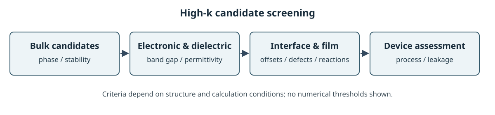
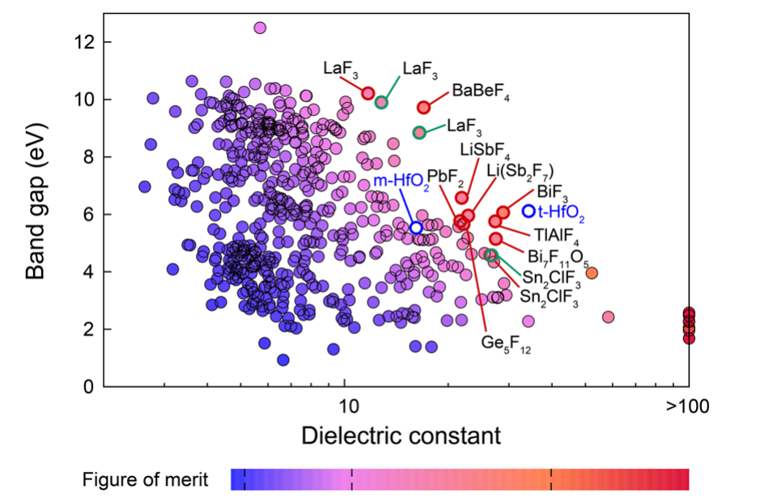

# High-\(\kappa\) dielectric screening

High-\(\kappa\) 유전체는 기준 물질보다 큰 상대 유전율을 이용해 같은 정전용량을 더 두꺼운 막으로 구현할 수 있는 재료 후보를 뜻한다. 이상적인 평행판 근사에서 면적당 정전용량은 \(C/A=\varepsilon_0\kappa/t\)이므로, 큰 \(\kappa\)는 터널링 누설을 낮출 수 있는 물리 두께의 여지를 준다. 그러나 실제 적합성은 밴드 오프셋, 결함, 계면 반응, 열·화학 안정성과 공정성에 달려 있다. [1, §1–2; 2, §2]

<figure markdown="span">
  
  <figcaption markdown="1">High-κ 후보 선별의 주요 검토 항목을 나타낸 위키 자체 도식이다. 기준의 순서와 수치 경계는 재료와 목적에 따라 달라진다. [1, §2–4; 4, Methods][도식 크게 보기](images/high-k-selection.svg)</figcaption>
</figure>

## 1. 후보 선별의 기준

유전율과 밴드갭은 서로 독립적으로 최적화되지 않을 수 있다. 따라서 큰 유전율만으로 후보를 고르면 전자 장벽과 누설 조건을 놓칠 수 있다. 계산 스크리닝은 정적 유전 응답과 전자 밴드갭을 함께 보되, 최종 소자 판단은 계면 밴드 정렬과 결함·구조 안정성으로 확장해야 한다. [1, §2–4; 2, §2]

벌크 유전율은 조성 및 구조를 바꾼 박막·계면에서 그대로 유지되지 않을 수 있다. 박막에서는 응력, 결정상, 계면층, 배향, 두께가 응답을 바꿀 수 있어, 벌크 후보 선별을 실험 소자 성능 예측으로 바로 읽어서는 안 된다. [2, §2–4; 3, §1–3]

## 2. 계산 자료를 비교할 때

후보 표의 유전율은 실험값, 전자 기여, 정적 격자 기여, 계산된 전체 정적 유전율이 서로 섞여 있을 수 있다. 구조의 상, 계산 함수, 주파수와 이온 완화 여부, 유전 텐서의 평균 방식을 먼저 맞춘다. 밴드갭은 semilocal DFT, hybrid functional, 실험값이 다를 수 있으므로 데이터 출처와 보정 방법을 구별한다. [1, Methods; 2, §2–4]

## 3. 탐색 연구와 연결

2015년 연구는 산화물에서 높은 유전율과 넓은 밴드갭을 동시에 찾는 자동화 제일원리 스크리닝을 수행했다. 2018년 연구는 탄화물·질화물·황화물·인화물·할로겐화물 등 비산화물 후보로 탐색을 넓혔다. 두 사례는 후보 선별 범위와 계산 파이프라인을 보여주며, 실제 박막의 공정·계면 성능을 입증한 것은 아니다. [4, Abstract; 5, Abstract and Methods]

Lee 등의 불화물 선별 결과는 유전율과 밴드갭을 함께 비교하는 사례다. 점과 강조된 후보는 논문에서 사용한 계산 조건과 선별 기준에 한정해 읽어야 한다. [5, Fig. 5 and Methods]

<figure markdown="span">
  
  <figcaption markdown="1">M. Lee, Y. Youn, K. Yim, S. Han, “High-throughput ab initio calculations on dielectric constant and band gap of non-oxide dielectrics,” *Scientific Reports* 8, 14794 (2018), Fig. 5, [DOI](https://doi.org/10.1038/s41598-018-33095-6), [CC BY 4.0](https://creativecommons.org/licenses/by/4.0/). 점 색은 밴드갭과 유전율의 곱으로 정한 figure of merit, 빨강과 초록 원은 각각 안정 및 준안정 후보를 뜻한다. 비교 기준인 m- 및 t-HfO₂도 포함한다. 원문 PDF에서 그림 영역을 잘랐으며 데이터·축·범례·색상은 수정하지 않았다.</figcaption>
</figure>

2026년 Takigawa 등은 머신러닝과 제일원리 계산을 결합해 8,717개 산화물을 선별하고 최종 고유전율 후보 31개를 보고했다. 원 논문 Fig. 4(a,b)는 단계별 후보 축소와 유전율–밴드갭 지도를 함께 보여준다. [6, §II.B, Fig. 4]

원 논문 Fig. 4(a,b)의 선별 절차와 결과 지도는 [APS 공식 도판](https://journals.aps.org/prx/article/10.1103/28wr-w896/deliverable/ded1aa42-0182-40ff-9cde-d6c2f81a6e41)에서 볼 수 있다. 논문은 CC BY 4.0을 따르지만 APS는 일부 도판에 제3자 저작권 예외가 있을 수 있다고 안내한다. Fig. 4 캡션에서 별도 권리자 표기는 확인되지 않았다. 출판사 도판 파일은 접근 제한으로 확보하지 못해, 이 문서에는 원그림을 복제하지 않고 공식 링크만 둔다. [6, Fig. 4]

## 4. 참고 문헌

1. J. Robertson, “High dielectric constant oxides,” *European Physical Journal Applied Physics* **28**, 265–291 (2004), https://doi.org/10.1051/epjap:2004206.
2. J. Robertson, “High dielectric constant gate oxides for metal oxide Si transistors,” *Reports on Progress in Physics* **69**, 327–396 (2006), https://doi.org/10.1088/0034-4885/69/2/R02.
3. A. A. Demkov and A. Navrotsky, eds., *Materials Fundamentals of Gate Dielectrics*, Springer (2005), https://doi.org/10.1007/0-387-27658-3.
4. K. Yim et al., “Novel high-\(\kappa\) dielectrics for next-generation electronic devices screened by automated ab initio calculations,” *NPG Asia Materials* **7**, e190 (2015), https://doi.org/10.1038/am.2015.57.
5. M. Lee et al., “High-throughput ab initio calculations on dielectric constant and band gap of non-oxide dielectrics,” *Scientific Reports* **8**, 14794 (2018), https://doi.org/10.1038/s41598-018-33095-6.
6. A. Takigawa, S. Kiyohara, and Y. Kumagai, “Physics-Based Factorized Machine Learning for Predicting Ionic Dielectric Tensors,” *Physical Review X* **16**, 021006 (2026), [DOI](https://doi.org/10.1103/28wr-w896), [APS reuse information](https://journals.aps.org/prx/abstract/10.1103/28wr-w896).
