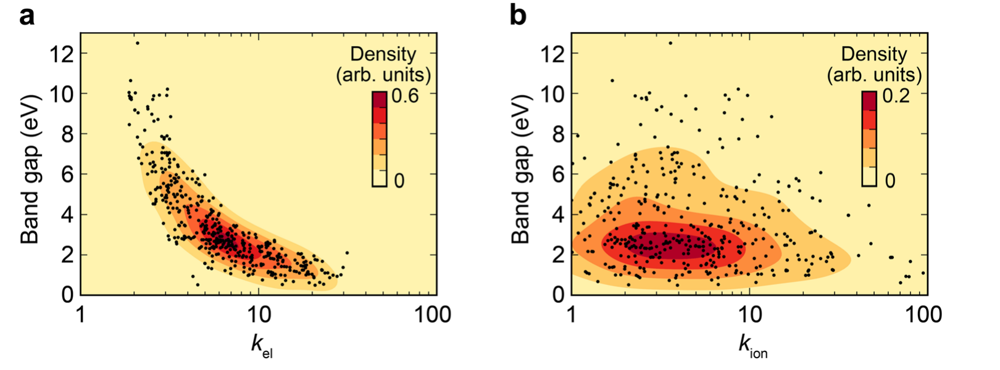
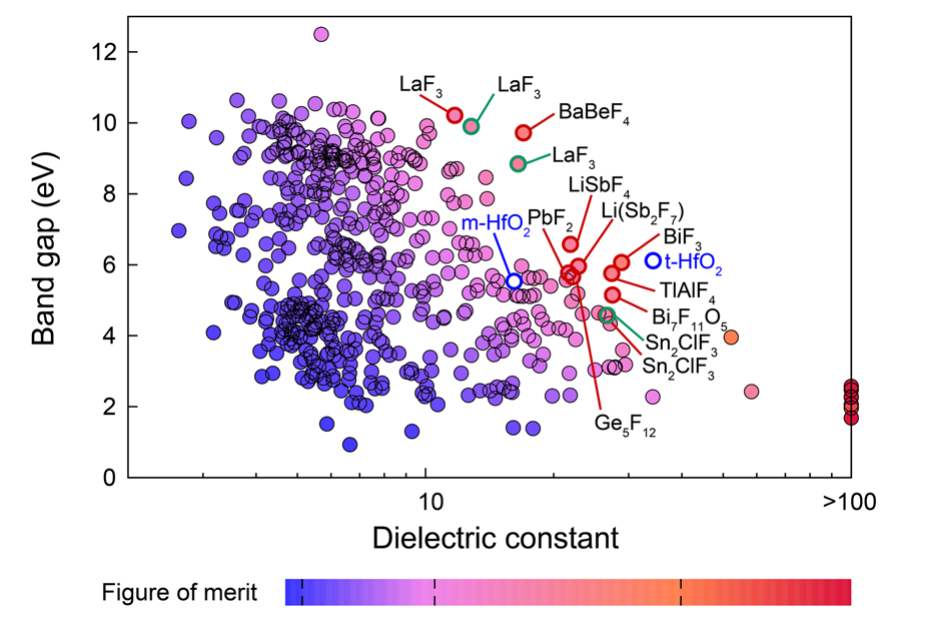

# Lee et al. 2018: non-oxide dielectrics

Lee 등은 산화물 중심의 유전체 후보 탐색을 비산화물로 확장해, 고유전율과 넓은 밴드갭을 함께 만족할 가능성이 있는 조성을 조사했다. 대상에는 탄화물, 질화물, 황화물, 인화물과 할로겐화물이 포함됐다. [1, Abstract and Introduction]

<figure markdown="span">

  

  <figcaption markdown="1">
  **그림 1.** M. Lee, Y. Youn, K. Yim, S. Han, “High-throughput ab initio calculations on dielectric constant and band gap of non-oxide dielectrics,” *Scientific Reports* 8, 14794 (2018), Fig. 4, [DOI](https://doi.org/10.1038/s41598-018-33095-6). [CC BY 4.0](https://creativecommons.org/licenses/by/4.0/). 원문 PDF에서 페이지 여백과 논문 캡션을 덜어 내고 도판 영역을 수록했다. 축·데이터·색상은 수정하지 않았다.
  </figcaption>
</figure>

## 1. 연구 질문과 후보 구조

[Yim 등의 산화물 탐색](yim-2015-high-k-oxides.md)에 이어 연구진은 산소 이외의 음이온을 포함한 결정에서도 큰 밴드갭과 유전율을 함께 갖는 후보를 찾고자 했다. 2015년판 ICSD에서 보고된 정렬 이원 결정 중 탄화물·질화물·불화물·인화물·황화물·염화물을 대상으로 삼았다. 부분 점유된 d 궤도를 가진 V–Cu 및 원시 셀 원자 수가 50개를 넘는 구조는 논문이 밝힌 비용과 물성 기준으로 제외했다. 따라서 이 선택은 전체 비산화물 공간의 완전한 탐색이 아니다. [1, Introduction and “Automation workflow”]

저자들은 이원 구조 **869개**를 조사했고, 이 중 절연체 **449개**의 결과를 정리했다. 이원 불화물이 넓은 밴드갭 분포를 보여 탐색을 삼원 불화물로 확장했다. 논문은 ICSD에 보고된 삼원 불화물 644개 중 유한한 밴드갭을 가진 415개의 관계를 Fig. 5에 표시한다. [1, Results, “High-throughput screening for binary non-oxides” and “High-throughput screening for ternary fluorides”]

## 2. 계산 흐름과 선택한 근사

### (1) 밴드갭과 구조

연구진은 VASP의 projector augmented wave 방법과 PBE 형태의 일반화 기울기 근사(generalized gradient approximation, GGA)로 구조를 완화했다. GGA(+U) 밴드에서 고대칭 경로의 밴드 경계점을 찾고, 그 점에서 HSE06 에너지를 계산하는 HSE@GGA를 적용했다. 구조와 밴드 경계점의 선택을 재사용하는 근사이므로 전체 k공간의 HSE 밴드 탐색과 구별해야 한다. Zn·La·Ce가 포함된 계에는 논문에서 명시한 GGA+U 설정도 사용했다. [1, Methods, “Computational details” and “Band gap”]

선택한 물질과 실험을 비교한 Fig. 2(a)에서는 약 8 eV보다 큰 밴드갭의 경우 차이가 두드러졌다. 이는 선택된 비교 물질에 대한 저자들의 관찰이며, 모든 물질에 동일한 크기의 오차가 난다는 뜻은 아니다. [1, Results, “Validation of automatic calculations”, Fig. 2(a)]

### (2) 유전율과 포논

정적 유전율은 LDA와 [밀도범함수 섭동이론(DFPT)](dfpt-dielectric-response.md)을 이용했다. [Born 유효전하](born-effective-charge.md)와 포논은 이온 응답을 구성하고, 전자 응답도 전체 정적 유전율에 포함된다. 두 기여의 의미는 [유전 응답](dielectric-response.md) 문서에서 다룬다. 저자들은 DFPT의 k점 민감성을 고려해 유전율 계산의 k점 밀도를 두 배로 늘렸다고 기술했다. [1, Methods, “Dielectric constant”; 3, §§V, VIII]

논문은 선택된 물질에서 GGA와 LDA 유전율을 실험과 비교하고, 고유전율 물질에서 GGA의 과대 경향을 고려해 LDA를 선택했다. 이 선택이 모든 상과 물질에서 LDA가 가장 정확하다는 결론을 보장하지는 않는다. [1, Results, “Validation of automatic calculations”, Fig. 2(b)]

## 3. 전자·이온 응답에서 불화물 후보까지

첫 그림에 해당하는 원 논문 Fig. 4는 이원 비산화물의 유전율을 전자 기여와 이온 기여로 나누어 밴드갭에 대해 표시한다. 연구진은 전자 기여에서는 역상관이 뚜렷하고 이온 기여에서는 점들의 분산이 더 크다고 분석했다. 두 패널의 분포는 **이 논문에서 계산한 결정군**에 대한 결과다. [1, “Distribution of dielectric constants”, Fig. 4]

아래 Fig. 5에서는 이원 불화물 86개와 삼원 불화물 415개의 밴드갭–유전율을 비교한다. 점 색의 지표는 \(E_g\kappa\)이며 \(E_g\)는 eV 단위로 사용한다. 빨간색·초록색 원은 각각 안정상·준안정 후보를 표시한다. m- 및 t-HfO\(_2\)는 비교 기준이다. 후보에 대해서는 포논 분석을 이용해 동역학적으로 불안정한 구조를 제외했다고 설명한다. [1, Fig. 5 and “High-throughput screening for ternary fluorides”]

<figure markdown="span">

  

  <figcaption markdown="1">
  **그림 2.** M. Lee, Y. Youn, K. Yim, and S. Han, “High-throughput ab initio calculations on dielectric constant and band gap of non-oxide dielectrics,” *Scientific Reports* 8, 14794 (2018), Fig. 5, [DOI](https://doi.org/10.1038/s41598-018-33095-6), [CC BY 4.0](https://creativecommons.org/licenses/by/4.0/). 원문 PDF에서 페이지 여백과 논문 캡션을 덜어 내고 도판 영역을 수록했다. 데이터·축·범례·색상은 수정하지 않았다.
  </figcaption>
</figure>

### (1) 대표 후보와 보고값

원 논문의 Table 1은 \(E_g>4\) eV와 \(E_g\kappa>120\) 조건을 만족하는 후보를 제시한다. 예를 들어 저자들이 보고한 BiF\(_3\)는 \(E_g=6.07\) eV, κ = 28.9이고, BaBeF\(_4\)는 \(E_g=9.72\) eV, κ = 17.0이다. 수치는 해당 구조와 계산 설정에서 나온 논문 보고값이다. [1, Table 1 and Discussion]

## 4. 결과를 사용할 때의 한계

\(E_g\kappa\)는 선별을 위한 간단한 지표이며 전극과의 밴드 오프셋, 누설 경로, 박막 결함이나 계면 반응을 직접 계산한 값이 아니다. 실제 소자 적용에는 [high-κ 후보 선별](high-k-screening.md)에서 설명한 계면·안정성 검토가 뒤따라야 한다. 논문 역시 후보 물질의 계산 결과를 제시하며, 제시된 모든 물질의 소자 제조와 신뢰성을 입증하지는 않았다. [1, Discussion; 2, §1–2]

!!! note "계산 수치의 비교"

    구조상과 유전 텐서 평균, 이온 완화 여부, 밴드갭 근사 및 k점 조건을 맞춘 뒤 다른 데이터와 비교한다. 특히 Fig. 4의 전자 기여와 이온 기여를 전체 정적 유전율과 혼동하지 않는다. [1, Methods, Figs. 4–5; 3, §§IV–V, VIII]

## 5. 참고 문헌

1. M. Lee, Y. Youn, K. Yim, and S. Han, “High-throughput ab initio calculations on dielectric constant and band gap of non-oxide dielectrics,” *Scientific Reports* **8**, 14794 (2018), https://doi.org/10.1038/s41598-018-33095-6.
2. J. Robertson, *European Physical Journal Applied Physics* **28**, 265–291 (2004), https://doi.org/10.1051/epjap:2004206.
3. X. Gonze and C. Lee, *Physical Review B* **55**, 10355 (1997), https://doi.org/10.1103/PhysRevB.55.10355.
