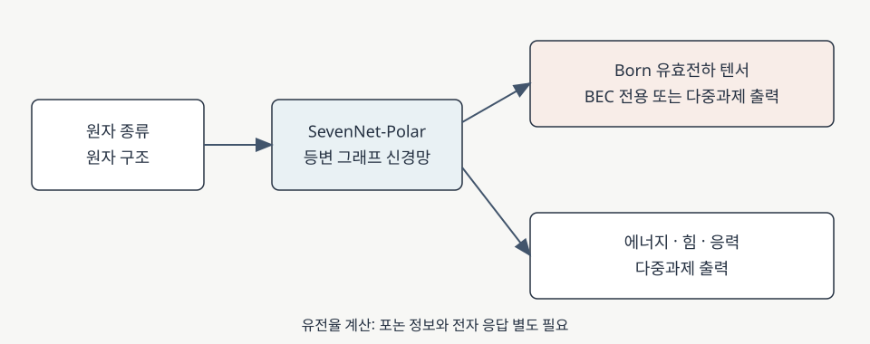

# Machine learning for Born effective charges: SevenNet-Polar

SevenNet-Polar는 원자 구조에서 [Born 유효전하(Born effective charge, BEC)](born-effective-charge.md) 텐서를 예측하도록 SevenNet 그래프 신경망을 확장한 연구다. 원자 변위에 따른 분극 응답을 [밀도범함수 섭동이론(DFPT)](dfpt-dielectric-response.md)으로 반복 계산하는 부담을 줄이는 것이 목적이다. 논문은 BEC만 예측하는 모델과 에너지·힘·응력까지 함께 예측하는 모델을 제시한다. 이 문서는 2026년 7월 21일 공개된 arXiv v3를 기준으로 한다. [1, Abstract and §§1, 4.2]

<figure markdown="span">

  

  <figcaption markdown="1">
  이 위키에서 제작한 흐름도. SevenNet-Polar가 예측하는 양을 논문 [1]에 따라 정리했다. 유전율 계산에는 별도의 포논 정보와 전자 응답이 필요하다 [3].
  [도식 크게 보기](images/sevennet-polar-outputs.svg)</figcaption>
</figure>

## 1. 연구 질문과 예측하는 양

BEC는 원자 하나의 미소 변위에 대한 거시 분극의 변화율이다. 원자마다 \(3\times3\) 텐서이므로 같은 결정이라도 변위 방향과 분극 방향에 따라 응답이 다르다. 원자 구조를 회전하면 텐서도 그 좌표 변환에 맞게 바뀌어야 한다. 논문은 이 관계를 유지하는 등변 그래프 신경망을 사용해 원자 환경에서 텐서를 예측한다. [1, §§4.2, 4.4; 3, §V]

표기하면 셀 부피를 \(\Omega\), 분극 성분을 \(P_\alpha\), 원자 \(i\)의 변위를 \(u_{i\beta}\)로 두었을 때 논문의 BEC 정의는 다음과 같다. [1, §4.2, Eq. (1); 3, §V]

\[
Z^*_{i,\alpha\beta}=\Omega\frac{\partial P_\alpha}{\partial u_{i\beta}}.
\]

이 정의의 단위는 전하이며 논문은 기본전하 \(e\) 단위로 수치를 표시한다. 논문은 일반적인 비대칭 2차 텐서를 스칼라 자취, 반대칭 성분, 대칭 무자취 성분으로 분해해 아홉 자유도를 표현한다. 이렇게 출력의 회전 변환 법칙을 모델에 반영한다. [1, §§4.2, 4.4]

논문의 예측 대상은 BEC와 에너지·힘·응력이다. BEC만으로 전체 유전율이 정해지지는 않는다. 정적 이온 응답에는 포논 주파수와 고유벡터도 필요하고 전자 기여 \(\varepsilon^\infty\)도 따로 포함해야 한다. 이 관계는 [유전 텐서](dielectric-response.md)와 [DFPT 유전 응답](dfpt-dielectric-response.md) 문서에서 설명한다. [1, Abstract; 3, §VIII]

## 2. PS와 PM: 학습 표적과 자료

| 모델 | 예측 표적 | 논문의 주된 학습 자료 |
|---|---|---|
| SevenNet-PS | BEC 텐서 | ZrO\(_2\), Li\(_3\)PO\(_4\), 페로브스카이트 |
| SevenNet-PM | 에너지, 힘, 응력, BEC | ZrO\(_2\), Li\(_3\)PO\(_4\) |

PM의 학습은 네 물리량의 손실을 가중 합으로 묶는다. PS는 이 가운데 BEC 예측을 전용 표적으로 삼는다. [1, §§2.2–2.3, 4.5]

\[
\mathcal L_{\mathrm{PM}}
 =w_E\mathcal L_E+w_F\mathcal L_F+w_S\mathcal L_S
 +w_{\mathrm{BEC}}\mathcal L_{\mathrm{BEC}}.
\]

논문 본문은 각 \(\mathcal L\)을 해당 물리량의 평균제곱오차로 설명한다. 보충자료의 BEC 손실은 각 원자의 텐서 아홉 성분에 대한 오차 제곱합을 원자 수로 나눈다. 따라서 아홉 성분을 모두 평균한 원소별 MSE의 9배다. 가중치 \(w\)는 단위와 크기가 다른 손실의 상대적 기여를 정하며, 가중합의 최솟값 자체를 BEC의 물리적 오차로 읽지는 않는다. [1, §4.5, Eq. (2); Supplementary §10, Eq. (S1)]

저자들은 ZrO\(_2\)의 10,103개 구조에 결함 및 변형 구조가 포함되며, Li\(_3\)PO\(_4\)의 17,900개 구조는 최대 2,000 K의 분자동역학 구조를 포함한다고 설명한다. 별도의 페로브스카이트 자료는 1,224개 무결함 구조다. 세 자료의 기준 전자구조 계산에서 ZrO\(_2\)와 Li\(_3\)PO\(_4\)는 PBE, 페로브스카이트는 PBEsol을 사용했다. PM의 에너지·힘·응력 학습에서는 함수의 일관성을 위해 앞의 두 자료만 사용한다. 기본 분할은 학습 80%, 검증 10%, 시험 10%다. [1, §§4.6–4.7]

각 계열의 S, M, L은 모델 크기가 다른 선택지다. 예를 들어 PS-M과 PM-M은 cutoff 6 Å, message-passing 4층, 최대 각운동량 \(l_{\max}=3\)을 사용한다. 논문의 L 모델은 5층과 \(l_{\max}=4\)를 사용하고, S 모델은 더 작은 각 해상도를 쓴다. 모델 크기와 정확도·비용의 비교는 논문이 사용한 자료와 하드웨어 조건에서 읽어야 한다. [1, §§2.3.3, 4.6, Tables 1–3]

## 3. 시험 자료에서 보고한 정확도

논문 Table 1에서 세 물질군을 함께 쓴 PS-L의 BEC 전체 RMSE는 \(0.0043e\)다. 같은 자료의 PS-M과 PS-S는 각각 \(0.0063e\), \(0.0120e\)다. PM-L은 ZrO\(_2\)와 Li\(_3\)PO\(_4\) 시험 자료에서 에너지 1.0 meV/atom, 힘 11.9 meV/Å, 응력 0.05 GPa, BEC \(0.0029e\)의 RMSE를 보고한다. 여기서 \(e\)는 기본전하의 크기다. [1, §§2.2–2.3, Tables 1–2]

PS-L과 PM-L의 BEC 값은 포함된 물질군이 다르므로 그 숫자만으로 다중과제 학습이 BEC 예측을 개선했다고 결론 내릴 수 없다. 저자들도 PM-L의 낮은 오차를 설명하면서 평가에서 페로브스카이트가 빠진 차이를 지적한다. 두 값은 독립 재현값이나 임의 물질의 오차 보장이 아니다. [1, §2.3.2]

!!! note "논문 Fig. 2의 모델 표기"

    해당 절의 본문은 PS-L을 설명하지만 그림 캡션은 PS-M을 적는다. 또한 본문의 PS-M 전체 RMSE 표기 0.063 e와 Abstract·Table 1의 0.0063 e가 일치하지 않는다. 위의 값은 모델과 자료가 명시된 Table 1 및 Abstract를 기준으로 제시한다. [1, Abstract, §2.2, Fig. 2, Table 1]

## 4. 학습 자료가 늘어날 때와 계산 비용

저자들은 ZrO\(_2\) 자료의 일부로 학습량을 바꾸어 BEC 성분의 RMSE를 비교했다. Fig. 1에서 학습 곡선의 거듭제곱 지수는 학습 구조 64–512개 범위에서 맞춘 값이다. 대각 성분과 비대각 성분의 기울기가 달랐으며, 더 많은 자료를 쓴 구간에서는 오차 감소가 완만해지는 경향을 보였다. 이는 해당 데이터와 구조군의 관찰이며 모든 물질에서 같은 지수가 성립한다는 뜻은 아니다. [1, §2.1, Fig. 1]

BEC 출력을 포함하는 등변 연산의 계산 비용을 줄이기 위해 저자들은 FlashTP를 결합했다. 예를 들어 논문의 단일 GH200 GPU 시험에서 FlashTP 사용 여부에 따라 가능한 원자 수와 시간은 달라졌다. 모델 크기, GPU 메모리와 구현에 의존하므로 다른 장비의 처리 속도로 바로 옮겨 읽을 수 없다. [1, §2.3.3, Fig. 5, Supplementary §3]

## 5. 학습 자료 밖 구조의 적용 사례

저자들은 산소 빈자리가 있는 정방정 ZrO\(_2\)에서 산소 이동 경로를 nudged elastic band (NEB)로 계산했다. PM-M이 보고한 장벽은 0.694 eV, DFT 비교값은 0.677 eV였다. 전기장을 \(z\) 방향으로 가한 사례도 제시했으며, Fig. 7은 같은 image 번호라도 DFT와 모델의 구조가 서로 다를 수 있다고 밝힌다. 이 수치는 해당 결함과 경로에서의 논문 보고값이다. [1, §2.4.1, Fig. 7]

또 다른 시험에서는 학습에 없던 입계 국소 환경을 포함한 입방정 ZrO\(_2\)의 \(\Sigma5(310)/[001]\) 입계에 PM-M을 적용했다. 저자들은 BEC RMSE \(0.021e\)를 보고했다. 앞의 무작위 분할 시험과 구조가 다른 결함에 대한 검증이므로, 두 숫자를 같은 시험 조건의 순위로 해석하지 않는다. [1, §2.4.2, Fig. 8]

## 6. 유전율 계산과 적용 범위

이 모델의 BEC 출력을 유전율 예측에 쓰려면 구조에 맞는 포논과 전자 응답을 별도로 준비해야 한다. [Takigawa 등의 이온 유전 텐서 연구](takigawa-2026-prx-ionic-dielectric-ml.md)는 BEC와 포논 정보를 결합하는 별도의 접근이며, SevenNet-Polar가 유전율 텐서를 직접 출력한다는 뜻은 아니다. [1, Abstract; 3, §VIII]

[High-κ 후보 선별](high-k-screening.md)에서는 BEC 시험 오차 외에도 학습 조성·결함·상태와 목표 구조의 차이, 전하 중성 및 acoustic sum rule, 포논 안정성과 전자 응답을 함께 확인한다. 학습 분포가 달라지는 조건에서의 일반화는 보유 시험 자료에서 얻은 점수와 별개의 검증 질문이다. [1, §§2.4, 4.7; 4, §2–4; 5, Abstract]

## 7. 참고 문헌

1. A. K. A. Lu et al., “SevenNet-Polar for MultiTask Prediction of Energy, Forces, Stress, and Born Effective Charges: Development and Application to ZrO\(_2\), Li\(_3\)PO\(_4\), and Perovskites,” arXiv:2607.14827v3 (2026), [원문](https://arxiv.org/html/2607.14827v3).
2. SevenNet-Polar project repository and usage documentation, https://github.com/AugustinLu/SevenNet-Polar.
3. X. Gonze and C. Lee, *Physical Review B* **55**, 10355 (1997), https://doi.org/10.1103/PhysRevB.55.10355.
4. J. Robertson, *European Physical Journal Applied Physics* **28**, 265–291 (2004), https://doi.org/10.1051/epjap:2004206.
5. P. W. Koh et al., “WILDS: A Benchmark of in-the-Wild Distribution Shifts,” *Proceedings of Machine Learning Research* **139**, 5637–5664 (2021), https://proceedings.mlr.press/v139/koh21a.html.
