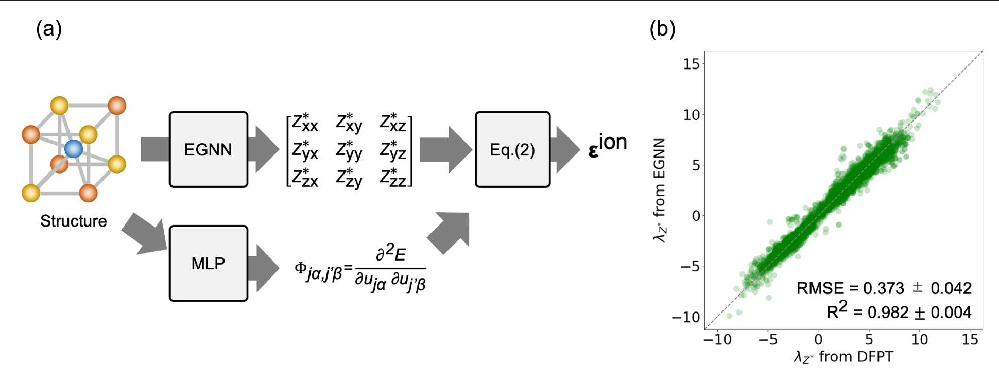

# Takigawa et al. 2026: factorized ML for ionic dielectric tensors

Takigawa, Kiyohara와 Kumagai는 이온 유전 텐서를 예측하기 위해 BEC와 포논 물성을 분리 예측한 뒤 물리식으로 결합하는 기계학습 접근을 제안했다. 논문은 2026년 *Physical Review X*에 발표됐다. [1, Abstract and publication record]

<figure markdown="span">

  

  <figcaption markdown="1">
  **그림 1.** A. Takigawa, S. Kiyohara, Y. Kumagai, “Physics-Based Factorized Machine Learning for Predicting Ionic Dielectric Tensors,” *Physical Review X* 16, 021006 (2026), Fig. 2, [DOI](https://doi.org/10.1103/28wr-w896). 논문은 CC BY 4.0으로 공개됐고 APS는 일부 그림에 제3자 권리 예외가 있을 수 있다고 안내한다. Fig. 2 캡션에는 별도 권리자 표기가 없다. 원문 PDF에서 페이지 여백과 논문 캡션을 덜어 내고 도판 영역을 수록했으며 데이터·표식·색상은 수정하지 않았다.
  </figcaption>
</figure>

## 1. 모델이 나누는 물리량

이 접근은 등변 그래프 신경망으로 BEC를 예측하고, 사전학습 원자간 포텐셜로 포논 물성을 얻은 다음 물리식으로 이온 유전 텐서를 계산한다. 정적 이온 기여가 BEC와 조화 진동 응답에 좌우된다는 구조를 모델에 반영한다. 전자 유전 기여도 별도로 기계학습으로 예측한다. 전체 스크리닝 파이프라인은 구조에서 유전율을 산출한다. 다만 주된 이온 유전율 모델은 이온 텐서를 한 번에 회귀하는 direct model이 아니라, BEC와 포논 물성을 분리해 예측한 뒤 물리식으로 결합한다. [1, Abstract, §II.A and Eq. (2); 2, §VIII]

논문은 SevenNet-MF-ompa가 Γ점에서 동역학적으로 안정하다고 예측한 산화물 839개에서 direct model과 joint model을 5-fold cross-validation으로 비교했다. 평가량은 \(\epsilon_{\mathrm{ion}}\) 텐서 고유값의 \(\log_{10}\)이다. 평균 \(R^2\) 값과 평균 RMSE는 direct model에서 각각 0.411과 0.254, joint model에서 각각 0.911과 0.099였다. 이 수치는 해당 구조 집합과 평가 정의에 대한 논문 보고치다. [1, §II.A and Fig. 3]

BEC와 포논을 분리해 예측하면 물리량별 오차를 각각 확인할 수 있지만, 각 오차가 유전율에 어떻게 전파되는지도 검토해야 한다. 낮은 주파수 모드가 식의 \(1/\omega_\nu^2\) 가중을 받으므로, 주파수 오차가 결과에 크게 반영될 수 있다. [1, §II.A and Results; 2, §VIII]

## 2. 스크리닝 결과의 범위

저자들은 8,717개 산화물에 SevenNet을 적용해 Γ점에서 동역학적으로 안정한 4,654개를 선별했다. ML 유전율과 r2SCAN 밴드갭으로 142개를 추린 뒤, PBEsol-DFPT 확인에서 121개를 남겼다. 마지막으로 \(\varepsilon_{\mathrm{ave}}^{\mathrm{DFPT}}E_g^{\mathrm{DDH}}\ge350\) 기준을 적용해 high-\(\kappa\) 후보 31개를 제안했다. 최종 후보의 유전율은 ML의 직접 출력만으로 정한 값이 아니다. 이 결과는 계산·모델 스크리닝이며 합성 가능성, 유한 온도 안정성, 박막·계면 효과나 전기적 누설을 검증한 실험 결과와 구분한다. [1, §II.B, Fig. 4, and Table III]

이 논문은 [SevenNet-Polar BEC 모델](ml-born-effective-charge.md)과도 범위가 다르다. SevenNet-Polar 문서는 다중과제 모델의 BEC 출력에 초점을 두고, 본 문서는 BEC·포논을 결합해 이온 유전 텐서를 계산하는 물리 기반 분해 접근을 다룬다. [1, Abstract; 3, Abstract]

## 3. 참고 문헌

1. A. Takigawa, S. Kiyohara, and Y. Kumagai, “Physics-Based Factorized Machine Learning for Predicting Ionic Dielectric Tensors,” *Physical Review X* **16**, 021006 (2026), https://doi.org/10.1103/28wr-w896.
2. X. Gonze and C. Lee, *Physical Review B* **55**, 10355 (1997), https://doi.org/10.1103/PhysRevB.55.10355.
3. A. Lu et al., “SevenNet-Polar…,” arXiv:2607.14827v3 (2026), https://arxiv.org/abs/2607.14827.
