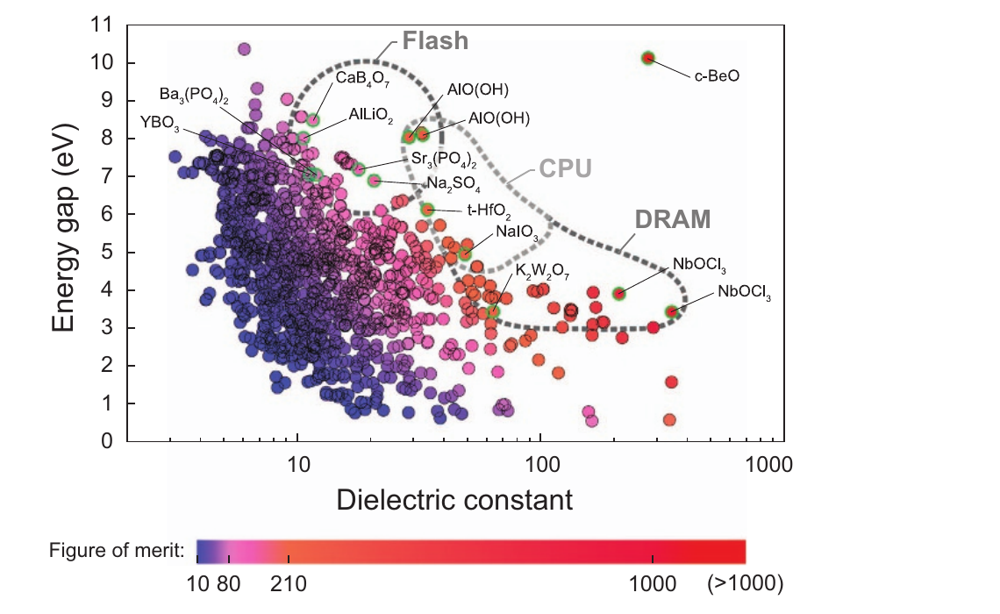

# Yim et al. 2015: high-\(\kappa\) oxides

Yim 등은 다음 세대 전자소자용 유전체 후보를 찾기 위해 자동화된 제일원리 계산으로 산화물을 선별했다. 연구의 목표는 유전율이 높은 물질만 찾는 것이 아니라, 유전율과 전자 밴드갭을 함께 고려하는 것이었다. [1, Abstract; 2, bibliographic record]

<figure markdown="span">

  

  <figcaption markdown="1">
  **그림 1.** K. Yim et al., “Novel high-κ dielectrics for next-generation electronic devices screened by automated ab initio calculations,” *NPG Asia Materials* 7, e190 (2015), Fig. 4, [DOI](https://doi.org/10.1038/am.2015.57). [CC BY 4.0](https://creativecommons.org/licenses/by/4.0/). 원문 PDF에서 페이지 여백과 논문 캡션을 덜어 내고 도판 영역을 수록했다. 축·데이터·색상은 수정하지 않았다.
  </figcaption>
</figure>

## 1. 연구 질문과 대상

유전체를 두껍게 유지하면서 정전용량을 확보하려면 큰 유전율이 유리하지만, 전극에서의 전하 주입을 줄이려면 큰 밴드갭도 고려해야 한다. 연구진은 널리 알려진 산화물에서 두 값이 대체로 반비례하는 경향이 더 넓은 후보군에서도 나타나는지, 그 경향에서 벗어나는 물질이 있는지 물었다. 배경은 [high-κ 후보 선별](high-k-screening.md)에 정리되어 있다. [1, Introduction; 3, §1–2]

구조는 ICSD에서 수집했다. 중복 구조와 부분 점유 구조, 3d 전이금속을 포함한 구조를 제외했다. 상온 안정상뿐 아니라 고온·고압에서 관찰된 상도 검토하되, 논문은 이론적으로 영온도·영압 조건에서 안정한 구조를 고려했다고 설명한다. 이는 가능한 모든 조성과 구조를 생성해 탐색했다는 뜻은 아니다. [1, Materials and Methods]

초록은 1,800개가 넘는 구조를 언급하지만 Results는 **1,762개 산화물**을 계산했다고 보고한다. Fig. 4에는 금속과 불안정 구조를 제외한 **1,158개 이원·삼원 산화물**이 표시된다. 원문은 초록과 Results의 수를 별도로 조정해 설명하지 않는다. [1, Abstract, Results, Fig. 4]

## 2. 구조에서 밴드갭과 유전율까지

### (1) 구조와 밴드갭

연구진은 VASP로 원자 위치와 격자상수를 완화한 후, generalized gradient approximation (GGA)으로 고대칭 경로의 가전자대 최댓값과 전도대 최솟값을 찾았다. 그 지점들에서 구조를 다시 완화하지 않고 HSE06 혼합 범함수 에너지를 계산하는 방식을 **HSE@GGA**라고 불렀다. 전체 HSE 밴드구조를 전수 탐색하는 비용을 줄이는 대신, 밴드 경계의 위치가 바뀌지 않는다는 근사에 의존한다. Tl·Pb·Bi 함유 산화물의 밴드갭에는 스핀–궤도 결합도 반영했다. [1, Materials and Methods, “Computation of band gap”]

선택된 산화물의 비교에서 저자들은 밴드갭이 약 4 eV보다 큰 영역에서 실험과 최대 1 eV 정도 차이가 나는 사례를 보고했다. 이 수치는 그 비교 사례의 오차이며, 모든 후보에 대한 오차 보증이 아니다. [1, Fig. 3(a) and “Computation of band gap”]

### (2) 정적 유전율

유전 응답은 local density approximation (LDA)과 [밀도범함수 섭동이론(DFPT)](dfpt-dielectric-response.md)으로 평가했다. 고정 이온 전자 응답에 [Born 유효전하](born-effective-charge.md)와 브릴루앙 영역 중심의 적외선 활성 포논이 만드는 이온 응답을 더해 정적 텐서를 얻고, 대각 성분을 평균해 스칼라 κ를 사용했다. 전자·이온 기여의 물리적 구분은 [유전 응답 문서](dielectric-response.md)를 참고할 수 있다. [1, Eq. (1), “Computation of dielectric constant”; 4, §II–III]

저자들은 선형 응답의 k점 민감도를 고려해 각 방향 k점 밀도를 두 배로 늘렸다. 선택한 κ < 30 물질과 실험을 비교했을 때 평균 절대 오차는 GGA에서 2.06, LDA에서 1.37로 보고되었고, 이 비교를 근거로 LDA를 선택했다. [1, Fig. 3(b) and “Computation of dielectric constant”]

## 3. 그림과 선별 결과 읽기

Fig. 4의 가로축은 계산 밴드갭, 세로축은 정적 유전율이다. 저자들은 직접 터널링 모형에서 유효질량과 주입 장벽이 대략 밴드갭에 비례한다고 가정해, 색상으로 표시할 선별 지표를 \(E_g\kappa\)로 단순화했다. 이는 후보 간 비교를 위한 대리 지표다. 전극과의 실제 장벽·유효질량·결함을 계산한 누설 전류 자체는 아니다. [1, Results, Eq. (2), Fig. 4]

예를 들어 저자들이 두드러진 후보로 논의한 rocksalt 상 c-BeO는 밴드갭 10.1 eV와 κ 275를 계산 보고했다. 이는 고압상에 대한 결과이므로 상온에서 안정한 wurtzite BeO나 실제 박막 성능으로 그대로 바꾸어 읽을 수 없다. [1, Results, “New candidate high-κ materials”, Table 1]

!!! note "후속 연구"

    [Lee et al. 2018](lee-2018-nonoxide-dielectrics.md)은 같은 질문을 비산화물로 확장하고, 전자 및 이온 유전 기여의 분포를 나누어 살폈다. 두 데이터셋을 비교할 때는 대상 구조와 계산 조건을 함께 확인해야 한다. [1, Materials and Methods; 5, Results and Methods]

## 4. 적용 범위와 재사용 시 확인점

선별 통과는 논문의 계산된 bulk 구조와 지표에 대한 판정이다. 박막에서의 상 안정성, 계면 반응, 밴드 정렬, 결함과 누설은 별도 평가가 필요하다. HSE@GGA의 밴드 경계 근사, 정적 유전 텐서의 평균 방식, Γ점 포논 및 구조 안정성 판단도 결과를 재사용할 때 확인한다. [1, Materials and Methods and Discussion; 3, §1–2]

## 5. 참고 문헌

1. K. Yim et al., “Novel high-\(\kappa\) dielectrics for next-generation electronic devices screened by automated ab initio calculations,” *NPG Asia Materials* **7**, e190 (2015), https://doi.org/10.1038/am.2015.57.
2. Seoul National University research record, “Novel high-\(\kappa\) dielectrics for next-generation electronic devices screened by automated ab initio calculations,” https://snu.elsevierpure.com/en/publications/novel-high-%CE%BA-dielectrics-for-next-generation-electronic-devices-s/.
3. J. Robertson, *European Physical Journal Applied Physics* **28**, 265–291 (2004), https://doi.org/10.1051/epjap:2004206.
4. S. Baroni et al., *Reviews of Modern Physics* **73**, 515 (2001), https://doi.org/10.1103/RevModPhys.73.515.
5. M. Lee et al., “High-throughput ab initio calculations on dielectric constant and band gap of non-oxide dielectrics,” *Scientific Reports* **8**, 14794 (2018), https://doi.org/10.1038/s41598-018-33095-6.
