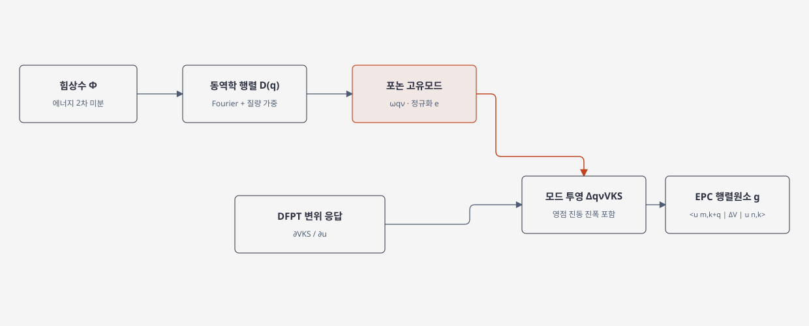

# Electron–phonon coupling

전자–포논 결합(electron–phonon coupling, EPC)은 격자 진동이 만든 전위 변화가 전자 상태 사이의 전이를 일으키는 상호작용이다. 제일원리 계산에서는 원자 변위에 대한 전자 퍼텐셜의 1차 응답을 포논 모드에 투영해 결합 행렬원소를 만든다. [1, §III.B; 2, “Electron-phonon matrix elements”]

## 1. 힘상수 행렬에서 포논 모드까지

평형 원자 위치 \(R^0_{\kappa\alpha}\) 주변의 작은 변위 \(u_{\kappa\alpha}\)에 대해 총 에너지를 2차까지 전개하면

\[
E^{(2)}=\frac12\sum_{\ell,\mathbf R}
\sum_{\kappa\alpha,\kappa'\beta}
\Phi_{\ell\kappa\alpha,\ell+\mathbf R\,\kappa'\beta}
u_{\ell\kappa\alpha}u_{\ell+\mathbf R\,\kappa'\beta},
\qquad
\Phi_{\ell\kappa\alpha,\ell+\mathbf R\,\kappa'\beta}
=\frac{\partial^2E}
{\partial u_{\ell\kappa\alpha}\partial u_{\ell+\mathbf R\,\kappa'\beta}}.
\]

\(\Phi\)가 힘상수(interatomic force-constant, IFC) 행렬이다. 이는 변위에 대한 힘의 미분이며, 선형 복원력은 \(F_{\ell\kappa\alpha}=-\sum_{\mathbf R,\kappa'\beta}\Phi_{\ell\kappa\alpha,\ell+\mathbf R\,\kappa'\beta}u_{\ell+\mathbf R\,\kappa'\beta}\)로 쓴다. IFC 자체에는 질량 가중이 없다. 주기 결정에서는 실공간 IFC를 격자 벡터에 대해 Fourier 변환하고 원자 질량으로 질량 가중해 동역학 행렬 \(D(\mathbf q)\)를 만든다. \(\ell\)은 기준 셀, \(\mathbf R\)은 기준 셀에서 이웃 셀까지의 상대 격자벡터다.

\[
D_{\kappa\alpha,\kappa'\beta}(\mathbf q)
=\frac{1}{\sqrt{M_\kappa M_{\kappa'}}}
\sum_{\mathbf R}\Phi_{0\kappa\alpha,\mathbf R\kappa'\beta}
e^{i\mathbf q\cdot\mathbf R}.
\]

이는 한 가지 Fourier 부호 규약이다. \(D(\mathbf q)\)의 고유값은 \(\omega_{\mathbf q\nu}^2\)이며, 고유벡터 \(e_{\kappa\alpha,\nu}(\mathbf q)\)는 \(\sum_{\kappa\alpha}|e_{\kappa\alpha,\nu}|^2=1\)로 정규화한 편극 벡터다. 실제 원자 변위의 모드 패턴에는 \(e_{\kappa\alpha,\nu}/\sqrt{M_\kappa}\)가 들어간다. 따라서 힘상수 행렬은 실공간 변위 좌표의 2차 에너지 미분이고, 동역학 행렬은 이를 파수 공간에서 질량 가중한 고유값 문제다. 두 행렬을 같은 것으로 부르면 안 된다. [1, §III.A; 2, “Phonons and lattice dynamics”; 4, §II.D.3]

## 2. 포논 모드에서 결합 행렬원소까지

원자별 변위 응답에 포논 고유벡터를 투영한 뒤 영점 진동 진폭을 곱해 진동 모드 \((\mathbf q,\nu)\)의 1차 Kohn–Sham 퍼텐셜 변화를 계산한다. 편극벡터를 \(\sum_{\kappa\alpha}|e_{\kappa\alpha,\nu}(\mathbf q)|^2=1\)로 정규화하는 한 가지 규약에서는,

\[
\Delta_{\mathbf q\nu}v^{KS}
=\sum_{\kappa\alpha}
\sqrt{\frac{\hbar}{2M_\kappa\omega_{\mathbf q\nu}}}\,
e_{\kappa\alpha,\nu}(\mathbf q)\,
\partial_{\kappa\alpha,\mathbf q}v^{KS},
\qquad
g_{mn\nu}(\mathbf k,\mathbf q)
=\langle u_{m,\mathbf k+\mathbf q}|
\Delta_{\mathbf q\nu}v^{KS}
|u_{n,\mathbf k}\rangle_{\mathrm{uc}}.
\]

여기서 \(v^{KS}\)와 \(\partial_{\kappa\alpha,\mathbf q}v^{KS}\)는 각각 Kohn–Sham 퍼텐셜과 변위 응답의 격자 주기 성분이다. 전체 퍼텐셜 섭동은 \(\Delta_{\mathbf q\nu}V^{KS}(\mathbf r)=e^{i\mathbf q\cdot\mathbf r}\Delta_{\mathbf q\nu}v^{KS}(\mathbf r)\)로 쓸 수 있다. \(u_{n\mathbf k}\)는 Bloch 상태의 주기 부분이므로, 식의 단위 셀 행렬원소에는 주기 성분 \(\Delta v^{KS}\)가 들어간다. 이는 단위 셀 적분 convention이며, 유한 Born–von Kármán 결정의 해밀토니안에는 별도로 셀 수 정규화 인자가 나타날 수 있다. \(g\)는 초기 전자 상태 \((n,\mathbf k)\)와 최종 상태 \((m,\mathbf k+\mathbf q)\)를 특정 포논과 연결하는 복소 전이 진폭이며, 보통 그 제곱 크기가 산란율 또는 self-energy에 들어간다. [1, §III.A–B; 2, “Electron-phonon matrix elements”]

<figure markdown="span">

  

  <figcaption markdown="1">
  이 위키가 작성한 계산 흐름도. 힘상수 행렬에서 포논 모드를 얻고 원자변위 DFPT 응답을 모드에 투영해 전자–포논 행렬원소를 구성한다. 기저와 정규화 규약은 본문 식에 명시했다.
  </figcaption>
</figure>

## 3. 제일원리 계산 흐름과 보간

대표적 계산 흐름은 전자 바닥상태 DFT, DFPT 포논·퍼텐셜 응답, 거친 \(\mathbf k/\mathbf q\) 격자에서 \(g\) 계산, Wannier 공간 보간, 조밀 격자에서의 적분이다. Wannier 보간은 적은 수의 직접 계산을 조밀 격자로 확장하는 계산 기법이지만, Wannier 함수의 국소화와 에너지 창 및 격자 수렴을 따로 확인해야 한다. [1, §III; 2, “Wannier-Fourier interpolation”]

극성 절연체에서는 장거리 Fröhlich 항이 \(\mathbf q\to0\)에서 특이해질 수 있다. 이 항은 BEC와 \(\varepsilon^\infty\)에 연결되므로, 짧은 범위 항의 단순 보간에 맡기지 않고 장거리 기여를 분리하는 처리가 필요하다. [1, §III.B; 2, “Long-range contributions”]

## 4. 의미와 적용 범위

큰 \(|g|^2\)는 특정 밴드·파수·포논 모드에서 강한 결합을 뜻할 수 있지만, 단일 행렬원소만으로 전체 수송도, 초전도 전이온도, 밴드 이동이나 수명을 단정할 수는 없다. 이들은 상태 합, 점유, 에너지 보존, 결정 대칭과 적분 규약을 포함하는 별도의 계산량이다. 전자 self-energy의 Fan–Migdal 및 Debye–Waller 기여는 [하위 문서](electron-phonon-self-energy.md)에서 다룬다. [1, §V; 2, “Self-energies and coupling strength”]

## 5. 참고 문헌

1. F. Giustino, “Electron-phonon interactions from first principles,” *Reviews of Modern Physics* **89**, 015003 (2017), https://doi.org/10.1103/RevModPhys.89.015003.
2. EPW project, “Theory,” https://docs.epw-code.org/Theory.html.
3. S. Poncé, E. R. Margine, C. Verdi, and F. Giustino, “EPW: Electron–phonon coupling, transport and superconducting properties using maximally localized Wannier functions,” *Computer Physics Communications* **209**, 116–133 (2016), https://doi.org/10.1016/j.cpc.2016.07.028.
4. S. Baroni, S. de Gironcoli, A. Dal Corso, and P. Giannozzi, “Phonons and related crystal properties from density-functional perturbation theory,” *Reviews of Modern Physics* **73**, 515 (2001), https://doi.org/10.1103/RevModPhys.73.515.
