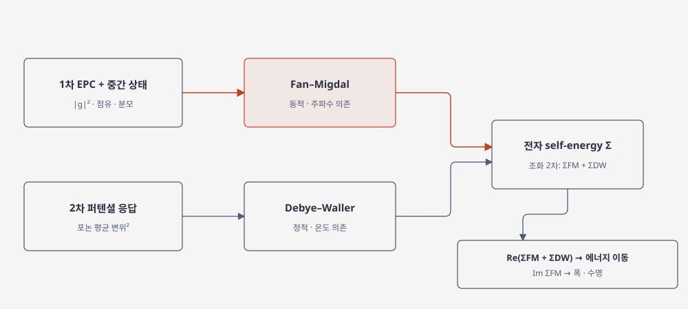

# Electron self-energy from electron–phonon coupling

전자–포논 self-energy는 포논과 상호작용한 전자의 에너지·스펙트럼 변화를 기술한다. 조화 근사의 2차 e-ph self-energy는 동적 Fan–Migdal 항과 정적 Debye–Waller 항으로 나뉜다. Adiabatic Allen–Heine–Cardona(AHC) 근사는 여기에 추가 가정을 둔다. 두 항은 서로 다른 섭동 차수와 물리적 유래를 가지므로, 하나를 계산했다고 전체 조화 e-ph renormalization을 모두 계산한 것은 아니다. [1, “Electron self-energy”; 2, §V.B]

## 1. Fan–Migdal 기여

Fan–Migdal self-energy는 두 1차 e-ph 행렬원소의 곱에 비례하는 동적 항이다. band-diagonal, 조화 포논 및 retarded 규약에서 유한 온도 표현의 구조는

\[
\Sigma^{\mathrm{FM}}_{n\mathbf k}(\omega,T)
=\frac{1}{\hbar}\sum_{m\nu}\int_{\mathrm{BZ}}\frac{d\mathbf q}{\Omega_{\mathrm{BZ}}}
|g_{mn\nu}(\mathbf k,\mathbf q)|^2
\left[
\frac{1-f_{m,\mathbf k+\mathbf q}+n_{\mathbf q\nu}}
{\omega-\varepsilon_{m,\mathbf k+\mathbf q}/\hbar-\omega_{\mathbf q\nu}+i\eta}
+
\frac{f_{m,\mathbf k+\mathbf q}+n_{\mathbf q\nu}}
{\omega-\varepsilon_{m,\mathbf k+\mathbf q}/\hbar+\omega_{\mathbf q\nu}+i\eta}
\right].
\]

\(f\)와 \(n\)은 각각 전자와 포논 점유, \(\eta>0\)는 retarded 분모의 양의 무한소 또는 수치 적분에서 쓰는 broadening이다. 이 식은 흡수·방출 경로와 각 경로의 점유 인자를 구분한다. 구현에서 \(\omega\)를 에너지로 쓰는지 각진동수로 쓰는지 단위를 확인해야 한다. 이 식은 band-off-diagonal 항과 비조화 포논 효과를 포함하지 않는 근사식이다. [1, Eq. 28; 2, §V.B]

## 2. Debye–Waller 기여

Debye–Waller 항은 원자 변위에 따른 2차 전자 퍼텐셜 변화의 열평균에서 나온다. 조화 모드의 점유 가중치는 \(2n_{\mathbf q\nu}+1\)을 포함해 0 K에도 영점 진동 기여가 남는다. 이 band-diagonal 조화 근사에서 해당 항은 정적이며 실수다. 실제 값은 2차 퍼텐셜 미분의 계산 또는 이를 근사하는 방법에 의존하므로, rigid-ion approximation 등 적용한 근사를 함께 기록한다. [1, Eq. 29; 2, §V.B; 3, §III]

<figure markdown="span">

  

  <figcaption markdown="1">
  이 위키의 기여 분해도. 조화 근사에서 1차 전자–포논 결합은 동적 Fan–Migdal 항을, 2차 퍼텐셜 항은 정적 Debye–Waller 항을 만든다. 각 항의 근사와 부호는 본문에서 정의한다.
  </figcaption>
</figure>

## 3. 에너지 이동과 스펙트럼 폭

band-diagonal 준입자 근사의 pole 방정식은 에너지가 대략

\[
E_{n\mathbf k}(T)
=\varepsilon_{n\mathbf k}
+\operatorname{Re}\Sigma^{\mathrm{FM}}_{n\mathbf k}(E_{n\mathbf k}/\hbar,T)
+\Sigma^{\mathrm{DW}}_{n\mathbf k}(T)
\]

를 만족한다. 이 식은 band-off-diagonal self-energy와 polaron 자기포획을 무시한 band-diagonal 근사에서 pole을 일관되게 푸는 형태다. On-shell 근사는 self-energy의 에너지 인수를 보통 기준 DFT 에너지 \(\varepsilon_{n\mathbf k}\)로 바꾼다. Adiabatic AHC 근사에는 포논 에너지를 분모에서 무시하는 등 추가 가정이 들어가므로, 세 근사를 같은 이름처럼 쓰지 않는다. \(T=0\)에도 영점 진동으로 인한 renormalization이 가능하며, 고정 격자 계산의 e-ph 효과와 열팽창에 따른 구조 변화는 별도 기여다. [1, Eq. 36; 2, §V.B]

retarded self-energy의 실수부는 준입자 피크의 에너지 이동, 허수부는 스펙트럼 폭과 수명에 연결된다. 이 조화·대각 근사의 Debye–Waller 항은 실수이므로 폭은 \(\operatorname{Im}\Sigma^{\mathrm{FM}}\)에서 온다. 날카로운 준입자 피크가 있을 때 에너지 반폭은 \(\Gamma=Z|\operatorname{Im}\Sigma^{\mathrm{FM}}|\), 수명은 \(\tau=\hbar/(2\Gamma)\)로 표현할 수 있다. 여기서 \(Z=[1-\partial_{\mathcal E}\operatorname{Re}\Sigma]^{-1}\)이고 \(\mathcal E=\hbar\omega\)는 에너지 변수다. \(\Gamma\)는 반치폭이며 전체폭은 \(2\Gamma\)다. 준입자 피크가 넓거나 비대각 성분이 중요한 경우 이 단순 수명식은 적절하지 않을 수 있다. [1, Eqs. 30–34; 2, §V.B]

## 4. 수렴과 주장 범위

조밀한 \(\mathbf k,\mathbf q\) 적분, Wannier 보간 창, broadening \(\eta\), 극성 장거리 항 처리를 각각 바꾸어 결과의 안정성을 확인한다. 온도, 화학퍼텐셜, 전자·포논 점유와 사용한 구조를 기록한다. 수치 수렴과 self-energy 근사의 타당성은 별도로 판단해야 한다. [1, “Wannier-Fourier interpolation” and “Electron self-energy”; 2, §V.B]

계산 결과는 선택한 DFT 밴드구조, 조화 포논과 포함한 self-energy 항에 대한 진술이다. 비조화성, 강한 polaron 자기포획, 전자 상관, 열팽창 또는 다중 밴드 혼합이 중요하면 해당 효과를 추가해야 한다. [1, “Electron self-energy”; 2, §V.B; 3, §III–IV]

## 5. 참고 문헌

1. EPW project, “Theory,” https://docs.epw-code.org/Theory.html.
2. F. Giustino, “Electron-phonon interactions from first principles,” *Reviews of Modern Physics* **89**, 015003 (2017), https://doi.org/10.1103/RevModPhys.89.015003.
3. S. Poncé et al., “The electron–phonon renormalization in the electronic structure calculation: Fundamentals, current status, and challenges,” *Journal of Chemical Physics* **158**, 130901 (2023), https://doi.org/10.1063/5.0131009.
