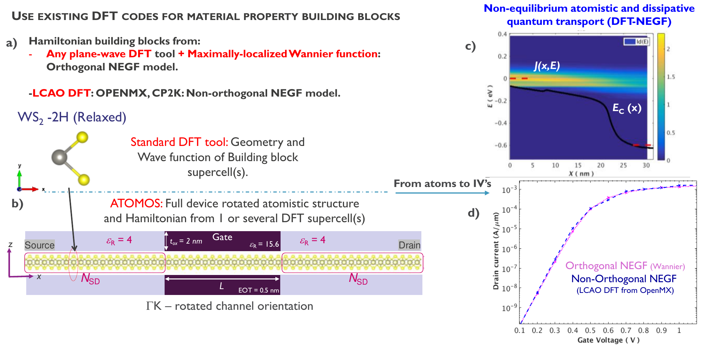
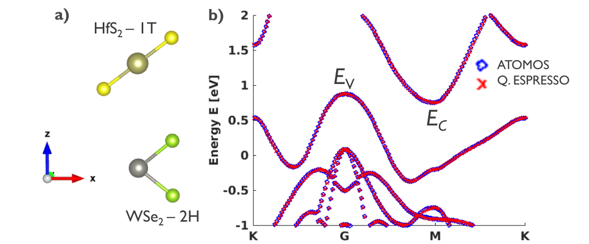

# 수송 계산의 basis 검증 사례

문헌에서 작은 [국소 원자궤도 basis](../../computational-science/atomistic-simulation/localized-basis-sets.md)를 사용했다는 사실과 작은 basis가 목표 수송 물리량에 대해 검증되었다는 주장은 다르다. 아래 사례는 저자가 보고한 비교 범위를 기준으로 정리한다. 다른 물질·pseudopotential·접촉 구조에 결과를 그대로 적용하지 않는다.

## 1. MoS₂/산화물 트랜지스터: 원소별 basis를 섞은 검증

Ducry 등은 CP2K/PBEsol을 사용했다. 기준 계산에서는 Mo에 TZVP MOLOPT, 다른 원소에 DZVP MOLOPT를 사용하고 VASP plane-wave 밴드와 비교했다. 수송용 Hamiltonian에서는 Mo/S/H에 DZVP, 산화물의 Al/O에 SZV를 사용했다. 저자들은 MoS₂ 전도대 edge가 거의 변하지 않고 산화물 결함 준위 차이가 50 meV 이내이며, n형 수송 결과에 basis가 큰 영향을 주지 않았다고 보고한다. 수송은 자기일관 NEGF–Poisson과 모드 공간 방법을 사용했다. [1, Methods; Supplementary Information]

이 사례의 검증은 모든 원소를 SZP로 줄인 테스트가 아니다. 수송 채널에 직접 관여하는 MoS₂는 DZVP로 유지하고 산화물에서 basis를 줄였다. 따라서 SIESTA의 Mo/S SZP나 특정 Au/MoS₂ 접촉을 검증했다고 해석할 수 없다.

## 2. ReS₂ 트랜지스터: T(E)를 직접 비교한 제한된 사례

Quhe 등의 보충자료 Fig. S1은 zigzag ReS₂, 채널 길이 \(L_g=4\) nm, \(V_g=-1.3\) V 조건에서 SZP와 DZP로 얻은 transmission을 겹쳐 보인다. 저자들은 결과가 일관된다고 설명한다. 비교는 실제 수송량을 직접 다뤘다는 점에서 참고가 되지만, 대표 조건 하나의 정성 비교이며 수치 오차나 전류 오차의 체계적 수렴을 제시하지 않는다. 그림은 [Supporting Information p. 1, Fig. S1](https://www.rsc.org/suppdata/c8/tc/c8tc05863f/c8tc05863f1.pdf)에서 볼 수 있다. 재사용 권한은 확인하지 못했으므로 위키에는 원그림을 복제하지 않고 출처만 연결한다. [2]

## 3. WSe₂/Au 접촉: SZP 사용 보고와 검증을 구분

Sassi 등은 WSe₂ 변형에 따른 밴드를 SIESTA/DZP로 계산하고 Au|WSe₂ 계면 수송에는 계산 비용을 줄이기 위해 TranSIESTA/SZP를 사용했다고 보고한다. 이 논문은 작은 basis를 실제 수송에 적용한 사례지만, 본문에 SZP와 DZP의 장치 transmission 또는 전류를 직접 비교한 검증은 제시하지 않는다. SZP 사용 사실만으로 해당 계산의 basis 수렴이 입증된 것은 아니다. [3, Methods]

## 4. 서로 다른 Hamiltonian 표현의 비교

Afzalian 등은 WS₂ 소자에서 Quantum ESPRESSO plane-wave DFT와 Wannier Hamiltonian을 사용하는 경로, OpenMX의 비직교 국소 원자궤도 경로를 비교하고 \(I_D\)–\(V_G\)의 일치를 보고한다. 이는 서로 다른 DFT-NEGF 구현과 Hamiltonian 표현을 비교한 사례다. SZP와 DZP의 basis 수렴 테스트로 읽어서는 안 된다. 참고로 이 2021년 논문 저자 목록에는 Mathieu Luisier가 없다. [4, Fig. 1; §§II–III]

<figure markdown="span">

  

  <figcaption markdown="1">
  **arXiv:2106.07248v1 Fig. 1.** A. Afzalian et al., “Advanced DFT-NEGF transport techniques for novel 2D-material and device exploration including HfS₂/WSe₂ van-der-Waals heterojunction TFET and WTe₂/WS₂ metal/semiconductor contact,” *IEEE Transactions on Electron Devices* 68 (2021), [DOI](https://doi.org/10.1109/TED.2021.3078412), [arXiv v1 PDF](https://arxiv.org/pdf/2106.07248v1), [CC BY 4.0](https://creativecommons.org/licenses/by/4.0/). arXiv v1 PDF에서 페이지 여백과 논문 캡션을 덜어 내고 도판 영역을 수록했다. 구조·곡선·표시는 수정하지 않았다. 이 결과는 서로 다른 Hamiltonian 표현의 비교이며 SZP/DZP 수렴 검증이 아니다.
  </figcaption>
</figure>

Afzalian 등의 Fig. 2는 HfS₂/WSe₂ 이종구조의 완화 구조와 함께, Wannierized Hamiltonian을 ATOMOS에 넣어 계산한 밴드와 Quantum ESPRESSO의 평면파 밴드를 나란히 보여준다. 두 분산이 그림에 표시된 경로에서 가깝게 겹치는 것은 이 사례의 Hamiltonian 표현 비교다. 원자궤도 basis 크기의 수렴이나 모든 에너지·구조에서 두 방법이 동등하다는 뜻은 아니다. [4, Fig. 2, p. 3]

<figure markdown="span">

  

  <figcaption markdown="1">
  **원 논문 Fig. 2.** A. Afzalian et al., “Advanced DFT-NEGF transport techniques for novel 2D-material and device exploration including HfS₂/WSe₂ van-der-Waals heterojunction TFET and WTe₂/WS₂ metal/semiconductor contact,” *IEEE Transactions on Electron Devices* 68 (2021), [DOI](https://doi.org/10.1109/TED.2021.3078412), [arXiv v1 PDF, p. 3](https://arxiv.org/pdf/2106.07248v1), [CC BY 4.0](https://creativecommons.org/licenses/by/4.0/). 패널 (a,b)와 축·범례를 보존하고 페이지 여백 및 논문 캡션을 잘라냈다. 구조와 밴드 곡선은 수정하지 않았다. 이 그림은 서로 다른 Hamiltonian 표현의 밴드 비교이며 SZP/DZP basis 수렴 검증은 아니다.
  </figcaption>
</figure>

Szabó 등은 VASP 계산에서 얻은 층별 Hamiltonian을 maximally localized Wannier 함수로 표현해 금속/MoS₂ 접촉에 적용하고, 각 층 Hamiltonian의 밴드를 확인한다. Wannier 표현의 검증 사례이지 SZP/DZP 원자궤도 basis 비교는 아니다. 논문은 접촉 정렬 보정과 제한된 \(k_z\) 표본 등 별도 모델 조건도 사용하므로 그 조건을 결과 해석에 남겨야 한다. [5, §§II–III]

## 5. 밴드 일치와 접촉 수송

Ducry 등의 [mode-space 연구](mode-space-transport.md)는 원자궤도 basis 크기를 줄인 연구와 구분해야 한다. CP2K의 DZVP basis를 유지하고 전극 모드 수를 줄이는 변환을 비교했다. Cu 밴드의 최대 오차가 2 eV 창에서 0.047 meV였지만, 모든 금속 전극 블록을 mode-space로 처리하면 V=0.2 V에서 전류가 거의 20% 낮아졌다. 계면 real-space 블록을 남긴 설정에서는 보고된 전류 오차가 1% 미만이었다. 이는 basis 축소 결과가 아니라, 밴드 적합도만으로 device 전류를 보장할 수 없음을 보여주는 별도의 근사 사례다. [6, pp. 70–72, Figs. 2, 4]

## 6. 해석 범위

이 사례들은 “SZP면 충분하다”거나 “DZP가 기준 정답이다”라는 보편 명제를 만들지 않는다. 작은 basis의 적합성은 목표 에너지 창, 접촉 구조와 관측량에 따라 확인해야 한다. 논문에서 보고한 재료·pseudopotential·기기 구조의 결과는 다른 계산 설정의 basis 수렴을 대신 검증하지 않는다.

## 7. 참고 자료

1. S. Ducry et al., “Oxide induced degradation in MoS₂ field-effect transistors,” *npj 2D Materials and Applications* **10**, 49 (2026), [article](https://www.nature.com/articles/s41699-026-00677-2) and Supplementary Information.
2. J. Quhe et al., “A sub-10 nm monolayer ReS₂ transistor for low-power applications,” *J. Mater. Chem. C* **7**, 1108 (2019), [Supporting Information, p. 1, Fig. S1](https://www.rsc.org/suppdata/c8/tc/c8tc05863f/c8tc05863f1.pdf).
3. A. Sassi et al., “Mechanistic Understanding and Demonstration of Direct Chemical Vapor Deposition of Transition Metal Dichalcogenides Across Metal Contacts,” *ACS Applied Electronic Materials* **7** (2025), [https://doi.org/10.1021/acsaelm.5c00828](https://doi.org/10.1021/acsaelm.5c00828).
4. A. Afzalian et al., “Advanced DFT-NEGF transport techniques for novel 2-D material and device exploration including HfS₂/WSe₂ van der Waals heterojunction TFET and WTe₂/WS₂ metal/semiconductor contact,” *IEEE Transactions on Electron Devices* **68**(11), 5372–5379 (2021), [DOI](https://doi.org/10.1109/TED.2021.3078412), [arXiv:2106.07248](https://arxiv.org/abs/2106.07248).
5. M. Szabó et al., “Electron transport through metal/MoS₂ interfaces,” *Nano Letters* **19**, 3647 (2019), [arXiv:1912.04847](https://arxiv.org/abs/1912.04847).
6. S. Ducry et al., “A Hybrid Mode-Space/Real-Space Scheme for DFT+NEGF Device Simulations,” *SISPAD* (2019), [pp. 70–72, Figs. 2, 4](https://in4.iue.tuwien.ac.at/pdfs/sispad2019/SISPAD_4.1.pdf).
