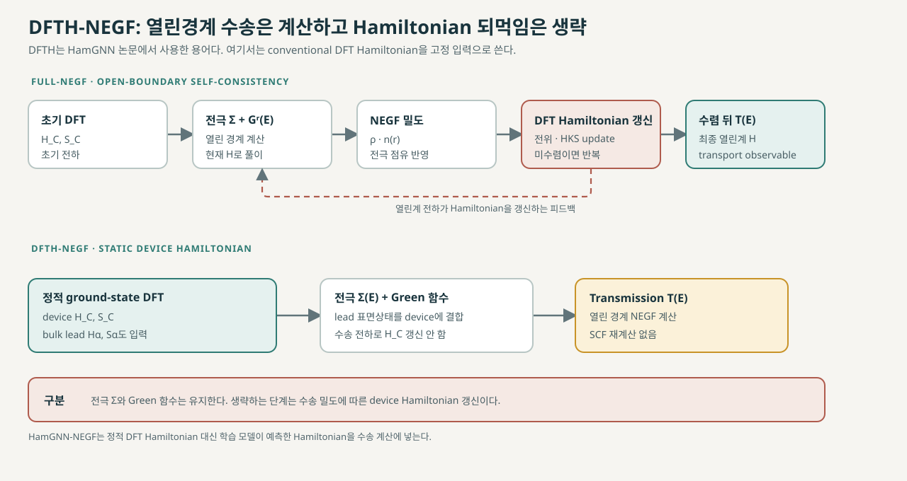

# DFTH-NEGF: 정적 DFT Hamiltonian으로 푸는 수송

Liu 등의 2026년 프리프린트는 열린경계 수송의 자기일관 Hamiltonian 대신 주기 ground-state DFT Hamiltonian을 고정해 [NEGF](negf.md)에 넣는 경로를 DFTH-NEGF라 부른다. 이 문서에서도 해당 논문의 용어로 DFTH-NEGF를 사용한다. 이때 NEGF와 전극 self-energy 계산은 유지하고, 수송 전하에 따른 Hamiltonian 갱신은 생략한다. [1, Introduction and Results]

<figure markdown="span">

  

  <figcaption markdown="1">
  이 위키가 작성한 단순화 개념도. 매 반복의 DFT Hamiltonian 갱신을 포함하는 self-consistent NEGF와, 고정 Hamiltonian에 전극 self-energy와 Green 함수 계산을 연결하는 DFTH 경로의 차이를 나타낸다. KPM 또는 직접 대각화로 Fermi 준위를 정하는 세부 경로는 원 논문 안의 설명이 서로 맞지 않아 도식에 넣지 않았다.
  </figcaption>
</figure>

## 1. NEGF 계산에서 유지하는 것과 생략하는 것

[비직교 국소 기저](../../computational-science/atomistic-simulation/localized-basis-sets.md)에서 산란영역의 Green 함수는

\[
G_C^r(E)=
\left[(E+i\eta)S_C-H_C-\Sigma_L^r(E)-\Sigma_R^r(E)\right]^{-1}
\]

로 쓸 수 있다. 여기서 \(\eta\to0^+\)이며, \(H_C,S_C\)는 중심 산란영역의 Hamiltonian과 overlap이다. \(\Sigma_\alpha^r\)는 반무한 전극 \(\alpha\)가 중심부에 주는 경계 효과를 나타낸다. 전극 self-energy는 전극의 DFT Hamiltonian·overlap과 계면 결합으로 표면 Green 함수를 계산해 구성한다. [2, “NEGF equations”; 3, §II, Eqs. (1)–(4)]

전극 broadening은 \(\Gamma_\alpha(E)=i[\Sigma_\alpha^r(E)-\Sigma_\alpha^a(E)]\)이고, \(\Sigma_\alpha^a=(\Sigma_\alpha^r)^\dagger\), \(G_C^a=(G_C^r)^\dagger\)이다. 두 단자 coherent 수송의 transmission은

\[
T(E)=\operatorname{Tr}\!\left[
\Gamma_L G_C^r \Gamma_R G_C^a
\right]
\]

로 계산할 수 있다. 비직교 기저의 정확한 계면 coupling 표현과 행렬 partition은 코드와 표기 규약을 확인해야 한다. 전류는 전극 점유 차와 \(T(E)\)를 적분해 구하며, Landauer 적분의 조건은 [Landauer transport 문서](landauer-transmission.md)에서 다룬다. [2, “NEGF equations”; 3, §II, Eqs. (1)–(4)]

## 2. Full-NEGF와 DFTH-NEGF

Full-NEGF에서는 중심부 전자밀도 또는 밀도행렬에서 DFT Hamiltonian을 만든다. 이 Hamiltonian으로 열린경계 Green 함수와 새 밀도행렬을 계산한 뒤, 새 밀도에 맞춰 전위를 갱신한다. 수렴할 때까지 이 과정을 반복한다. TranSIESTA 문서는 NEGF로 새 밀도를 계산해 DFT-NEGF 자기일관 주기를 닫는다고 설명한다. [1, Fig. 1(a); 2, TranSIESTA overview; 3, §2]

DFTH-NEGF에서는 수송 자기일관 피드백을 생략한다. 고정된 주기 DFT Hamiltonian에 전극 self-energy를 결합해 \(G^r\)와 \(T(E)\)를 계산하지만, NEGF의 열린경계 Green 함수와 산란계산 자체를 생략하지는 않는다. 따라서 “DFT도 NEGF도 하지 않는다”거나 “모든 전하 자기일관성을 생략한다”는 뜻이 아니다. 앞 단계의 ground-state DFT는 필요하며, 생략되는 것은 열린경계 수송 결과를 반영해 \(H_C\)를 반복 갱신하는 과정이다. [1, Fig. 1; 2, TranSIESTA overview]

| 항목 | Full-NEGF | DFTH-NEGF |
|---|---|---|
| 중심부 Hamiltonian | 열린경계 전하에 맞춰 반복 갱신 | 주기 ground-state DFT의 고정 행렬 사용 |
| 전극 경계 | 전극 self-energy 사용 | 전극 self-energy 사용 |
| Green 함수와 transmission | 계산 | 계산 |
| 수송 전하로 Hamiltonian 갱신 | 수렴까지 반복 | 생략 |
| 주된 검증 질문 | 열린계 SCF가 수렴했는가 | 고정 Hamiltonian이 목표 전송을 충분히 재현하는가 |

## 3. DFTH-NEGF와 HamGNN-NEGF의 관계

이 논문에서 DFTH-NEGF는 수송 계산부를 뜻한다. Figure 1의 HamGNN-NEGF 경로에서 학습 모델을 빼고 기존 DFT로 계산한 Hamiltonian을 넣으면 DFTH-NEGF가 된다. HamGNN-NEGF에서는 같은 종류의 수송 계산에 들어가는 device Hamiltonian을 학습된 모델이 예측한다. 따라서 차이는 NEGF 자체보다 장치 Hamiltonian을 만드는 방법에 있다. [1, Fig. 1 caption]

전극 Hamiltonian과 overlap에서 self-energy를 만드는 일, 중심부 Hamiltonian을 고정하는 일, \(G^r\)에서 transmission을 계산하는 일은 서로 다른 단계다. 특히 학습 Hamiltonian을 사용해도 고정 전위가 적절한지, 전극 정렬이 맞는지, 열린계 전하 변화가 작다는 점이 자동으로 보장되지는 않는다.

## 4. 논문에서 직접 비교한 범위

저자들은 학습모형의 영향과 분리해 고정 DFT Hamiltonian을 쓴 DFTH-NEGF와 Full-NEGF를 비교했다. Au–benzenedithiol–Au 분자 접합과 Stone–Wales 결함 탄소나노튜브에서 두 방식의 transmission spectra가 거의 일치했고, 전체 계산 시간은 각각 18.3%, 27.4% 줄었다고 보고했다. 이 결과는 해당 두 사례에서 열린경계 SCF loop를 생략한 차이를 시험한 것이다. 모든 재료·접촉·전하 상태에서 Full-NEGF와 같다는 뜻은 아니다. [1, Results, p. 4, Fig. 2]

Methods는 Pt–Si–Pt, Pt–분자–Pt, Pt–Si:P–Pt benchmark systems의 Fermi 준위를 일반화 고유값 문제의 직접 대각화로 얻었다고 적는다. 이어 zero-bias transmission은 TBtrans에서 DFT 또는 HamGNN Hamiltonian과 Pt 전극 self-energy를 조합해 계산하고, Full-NEGF 비교에는 TRANSIESTA를 사용했다고 설명한다. [1, Methods, p. 12; 2, TranSIESTA and NEGF equations; 3, §II, (1)–(4); §III.B]

Results p. 5는 \(2\times2\times5\) Si benchmark에서 KPM을 수렴시켜 얻은 \(E_F\)를 이후 NEGF 계산에 사용했다고 적는다. 반면 Methods p. 12는 benchmark systems의 Fermi 준위를 직접 대각화로 얻었다고 서술한다. 두 설명은 같은 Si benchmark의 실제 절차에 대해 서로 맞지 않으며, 프리프린트는 어느 설명이 해당 transmission 계산에 적용되는지 해소하지 않는다. 따라서 원문 내부의 불일치로 기록하고, KPM과 직접 대각화 중 하나를 모든 benchmark에 사용한 단일 절차로 확정하지 않는다. [1, Results, p. 5; Methods, p. 12]

## 5. 유한 바이어스에서의 H₀ 근사

DFTH-NEGF의 중심 개념은 수송 SCF 되먹임 없이 고정 Hamiltonian으로 열린경계 transmission을 계산하는 것이다. 논문은 이에 더해 유한 바이어스 계산에서 zero-bias Hamiltonian \(H_0\)를 그대로 두고 전극 화학퍼텐셜과 비평형 에너지 창을 바꾸는 근사를 시험한다. 저자들은 이 근사를 약한 비선형 영역에 적합하다고 설명한다. 이는 바이어스에 따라 변하는 Hamiltonian을 계산하는 완전한 유한 바이어스 Full-NEGF와 같은 절차가 아니다. [1, Discussion, pp. 9–10; Methods, p. 12]

비도핑 Pt–Si–Pt에서 보고한 transmission MAE는 0.1 V에서 4–5%, 0.2 V에서 8–13%로 증가했다. 도핑된 Pt–Si:P–Pt는 두 바이어스 모두 1.5% 이내였다. 강한 비선형 영역이나 negative differential resistance에서는 \(H_0\) 근사가 무너질 수 있다고 저자들도 적는다. 이 수치는 특정 모델과 에너지 창의 논문 결과이며 일반 허용오차가 아니다. [1, Discussion, pp. 9–10]

## 6. 적용 전 확인할 점

- 주기 DFT의 \(H_C,S_C\)가 실제 산란영역의 접촉·결함·도핑 환경을 대표하는가?
- 전극 self-energy가 같은 기저·에너지 기준·계면 결합과 일관되게 만들어졌는가?
- 목표 물리량에 영향을 줄 만큼 열린계 전하 이동이나 전위 굽힘이 큰가?
- 정적 Hamiltonian 결과를 Full-NEGF 또는 다른 신뢰 가능한 기준과 대표 조건에서 비교했는가?
- 유한 바이어스라면 \(H_0\) approximation의 적용 범위 안에 있는가?

DFTH-NEGF는 수송 SCF 비용을 줄이는 대신 고정 Hamiltonian의 적합성을 별도로 확인해야 한다. 전하 재분포, 강한 gate 전위, 큰 바이어스에 따라 Hamiltonian이 달라지는 장치에서는 근사 오차가 목표 관측량에 얼마나 전달되는지 확인해야 한다. 학습 Hamiltonian 구현과 수치 결과는 [HamGNN-NEGF 문서](hamgnn-negf.md), 비직교 KPM의 Fermi 준위 수렴은 [KPM 문서](nonorthogonal-kpm.md)를 참고한다.

## 7. 참고 자료

1. B. Liu et al., “Linear-Scaling Quantum Transport from Machine-Learning Density Functional Theory Hamiltonians,” arXiv:2609.37058v1 (2026), [Abstract](https://arxiv.org/abs/2609.37058), [PDF](https://arxiv.org/pdf/2609.37058v1), Introduction, Results, Discussion, Methods, and Figs. 1–2. Preprint.
2. SIESTA developers, [SIESTA 5.4 reference manual](https://docs.siesta-project.org/projects/siesta/en/5.4/reference/siesta.html#sec:negf-equations), “NEGF equations”; [TranSIESTA overview](https://docs.siesta-project.org/projects/siesta/en/5.4/reference/siesta.html#sec:transiesta:description).
3. N. Papior, N. Lorente, T. Frederiksen, A. García, and M. Brandbyge, “Improvements on non-equilibrium and transport Green function techniques: The next-generation TranSIESTA,” *Computer Physics Communications* **212**, 8–24 (2017), [DOI](https://doi.org/10.1016/j.cpc.2016.09.022), [arXiv](https://arxiv.org/abs/1607.04464).
