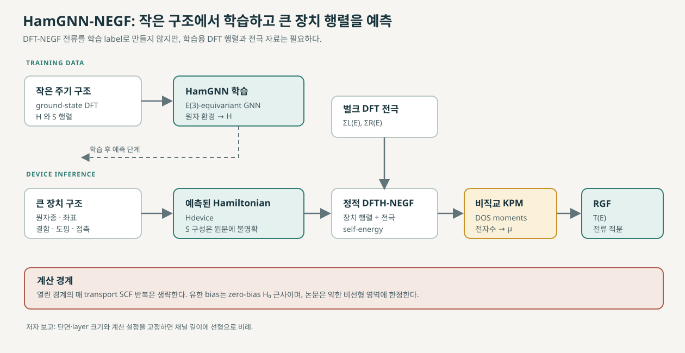

# HamGNN-NEGF: 학습 Hamiltonian으로 확장하는 양자 수송

HamGNN-NEGF는 작은 구조에서 얻은 일반 DFT Hamiltonian과 overlap 행렬 자료로 원자 환경과 행렬 요소의 관계를 학습하고, 큰 장치 구조의 Hamiltonian을 예측한 뒤 NEGF 수송에 넣는 방법이다. 저자들은 이를 통해 계산량을 줄이면서 고정 단면에서 채널 길이에 대한 선형 스케일링을 얻었다고 보고한다. 논문은 2026년 9월 공개된 arXiv v1 프리프린트다. [1, Abstract; §§I–II]

## 1. Hamiltonian 블록 반복과 무엇이 다른가

짧은 구조의 DFT 결과를 이미 갖고 있고 균일 채널을 길게 만들려면 대표 Hamiltonian·overlap 블록을 반복하는 모델을 검토할 수 있다. HamGNN은 그 블록을 그대로 복사하지 않는다. 작은 구조의 DFT 행렬을 학습자료로 사용해 원자 배치에서 Hamiltonian을 예측한다. 비직교 기저의 계산에는 overlap S도 필요하지만, 논문은 큰 장치의 S를 어떤 절차로 구성하는지 충분히 설명하지 않는다. [1, §§II–III]

HamGNN은 원자 환경에 따라 새 Hamiltonian을 예측하므로 구조 변화도 표현할 수 있다. 학습 범위를 벗어난 결함, 접촉 재구성, 큰 변형은 별도 검증해야 한다.

## 2. 학습 자료와 행렬 예측

논문은 E(3)-equivariant graph neural network인 HamGNN을 사용한다. 학습자료는 전자 수송 결과가 아니라, 작은 주기 구조에 대한 ground-state DFT Hamiltonian \(H\)와 overlap \(S\)다. 본문 Methods는 PBE/SIESTA, norm-conserving pseudopotential, DZP basis를 사용했다고 적는다. Pt–Si–Pt, P-doped Pt–Si:P–Pt, Pt–분자–Pt 세 구조군마다 세 가지 채널 길이를 만들었다. 각 길이별로 산란영역 원자에 0.08 Å 무작위 변위를 적용한 구조 50개를 생성했다. 자료는 training/validation/test로 80/10/10 분할했다. [1, Methods, pp. 11–12]

학습 단계에는 ground-state DFT의 H/S 행렬과 전극 자료가 필요하다. 다만 매 transport 단계에서 full DFT-NEGF 결과를 label로 만들지는 않는다고 저자들은 설명한다. [1, Abstract; Methods]

## 3. 예측 행렬에서 transmission까지

계산은 다음 네 단계로 이어진다.

1. **큰 장치의 원자 구조를 입력한다.** HamGNN은 원자 환경을 바탕으로 device Hamiltonian H를 예측한다. 비직교 계산에는 overlap S도 필요하지만, 큰 장치의 S를 구성하는 절차는 논문에서 명확히 설명하지 않는다.
2. **정적 장치 행렬에 전극 self-energy를 붙인다.** Self-energy는 별도의 bulk DFT 전자구조 계산에서 가져온다. 이 경로는 열린 경계 수송을 수행하면서 매번 전하밀도를 갱신해 Hamiltonian을 다시 만드는 Full-NEGF의 self-consistent loop를 생략한다.
3. **비직교 KPM으로 Fermi 준위를 정한다.** 비직교 기저의 일반화 고유값 문제 \(Hc_i=\epsilon_i S c_i\)를 다루며, overlap 행렬을 포함한 연산의 Chebyshev moments로 상태밀도(density of states, DOS)를 복원하고 전자수 조건에 맞는 Fermi 준위를 찾는다. 이 단계는 전체 고유값을 명시적으로 대각화하지 않는 것을 목표로 한다.
4. **RGF로 \(T(E)\)를 계산한다.** 산란영역을 principal layer로 나누고 인접 층 결합을 따라 Green 함수 정보를 재귀적으로 전달한다. [1, §II, Fig. 1; Methods, pp. 11–12]

KPM은 Fermi 준위를, RGF는 transmission을 계산한다. 블록 반복과 달리 HamGNN은 장치 구조에서 Hamiltonian을 새로 예측한다.

## 4. 선형 스케일링이 성립하는 조건

저자들은 전체 계산량이 **단면 크기와 계산 설정을 고정했을 때** 채널 길이에 선형으로 증가한다고 보고한다. 예측 모델은 고정된 국소 cutoff에서 원자 수에 비례하는 graph edge 수를 사용한다. 논문이 제시하는 비직교 KPM 비용은 \(O(N_\mathrm{mom}N_\mathrm{rand}N)\), RGF 비용은 \(O(N_z M_b^3)\)다. 여기서 \(N\)은 행렬 차원, \(N_\mathrm{mom}\)은 다항식 moment 수, \(N_\mathrm{rand}\)는 random vector 수, \(N_z\)는 수송 방향 layer 수, \(M_b\)는 layer 행렬 크기다. 따라서 선형 길이 스케일링을 읽을 때는 단면·layer 크기·에너지 및 횡방향 k점 표본·수렴 설정이 고정된 비교인지 확인해야 한다. [1, §II; Methods]

## 5. 논문이 보고한 검증

| 시험 | 저자가 보고한 결과 | 해석 범위 |
|---|---|---|
| Pt–Si–Pt, \(2\times2\times5\) | Hamiltonian 원소 MAE 0.020 meV, transmission MAE 1.71% | 논문에 사용된 구조·기저·에너지 범위의 비교 |
| 더 긴 Pt–Si–Pt, \(2\times2\times7\), \(2\times2\times10\) | transmission MAE 3.86%, 6.25% | 학습에 사용한 더 짧은 구조를 넘어선 길이 확장 시험 |
| P-doped Pt–Si:P–Pt의 \(1\times1\times7\), \(1\times1\times10\) | transmission MAE 2.03%, 1.92% | 해당 도핑·구조군에서 보고된 결과 |
| 320–480 원자 benchmark | Full-NEGF 대비 약 1,000–2,000배 가속 보고 | 특정 구현과 계산 설정의 benchmark이며 모든 시스템의 보장값은 아님 |
| 10,000 원자 초과 | 대형 장치 예측 사례 보고 | 해당 사례의 실현 가능성이지 임의 화학계의 정확도 보장은 아님 |

분자 사슬에서는 좁은 공명 때문에 길이가 늘수록 에너지별 T(E) 차이가 커졌다. 10-ring과 16-ring에서 MAE 8.01%, 11.10%를 보고한다. 작은 Hamiltonian 오차가 공명 위치에서는 큰 \(T(E)\) 차이가 될 수 있으므로 평균 오차 하나로 수송 품질을 판단하지 않는다. [1, Results, pp. 5–7]

## 6. 유한 바이어스와 전하 자기일관성의 경계

주요 계산은 정적 Hamiltonian을 쓰는 DFTH-NEGF다. 유한 바이어스에서는 zero-bias Hamiltonian H0를 그대로 두고 전극 화학퍼텐셜과 비평형 에너지 창을 갱신한다. 저자들은 이 근사를 약한 비선형 영역에 한정한다. pristine Pt–Si–Pt에서는 transmission MAE가 0.1 V에서 4–5%, 0.2 V에서 8–13%로 커졌고, P-doped 접합에서는 두 바이어스 모두 1.5% 이내라고 보고한다. 강한 비선형성이나 NDR는 이 근사의 검증 범위를 벗어나며 논문에서도 후속 연구 과제로 둔다. [1, Abstract; Results, pp. 9–11]

수송 SCF를 생략하므로 정적 Hamiltonian이 충분한지는 대표 Full-NEGF 계산이나 별도 전기정역학 검증으로 확인해야 한다. 특히 접촉 전하 이동, 강한 gate/bias 전위 변화, 계면 재구성이 중요하면 그 영향을 따로 살펴야 한다. 논문은 Au–benzenedithiol–Au와 결함 CNT 시험에서 정적 DFTH-NEGF와 Full-NEGF transmission이 거의 겹친 예를 보고하지만, 그 결과를 모든 재료·접촉으로 일반화할 수는 없다. [1, Fig. 2, p. 4]

HSE06 결과 역시 별도의 Hamiltonian 자료로 다시 학습한 예시다. 따라서 HSE06로 학습하지 않은 모델이 HSE06 행렬을 자동으로 예측한다고 읽으면 안 된다. [1, Results, pp. 7–8; Methods]

## 7. 이 방법을 적용할 때 확인할 질문

- 학습자료가 목표 물질, 결합, 결함, 변형과 접촉의 국소 환경을 포함하는가?
- 예측된 \(H\)와 그 계산에 사용한 \(S\)의 출처·정합성이 목표 에너지 창의 band edge, 공명, transmission을 보존하는가?
- 비직교 KPM의 Fermi 준위와 전자수 수렴이 충분한가?
- 정적 전극 self-energy와 비자기일관 Hamiltonian이 목표 전위·전하 조건을 대표하는가?
- 유한 바이어스가 약한 비선형 영역에 있는가? 그 범위를 벗어나면 어떤 기준 계산으로 확인할 것인가?

HamGNN-NEGF는 매번 full DFT-NEGF를 풀지 않고 긴 장치 행렬을 만들 수 있는 경로다. 예측의 적용 범위는 학습자료, 정적 Hamiltonian 가정, KPM/RGF 설정과 목표 장치 검증으로 정해진다. 이 논문은 사용자의 MoS₂/Au 구조를 직접 검증한 사례는 아니다.

## 8. 함께 보기

- [긴 채널 수송 방법 비교](long-channel-transport.md)
- [Hamiltonian 블록 확장과 RGF](hamiltonian-block-stitching.md)
- [ML Hamiltonian 수송 개요](ml-hamiltonian-transport.md)
- [전자구조 대규모 solver의 역할](../../computational-science/atomistic-simulation/electronic-structure-solvers.md)

## 9. 참고 자료

1. B. Liu et al., “Linear-Scaling Quantum Transport from Machine-Learning Density Functional Theory Hamiltonians,” arXiv:2609.37058v1 (2026), [abstract](https://arxiv.org/abs/2609.37058), [PDF](https://arxiv.org/pdf/2609.37058v1), submitted 2026-09-29. Preprint.
