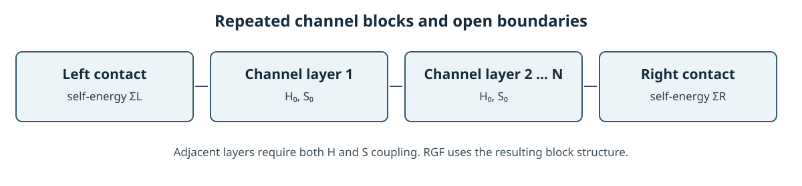

# Hamiltonian 블록 확장과 RGF

짧은 원자구조에서 계산한 국소 Hamiltonian을 길이 방향으로 반복하면 긴 채널의 행렬 모형을 만들 수 있다. 이 방법은 반복할 행렬과 연결 블록을 조립하는 근사다. 확장된 모든 원자에 대해 새 Kohn–Sham 전하와 퍼텐셜을 자기일관적으로 계산하는 Order-N DFT와는 다르다. [1, §XIII; 2, “Calculation of electronic structure”]

<figure markdown="span">
  
  <figcaption markdown="1">균일 채널의 블록 확장과 열린 경계를 나타낸 위키 자체 도식이다. 층 사이의 Hamiltonian과 overlap 결합도 필요하며, RGF는 조립된 블록 구조를 따라 계산한다. [2, “Principal layer interactions”; 3, §1][도식 크게 보기](images/block-stitching.svg)</figcaption>
</figure>

## 1. 기저 확장과 행렬 블록

국소 원자궤도 기저에서는 단일 전자 상태를

\[
|\psi_n\rangle=\sum_\mu |\phi_\mu\rangle c_{\mu n}
\]

로 전개한다. 이에 대응하는 행렬은

\[
H_{\mu\nu}=\langle\phi_\mu|\hat H_{\mathrm{KS}}|\phi_\nu\rangle,
\qquad
S_{\mu\nu}=\langle\phi_\mu|\phi_\nu\rangle,
\qquad
Hc_n=\epsilon_n S c_n
\]

이다. 기저가 비직교하면 \(S\)를 생략할 수 없다. 유한 범위 원자궤도는 멀리 떨어진 원자 사이의 행렬 요소를 0으로 만들어 \(H\)와 \(S\)를 희소하게 한다. [1, §§III–IV, VI; 2, SIESTA 5.4, “Calculation of the electronic structure”]

수송 방향을 principal layer \(i\)들로 나누고, 완전히 반복되는 채널이라면 각 층의 내부 행렬과 이웃 층 결합을

\[
H_{ii}=H_0,\quad H_{i,i+1}=V,\quad H_{i+1,i}=V^\dagger,\qquad
S_{ii}=S_0,\quad S_{i,i+1}=S_1,\quad S_{i+1,i}=S_1^\dagger
\]

처럼 반복해 조립할 수 있다. \(V\)와 \(S_1\)은 인접 층 사이의 Hamiltonian과 overlap이다. 역방향 블록은 Hermitian 행렬 \(H\), \(S\)의 켤레전치다. 실제 소자에서는 접합·결함·전위가 달라지는 위치에 다른 블록을 두어야 한다. 비직교 기저에서는 retarded Green kernel \(zS-H\), \(z=E+i0^+\)에 층간 항 \(zS_1-V\)가 함께 들어간다. Hamiltonian만 복사하고 overlap이나 층간 행렬 요소를 빼면 원래의 전자 문제와 달라진다. [1, §§III–VI; 2, “Hamiltonian matrix” and “Principal layer interactions”]

## 2. 전극과 열린 경계

유한 산란영역의 retarded Green 함수는

\[
G^r(E)=\left[(E+i0^+)S-H-\Sigma_L^r(E)-\Sigma_R^r(E)\right]^{-1}
\]

로 쓴다. \(\Sigma_L^r\), \(\Sigma_R^r\)는 반무한 전극의 표면 Green 함수와 전극–소자 결합으로부터 얻는 self-energy다. 탄성·단일입자 수송의 transmission은

\[
T(E)=\operatorname{Tr}\!\left[\Gamma_LG^r\Gamma_RG^a\right],
\qquad
\Gamma_\alpha=i(\Sigma_\alpha^r-\Sigma_\alpha^a)
\]

로 표현된다. 전류 적분과 비평형 점유는 [NEGF 문서](negf.md)를 따른다. [2, “NEGF equations,” “TBT.Elec.<>.HS,” “Principal layer interactions”; 4, §§II, IV.A]

결합 범위가 한 층보다 길면 principal layer를 더 크게 잡아 결합이 인접 블록으로만 보이게 해야 한다. SIESTA TBtrans 안내서는 전극이 이웃 초격자 하나와만 상호작용하는 principal layer 조건을 확인하도록 요구하며, 이를 무시하면 비물리 결과가 날 수 있다고 경고한다. [2, “Principal layer interactions”]

## 3. RGF의 계산 복잡도

Recursive Green's function (RGF)은 전체 산란영역의 조밀한 역행렬을 한 번에 구하는 대신, 블록 삼중대각 구조를 따라 층별 Green 함수와 자기 에너지를 순차적으로 갱신한다. 조밀한 층 블록의 차원 \(M_b\)를 고정하면 central scattering region에서 한 에너지·횡방향 \(k\)-점의 재귀 계산은 층 수 \(N_z\)에 따라 대략 \(O(N_z M_b^3)\)로 증가한다. 따라서 **단면 크기와 블록 차원을 고정한 채 길이만 늘릴 때** 이 부분의 비용은 채널 길이에 대해 선형이다. 단면을 넓히면 \(M_b\)가 커지고 비용이 빠르게 증가할 수 있다. 이 추정에는 전극 surface Green 함수 계산, 에너지 적분, 자기일관 반복이 포함되지 않는다. [3, §1, Eqs. (9)–(12), pp. 4–5; 4, §III.C.1, Eqs. (17)–(18)]

### (1) 한 층씩 붙이는 재귀식

\(K_{ij}(z)=zS_{ij}-H_{ij}\)로 두고 \(N\ge2\)개의 층에서 전극 self-energy가 각각 첫 층과 마지막 층에만 작용하며, 왼쪽으로부터 \(i\)층까지의 부분계가 오른쪽 전극과 아직 연결되지 않았다고 하자. 왼쪽 전극만 접속된 첫 층의 Green 함수와 그 뒤의 왼쪽 연결 Green 함수는 블록 소거로

\[
g_1^L=\left[K_{11}-\Sigma_L^r\right]^{-1},\qquad
g_i^L=\left[K_{ii}-K_{i,i-1}g_{i-1}^L K_{i-1,i}\right]^{-1}
\quad(2\le i\le N)
\]

로 구한다. 마지막 층에 오른쪽 전극을 연결할 때는 \(i=N\)의 대괄호 안에 \(-\Sigma_R^r\)를 추가한다. \(g_i^L\)는 **잘라 둔 부분계**의 마지막 층 Green 함수이므로, 일반적으로 양쪽 전극을 모두 연결한 전체 소자의 \(G_{ii}^r\)와 같지 않다. 전송과 공간별 밀도에 필요한 비대각 블록이나 나머지 대각 블록은 추가 재귀 또는 역방향 단계를 통해 구한다. [3, §1, Eqs. (9)–(12); 4, §III.C.1, Eqs. (17)–(18)]

여기서 \(K_{i,i-1}\)과 \(K_{i-1,i}\)는 각각 \(zS-H\)의 방향별 블록이다. 같은 복소 \(z\)에서 한쪽 블록을 다른 쪽의 단순 켤레전치로 치환하지 않는다. 이 재귀는 인접 층 밖 결합이 없도록 principal layer를 선택한 경우에 성립한다. 모드 수를 줄여 각 층의 차원을 낮추는 접근과 재귀 풀이의 차이는 [mode-space 수송](mode-space-transport.md)을 참고한다. [3, §1; 4, §III.C.1]

## 4. 블록 복제가 맞는 조건과 어긋나는 조건

블록 확장이 잘 표현하는 대상은 반복 단위와 전자적 환경이 길이 방향으로 거의 일정한 채널이다. 확장 전에 DFT 계산과 장치 행렬 사이에서 원자 좌표, 기저 순서, 스핀, 에너지 기준, \(H\)와 \(S\)의 행·열 대응 및 층간 결합을 맞춰야 한다. 원자 위치만 이어 붙였다고 행렬 연결이 자동으로 맞는 것은 아니다. [1, §§III–VI; 2, “TBT.Elec.<>.HS” and “Matching electrode coordinates”]

단일 블록 반복은 아래 효과를 스스로 만들지 않는다.

- 게이트에 따른 공간 의존 전위, 밴드 굽힘과 screening
- 도핑·결함·변형으로 바뀐 국소 전자구조
- 채널 길이에 따라 달라지는 전하 재분포와 접촉 유도 전위·전하 변화의 자기일관 되먹임
- 전자–포논 등 비탄성 산란

이 항들이 목표 물성에 중요하면, 전위의 자기일관 갱신이나 검증된 수송 Hamiltonian 모델을 추가해야 한다. 예를 들어 TranSIESTA의 NEGF–Poisson 반복은 비평형 전하와 전위를 맞추는 경로이며, 고정 \(H\) 블록 복제만으로 대체되지 않는다. [2, “TranSIESTA,” “NEGF equations”; 4, §III.E, “Electrostatics in NEGF”]

## 5. 재현 가능한 확인 순서

1. 전극 및 대표 채널 구조에서 \(H\), \(S\), 원자 순서와 에너지 원점을 보존한다.
2. 짧은 산란영역을 직접 계산한 결과와 조립한 행렬의 band, transmission, 전하를 비교한다.
3. 층간 \(H\), \(S\) 결합 범위가 principal-layer 정의를 만족하는지 확인한다.
4. 길이, 에너지 격자, 전극 self-energy 정확도와 단면 \(k\)-점을 나누어 수렴시킨다.
5. 게이트·도핑·결함을 모델에 넣지 않았다면 그에 해당하는 물성을 설명하지 않는다.

이 검사는 행렬 구성과 수치 수렴을 확인한다. 복제한 Hamiltonian이 실제 장채널의 전자구조를 대표하는지에 대한 물리 검증은 별도로 필요하다.

## 6. 참고 자료

1. J. M. Soler et al., “The SIESTA method for ab initio order-\(N\) materials simulation,” *J. Phys.: Condens. Matter* **14**, 2745 (2002), [§§III–VI, XIV](https://doi.org/10.1088/0953-8984/14/11/302).
2. SIESTA developers, [SIESTA 5.4 reference manual](https://docs.siesta-project.org/projects/siesta/en/5.4/reference/siesta.html), “Calculation of electronic structure” and “NEGF equations”; [TBtrans User Guide](https://docs.siesta-project.org/projects/siesta/en/5.4/reference/tbtrans.html), “TBT.Elec.<>.HS,” “Principal layer interactions,” and “Calculation time.”
3. M. Wimmer and K. Richter, “Optimal block-tridiagonalization of matrices for coherent charge transport,” *Journal of Computational Physics* **228**, 8548–8565 (2009), [§1, Eqs. (9)–(12), pp. 4–5](https://arxiv.org/abs/0806.2739).
4. N. R. Papior et al., “Improvements on non-equilibrium and transport Green function techniques: the next-generation TranSIESTA,” *Computer Physics Communications* **212**, 8–24 (2017), [§III.C.1, Eqs. (17)–(18)](https://arxiv.org/abs/1607.04464).
5. J. Zou et al., “Deep learning accelerated quantum transport simulations in nanoelectronics: from break junctions to field-effect transistors,” *npj Computational Materials* **11**, 375 (2025), [§§III.2–III.3](https://doi.org/10.1038/s41524-025-01853-6).
