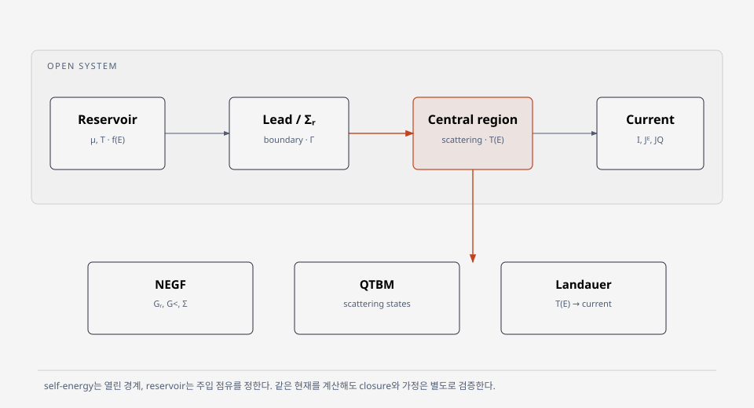

# Quantum transport

- [Non-equilibrium Green's function (NEGF)](negf.md)
- [Landauer transport and transmission](landauer-transmission.md)
- [Landauer–Büttiker transport](landauer-buttiker.md)
- [Quantum contact resistance](quantum-contact-resistance.md)
- [SCBA convergence](scba-convergence.md)
- [Scattering QTBM method](scattering-qtbm.md)
