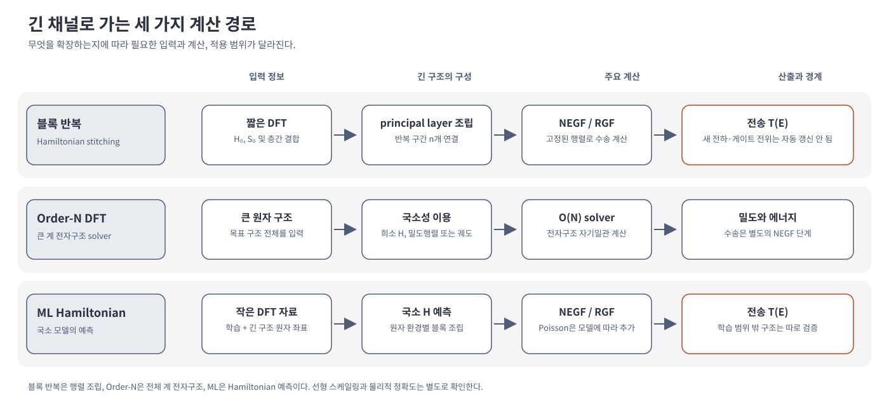

# 긴 채널의 Hamiltonian 확장과 수송 계산

짧은 계산으로 얻은 전자구조 정보를 긴 채널에 적용하는 방법은 한 가지가 아니다. 작은 구조의 Hamiltonian을 반복해 큰 행렬을 만드는 방식, 큰 구조 전체를 대상으로 선형 스케일링 DFT를 푸는 방식, 작은 DFT 자료로 학습한 모델이 긴 구조의 Hamiltonian을 예측하는 방식은 서로 다른 근사와 계산 목표를 가진다. 이 문서에서 **Hamiltonian 블록 확장**은 첫 번째 방식을 뜻한다. 이를 Order-N DFT와 같은 방법으로 부르지 않는다. [1, §§II, VI, XIII; 2, Calculation of the electronic structure; 3, §§II–III]

<figure markdown="span">

  

  <figcaption markdown="1">
  이 위키가 직접 그린 비교도. 작은 Hamiltonian 블록 반복, 전체 구조 Order-N DFT, 학습 Hamiltonian을 이용한 수송은 모델을 만드는 단계와 계산 목표가 서로 다르다. 선형 스케일링은 각 방법의 조건에서만 성립한다.
  </figcaption>
</figure>

## 1. Hamiltonian과 기저의 확장 방식

| 방법 | 큰 구조를 만드는 방식 | 주 계산 | 핵심 가정과 경계 |
|---|---|---|---|
| Hamiltonian 블록 확장 | 작은 구조의 \(H\), \(S\)와 층간 결합을 반복 조립 | NEGF, 필요하면 RGF | 반복 구간의 구조와 전자적 환경이 대표 블록과 같아야 한다. 그 자체로 새 구조의 DFT 자기일관 계산을 하지 않는다. |
| Order-N DFT | 목표가 되는 큰 원자 구조를 직접 다룬다. | 알고리즘에 따라 국소 궤도함수나 밀도행렬 등의 표현으로 큰 계의 전자구조를 구한다. | 국소성·희소성으로 연산량을 줄인다. 방법과 물질 상태에 따라 정확도와 적용 가능성이 달라진다. |
| 학습 Hamiltonian + NEGF | 작은 DFT 자료에서 학습한 국소 모델을 긴 원자 구조에 적용한다. | 예측된 행렬과 전극 self-energy로 NEGF/RGF를 푼다. | 학습 범위 밖의 원자 환경, 전하 재분포, 전기장과 비평형 효과는 별도 검증 또는 자기일관 처리가 필요하다. |

국소 원자궤도 기저에서 전자 상태를 기저함수의 선형결합으로 쓰면 Hamiltonian 행렬과 overlap 행렬 \(H\), \(S\)가 생긴다. 이 행렬을 길이 방향으로 조립하는 것은 **전자구조 행렬의 구성**이다. Order-N은 주어진 큰 구조의 전자구조를 계산하는 **알고리즘의 스케일링**이며, 세부 알고리즘에 따라 국소 궤도함수·밀도행렬 등을 이용한다. [1, §§VI, XIII; 2, “SolverON”]

학습 Hamiltonian은 원자 환경으로부터 행렬 요소를 **예측하는 모형**이며, 예측된 행렬을 NEGF에 넣어 수송을 계산할 수 있다. [3, §§II–III; 4, Abstract and main text]

HamGNN-NEGF의 학습 Hamiltonian, 비직교 KPM, RGF 연결과 적용 경계는 [독립 문서](hamgnn-negf.md)에서 자세히 설명한다. 정적 DFT Hamiltonian으로 열린계 수송을 계산하는 방법은 [DFTH-NEGF](dfth-negf.md), 전자수 조건으로 Fermi 준위를 찾는 비직교 KPM은 [별도 문서](nonorthogonal-kpm.md)에서 다룬다.

## 2. 채널 길이를 늘릴 때 먼저 정할 질문

완전히 주기적인 균일 채널을 긴 산란영역으로 표현하려는 경우에는 대표 단위의 행렬 블록을 반복하는 모델을 만들 수 있다. 반면 실제 트랜지스터에서는 전극 접합, 게이트 전위, 도핑, 결함, 변형과 전하 재분포가 채널 위치에 따라 달라질 수 있다. 이 효과를 무시하고 한 블록을 복제하면 계산은 길어져도 해당 공간 변화를 Hamiltonian에 새로 반영하지 않는다. [1, §XIII; 2, TBT.Elec.<>.Bulk and principal-layer guidance; 3, §§III.2–III.3]

방법을 고르기 전에 다음을 구분한다.

- **균일한 밴드와 전송을 확인한다:** 주기 블록 반복과 RGF를 검토한다.
- **큰 계의 구조·전하·에너지 자체를 계산한다:** Order-N DFT 등 전체 계용 전자구조 solver를 검토한다.
- **결함·도핑·기하 변화가 있는 긴 채널의 행렬을 만든다:** 학습 Hamiltonian의 해당 환경 검증과 전극 정렬을 확인한다.
- **게이트와 비평형 전하가 중요하다:** NEGF–Poisson 또는 TranSIESTA와 같은 전위·전하 자기일관 절차가 모델에 포함되는지 확인한다. 학습 모델을 썼다는 사실만으로 이 되먹임이 자동으로 포함되지는 않는다. [2, “NEGF equations,” “TranSIESTA,” and “TBtrans”; 3, §§III.2–III.3; 4, Abstract and main text]

세 방법의 수식과 사례는 [Hamiltonian 블록 확장과 RGF](hamiltonian-block-stitching.md), [Order-N DFT](../../computational-science/atomistic-simulation/order-n-dft.md), [학습 Hamiltonian 기반 수송](ml-hamiltonian-transport.md)에서 각각 다룬다. 기본 NEGF의 \(H\), \(S\), 전극 self-energy와 전류 정의는 [NEGF 문서](negf.md)를 참고한다.

## 3. 참고 자료

1. J. M. Soler et al., “The SIESTA method for ab initio order-\(N\) materials simulation,” *J. Phys.: Condens. Matter* **14**, 2745 (2002), [§§III, VI, XIII](https://doi.org/10.1088/0953-8984/14/11/302).
2. SIESTA developers, [SIESTA 5.4 reference manual](https://docs.siesta-project.org/projects/siesta/en/5.4/reference/siesta.html), “Calculation of the electronic structure,” “SolverON,” “NEGF equations”; [TBtrans user guide](https://docs.siesta-project.org/projects/siesta/en/5.4/reference/tbtrans.html), “Principal layer interactions.”
3. J. Zou et al., “Deep learning accelerated quantum transport simulations in nanoelectronics: from break junctions to field-effect transistors,” *npj Computational Materials* **11**, 375 (2025), [§§II–III](https://doi.org/10.1038/s41524-025-01853-6).
4. B. Liu et al., “Linear-Scaling Quantum Transport from Machine-Learning Density Functional Theory Hamiltonians,” arXiv:2609.37058v1 (2026), [Abstract, Introduction, Results, and Discussion](https://arxiv.org/abs/2609.37058v1).
