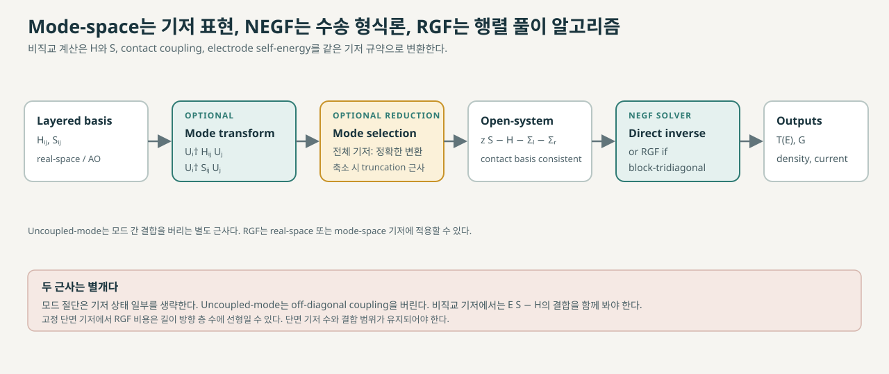
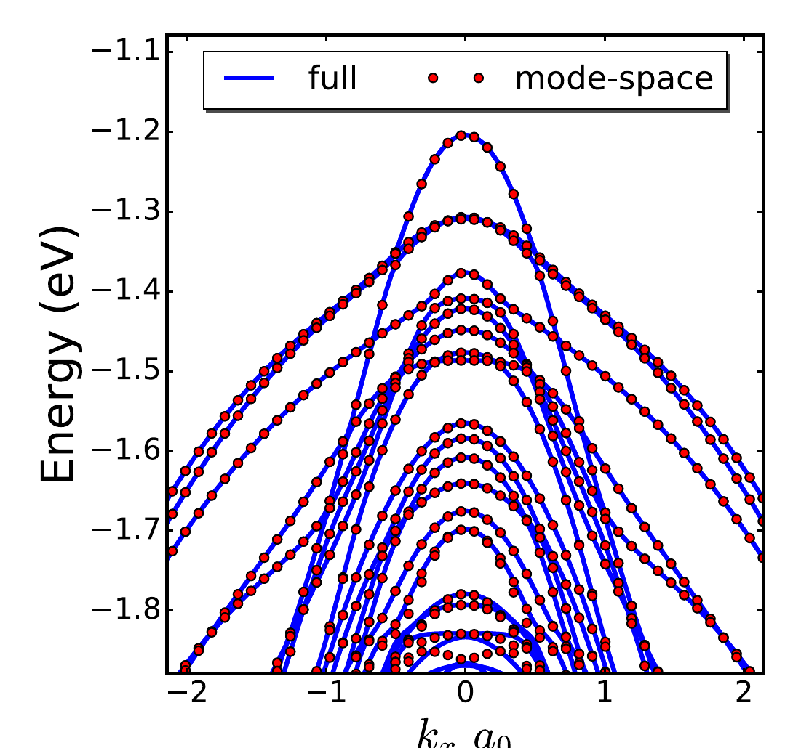

# Mode-space 표현과 수송 계산

Mode-space는 원자 궤도나 실공간 격자로 표현한 수송 문제를 횡방향 모드 기저에서 다시 표현하는 방법이다. 완전한 기저의 좌표변환과 일부 모드만 남기는 축소는 구별해야 한다. 일반 [비직교 원자궤도 기저](../../computational-science/atomistic-simulation/localized-basis-sets.md)에서 변환행렬이 유클리드 내적 기준의 unitary일 필요는 없으며, 직교화한 기저에서는 unitary 변환으로 표현된다. 전자는 표현 변경이고, 후자는 물리 상태의 절단이다. 모드 사이 결합까지 제거하면 추가 근사가 된다. 이 문서는 정상상태 2단자 [nonequilibrium Green’s function (NEGF)](negf.md)을 기준으로 투영, 접촉, 밀도·전류, 산란과 검증 조건을 정리한다. [1, §§II.B, IV; 2, “Tight Binding Mode Space Model”; 3, §§2.1–2.6]

<figure markdown="span">

  

  <figcaption markdown="1">
  이 위키의 개념도. Mode-space는 필요에 따라 적용하는 기저 변환이고 RGF는 block-tridiagonal 행렬의 재귀 풀이임을 분리해 표시했다. 모드 절단과 uncoupled-mode 근사의 차이 및 선형 길이 스케일링의 조건은 본문과 참고문헌 [10–11]에 설명한다.
  </figcaption>
</figure>

## 1. 기저 변환과 투영

수송 방향으로 단면을 \(i\)번째 slice라 하고, 그 단면의 원자 궤도 또는 실공간 기저를 \(\{|\phi_{i\mu}\rangle\}\)라 하자. 횡방향 기저에서 선택한 모드를 열로 갖는 행렬을 \(U_i\)라 두면, slice \(i,j\) 사이의 행렬 블록은

\[
H^{\mathrm{MS}}_{ij}=U_i^\dagger H_{ij}U_j,
\qquad
S^{\mathrm{MS}}_{ij}=U_i^\dagger S_{ij}U_j
\]

로 투영된다. \(H\)는 Hamiltonian, \(S\)는 overlap 행렬이며, 직교 기저에서는 \(S=I\)다. 비직교 기저에서는 \(H\)만 변환하고 \(S\)를 버릴 수 없다. 모드가 \(S\)-정규직교화되어 있더라도 slice 사이 overlap 블록이 자동으로 사라지는 것은 아니다. [1, §II.B, Eqs. (11)–(13); 4, pp. 69–70]

모드는 보통 각 단면의 횡방향 고유문제에서 얻는다. 유효질량 모형에서는 횡방향 Schrödinger 방정식의 고유상태가 모드가 될 수 있다. 원자론적 tight-binding (TB) 모형에서는 단면 Hamiltonian의 고유상태를 에너지와 \(k\)-공간 범위에서 모으고, 직교화·정제해 축소 기저를 구성할 수 있다. Afzalian 등의 최적화된 nanowire TB 기저에서는 관심 에너지 창과 전체 Brillouin zone을 표본화했다. 반쪽 Brillouin zone만 표본화한 경우에는 표본에서 빠진 영역에 비물리적인 분산이 남을 수 있었다. 따라서 필요한 표본 범위는 기저 생성법, 대칭 처리와 수송 대상에 따라 정한다. [1, §II.B; 2, “Results: A Tight-Binding Mode-Space Model,” pp. 3–4, “Methods,” p. 7, Eqs. (1)–(7); 3, §2.1, Eqs. (5)–(7)]

완전한 모드 집합으로 기저를 변환하면 원래 계산과 동등하다. 선택한 \(n\)개 모드가 원래 \(N\)개 기저보다 적을 때 \(n\ll N\)인 축소 표현을 얻지만, 생략된 모드의 전파·evanescent 상태 및 산란 경로는 결과에 영향을 줄 수 있다. 따라서 mode-space 자체가 자동으로 정확한 것은 아니다. [1, §II.B; 2, “Methods,” p. 7; 3, §2.1]

???+ note "생략한 모드가 남기는 효과"

    기저 전체를 보존한 표현에서 유지할 부분공간을 \(P\), 제거할 부분을 \(Q\)라 하고, 전체 열린경계 Green kernel을 \(K(z)=zS-H-\Sigma_L-\Sigma_R\)로 놓자. \(K_{QQ}\)가 가역인 에너지에서 블록 소거를 하면 정확한 유지 공간 Green 함수는

    \[
    G_{PP}^r=\left[K_{PP}-K_{PQ}K_{QQ}^{-1}K_{QP}\right]^{-1}
    \]

    이다. 여기서 P와 Q는 같은 완전 기저에서 나눈 행·열 블록의 표기이며, \(G_{PP}\)는 \(K^{-1}\)의 해당 블록이다. 비직교 기저에서 이 표기를 별도 정의 없이 직교 projector로 해석하지 않는다. 오른쪽 두 번째 항은 제거한 공간으로 갔다가 돌아오는 효과를 나타내며 일반적으로 에너지에 의존한다. 단순한 부분공간 투영으로 \(K_{PP}^{-1}\)만 쓰면 이 항을 보존하지 않는다. 따라서 선택한 에너지 창 밖 모드도 결합이나 가상 전이를 통해 결과에 영향을 줄 수 있다. 이 식은 완전 기저의 행렬 소거에서 얻은 설명용 항등식이며, 모든 실제 mode-space 구현이 이 보정을 명시적으로 계산한다는 뜻은 아니다. [1, §II.B; 9, §III.A; 11, §III.C.1]

아래 예는 모드 절단을 한 밴드 비교로 점검하는 방법을 보여준다. Carrillo-Nuñez 등은 3 nm 두께의 \(\langle111\rangle\) Si nanowire에서 K-space와 mode-space Hamiltonian의 밴드를 비교했다. 저자들은 \(E_v-E_n=0.6\,\mathrm{eV}\) 창에서 얻은 mode-space 밴드가 약 \(-1.7\,\mathrm{eV}\)보다 높은 에너지에서 원래 K-space 밴드를 잘 재현한다고 보고한다. 이는 해당 구조와 에너지 창의 밴드 검증이며, 다른 기하·산란·전류 조건의 정확도를 보장하지 않는다. [12, Fig. 2, p. 5]

<figure markdown="span">

  

  <figcaption markdown="1">
  **원 논문 Fig. 2.** H. Carrillo-Nuñez et al., “Full-band quantum transport simulation in the presence of hole-phonon interactions using a mode-space \(k\cdot p\) approach,” *Nanotechnology* 32, 020001 (2020), [DOI](https://doi.org/10.1088/1361-6528/abacf3), [논문 PDF, p. 5](https://eprints.gla.ac.uk/221595/13/221595.pdf), [CC BY 4.0](https://creativecommons.org/licenses/by/4.0/). 축, 범례와 곡선을 유지하고 논문 페이지 여백 및 캡션만 잘라냈다. 곡선·데이터는 수정하지 않았다.
  </figcaption>
</figure>

## 2. Mode-space Hamiltonian과 전극 접속

비직교 기저에서 retarded Green 함수는 mode-space 표현으로

\[
G^r_{\mathrm{MS}}(E)=\left[(E+i0^+)S^{\mathrm{MS}}-H^{\mathrm{MS}}
-\Sigma_L^r-\Sigma_R^r-\Sigma_{\mathrm{sc}}^r\right]^{-1}
\]

이다. \(\Sigma_L^r,\Sigma_R^r\)는 양쪽 전극의 retarded self-energy이고, \(\Sigma_{\mathrm{sc}}^r\)는 포함한 산란 기작의 self-energy다. 직교 기저에서는 \(S^{\mathrm{MS}}=I\)다. [1, §II.B, Eq. (13); 4, pp. 69–70; 9, §III.A, Eqs. (11)–(13)]

전극 self-energy는 기기와 전극 사이 결합 및 전극 표면 Green 함수에서 계산한다. 비직교 기저에서는 Green 함수의 역행렬에 \(zS-H\)가 들어가므로, 결합은 \(\tau_{C\alpha}(z)=H_{C\alpha}-zS_{C\alpha}\), \(z=E+i0^+\)로 쓸 수 있다. 이때 \(\Sigma_\alpha^r=\tau_{C\alpha}g_\alpha^r\tau_{\alpha C}\)다. 기기 쪽 모드 기저를 \(U_C\)라 하면, 완전한 변환에서는 \(\Sigma_{\alpha,\mathrm{MS}}^{r,<}=U_C^\dagger\Sigma_{\alpha,\mathrm{RS}}^{r,<}U_C\)로 쓸 수 있다. 실무에서는 변환한 device–lead 결합과 같은 기저의 리드 표면 Green 함수로 self-energy를 직접 계산하기도 한다. 두 경로는 완전한 기저에서는 같은 물리계를 표현하지만, 모드 절단 후에는 생략된 리드 채널이 접촉 self-energy에 남기는 효과 때문에 결과가 달라질 수 있다. 따라서 기기 Hamiltonian만 변환해서는 충분하지 않으며, \(H\), \(S\), 접촉 결합과 retarded/lesser self-energy를 일관된 기저로 표현해야 한다. [1, §II.B, Eq. (13); 4, pp. 69–70; 5, Appendix A, pp. 3738–3739; 9, §III.A, Eqs. (11)–(13), (20)–(22)]

횡방향 주기 구조의 접촉에서는 단일 단면 고유상태만으로 주기 리드의 분산 및 이웃 \(k\)-점 결합을 충분히 표현하지 못할 수 있다. 한 DFT+NEGF 사례에서는 mode-space 기저를 정제해 밴드를 정확히 맞췄어도, 0.2 V에서 금속 전극 interface 블록을 모두 변환했을 때 전류가 거의 20% 작아졌다. 한 interface 블록을 실공간으로 유지한 같은 사례에서는 전류 오차가 1% 미만이었다. 이는 Cu/amorphous-SiO₂/Cu 소자에 대한 보고값이며 일반적인 오차 범위가 아니다. [4, pp. 69–72, Figs. 2–4]

## 3. Coherent NEGF와 물리량 복원

여기서는 \(G^<_{ij}(t,t')=i\langle c_j^\dagger(t')c_i(t)\rangle\) convention을 사용한다. 산란 self-energy를 제외하고 전극에 결합된 상태의 점유가 reservoir에 의해 정해지는 coherent two-terminal 계산에서 lesser Green 함수는

\[
G^<_{\mathrm{MS}}=G^r_{\mathrm{MS}}
\left(\Sigma_L^<+\Sigma_R^<\right)G^a_{\mathrm{MS}},
\qquad
\Sigma_\alpha^<=if_\alpha\Gamma_\alpha,
\qquad
\Gamma_\alpha=i(\Sigma_\alpha^r-\Sigma_\alpha^a)
\]

로 쓸 수 있다. 여기서 \(f_\alpha(E)\)는 전극 점유 함수, \(G^a=(G^r)^\dagger\)다. 산란을 포함하면 괄호 안에 해당 산란 \(\Sigma_{\mathrm{sc}}^<\) 항을 더한다. Mode-space NEGF는 변환된 행렬에 같은 Dyson–Keldysh 관계를 적용하지만, 접촉과 산란항도 동일한 기저 정의를 따라야 한다. [1, §II.B, Eq. (13); 3, §§2.3–2.6, Eqs. (8)–(11)]

전극과 결합하지 않는 bound state \(|\psi_b\rangle\)에서는 각 전극의 broadening이 이 상태에 대해 \(\langle\psi_b|\Gamma_\alpha|\psi_b\rangle=0\)이다. 따라서 위의 전극 주입항만으로 그 상태의 점유가 정해지지 않을 수 있다. 이런 상태가 있으면 사용한 점유 규약이나 별도 reservoir 처방을 명시해야 한다. [9, §III.B; 11, §II.B, “Weighing \(\rho\) and bound states,” Eqs. (10)–(15)]

전자밀도는 lesser Green 함수의 에너지 적분으로 구한다. 직교 정규화된 mode basis에서 slice \(i\)의 횡방향 파동함수를 \(\psi_{im}(r)\)라 하면, 특정 \(\k\)-점에서 spin 가중치와 정규화 계수를 생략한 밀도의 모식적 표현은 모드 대각 성분만의 합이 아니라 일반적으로

\[
n_i(r)\;\propto\;-i\int\frac{dE}{2\pi}
\sum_{m,n}\psi_{im}(r)G^<_{i m,i n}(E)\psi^*_{in}(r)
\]

와 같이 같은 slice 내 모드 간 coherence \(G^<_{i m,i n}\)를 포함한다. 이 식은 직교 정규화된 mode basis에서의 모식적 표현이다. 비직교 원자궤도 기저로 되돌릴 때는 overlap metric을 반영한 density-matrix convention을 써야 한다. 모드를 비결합으로 근사하지 않는 한 off-diagonal 성분을 임의로 버릴 수 없다. [1, §II.B, Eqs. (14)–(16); 3, §§2.4–2.5]

인접 slice 사이의 국소 전류도 \(G^<_{i,i+1}\)의 모드 성분과 변환된 inter-slice coupling으로 계산한다. 따라서 source-to-drain 총전류만 비교하지 말고, 공간별 전류가 연속인지 확인해야 한다. 2D transistor 예제에서 mode correlation 항을 빠뜨리면 공간 전류 보존이 나빠질 수 있음이 보였다. 전류 부호와 비직교 기저의 bond-current 식은 구현 convention에 맞춰 일관되게 정의해야 한다. [1, §II.B, Eqs. (17)–(18); 3, §2.4]

전자밀도가 electrostatic potential을 결정하는 계산에서는 NEGF와 Poisson 방정식을 함께 반복한다. 매 반복에서 potential로 Hamiltonian을 갱신하고, Green 함수와 밀도 및 Poisson potential을 다시 구한다. self-consistency가 수렴했다는 사실은 mode truncation, contact model 또는 물리적 가정이 충분하다는 검증을 대신하지 않는다. [1, §III; 2, “Results: Performance,” pp. 5–6]

## 4. Coupled mode와 uncoupled mode

단면별 고유모드로 \(H_{ii}^{\mathrm{MS}}\)를 대각화할 수 있어도, 이웃 단면의 모드 모양이 달라지면 \(H_{i,i+1}^{\mathrm{MS}}=U_i^\dagger H_{i,i+1}U_{i+1}\)는 일반적으로 모드 대각행렬이 아니다. 직교 기저에서는 이 inter-slice Hamiltonian의 비대각 성분을 유지하는 계산이 **coupled-mode**에 해당한다. 이를 버리고 각 모드를 독립 채널로 풀면 **uncoupled-mode** 근사다. 비직교 기저에서는 연결 블록 \(E S_{i,i+1}^{\mathrm{MS}}-H_{i,i+1}^{\mathrm{MS}}\)의 모드 간 결합도 함께 고려해야 한다. 이를 무시하면 \(H\)와 \(S\) 모두에 추가 근사를 둔 것이다. [1, §II.B, Eqs. (11)–(13); 2, “Methods,” p. 7, Eq. (1)]

특히 급격한 단면 변화, 좁아졌다 넓어지는 채널, flared contact와 heterostructure에서는 모드 혼합이 커질 수 있다. Venugopal 등의 decoupled effective-mass 결과는 균일한 얇은 완전공핍 SOI 조건에서는 실공간과 가까웠지만, squeezed channel 사례에서는 높은 drain bias에서 최대 약 15%의 전류 차이를 보고했다. 저자들은 넓거나 퍼지는 접촉 및 heterostructure에서 coupled mode가 필요하다고 논의한다. 이 수치는 해당 2002년 모형과 조건에 한정된다. [1, §I; 5, §§IV–V, pp. 3737–3739]

따라서 effective-mass subband 근사와 mode-space는 동의어가 아니다. 횡방향 유효질량 고유상태를 독립 1D 채널로 풀어 intermode coupling을 생략하는 방식은 mode-space의 한 특수한 구성이다. TB mode-space는 atomistic Hamiltonian을 투영해 관심 에너지 창 안에서 full-band 특성을 남길 수 있고, 모드 간 coupling도 유지할 수 있다. 다만 basis truncation이나 coupling 생략이 있으면 그에 따른 오차는 별도로 검증해야 한다. [2, “Methods,” p. 7, Eq. (1); 3, §§2.1–2.4; 5, §II.B]

uncoupled-mode는 단순한 계산 선택이 아니라 intermode coupling을 제거하는 물리적 근사다. 반대로 모드를 유지하더라도 기저 수를 줄였다면 모드 truncation 오차는 여전히 남는다. 따라서 coupled/uncoupled 여부와 retained-mode 개수는 서로 다른 근사 선택으로 기록한다. [1, §II.B; 2, “Results: A Tight-Binding Mode-Space Model,” pp. 3–4; 3, §2.1]

## 5. 산란과 self-consistent Born approximation

Mode-space에 phonon 같은 비탄성 산란을 넣으려면 \(H\)만 투영해서는 충분하지 않다. 전자–포논 상호작용 vertex도 \(U\)로 변환하고, 그 결과 산란 self-energy를 현재 \(G^{r,<,>}_{\mathrm{MS}}\)에서 계산해야 한다. [self-consistent Born approximation (SCBA)](scba-convergence.md)은 변환된 산란 self-energy와 Green 함수를 고정점까지 반복 갱신한다. Poisson self-consistency가 함께 있으면 산란 반복과 electrostatic 반복을 구분해 기록한다. [3, §§2.3–2.6, Eqs. (8)–(11); 6, §II.2]

변환한 electron–phonon form factor는 retained mode index 네 개를 포함할 수 있어, 해당 계산에서 상호작용 연산이 커질 수 있다. Lemus 등은 form factor의 off-diagonal 성분을 제거하는 근사에서 intermode scattering을 생략했다. 이 산란 근사를 써도 정확한 밀도 계산에는 mode off-diagonal Green 함수 성분이 중요하다고 보고했다. 논문의 주요 benchmark 계산은 retarded self-energy의 실수부를 생략했고, 그 실수부의 효과는 별도 InAs TFET 조건에서 분석했다. 따라서 산란 포함 시에는 form-factor 근사, mode-space SCBA 반복 기준, retarded self-energy 처리와 비교한 관측량을 함께 명시한다. [3, §§2.3–2.6, §§3.1–3.5, Figs. 2–6]

## 6. 비용, 검증과 한계

Mode-space가 유리할 가능성은 retained mode 수가 원래 slice 기저보다 훨씬 작을 때 생긴다. 이때 Green 함수의 블록 차원이 줄어 반복 계산의 비용을 낮출 수 있다. 다만 변환은 블록 희소성을 바꿀 수 있고, 실공간과 mode-space 사이의 Hamiltonian·밀도 변환에도 비용이 든다. 따라서 “mode-space”라는 이름만으로 속도 향상을 보장할 수 없으며, device 길이, slice별 mode 수, 행렬 희소성, 산란 반복과 변환 overhead를 포함해 실제 계산에서 비교해야 한다. [2, “Performance,” pp. 5–6, Eqs. (8)–(9), Figs. 1–2; 3, §3.3]

재현 가능한 검증은 다음 항목을 분리해 확인한다.

- 에너지·바이어스 창과 관련 \(k\)-점에 대해 mode basis가 전도·가전자대, valley 및 relevant evanescent states를 포함하는가?
- retained mode 수를 늘렸을 때 transmission, 전류, 전하밀도 및 주요 상태가 안정되는가?
- 기준 실공간 계산 또는 더 큰 mode-space basis와 비교했을 때 목표 관측량이 일치하는가?
- 좌우 단자 전류 및 공간별 bond current가 보존되는가?
- 전극 표면 Green 함수, device–lead coupling, \(H\)와 \(S\)의 변환이 interface에서 같은 basis convention을 쓰는가?
- SCBA를 사용하면 mode-space와 scattering approximation을 함께 수렴시켰는가?

밴드 분산이 맞는다는 것만으로 transmission이나 전류가 맞음을 보장하지 않는다. Cu/a-SiO₂/Cu 사례에서 밴드 오차가 작아진 basis도 전극 interface 처리에 따라 전류가 달라졌다. 이 사례는 해당 구조를 넘어선 일반 오차를 주지 않지만, 수송 관측량을 직접 비교해야 한다는 검증 기준을 뒷받침한다. [4, pp. 69–72, Figs. 2–4; 1, §IV, pp. 043713-10–11]

NEGF는 열린 계의 Green 함수, 전극 self-energy, reservoir 점유와 전류를 연결하는 수송 형식론이다. Recursive Green-function (RGF)은 별도의 수송 형식론이 아니라, 산란영역의 inverse operator가 block-tridiagonal 구조를 가질 때 필요한 Green 함수 블록을 재귀적으로 계산하는 알고리즘이다.

층 수를 \(N_z\), 고정된 블록 폭을 \(M\)이라 하면 대표 비용은 한 에너지·횡방향 \(k\)-점의 Green 함수 계산에서 \(O(N_zM^3)\)다. 전체 수송 계산에서는 에너지와 \(k\)-점 표본, 바이어스, SCF 및 SCBA 반복에 따라 이 비용이 누적된다. 길이 방향 층 수에 선형인 스케일링은 단면 크기와 층당 기저 수가 고정될 때 성립한다.

비직교 기저의 TranSIESTA에서는 재귀 대상이 \(E I-H\)가 아니라 \(zS-H-\sum_e\Sigma_e\)의 block-tridiagonal 행렬이다. Mode-space는 이 블록의 기저를 변환하거나 축소하고, RGF는 변환된 블록 행렬을 푼다. OMM은 점유 부분공간을 구하는 Kohn–Sham 전자구조 solver다. [1, §II.B; 2, “Performance,” pp. 5–6; 3, §1; 7, Abstract and §1; 8, “Orbital minimization method (OMM)”; 10, §1, Eqs. (8)–(12); 11, §III.C.1, Eqs. (17)–(18)]

## 7. 참고 자료

1. M. Luisier, A. Schenk, W. Fichtner, “Quantum transport in two- and three-dimensional nanoscale transistors: Coupled mode effects in the nonequilibrium Green’s function formalism,” *Journal of Applied Physics* **100**, 043713 (2006), [DOI](https://doi.org/10.1063/1.2244522), [PDF](https://iis-people.ee.ethz.ch/~schenk/JApplPhys_100_043713.pdf). 관련 내용: §II.B, Eqs. (9), (11)–(18), pp. 043713-3–5; §III, p. 043713-6; §IV, pp. 043713-9–10; Appendix A, p. 043713-10; Appendix B, p. 043713-11.
2. A. Afzalian et al., “An efficient tight-binding mode-space NEGF model enabling up to million atoms III-V nanowire MOSFETs and TFETs simulations,” [arXiv:1705.00909](https://arxiv.org/abs/1705.00909), [PDF](https://arxiv.org/pdf/1705.00909), published as *Journal of Physics: Condensed Matter* (2018), [DOI](https://doi.org/10.1088/1361-648X/aac156). 관련 내용: “Results: A Tight-Binding Mode-Space Model,” pp. 3–4; “Performance,” pp. 5–6, Eqs. (8)–(9), Figs. 1–2; “Methods,” p. 7, Eqs. (1)–(7).
3. D. A. Lemus, J. Charles, T. Kubis, “Mode-space-compatible inelastic scattering in atomistic nonequilibrium Green’s function implementations,” *Journal of Computational Electronics* **19**, 1389–1398 (2020), [DOI](https://doi.org/10.1007/s10825-020-01549-8), [full manuscript](https://arxiv.org/html/2003.09536v2). 관련 내용: §§2.1–2.6, Eqs. (5)–(11); §3.2–3.5, Figs. 2–6.
4. F. Ducry, M. H. Bani-Hashemian, M. Luisier, “A Hybrid Mode-Space/Real-Space Scheme for DFT+NEGF Device Simulations,” SISPAD 2019, [DOI](https://doi.org/10.1109/SISPAD.2019.8870571), [PDF](https://in4.iue.tuwien.ac.at/pdfs/sispad2019/SISPAD_4.1.pdf). 관련 내용: pp. 69–70, generalized \(E-k\) eigenproblem 및 \(H,S\); p. 71, Figs. 2–3; pp. 71–72, Eq. (6), Fig. 4.
5. R. Venugopal et al., “Simulating quantum transport in nanoscale transistors: Real versus mode-space approaches,” *Journal of Applied Physics* **92**, 3730–3739 (2002), [DOI](https://doi.org/10.1063/1.1503165), [accessible full-text copy checked](https://www.researchgate.net/publication/228606289_Simulating_quantum_transport_in_nanoscale_transistors_Real_versus_mode-space_approaches). 관련 내용: §II.B, pp. 3732–3733; §§IV–V, pp. 3737–3739; Appendix A, pp. 3738–3739. 출판사 PDF가 아닌 전문 사본으로 본문과 그림을 대조했다.
6. R. Grassi, A. Gnudi, I. Imperiale, E. Gnani, S. Reggiani, G. Baccarani, “Mode space approach for tight-binding transport simulations in graphene nanoribbon field-effect transistors including phonon scattering,” *Journal of Applied Physics* **113**, 144506 (2013), [DOI](https://doi.org/10.1063/1.4800900), [arXiv:1302.0694](https://arxiv.org/abs/1302.0694). 관련 내용: §II.2, §III.1–III.2, Figs. 4–12.
7. F. Corsetti, “The orbital minimization method for electronic structure calculations with finite-range atomic basis sets,” *Computer Physics Communications* **185**, 873–883 (2014), [DOI](https://doi.org/10.1016/j.cpc.2013.12.008), [full manuscript](https://arxiv.org/html/1312.1549v1). 관련 내용: Abstract, §1, and §2.1, Eqs. (1)–(8).
8. SIESTA developers, [SIESTA 5.4 Reference Manual](https://docs.siesta-project.org/projects/siesta/en/5.4/reference/siesta.html), “Calculation of the electronic structure” and “Orbital minimization method (OMM),” especially SolverOMM. 관련 내용: §Calculation of the electronic structure; §Orbital minimization method (OMM).
9. M. Brandbyge, J.-L. Mozos, P. Ordejón, J. Taylor, K. Stokbro, “Density-functional method for nonequilibrium electron transport,” *Physical Review B* **65**, 165401 (2002), [DOI](https://doi.org/10.1103/PhysRevB.65.165401), [arXiv:cond-mat/0110650](https://arxiv.org/abs/cond-mat/0110650). 관련 내용: §III.A, Eqs. (11)–(13), (20)–(22).

10. R. Wimmer and K. Richter, “Optimal block-tridiagonalization of matrices for coherent charge transport,” *Journal of Computational Physics* **228**, 8548–8565 (2009), [DOI](https://doi.org/10.1016/j.jcp.2009.08.001), [arXiv:0806.2739](https://arxiv.org/abs/0806.2739). §1, Eqs. (8)–(12).
11. N. Papior, N. Lorente, T. Frederiksen, A. García, and M. Brandbyge, “Improvements on non-equilibrium and transport Green function techniques: The next-generation TranSIESTA,” *Computer Physics Communications* **212**, 8–24 (2017), [DOI](https://doi.org/10.1016/j.cpc.2016.09.022), [arXiv:1607.04464](https://arxiv.org/abs/1607.04464). §III.C.1, “Block-tri-diagonal inversion,” Eqs. (17)–(18); §II.B, “Weighing \(\rho\) and bound states,” Eqs. (10)–(15).
12. H. Carrillo-Nuñez, C. Medina-Bailon, V. P. Georgiev, and A. Asenov, “Full-band quantum transport simulation in the presence of hole-phonon interactions using a mode-space \(k\cdot p\) approach,” *Nanotechnology* **32**, 020001 (2020), [DOI](https://doi.org/10.1088/1361-6528/abacf3), [open manuscript](https://eprints.gla.ac.uk/221595/13/221595.pdf). §4.1, Fig. 2, p. 5.
