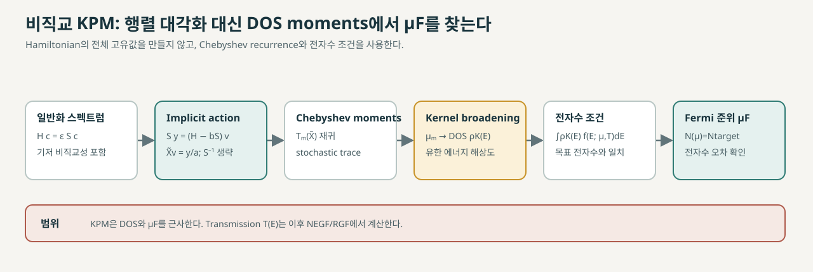
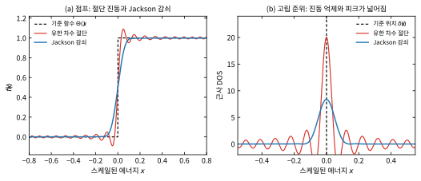

# 비직교 KPM으로 Fermi 준위 찾기

[비직교 국소 기저](../../computational-science/atomistic-simulation/localized-basis-sets.md)의 Kohn–Sham 문제는 \(H\mathbf{c}_i=E_iS\mathbf{c}_i\)로 표현한다. Kernel polynomial method (KPM)은 Chebyshev 다항식의 moments로 전체 상태밀도(density of states, DOS)를 근사하므로 모든 고유값을 직접 구하지 않아도 된다. DOS와 점유 함수를 적분해 목표 전자수를 맞추는 것은 이 근사를 Fermi 준위 탐색에 사용하는 후속 절차다. Röder 등의 원 연구는 비직교 전자구조의 DOS 계산을 보였고, HamGNN-NEGF 논문은 이를 수송 workflow에 연결한다. 다만 해당 논문의 Results와 Methods에는 KPM과 직접 대각화가 각각 보고되어 적용 범위에 설명되지 않은 차이가 있다(5절). [1, Eqs. (1)–(9); 2, §§II–III]

<figure markdown="span">

  

  <figcaption markdown="1">
  이 위키가 작성한 계산 개념도. 비직교 KPM이 연산자 moments를 계산하는 단계와 DOS 기반 Fermi 준위 탐색을 분리해 나타낸다. Transmission 계산은 RGF 단계에서 수행된다.
  </figcaption>
</figure>

## 1. 비직교 KPM의 계산 대상

\(H\)는 Hamiltonian 행렬이고 \(S\)는 overlap 행렬이다. \(S\)가 양의 정부호인 비직교 기저에서 일반화 고유값 \(E_i\)를 직접 모두 구하는 대신, KPM은 스펙트럼 전체를 다항식 계수로 요약한 뒤 DOS를 복원한다. KPM은 개별 고유값과 고유벡터를 모두 출력하는 고유값 solver가 아니다. 따라서 특정 고유상태의 에너지나 파동함수가 필요하면 별도의 방법을 써야 한다. [1, Eq. (1); 3, §§II–III]

KPM에서 얻는 DOS와 \(\mu_F\)는 주어진 Hamiltonian, overlap, 점유 규약 및 목표 전자수에 해당한다. 이 방법 자체가 transmission이나 수송 전류를 계산하지는 않는다. HamGNN-NEGF workflow에서는 KPM으로 \(\mu_F\)를 정한 뒤 [RGF](hamiltonian-block-stitching.md)로 transmission을 계산한다. [2, §II]

## 2. 일반화 고유값 문제의 KPM 연산자 표현

비직교 기저의 Kohn–Sham 문제는

\[
H\mathbf{c}_i=E_iS\mathbf{c}_i
\]

로 쓴다. 보존한 기저에서 \(S\)가 양의 정부호이면 형식적으로

\[
X\mathbf{c}_i=E_i\mathbf{c}_i,\qquad X=S^{-1}H
\]

로 바꿀 수 있다. \(X\)는 원래 일반화 고유값 문제와 같은 고유값을 갖는다. 그러나 희소한 \(S\)의 역행렬은 보통 조밀하므로, \(S^{-1}\)을 직접 만들어 저장하면 국소 희소 구조의 이점을 잃을 수 있다.

Chebyshev 재귀에는 스펙트럼을 \([-1,1]\) 안에 옮긴 연산자

\[
\widetilde X=\frac{X-bI}{a}
=\frac{S^{-1}H-bI}{a}
\]

를 쓴다. 벡터 \(\mathbf v\)에 대한 이 연산은 직접 행렬을 만들지 않고 다음 선형계로 구할 수 있다.

\[
S\mathbf y=(H-bS)\mathbf v,\qquad
\widetilde X\mathbf v=\frac{\mathbf y}{a}.
\]

즉 각 Chebyshev 반복은 \(S^{-1}H\)라는 조밀 행렬을 저장하는 과정이 아니라, sparse overlap 선형계를 풀어 필요한 연산자 작용을 구하는 과정이다. Röder 등의 논문은 스케일링 전 형태 \(S\mathbf y=H\mathbf v\)를 식 (8)로 제시하고, 이 선형계를 전처리 켤레기울기법 (preconditioned conjugate gradient, PCG)으로 푼다. [1, Eqs. (7)–(9)]

PCG는 큰 희소 양의 정부호 선형계에 대해 행렬 분해를 명시적으로 수행하지 않고 반복적으로 해를 찾는다. Röder 등은 overlap 행렬의 sparsity pattern을 따르는 불완전 안정화 Cholesky 근사 \(\widetilde S\approx S\)를 전처리기로 사용한다. 이 희소 근사 분해는 반복을 빠르게 하는 용도이고, 원래 선형계의 해를 정하는 행렬은 계속 \(S\)다. 따라서 \(S^{-1}\)을 만들지 않는다는 말은 전처리도 전혀 쓰지 않는다는 뜻이 아니다. 논문은 동일한 전처리기를 재사용하며, 비직교 문제의 반복 비용이 기본 KPM보다 커진다고 보고한다. [1, pp. 15383–15384, Eqs. (8)–(9)]

\(S^{-1}H\)는 일반적으로 보통의 유클리드 내적에서 Hermitian이 아니다. 다만 \(S\)가 양의 정부호이면 \(S^{-1}H\)는 Hermitian 연산자 \(S^{-1/2}HS^{-1/2}\)와 유사하므로 고유값은 같다. 이 유사성만으로 유한 정밀도 계산의 안정성이 보장되지는 않는다. Röder 등은 overlap이 stiff하고 moment 수가 클 때 반복적인 \(S^{-1}H\) 작용이 수치적으로 비-Hermitian해질 수 있다고 경고하며, 대안으로 \(S^{-1/2}HS^{-1/2}\)를 제시한다. 구현에서는 PCG 잔차와 Chebyshev 재귀의 수치 오차를 별도로 살펴야 한다. [1, pp. 15384–15385]

## 3. Chebyshev moments와 DOS 복원

먼저 스펙트럼 구간 \([E_{\min},E_{\max}]\)을 \([-1,1]\) 안에 넣는다. 스펙트럼 경계에 여유 \(\varepsilon>0\)를 두는 한 가지 정의는

\[
b=\frac{E_{\max}+E_{\min}}{2},\qquad
a=\frac{E_{\max}-E_{\min}}{2-\varepsilon},\qquad
x=\frac{E-b}{a},\qquad
\widetilde X=\frac{X-bI}{a}.
\]

이다. 추정된 고유값이 정확히 \(\pm1\)에 닿거나 범위를 벗어나지 않도록 여유를 둔다. Chebyshev 다항식은 \(T_0(x)=1\), \(T_1(x)=x\), \(T_{m+1}(x)=2xT_m(x)-T_{m-1}(x)\)로 재귀 정의된다. 실제 스펙트럼 바깥에서는 이 다항식이 빠르게 커질 수 있어, 전체 스펙트럼을 포함하는 경계 추정이 수치 안정성에 중요하다. [1, Eqs. (2), (6); 3, Eqs. (10), (24)–(27)]

### (1) DOS moments의 정의와 의미

스케일된 연산자 \(\widetilde X\)의 고유값을 \(x_i=(E_i-b)/a\), 기저 공간의 차원을 \(D\)라 하자. 전체 상태 수를 세는 DOS는

\[
\rho_x(x)=\sum_{i=1}^{D}\delta(x-x_i)
        =\operatorname{Tr}[\delta(xI-\widetilde X)]
\]

로 쓸 수 있다. \(m\)차 Chebyshev moment는

\[
\mu_m=\int_{-1}^{1}\rho_x(x)T_m(x)\,dx
    =\operatorname{Tr}[T_m(\widetilde X)]
    =\sum_{i=1}^{D}T_m(x_i)
\]

이다. 하나의 moment가 특정 고유값 하나를 가리키는 것은 아니다. 모든 고유값에 \(T_m\)을 적용해 더한 값, 즉 전체 스펙트럼 분포를 다항식으로 요약한 계수다. 예를 들어 \(T_0=1\), \(T_1=x\), \(T_2=2x^2-1\)이므로

\[
\mu_0=D,\qquad
\mu_1=\sum_i x_i,\qquad
\mu_2=2\sum_i x_i^2-D.
\]

여기서 쓰는 Chebyshev moments는 거듭제곱 moments \(\int x^m\rho_x(x)\,dx\)와 다르다. \(\mu_m\)는 스펙트럼을 \([-1,1]\)에 놓고 Chebyshev 다항식으로 투영한 계수다. 전체 DOS는 \(\int_{-1}^{1}\rho_x(x)\,dx=D\)로 정규화되어 있다. 원자당·기저함수당·상태당 DOS를 원하면 적절한 정규화 인자로 나눈다. 스핀 축퇴도나 \(k\)-점 가중치를 포함하는 정의도 moment 계산과 전자수 적분에서 일관되게 적용해야 한다. 물리 에너지 단위의 DOS는 \(E=ax+b\)에 따라

\[
\rho_E(E)=\frac{1}{a}\rho_x\!\left(\frac{E-b}{a}\right)
\]

로 변환한다. \(\rho_x\)는 스케일된 에너지 단위당 상태 수이고, \(\rho_E\)는 물리 에너지 단위당 상태 수다. [1, Eqs. (2)–(3); 3, Eqs. (18)–(23), (105)–(107)]

### (2) 무작위 trace 추정과 벡터 재귀

정의대로 계산하려면 큰 행렬 \(T_m(\widetilde X)\)를 만들어 대각합을 구해야 한다. 대신 평균이 0이고 공분산이 단위행렬인 무작위 벡터 \(\mathbf r_q\)를 쓰면

\[
\mathbb E[\mathbf r_q\mathbf r_q^\dagger]=I,\qquad
\mu_m=\mathbb E\!\left[\mathbf r_q^\dagger T_m(\widetilde X)\mathbf r_q\right]
\]

이므로 \(N_{\mathrm{rand}}\)개 표본으로

\[
\widehat\mu_m=\frac{1}{N_{\mathrm{rand}}}
\sum_{q=1}^{N_{\mathrm{rand}}}
\mathbf r_q^\dagger T_m(\widetilde X)\mathbf r_q
\]

를 추정한다. 무작위 벡터는 물리적 열·구조 요동을 표본화하는 대상이 아니라 trace를 값싸게 추정하는 수치 도구다. 평균적으로 trace를 주지만 유한 표본에는 확률적 오차가 남는다. 이 오차는 moment 절단과 kernel에 따른 분해능 오차와 별개다. [1, Eq. (5); 3, Eqs. (36)–(45)]

각 표본에서는 Chebyshev 다항식 행렬을 만들지 않고 벡터만 재귀적으로 갱신한다.

\[
\mathbf v_{0,q}=\mathbf r_q,\qquad
\mathbf v_{1,q}=\widetilde X\mathbf r_q,\qquad
\mathbf v_{m,q}=2\widetilde X\mathbf v_{m-1,q}-\mathbf v_{m-2,q},\qquad
\widehat\mu_m=\frac{1}{N_{\mathrm{rand}}}\sum_q\mathbf r_q^\dagger\mathbf v_{m,q}.
\]

재귀 벡터 두 개를 유지하며 sparse 행렬–벡터 작용을 반복하므로 \(T_m(\widetilde X)\) 전체를 저장할 필요가 없다. 비직교 기저에서는 매번의 \(\widetilde X\mathbf v\) 적용에 앞 절의 PCG overlap 선형계 풀이가 추가된다. [1, Eqs. (5)–(8); 3, Eqs. (28)–(45)]

### (3) 유한 차수 절단과 Gibbs 진동

moment를 \(N\)개만 계산하면 재구성 급수도 유한 차수에서 끊긴다. DOS에 급격한 불연속이나 매우 좁은 피크가 있을 때 단순 절단은 경계 주변에 진동과 overshoot/undershoot를 만든다. 이를 유한 차수 Chebyshev 근사의 Gibbs 진동이라 한다. [1, Eq. (4); 3, §II.C, Eq. (46)]

Jackson kernel은 moment에 차수별 계수 \(g_m^{(J)}\)를 곱해 고차 성분을 감쇠한다. moment 개수를 \(N\)이라 하고 \(m=0,\ldots,N-1\)로 세면

\[
g_m^{(J)}=
\frac{(N-m+1)\cos\!\left(\frac{\pi m}{N+1}\right)
+\sin\!\left(\frac{\pi m}{N+1}\right)\cot\!\left(\frac{\pi}{N+1}\right)}
{N+1}.
\]

따라서 스케일된 에너지에서 DOS 근사는

\[
\rho_{x,K}(x)\approx
\frac{g_0\mu_0+2\sum_{m=1}^{N-1}g_m\mu_mT_m(x)}
{\pi\sqrt{1-x^2}},\qquad -1<x<1.
\]

여기서 \(g_m=1\)이면 kernel을 적용하지 않은 단순 절단 급수다. Jackson 계수를 적용하면 불연속 주변의 잔물결이 줄어드는 대신 날카로운 계단과 delta 피크가 유한 폭으로 퍼진다. 중앙 \(x=0\)의 고립 delta 피크에 대한 Jackson broadening 표준편차는 큰 \(N\)에서 대략 \(\pi/N\)이며, 에너지 단위로는 \(a\pi/N\) 규모다. 분해능은 스펙트럼 위치와 kernel에도 의존하므로 이 값을 전체 구간에 동일하게 적용하지 않는다. [3, Eqs. (47), (67), (72)–(76), Fig. 1]

<figure markdown="span">

  

  <figcaption markdown="1">
  **그림 1.** 이 위키가 점프 함수와 \(x=0\)의 delta 피크를 직접 계산해 그린 수학적 예시다. 왼쪽은 유한 64개 moment의 단순 절단에서 나타나는 Gibbs 진동, 오른쪽은 Jackson 감쇠로 진동이 줄고 피크가 넓어지는 효과를 보여준다. 물질 데이터가 아니며, 원리와 kernel은 Weiße et al. [3, §II.C, Fig. 1]을 따른다.
  </figcaption>
</figure>

그림은 점프 함수와 delta 피크에 대해 유한 차수의 단순 절단과 Jackson 감쇠를 비교한다. 감쇠를 적용하면 불연속 주변의 진동이 줄어드는 대신 피크가 넓어진다. 이는 특정 물질의 DOS가 아니라 Chebyshev 근사의 수학적 예시다. [3, §II.C, Fig. 1]

물리 에너지 단위의 근사 DOS는 \(\rho_{E,K}(E)=\rho_{x,K}((E-b)/a)/a\)로 변환한다. broaden된 피크의 폭은 입력 DOS의 실제 선폭과 같지 않다. 따라서 Fermi 준위도 \(N_{\mathrm{mom}}\)과 kernel을 바꿨을 때 안정한지 확인해야 한다. [3, Eqs. (72)–(76)]

## 4. 전자수 적분과 Fermi 준위

근사 DOS를 점유 함수 \(f(E;\mu,T)\)와 적분해 전자수를 계산한다.

\[
N(\mu,T)=\int \rho_{E,K}(E)f(E;\mu,T)\,dE.
\]

목표 전자수 \(N_{\mathrm{target}}\)에 대해 \(N(\mu_F,T)=N_{\mathrm{target}}\)이 되도록 \(\mu_F\)를 찾는다. \(T=0\)에서는 \(f(E;\mu,0)=\Theta(\mu-E)\)라서 \(\mu\) 아래 DOS의 적분값이 전자수를 정한다. 유한 온도에서는 Fermi–Dirac 점유를 사용한다. 실제 계산에서는 DOS와 목표 전자수의 spin 축퇴도 및 \(k\)-점 가중치 규약이 일치해야 한다. [1, p. 15384; 2, §II]

kernel로 broaden된 DOS에서 얻은 \(\mu_F\)는 moment 수, kernel, 무작위 벡터 수에 민감할 수 있다. HamGNN 논문은 \(2\times2\times5\) Si 구조에서 \(N_{\mathrm{mom}}\)과 \(N_{\mathrm{rand}}\)를 수렴시킨 뒤 meV 수준의 Fermi 준위 정확도를 보고한다. 이는 해당 구조와 설정에 관한 결과다. [2, Results, Fig. 3, and Supplementary Table 1]

## 5. HamGNN-NEGF에서 맡는 역할과 보고 범위

논문이 제시하는 계산 경로에서는 장치 Hamiltonian과 overlap \(H_C,S_C\)로 비직교 KPM을 수행해 \(\mu_F\)를 정한 뒤 전극 self-energy와 RGF로 transmission을 계산한다. 논문은 KPM DOS 계산에 에너지 의존 전극 self-energy를 포함하는지 명확히 설명하지 않는다. 따라서 이를 열린 계 DOS라고 단정할 근거는 부족하다. [2, §II, Fig. 1]

Results 절은 \(2\times2\times5\) Si 사례에서 KPM 수렴을 확인하고 KPM으로 얻은 Fermi 준위를 이후 NEGF 계산에 사용했다고 적는다. 반면 Methods p. 12는 benchmark systems의 Fermi 준위를 일반화 고유값 문제의 직접 대각화로 얻었다고 적는다. 프리프린트는 두 진술의 적용 범위 관계를 설명하지 않는다. 따라서 두 기술을 모두 원문 보고로 기록하고 모든 transmission benchmark에서 사용한 절차를 하나로 단정하지 않는다. [2, Results, Fig. 3 and Supplementary Table 1; Methods, p. 12]

## 6. 수렴과 스케일링에서 확인할 항목

- \(N_{\mathrm{mom}}\): 급수 절단 오차와 kernel 분해능을 정한다. 관심 피크·band edge·점유 경계가 안정해지는지 확인한다.
- \(N_{\mathrm{rand}}\): stochastic trace 추정 오차에 영향을 준다. moment 수에 따른 변화와 분리해 DOS와 \(\mu_F\)를 비교한다.
- 스펙트럼 경계와 여유 \(\varepsilon\): 전체 스펙트럼이 rescaled 구간 안에 들도록 잡는다. 경계를 벗어난 고유값은 Chebyshev 재귀를 불안정하게 만들 수 있다.
- PCG 수렴: overlap 선형계 잔차와 전처리 효과를 확인한다. 이 오차는 moment 절단·확률적 trace 오차와 별개다.
- 비직교 수치 안정성: overlap 조건이 나쁘거나 moment 차수가 클 때 재귀 안정성과 대칭성 오차를 확인한다.
- 최종 기준: \(\mu_F\) 변화만 보지 말고 전자수 잔차와 관심 에너지 구간의 DOS도 확인한다. 작은 계에서는 같은 \(H,S\), 에너지 구간, 점유·축퇴 규약으로 일반화 고유값 직접 대각화 결과와 비교할 수 있다.

HamGNN 논문은 희소 행렬에서 KPM 비용을 \(O(N_{\mathrm{mom}}N_{\mathrm{rand}}N)\)으로 제시한다. 이 식은 희소 행렬–벡터 연산의 선형 비용과 고정된 moment 및 random-vector 수를 전제로 한 추정이다. 비직교 KPM에서는 각 moment마다 overlap 선형계 풀이가 추가되어 PCG 반복 수와 전처리 효율이 실제 비용을 좌우한다. 따라서 선형 스케일링은 희소성, 국소 결합, moment·random-vector 수와 선형계 수렴 설정을 고정하는 조건에서 해석한다. [1, pp. 15383–15385; 2, §II; 3, §II.B]

## 7. 함께 보기

- [DFTH-NEGF: 고정 DFT Hamiltonian으로 계산하는 수송](dfth-negf.md)
- [HamGNN-NEGF](hamgnn-negf.md)
- [NEGF와 전극 self-energy](negf.md)
- [긴 채널 Hamiltonian 확장과 수송](long-channel-transport.md)

## 8. 참고 자료

1. H. Röder, R. N. Silver, D. A. Drabold, and J. J. Dong, “Kernel polynomial method for a nonorthogonal electronic-structure calculation of amorphous diamond,” *Physical Review B* **55**, 15382–15385 (1997), [DOI](https://doi.org/10.1103/PhysRevB.55.15382), [author PDF](https://people.ohio.edu/drabold/pubs/45.pdf), Eqs. (1)–(9).
2. B. Liu et al., “Linear-Scaling Quantum Transport from Machine-Learning Density Functional Theory Hamiltonians,” arXiv:2609.37058v1 (2026), [Abstract](https://arxiv.org/abs/2609.37058), [PDF](https://arxiv.org/pdf/2609.37058v1), §§II–III, Methods, p. 12.
3. A. Weiße, G. Wellein, A. Alvermann, and H. Fehske, “The kernel polynomial method,” *Reviews of Modern Physics* **78**, 275–306 (2006), [DOI](https://doi.org/10.1103/RevModPhys.78.275), §§II.A–II.C and §III.A.
