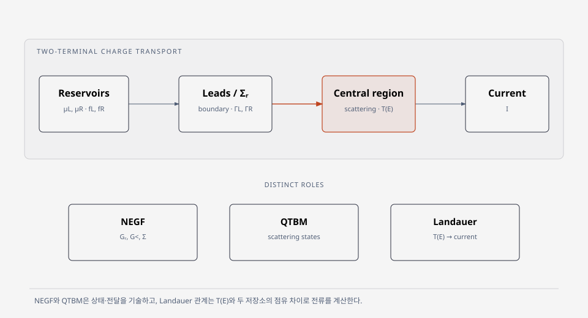

# 전자 수송의 열린 경계와 계산 접근

열린 전자 수송 문제는 전극이 상태를 공급하고 소자 안에서 전파·산란된 전자가 다시 전극으로 나가는 과정을 다룬다. 비평형 Green 함수 (non-equilibrium Green's function, NEGF)는 열린 계의 상태와 점유를 계산한다. 양자 전달 경계 방법 (quantum transmitting boundary method, QTBM)은 지정한 전극 모드에서 출발하는 산란 상태를 구한다. Landauer 관계는 에너지별 transmission과 두 전극의 점유 차이로 전류를 계산한다. 여기서는 독립 전자의 두 단자 정상상태 탄성·결맞음 수송을 기본형으로 둔다. [1, §II; 2, §II; 3; 4, §1.1; 5, §2.4; 6, Appendix D, pp. 784–785]

<figure markdown="span">

  

  <figcaption markdown="1">
  이 위키가 작성한 두 단자 charge-transport 개념도. NEGF와 QTBM의 수송 기술, Landauer 전류 관계의 역할을 나눠 표시했다. 원 논문의 그림을 복제하지 않았다.
  </figcaption>
</figure>

## 1. 문서 간 관계

[NEGF 문서](negf.md)는 열린 전극이 상태와 점유에 미치는 영향을 Green 함수로 다룬다. [QTBM 문서](scattering-qtbm.md)는 입사 전극 모드에 해당하는 산란 상태와 경계 조건을 설명한다. [Landauer 수송 문서](landauer-transmission.md)는 전극 점유 차이와 에너지별 transmission을 전류로 연결한다. 세 방법이 한 계산에서 항상 순서대로 적용되는 것은 아니다. 각 방법은 열린 경계, 파동함수 산란, 전류 관계라는 서로 다른 관점을 설명한다. [1–5]

## 2. 열린 경계에서 무엇을 계산하는가

중심영역의 고립 Hamiltonian만 대각화하면 그 영역을 통과하는 입사·출사 경계와 전극의 점유는 정해지지 않는다. 열린 수송에서는 전극의 반무한 반복 구조와 소자–전극 결합을 함께 기술한다. NEGF에서는 이를 에너지 의존 전극 self-energy로 축약하며, 각 reservoir의 Fermi 함수가 공급되는 상태의 점유를 정한다. 전극 결합과 reservoir 점유는 서로 다른 입력이다. [1, §II; 2, §II]

두 전극의 화학 퍼텐셜이 다르면 입사 상태의 점유가 달라져, 전송 가능한 상태가 있는 에너지에서 순전류에 기여할 수 있다. 탄성·결맞음 단일입자 기준에서는 \(T(E)\)와 그 점유 차이의 적분이 전류를 정한다. 두 전극의 화학 퍼텐셜과 온도가 모두 같으면 각 방향의 입자 흐름이 존재하더라도 순전류는 0이다. 관련 식과 열적 가중은 [Landauer 전송](landauer-transmission.md)에서 확인할 수 있다. [4, §1.1; 5, §2.4]

| 질문 | 먼저 볼 문서 | 구하는 양과 가정 |
|---|---|---|
| 전극·전하·전류를 어떻게 연결하는가? | [NEGF](negf.md) | self-energy, Green 함수, density matrix와 단자 전류 |
| 입사파가 어떻게 반사·투과하는가? | [QTBM](scattering-qtbm.md) | 에너지와 입사 모드별 파동함수 및 flux |
| 전송계수에서 선형 응답 전도도는? | [Landauer 수송](landauer-transmission.md) | Fermi 점유 차이의 에너지 적분 |
| 산란·전위가 바뀌는 장치를 어떻게 다루는가? | [SCBA](scba-convergence.md), [장채널 수송](long-channel-transport.md) | 추가 산란 모델 또는 전위·전하의 자기일관 조건 |

위 기준에서 빠진 전자–포논 산란을 넣으려면 결합 모델과 산란 self-energy 또는 다른 명시적인 산란 방정식이 필요하다. 에너지별 탄성 transmission만 제시한 계산에 비탄성 재분포가 자동으로 들어간다고 볼 수 없다. [1, §II; 5, §2.4]

## 3. 참고 자료

1. N. Papior et al., “Improvements on non-equilibrium and transport Green function techniques: the next-generation TranSIESTA,” *Computer Physics Communications* **212**, 8–24 (2017), [§II](https://arxiv.org/abs/1607.04464).
2. M. Brandbyge et al., “Density-functional method for nonequilibrium electron transport,” *Physical Review B* **65**, 165401 (2002), [§II](https://arxiv.org/abs/cond-mat/0110650).
3. C. S. Lent and D. J. Kirkner, “The quantum transmitting boundary method,” *Journal of Applied Physics* **67**, 6353–6359 (1990), [DOI](https://doi.org/10.1063/1.345156).
4. L. Bruneau et al., “Landauer-Büttiker and Thouless conductance,” *Journal of Mathematical Physics* **55**, 075204 (2014), [§1.1](https://arxiv.org/abs/1408.0185).
5. S. Kohler, J. Lehmann, and P. Hänggi, “Driven quantum transport on the nanoscale,” *Physics Reports* **406**, 379–443 (2005), [§2.4](https://arxiv.org/abs/cond-mat/0409251).
6. W. R. Frensley, “Boundary conditions for open quantum systems driven far from equilibrium,” *Reviews of Modern Physics* **62**, 745–791 (1990), [Appendix D, pp. 784–785](https://personal.utdallas.edu/~frensley/technical/FrensleyRMP1990.pdf), [DOI](https://doi.org/10.1103/RevModPhys.62.745).
