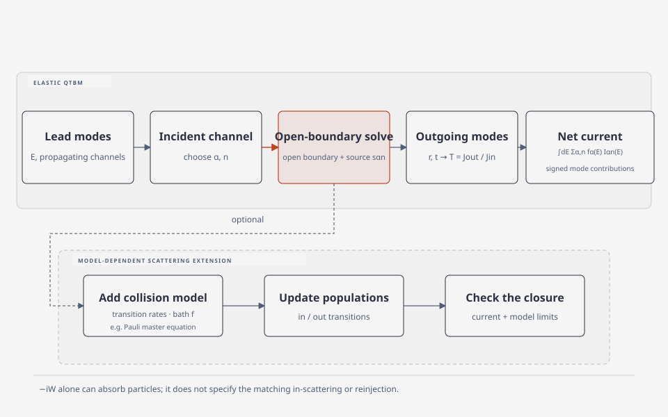

# Scattering QTBM method

quantum transmitting boundary method (QTBM)은 열린 전극에 연결된 유한한 소자 영역에서, 에너지와 입사 전극·모드를 정해 정상상태 Schrödinger 방정식을 푸는 방법이다. 먼저 탄성 산란 상태와 전류를 정의한 뒤, phonon이나 roughness처럼 추가 산란을 넣을 때 어떤 별도 모형이 필요한지 설명한다. 기본 QTBM 풀이만으로 reservoir의 점유나 비탄성 재분포가 정해지지는 않는다. [1, 초록; 2, Appendix D; 3, §3.5.4]

## 1. QTBM이 푸는 산란 문제

두 반무한 lead 사이에 유한한 central region을 둔다. 에너지 \(E\)를 고정하고 왼쪽 lead의 전파 모드 \(n\)으로 입사하는 상태를 구하면, 왼쪽 먼 영역에는 입사파와 반사파가 있고 오른쪽 먼 영역에는 진행 방향의 투과파가 남는다. 모드 표기를 쓰면

\[
\psi_L=\chi_{Ln}^{+}+\sum_m r_{mn}\chi_{Lm}^{-},
\qquad
\psi_R=\sum_m t_{mn}\chi_{Rm}^{+}.
\]

여기서 \(\chi_{\alpha m}^{+}\), \(\chi_{\alpha m}^{-}\)는 lead \(\alpha\)에서 각각 소자로 들어가는 모드와 소자에서 나가는 모드이며, \(r_{mn}\), \(t_{mn}\)은 반사·투과 진폭이다. 실제 계산은 transverse subband 또는 복수 orbital이 있어 여러 propagating mode를 갖는 lead에도 확장할 수 있다. Mode matching에서는 evanescent mode도 경계조건을 맞추는 데 필요할 수 있다. 이 모드는 먼 lead의 독립적인 flux-normalized incoming/outgoing channel은 아니지만, 그 꼬리가 소자 내부를 가로지를 만큼 소자가 짧으면 transmission에 영향을 줄 수 있다. [2, Appendix D, 식 (D1)–(D6); 3, §3.5.4, 식 (3.92)–(3.99); 4, §II; 13, §III.A–B, 식 (4)–(17); 14, §II.A, §III.A]

## 2. 열린 경계조건과 선형 방정식

계산 영역을 단순히 자르고 wavefunction을 0으로 두면 lead로 나가야 할 파가 경계에서 반사된다. QTBM은 lead의 분산관계와 진행 방향을 경계조건에 넣어, 계산 영역 바깥의 입사·반사·투과 파를 유한 영역 안의 해와 연결한다. 경계 조건은 에너지에 의존한다. [2, Appendix D, 식 (D3)–(D6); 3, §3.5.4, 식 (3.93)–(3.99)]

1차원 단일 모드 lead에서 Frensley의 연속 경계식은 왼쪽과 오른쪽의 입사 진폭을 각각

\[
A=\frac{1}{2}\left[\psi(0)-\frac{i}{k_0}\psi'(0)\right],
\qquad
D=\frac{1}{2}\left[\psi(L)+\frac{i}{k_L}\psi'(L)\right]
\]

로 정한다. 왼쪽에서 단위 진폭으로 입사시키는 예에서는 \(A=1\), \(D=0\)으로 놓고 정상상태 방정식과 경계식을 함께 풀어 미지 반사·투과 성분을 얻는다. 이 식은 단순한 1차원 연속 lead 예이며, 다중 모드나 이산화 방식에서는 해당 lead mode에 맞는 경계 연산자를 사용한다. [2, Appendix D, 식 (D1)–(D6); 3, §3.5.4]

여기서 \(k_0\), \(k_L\)은 각각 왼쪽·오른쪽 lead의 longitudinal wave number이고, \(L\)은 오른쪽 경계의 좌표다.

비직교 기저에서는 lead-device 결합에도 overlap이 들어간다. 예를 들어 결합 행렬은 \(\tau_{C\alpha}(z)=H_{C\alpha}-zS_{C\alpha}\)처럼 쓰므로, Hamiltonian 결합만 남기면 같은 열린 계가 아니다. 이산 비직교 기저에서 열린 경계 연산자를 정리하면 다음과 같은 구조를 얻는다. 다만 QTBM 구현마다 이산화와 주입 source의 표현은 다를 수 있다. [6, §VI.C–D; 11, §II, 식 (1)–(4)]

\[
\left[zS_C-H_C-\Sigma_L^r(E)-\Sigma_R^r(E)\right]
\psi_{\alpha n}(E)=s_{\alpha n}(E),
\qquad z=E+i0^+.
\]

\(H_C\)와 \(S_C\)는 central region의 Hamiltonian과 overlap 행렬이고, \(\Sigma_\alpha^r\)는 반무한 lead의 outgoing-wave 경계 효과를 나타낸다. 우변 \(s_{\alpha n}\)은 지정한 입사 모드의 주입을 나타내지만, 그 구체적인 행렬 형태와 부호는 기저·경계 이산화·진폭 정규화 convention에 따라 달라진다. 따라서 위 식은 공통 구조를 표시한 것이며 모든 QTBM 코드에 동일한 우변을 강제하는 식은 아니다. [3, §3.5.4, 식 (3.92)–(3.99); 4, §II, 식 (2)]

## 3. 산란 상태에서 transmission과 전류로

한 입사 모드의 transmission은 해당 입사 flux에 대한 출사 flux의 비로 정의한다.

\[
T_{\beta m\leftarrow\alpha n}(E)
=\frac{J^{\mathrm{out}}_{\beta m}(E)}
{J^{\mathrm{in}}_{\alpha n}(E)}.
\]

따라서 일반적으로 wavefunction 계수의 절댓값 제곱만으로 transmission을 얻을 수는 없다. 입사·출사 모드가 unit-flux로 정규화되어 있으면 \(T=|t|^2\)지만, 동일한 wavefunction-amplitude 정규화를 사용했다면 각 lead의 group velocity와 mode flux를 반영해야 한다. 여러 모드의 transmission을 합하면 에너지별 total transmission을 얻는다. [3, §3.5, 식 (3.55)–(3.56); 4, §II; 13, §III.B, 식 (16)–(17); 14, §II.A]

QTBM은 입사 모드 하나에 대한 산란 상태를 계산한다. reservoir가 실제로 채우는 정도는 \(f_\alpha(E)\)로 따로 정한다. 두 단자 순전류는 정한 양의 방향에 따라 좌·우 reservoir 입사 상태의 기여를 부호를 붙여 합산하므로, 점유를 곱한 mode 전류를 단순한 양의 flux 합처럼 다루면 안 된다. 탄성·결맞음 한계에서 이 합은 Landauer 식의 \(f_L-f_R\)로 나타난다. 같은 조건의 전류 적분은 [Landauer transport and transmission](landauer-transmission.md)에서 다룬다. QTBM의 경계조건 자체가 Fermi 점유, 전자-phonon collision 또는 carrier population update를 대신하지 않는다. [2, Appendix D; 3, §3.5.4; 5, 초록; 9, §1.1, 식 (1.2), (1.6); 10, §2.4, 식 (16)–(18)]

## 4. NEGF와의 연결

같은 \(H_C,S_C\)와 lead boundary를 쓰는 탄성 정상상태 문제에서는 QTBM의 입사 모드별 산란 상태와 NEGF의 retarded open-boundary 연산자가 같은 열린 경계 문제를 표현한다. Gehring은 scattering이 없는 경우 QTBM의 계수 행렬이 retarded Green function의 역행렬과 같음을 보인다. 차이는 계산의 주된 대상에 있다. QTBM은 지정한 입사 모드의 wavefunction을 직접 풀고, NEGF는 전극 결합을 포함한 \(G^r\), 점유를 반영하는 \(G^<\), 전하와 전류를 계산한다. 두 표현의 이 관계는 비탄성 산란을 자동 포함한다는 뜻은 아니다. [2, Appendix D; 3, §3.5.4, 식 (3.99); 6, §VI.C–D]

## 5. 별도 산란 모형을 결합하는 경우

산란을 추가하려면 QTBM 경계조건 외에 전이율이나 self-energy, in-scattering과 out-scattering, 그리고 점유를 닫는 방정식이 필요하다. 한 구체적 사례에서는 ballistic QTBM으로 open boundary를 처리하고 Pauli master equation으로 전자-phonon 및 surface-roughness 산란을 계산한다. 이는 가능한 결합 방식 하나이며 scattering QTBM 전체를 정의하는 유일한 closure는 아니다. [5, 초록; 12, §7.4]

허수 흡수 퍼텐셜 \(-iW\)는 선택한 상태의 out-scattering 또는 loss를 표현할 수 있지만, 대응하는 in-scattering과 reservoir·phonon bath의 점유를 스스로 정하지 않는다. 따라서 loss 항만 추가한 계산을 보존적인 비탄성 산란 모형으로 간주할 수 없다. in/out 항의 관계와 점유 갱신을 같은 모형 안에서 명시해야 한다. [7, §7.2.6.1, 식 (7.22)–(7.25); 8, §4.5]

<figure markdown="span">

  

  <figcaption markdown="1">
  이 위키가 새로 그린 계산 흐름도. 에너지별 입사 lead mode의 산란 문제를 푼 뒤 reservoir 점유와 부호를 반영해 전류를 적분한다. 산란 전이율을 추가하는 확장은 모델 의존적이며 기본 QTBM과 구분한다.
  </figcaption>
</figure>

## 6. 계산을 검토할 때

- 어떤 lead, 에너지, 입사 모드를 선택했는지와 모드의 normalization을 기록한다.
- propagating mode의 incoming·outgoing flux로 transmission을 계산한다. evanescent mode가 mode matching에 포함되는지, device 길이에 따라 transmission에 미치는 영향이 중요한지 점검한다.
- 여러 입사 상태를 reservoir occupation \(f_\alpha(E)\)로 가중할 때 spin, subband, 횡방향 \(k\)-점의 합산 규약을 기록한다.
- 산란 확장을 썼다면 전이율 또는 self-energy, in/out-scattering, population update, mixing·수렴 기준과 terminal current balance를 명시한다.
- current conservation은 수치·closure 검사의 일부다. 산란 모형의 타당성이나 device model의 물리적 정확성을 대신하지 않는다.

## 7. 참고 문헌

1. C. S. Lent, D. J. Kirkner, “The quantum transmitting boundary method,” *Journal of Applied Physics* **67**, 6353–6359 (1990), https://doi.org/10.1063/1.345156.
2. W. R. Frensley, “Boundary conditions for open quantum systems driven far from equilibrium,” *Reviews of Modern Physics* **62**, 745–791 (1990), Appendix D, https://personal.utdallas.edu/~frensley/technical/FrensleyRMP1990.pdf.
3. A. Gehring, *Simulation of Tunneling in Semiconductor Devices* (2003), §3.5.4, https://repositum.tuwien.at/bitstream/20.500.12708/12170/2/Gehring%20Andreas%20-%202003%20-%20Simulation%20of%20tunneling%20in%20semiconductor%20devices.pdf.
4. Z.-a. Shao, W. Porod, C. S. Lent, D. J. Kirkner, “An eigenvalue method for open-boundary quantum transmission problems,” *Journal of Applied Physics* **78**, 2177–2186 (1995), §II, https://academicweb.nd.edu/~lent/pdf/nd/An_eigenvalue_method_for_open-boundary_quantum_transmission_problems.pdf.
5. P. B. Vyas, M. L. Van de Put, M. V. Fischetti, “Master-Equation Study of Quantum Transport in Realistic Semiconductor Devices Including Electron-Phonon and Surface-Roughness Scattering,” *Physical Review Applied* **13**, 014067 (2020), https://doi.org/10.1103/PhysRevApplied.13.014067.
6. R. K. Lake, R. R. Pandey, “Non-Equilibrium Green Functions in Electronic Device Modeling” (2006), §VI.C–D, https://arxiv.org/pdf/cond-mat/0607219.
7. R. Kosik, *Numerical Challenges on the Road to NanoTCAD* (2004), §§7.2.6.1–2, https://www.iue.tuwien.ac.at/phd/kosik/node96.html.
8. F. O. Heinz, *Simulation Approaches for Nano-Scale Semiconductor Devices* (2004), §4.5, https://iis-people.ee.ethz.ch/~schenk/theses/heinz.pdf.
9. L. Bruneau, V. Jakšić, Y. Last, C.-A. Pillet, “Landauer-Büttiker and Thouless conductance,” *Journal of Mathematical Physics* **55**, 075204 (2014), §1.1, 식 (1.2), (1.6), https://arxiv.org/html/1408.0185.
10. S. Kohler, J. Lehmann, P. Hänggi, “Driven quantum transport on the nanoscale,” *Physics Reports* **406**, 379–443 (2005), §2.4, 식 (16)–(18), https://arxiv.org/pdf/cond-mat/0409251.
11. N. Papior, N. Lorente, T. Frederiksen, A. García, M. Brandbyge, “Improvements on non-equilibrium and transport Green function techniques: the next-generation transiesta,” *Computer Physics Communications* **212**, 8–24 (2017), §II, 식 (1)–(4), https://arxiv.org/pdf/1607.04464.
12. J. Weinbub and R. Kosik, “Computational perspective on recent advances in quantum electronics: from electron quantum optics to nanoelectronic devices and systems,” *Journal of Physics: Condensed Matter* **34**, 163001 (2022), §7.4, https://doi.org/10.1088/1361-648X/ac49c6.

13. P. A. Khomyakov, G. Brocks, V. Karpan, M. Zwierzycki, and P. J. Kelly, “Conductance calculations for quantum wires and interfaces: mode matching and Green functions,” *Physical Review B* **72**, 035450 (2005), §§III.A–B, https://arxiv.org/pdf/cond-mat/0501609.
14. H. H. B. Sørensen, P. C. Hansen, D. E. Petersen, S. Skelboe, and K. Stokbro, “Efficient wave function matching approach for quantum transport calculations,” (2009), §II.A, §III.A, https://arxiv.org/pdf/0804.4306.
