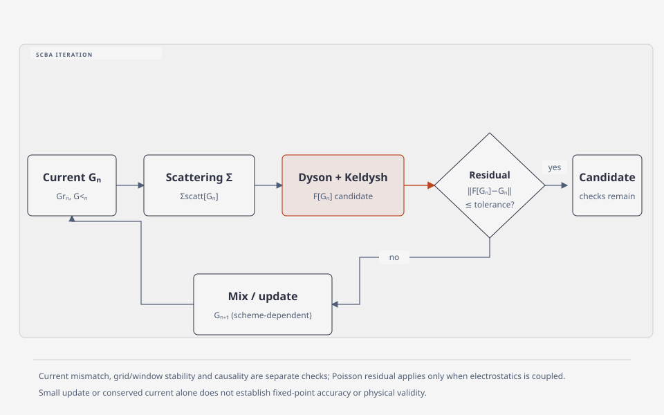

# SCBA convergence

## 1. SCBA가 푸는 고정점

self-consistent Born approximation (SCBA)은 scattering self-energy를 이전 Green function으로 계산하고 Dyson–Keldysh 식을 다시 푸는 고정점 문제다. 여기서 Born은 선택한 상호작용의 섭동 self-energy 근사를, self-consistent는 갱신된 Green function으로 self-energy를 다시 계산해 고정점을 찾는 절차를 가리킨다. 포함할 상호작용, bath와 diagram은 별도 산란 모형이 정한다. [Bescond et al., §II, 식 (1)–(2); Lee–Sanvito, 초록; Mera et al., §I–II] \(g\)를 고립 central region의 Green function으로 정의하면, 개략적으로

\[
G_{n}^{r}(E)=\left[g^{-1}(E)-\Sigma_{\mathrm{contacts}}^{r}(E)-\Sigma_{\mathrm{scatt}}^{r}[G_{n-1}](E)\right]^{-1}
\]

처럼 쓸 수 있으며, lesser component도 같은 self-energy functional과 함께 갱신한다. phonon scattering을 포함한 NEGF 전개에서 이 반복과 electrostatic self-consistency를 구분한 예가 제시되어 있다. [Bescond et al., §II, 식 (1)–(2)](https://in4.iue.tuwien.ac.at/pdfs/sispad2013/21-3.pdf), [Mera–Pedersen–Nikolić, §V.1–2, 식 (21), (25)–(28)](https://arxiv.org/html/1512.06846)

<figure markdown="span">

  

  <figcaption markdown="1">
  이 위키의 고정점 흐름도. Green 함수에서 산란 self-energy를 만들고 이를 다시 사용해 Green 함수를 갱신한다. 반복 잔차, 전류 보존, 격자·에너지 수렴과 인과성은 별도로 확인한다.
  </figcaption>
</figure>

### (1) 전자–포논 산란과 에너지 연결

한 포논을 흡수하거나 방출하는 산란에서는 전자 에너지가 \(\hbar\omega_\nu\)만큼 달라진다. 따라서 조화 평형 포논 bath의 전자–포논 SCBA self-energy는 같은 에너지의 \(G(E)\)만이 아니라 \(G(E\pm\hbar\omega_\nu)\)도 결합한다. 계수에는 포논 점유와 electron–phonon 행렬원소가 들어가며, lesser/greater 및 retarded 성분의 정확한 부호·계수는 Green 함수와 Fourier 변환 규약에 맞춰야 한다. [Lee–Sanvito, §II.B, Eqs. (15)–(18)](https://arxiv.org/pdf/0804.3389), [Bescond et al., §II](https://in4.iue.tuwien.ac.at/pdfs/sispad2013/21-3.pdf)

이 때문에 관심 있는 전류 적분 창만 잘라 계산하면 창 밖에서 산란해 들어오는 상태를 누락할 수 있다. bath 온도, 포논 에너지, energy window와 간격을 함께 수렴시켜야 한다. 결합 행렬원소의 물리적 정의와 흡수·방출 전이는 [전자–포논 결합](../electron-phonon-coupling/electron-phonon-coupling.md), 평형 전자 self-energy의 해석은 [전자 self-energy](../electron-phonon-coupling/electron-phonon-self-energy.md)에서 설명한다.

### (2) 열린 경계의 점유 갱신

정상상태의 통상적인 Keldysh 구성에서는

\[
G^<(E)=G^r(E)\,\bigl[\Sigma_L^<(E)+\Sigma_R^<(E)+\Sigma_{\rm scatt}^<(E)\bigr]G^a(E)
\]

와 같이 전극과 산란의 lesser self-energy를 함께 사용한다. 이는 초기 상관이나 결합되지 않은 bound-state 기여를 별도로 다룰 필요가 없는 경우의 표현이다. \(G^r\)만 갱신하고 산란의 점유 성분을 빠뜨리면 같은 SCBA 고정점 문제가 아니다. lead의 역할과 기본 정의는 [NEGF](negf.md)를 참고한다. [Bescond et al., §II](https://in4.iue.tuwien.ac.at/pdfs/sispad2013/21-3.pdf), [Mera et al., §V.1](https://arxiv.org/html/1512.06846)

## 2. 수치 수렴의 최소 조건

혼합된 iterate의 변화량이 작다는 것만으로 고정점 수렴을 선언하면 안 된다. mixing coefficient가 작으면 update가 작아져도 residual \(\lVert F[G]-G\rVert\)은 남을 수 있다. 따라서 (i) retarded와 lesser Green function 또는 self-energy의 residual, (ii) charge와 Poisson loop를 포함했으면 electrostatic residual, (iii) energy grid·integration window 변화에 대한 안정성을 서로 구분해 점검한다. 초기값과 energy range가 다른 self-consistent solution으로 이어질 수 있다는 사례가 보고되어 있다. [Lee–Sanvito, §III.B, 식 (41), (44); §V, Fig. 14–15](https://arxiv.org/pdf/0804.3389), [Bescond et al., §II](https://in4.iue.tuwien.ac.at/pdfs/sispad2013/21-3.pdf)

선형 mixing을 예로 들어 갱신할 대상 \(X\)와 고정점 함수 \(F\)에 대해

\[
r_n=F(X_n)-X_n,\qquad
X_{n+1}=X_n+\alpha r_n
\]

으로 놓자. \(\alpha\)가 0.01이고 한 성분의 residual이 0.1이면 update는 0.001이다. 이 단순 예시는 작은 update가 residual 자체의 작음을 의미하지 않는 이유를 보여준다. 실제 계산에서는 대상 성분·에너지·행렬 크기에 대한 norm과 절대/상대 기준을 정의하고, 동일한 기준으로 반복을 비교한다. mixing 자체의 수렴은 산란 근사의 타당성을 입증하지 않는다. [Lee–Sanvito, §III.B; Mera et al., §V.2]

## 3. conservation과 analytic structure

정상상태 two-terminal 계산에서는 terminal current가 \(I_L=-I_R\)인지 확인해야 한다. Mera–Pedersen–Nikolić의 대칭 molecular model에서는 특정 coupling과 wide-band 조건에서 전류 일치가 iteration의 민감한 판별자가 아니었으므로, 전류 일치 하나만을 일반 convergence criterion으로 쓰면 부족하다. [Mera–Pedersen–Nikolić, §V.2, 식 (25)–(28)](https://arxiv.org/html/1512.06846), [Bescond et al., §II](https://in4.iue.tuwien.ac.at/pdfs/sispad2013/21-3.pdf) retarded self-energy의 causality, lesser/greater component의 관계와 Hilbert-transform 처리는 구현 convention 및 포함한 diagram에 맞게 별도 점검해야 하며, current conservation이 이를 대신하지 않는다. [Lee–Sanvito, §II.B, 식 (15)–(18)](https://arxiv.org/pdf/0804.3389), [Mera–Pedersen–Nikolić, §V.1](https://arxiv.org/html/1512.06846)

## 4. 수렴 판정의 해석 범위

SCBA 반복의 residual 통과는 선택한 Born diagram, phonon bath, screening, device Hamiltonian, contact model이 실제 물리를 충분히 설명한다는 증거가 아니다. 서로 다른 초기값·grid·mixing에서 같은 관측량을 얻는지는 numerical robustness 검사이지 실험적 검증이 아니다. [Lee–Sanvito, §V](https://arxiv.org/pdf/0804.3389), [Bescond et al., §II](https://in4.iue.tuwien.ac.at/pdfs/sispad2013/21-3.pdf)

## 5. 권장 기록

반복 횟수만 남기지 말고 residual norm과 norm의 정의, mixing, energy range·spacing, contact current mismatch, charge/Poisson residual, 초기값 및 중단 기준을 기록한다. 전류·전하·spectral function의 검사와 실험 또는 상위 수준 계산의 비교를 수치 수렴과 분리해 보고한다.

## 6. 참고 문헌

1. M. Bescond et al., *One-shot Current Conserving Approach of Phonon Scattering Treatment in Nano-transistors* (2013), §II, https://in4.iue.tuwien.ac.at/pdfs/sispad2013/21-3.pdf.
2. W. Lee, S. Sanvito, *Exploring the limits of the self consistent Born approximation for inelastic electronic transport* (2008), §II–V, https://arxiv.org/pdf/0804.3389.
3. H. Mera, T. G. Pedersen, B. K. Nikolić, *Hypergeometric resummation of self-consistent sunset diagrams for electron-boson quantum many-body systems out of equilibrium* (2016), §I–II, §V, https://arxiv.org/html/1512.06846.
