# DFTB model for large-scale atomistic simulation

## 1. DFTB는 어떤 근사인가

density-functional tight binding (DFTB)은 reference density 주위에서 Kohn–Sham DFT total energy를 전개하고, minimal atomic basis와 pretabulated two-center matrix element를 쓰는 전자구조 근사다. SCC-DFTB에서는 charge fluctuation의 2차 항까지 남겨 charge redistribution을 self-consistently 푼다. 따라서 DFTB는 DFT와 같은 이름의 input을 받더라도 exchange-correlation functional, basis, repulsive term, charge model을 모두 직접 계산하는 plane-wave DFT가 아니다. [Hourahine et al., §II, 식 (1)–(2)](https://doi.org/10.1063/1.5143190), [Yang et al., §II, pp. 10862–10864](https://theory.rutgers.edu/resources/pdfs/Yang_JPhysChemA_2007_v111_p10861.pdf)

## 2. 에너지 모형과 SCC

유한 비주기계의 개략적 기본 SCC-DFTB2 에너지는

\[
E_{\mathrm{DFTB}}=\sum_i f_i\langle\psi_i\lvert H^0\rvert\psi_i\rangle
+\frac12\sum_{A,B}\gamma_{AB}\Delta q_A\Delta q_B
+\sum_{A<B}V_{\mathrm{rep}}^{AB}(R_{AB})
\]

처럼 band-structure term, atomic charge fluctuation \(\Delta q_A\)의 interaction, short-range repulsive potential로 구성된다. \(H^0\), \(\gamma_{AB}\), \(V_{\mathrm{rep}}^{AB}\)는 선택한 Slater–Koster parameter set 및 그 fitting 범위와 연결된다. SCC cycle은 Mulliken charge와 Hamiltonian을 self-consistently 갱신한다. 주기계에서는 lattice image·k-point와 전하 항의 periodic boundary 처리를 포함한 구현 식을 써야 한다. [Hourahine et al., §II.A](https://doi.org/10.1063/1.5143190), [Yang et al., §II, pp. 10862–10864](https://theory.rutgers.edu/resources/pdfs/Yang_JPhysChemA_2007_v111_p10861.pdf)

이 그림은 본문의 SCC fixed-point 구조만을 설명하기 위해 새로 제작한 개념도다. \(\Delta q\)의 부호 convention, mixing parameter, tolerance 및 전자온도는 사용하는 코드·parameter set의 정의와 함께 해석해야 한다.

## 3. 대규모 계산에서 얻는 것과 잃는 것

two-center table과 minimal basis는 큰 supercell의 geometry optimization, molecular dynamics, defect·interface sampling에 쓸 수 있는 근사 모형을 제공한다. 실제 scaling은 diagonalization, SCC iteration, sparse/local-orbital solver, parallelization에 좌우된다. 따라서 원자 수가 많다는 이유만으로 자동으로 linear scaling이 되거나 특정 DFT보다 정확하다는 뜻은 아니다. sparse implementation에서도 eigenproblem과 장거리 Coulomb 항의 처리를 따로 고려해야 한다. [Hourahine et al., §II](https://doi.org/10.1063/1.5143190), [Aradi et al., abstract](https://pureportal.strath.ac.uk/en/publications/dftb-a-sparse-matrix-based-implementation-of-the-dftb-method/)

## 4. parameter transferability가 핵심 검증 대상이다

parameter file은 원소 이름만으로 정할 수 없다. 적용하려는 결합·coordination·전하 상태·defect·surface가 fitting domain 밖이면 target observable을 별도 검증해야 한다. graphene defect의 한 비교에서는 일부 구조는 DFT와 잘 맞았지만 OH-terminated edge formation energy에는 큰 차이가 남았다. 이는 한 계·parameter set·reference DFT의 사례이지 일반 오차막대가 아니다. DFTB 계산의 수치 수렴과 target observable에 대한 parameter validation을 분리해야 한다. [Hourahine et al., §II](https://doi.org/10.1063/1.5143190), [Zobelli et al., §II–IV, Table I–II](https://arxiv.org/pdf/1207.3194)

## 5. 실무 검증 순서

대규모 production 전에 같은 parameter set으로 작은 representative 구조를 만들고, reference DFT 또는 실험과 실제 사용할 관측량을 비교하는 것이 합리적이다. 그 다음 cell size, k-point, SCC tolerance, electronic temperature의 물리적 선택, MD timestep의 안정성·통계 수렴을 각각 확인한다. 비교에 실패하면 더 큰 cell이나 tighter SCC만으로 해결된다고 가정하지 말고 parameter domain과 물리 보정을 재검토한다. 이는 위 근거에 따른 권장 검증 순서이며, 자동 보증이 아니다.

## 6. 참고 문헌

1. B. Hourahine et al., *DFTB+, a software package for efficient approximate density functional theory based atomistic simulations*, J. Chem. Phys. **152**, 124101 (2020), §II, https://doi.org/10.1063/1.5143190.
2. Y. Yang et al., *Extension of the Self-Consistent-Charge Density-Functional Tight-Binding Method* (2007), §II, pp. 10862–10864, https://theory.rutgers.edu/resources/pdfs/Yang_JPhysChemA_2007_v111_p10861.pdf.
3. B. Aradi et al., *DFTB+: A sparse matrix-based implementation of the DFTB method* (2007), abstract, https://pureportal.strath.ac.uk/en/publications/dftb-a-sparse-matrix-based-implementation-of-the-dftb-method/.
4. A. Zobelli et al. (2012), §II–IV, https://arxiv.org/pdf/1207.3194.
