# DFTB model for large-scale atomistic simulation

## 1. DFTB의 근사 원리

density-functional tight binding (DFTB)은 reference density 주위에서 Kohn–Sham DFT total energy를 전개하고, minimal atomic basis와 pretabulated two-center matrix element를 쓰는 전자구조 근사다. SCC-DFTB에서는 charge fluctuation의 2차 항까지 남겨 charge redistribution을 self-consistently 푼다. 따라서 DFTB는 DFT와 같은 이름의 input을 받더라도 exchange-correlation functional, basis, repulsive term, charge model을 모두 직접 계산하는 plane-wave DFT가 아니다. [Hourahine et al., §II, 식 (1)–(2)](https://doi.org/10.1063/1.5143190), [Yang et al., §II, pp. 10862–10864](https://theory.rutgers.edu/resources/pdfs/Yang_JPhysChemA_2007_v111_p10861.pdf)

## 2. 에너지 모형과 SCC

유한 비주기계의 개략적 기본 SCC-DFTB2 에너지는

\[
E_{\mathrm{DFTB}}=\sum_i f_i\langle\psi_i\lvert H^0\rvert\psi_i\rangle
+\frac12\sum_{A,B}\gamma_{AB}\Delta q_A\Delta q_B
+\sum_{A<B}V_{\mathrm{rep}}^{AB}(R_{AB})
\]

처럼 band-structure term, atomic charge fluctuation \(\Delta q_A\)의 interaction, short-range repulsive potential로 구성된다. \(H^0\), \(\gamma_{AB}\), \(V_{\mathrm{rep}}^{AB}\)는 선택한 Slater–Koster parameter set 및 그 fitting 범위와 연결된다. SCC cycle은 Mulliken charge와 Hamiltonian을 self-consistently 갱신한다. 주기계에서는 lattice image·k-point와 전하 항의 periodic boundary 처리를 포함한 구현 식을 써야 한다. [Hourahine et al., §II.A](https://doi.org/10.1063/1.5143190), [Yang et al., §II, pp. 10862–10864](https://theory.rutgers.edu/resources/pdfs/Yang_JPhysChemA_2007_v111_p10861.pdf)

### (1) 전자 상태와 Mulliken 점유수

\(\phi_\mu\)를 원자 중심 기저로 두고 전자 상태를 \(\psi_i=\sum_\mu c_{\mu i}\phi_\mu\)로 전개한다. 이 기저는 일반적으로 비직교이므로 Hamiltonian과 overlap \(S_{\mu\nu}=\langle\phi_\mu|\phi_\nu\rangle\)을 함께 사용하여 \(Hc_i=\epsilon_iSc_i\)를 푼다. 점유수 \(f_i\)를 포함한 계수 밀도행렬과 원자 \(A\)의 전자 점유수는 분자 또는 한 \(k\)점의 표기에서

\[
P_{\mu\nu}=\sum_i f_i c_{\mu i}c_{\nu i}^{*},\qquad
q_A=\operatorname{Re}\sum_{\mu\in A,\nu}P_{\mu\nu}S_{\nu\mu},\qquad
\sum_A q_A=\operatorname{Tr}(PS)=N_e
\]

로 쓸 수 있다. \(q_A\)를 전자 **개수**로 정의하면 \(\Delta q_A=q_A-q_A^0\)는 기준 중성 원자의 점유수 \(q_A^0\) 대비 전자 과잉이다. 양전하의 부호를 쓰는 코드에서는 반대 convention일 수 있다. Mulliken 분할은 비직교 overlap을 원자에 배분하는 방식이며 특정 원자의 측정 가능한 절대 전하로 유일하게 정해지는 양은 아니다. 주기계는 밴드·\(k\)점 가중합이 추가된다. [1, §II.A; 2, §II, pp.10862–10864]

### (2) 전하가 Hamiltonian을 바꾸는 방식

위 전자 과잉 convention의 기본 DFTB2에서는 \(\mu\in A\), \(\nu\in B\)에 대해 SCC 보정이

\[
H_{\mu\nu}=H^0_{\mu\nu}+
\frac{S_{\mu\nu}}{2}\sum_C(\gamma_{AC}+\gamma_{BC})\Delta q_C
\]

로 나타난다. \(\gamma_{AC}\)는 원자 간 전하 요동의 유효 상호작용이고, 동일 원자 극한은 해당 모형의 Hubbard parameter와 연결된다. 표의 \(H^0\)와 \(S\)는 원자쌍 거리와 궤도 방향의 두 중심 근사로 구성하며, \(\Delta q\)가 바뀌면 보정된 \(H\)도 바뀐다. 따라서 새 \(H\)에서 계산한 \(q_A\)가 입력 \(q_A\)와 같아질 때까지 반복한다. [1, §II.A, Eqs. (5), (8), (10)–(11); 2, §II]

초기 전하 \(q^{(n)}\)에서 계산된 전하를 \(q^{\mathrm{out}}\)이라 하면 잔차는 \(r=q^{\mathrm{out}}-q^{(n)}\)다. 가장 단순한 선형 mixing은 \(q^{(n+1)}=q^{(n)}+\alpha r\), \(0<\alpha\le1\)이다. 실제 코드는 다른 mixing과 수렴 기준을 제공할 수 있다. 잔차 감소는 선택한 SCC 모형의 고정점을 확인하는 것이며, parameter가 목표 재료에 정확하다는 검증은 아니다. 수송에서 self-energy를 갱신하는 [SCBA 반복](../../computational-materials-science/quantum-transport/scba-convergence.md)도 고정점 구조를 갖지만, 갱신하는 물리량과 모형은 다르다. [1, §II.A; 2, §II]

???+ example "두 원자의 전하 상호작용 예시"

    \(\Delta q_A=+0.1\), \(\Delta q_B=-0.1\)을 전자 개수로 가정하고, \(\gamma_{AA}=\gamma_{BB}=10\) eV, \(\gamma_{AB}=\gamma_{BA}=5\) eV를 임의로 두면 2차 전하 항은 \(\tfrac12[10(0.1)^2+10(-0.1)^2+2(5)(0.1)(-0.1)]=0.05\) eV다. 이 수치는 산술 예시이며 특정 Slater–Koster parameter나 실제 재료의 값이 아니다.

### (3) 에너지와 전자 상태의 차이

SCC Hamiltonian의 고유값에는 전하 보정이 이미 반영된다. 따라서 그 고유값 합에 위 2차 전하 에너지를 그대로 다시 더하면 에너지 항을 중복 계수할 수 있다. 에너지를 해석할 때는 \(H^0\) 기대값을 쓰는 원식과 코드가 출력하는 보정된 band-energy 및 double-counting convention을 구분한다. repulsive term 역시 원자핵의 단순 Coulomb 반발만을 뜻하는 항이 아니라 기준 에너지의 나머지를 근사하도록 parameterized된 기여다. [1, §II.A, Eqs. (3), (6), (8); 2, §II]

<figure markdown="span">

  

  <figcaption markdown="1">
  이 위키의 self-consistent-charge DFTB 흐름도. 현재 전하에서 Hamiltonian과 전자상태를 계산하고 새 Mulliken 전하와 residual을 구해, mixing 후 수렴 기준까지 반복한다.
  </figcaption>
</figure>

이 그림은 본문의 SCC fixed-point 구조만을 설명하기 위해 새로 제작한 개념도다. \(\Delta q\)의 부호 convention, mixing parameter, tolerance 및 전자온도는 사용하는 코드·parameter set의 정의와 함께 해석해야 한다.

## 3. 대규모 계산에서 얻는 것과 잃는 것

two-center table과 minimal basis는 큰 supercell의 geometry optimization, molecular dynamics, defect·interface sampling에 쓸 수 있는 근사 모형을 제공한다. 실제 scaling은 diagonalization, SCC iteration, sparse/local-orbital solver, parallelization에 좌우된다. 따라서 원자 수가 많다는 이유만으로 자동으로 linear scaling이 되거나 특정 DFT보다 정확하다는 뜻은 아니다. sparse implementation에서도 eigenproblem과 장거리 Coulomb 항의 처리를 따로 고려해야 한다. [Hourahine et al., §II](https://doi.org/10.1063/1.5143190), [Aradi et al., abstract](https://pureportal.strath.ac.uk/en/publications/dftb-a-sparse-matrix-based-implementation-of-the-dftb-method/)

## 4. 매개변수 전이 가능성의 검증

Slater–Koster 파일에는 원소쌍의 거리별 행렬요소와 관련 parameter가 들어간다. 가능한 모든 원소쌍의 파일이 존재하더라도 서로 다른 parameter set을 섞어 쓸 수 있다는 뜻은 아니다. 모델의 구성 요소와 fitting 대상을 함께 확인한다.

parameter file은 원소 이름만으로 정할 수 없다. 적용하려는 결합·coordination·전하 상태·defect·surface가 fitting domain 밖이면 target observable을 별도 검증해야 한다. graphene defect의 한 비교에서는 일부 구조는 DFT와 잘 맞았지만 OH-terminated edge formation energy에는 큰 차이가 남았다. 이는 한 계·parameter set·reference DFT의 사례이지 일반 오차막대가 아니다. DFTB 계산의 수치 수렴과 target observable에 대한 parameter validation을 분리해야 한다. [Hourahine et al., §II](https://doi.org/10.1063/1.5143190), [Zobelli et al., §II–IV, Table I–II](https://arxiv.org/pdf/1207.3194)

## 5. 실무 검증 순서

대규모 production 전에 같은 parameter set으로 작은 representative 구조를 만들고, reference DFT 또는 실험과 실제 사용할 관측량을 비교하는 것이 합리적이다. 그 다음 cell size, k-point, SCC tolerance, electronic temperature의 물리적 선택, MD timestep의 안정성·통계 수렴을 각각 확인한다. 비교에 실패하면 더 큰 cell이나 tighter SCC만으로 해결된다고 가정하지 말고 parameter domain과 물리 보정을 재검토한다. 이는 위 근거에 따른 권장 검증 순서이며, 자동 보증이 아니다.

[국소 원자궤도 기저](localized-basis-sets.md)는 기저 크기와 비직교 overlap의 의미를, [전자구조 solver](electronic-structure-solvers.md)는 대각화와 희소 solver의 차이를 설명한다. DFTB Hamiltonian으로 열린계 수송을 다룰 때는 [NEGF](../../computational-materials-science/quantum-transport/negf.md)의 전극 및 경계 조건도 별도로 정해야 한다.

## 6. 참고 문헌

1. B. Hourahine et al., *DFTB+, a software package for efficient approximate density functional theory based atomistic simulations*, J. Chem. Phys. **152**, 124101 (2020), §II, https://doi.org/10.1063/1.5143190.
2. Y. Yang et al., *Extension of the Self-Consistent-Charge Density-Functional Tight-Binding Method* (2007), §II, pp. 10862–10864, https://theory.rutgers.edu/resources/pdfs/Yang_JPhysChemA_2007_v111_p10861.pdf.
3. B. Aradi et al., *DFTB+: A sparse matrix-based implementation of the DFTB method* (2007), abstract, https://pureportal.strath.ac.uk/en/publications/dftb-a-sparse-matrix-based-implementation-of-the-dftb-method/.
4. A. Zobelli et al. (2012), §II–IV, https://arxiv.org/pdf/1207.3194.
