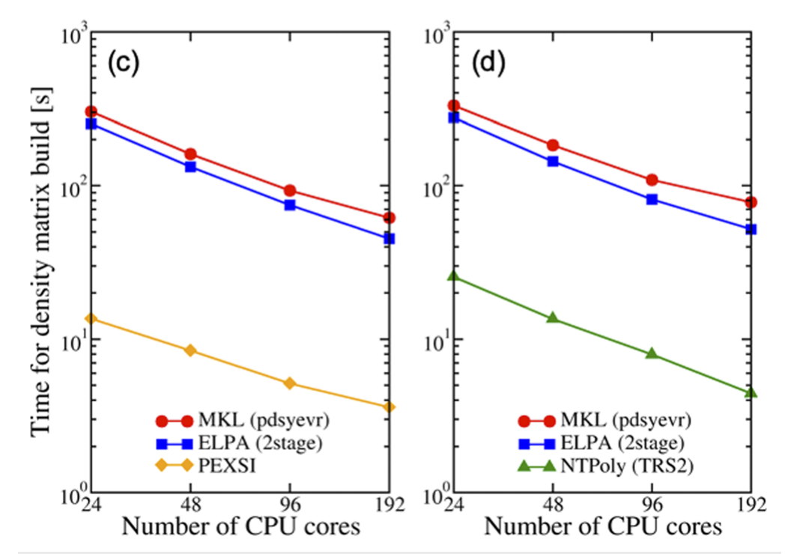

# 전자구조 대규모 solver의 역할

이 이름들은 대규모 전자구조 계산에서 서로 다른 역할을 한다. OMM, PEXSI와 CheSS는 Kohn–Sham 전자구조의 점유 부분공간 또는 밀도행렬을 구하는 서로 다른 알고리즘 계열이다. ELSI는 solver 자체가 아니라 여러 solver를 전자구조 코드에 연결하는 인터페이스다. 실제 계산의 지원 범위와 성능은 코드 버전, 컴파일 옵션, 기저 희소성, 원자계 크기와 계산 조건에 따라 달라진다. [1, Calculation of the electronic structure; 2, §§I–II]

<figure markdown="span">

  

  <figcaption markdown="1">
  이 위키가 작성한 역할 관계도. OMM·PEXSI·CheSS는 전자구조 solver이고, ELSI는 solver interface다. Hamiltonian 블록 확장과 수송 계산은 다른 단계다.
  </figcaption>
</figure>

## 1. Solver와 인터페이스의 역할

| 이름 | 역할과 기본 아이디어 | 계산 범위와 주의점 |
|---|---|---|
| **OMM** (Orbital Minimization Method) | 보조 궤도함수로 점유 부분공간을 나타내고 에너지 functional을 최소화한다. 모든 고유값·고유벡터를 먼저 구하지 않고 밀도행렬을 구성할 수 있다. | 국소화 제약을 두는지에 따라 스케일링과 근사가 달라진다. SIESTA 5.4의 SolverOMM은 전 점유 부분공간을 최적화하는 세제곱 스케일링 solver로 설명된다. 이를 과거 SIESTA Order-N 구현과 동일시하지 않는다. [1, SolverOMM; 5, §§I–III] |
| **PEXSI** (Pole EXpansion and Selected Inversion) | Fermi–Dirac matrix function을 소수의 유리함수 항으로 근사하고, 희소 행렬의 selected inversion으로 밀도행렬에 필요한 원소를 얻는다. | 전 고유상태를 모두 계산하지 않는 대안이다. 희소 행렬의 구조, 시스템 차원, pole 수와 병렬 자원에 따라 효율이 달라진다. 모든 계에서 O(N)이라고 부르거나 항상 대각화보다 빠르다고 보장하지 않는다. [1, SolverPEXSI; 3; 6] |
| **CheSS** (Chebyshev Sparse Solvers) | Chebyshev 다항식으로 희소 matrix function을 계산하는 라이브러리다. 밀도행렬, 행렬 거듭제곱, 선택 구간의 고유값 등을 대상으로 한다. | 희소성, 스펙트럼 폭과 원하는 오차가 다항식 계산량에 영향을 준다. SIESTA 5.4 설명은 CheSS 연동을 실험적 기능으로 표시한다. [1, SolverCheSS; 4] |
| **ELSI** (ELectronic Structure Infrastructure) | 전자구조 코드와 solver 라이브러리 사이의 공통 인터페이스·소프트웨어 기반이다. 코드가 지원되는 여러 solver 중 하나를 같은 API 계열로 선택하도록 연결한다. | 독립적인 수치 알고리즘 이름이 아니다. 사용 가능한 backend는 ELSI와 solver의 버전 및 빌드 옵션에 따라 달라진다. 정확도와 스케일링은 선택된 backend가 결정한다. [1, SolverELSI; 2; 5] |

### (1) 공통 입력과 출력: 밀도행렬

원자궤도 기저의 한 spin·\(k\)점에 대해 \(Hc_i=\epsilon_iSc_i\), \(c_i^\dagger Sc_j=\delta_{ij}\)라 하자. 점유수 \(f_i\)로 만든 밀도행렬 \(P=\sum_i f_i c_ic_i^\dagger\)은 전자수 \(N_e=\mathrm{Tr}(PS)\)와 전자밀도 구성에 들어간다. 유한 온도에서는 화학퍼텐셜 \(\mu\)를 전자수에 맞춰야 한다. solver는 이 단계에서 \(P\) 또는 그에 필요한 원소를 구하고, host DFT 코드는 전하와 퍼텐셜을 새로 계산해 SCF 반복을 이어간다. 힘 계산에는 에너지 밀도행렬이나 원자 이동에 따른 overlap 변화 등 추가 정보도 필요할 수 있다. [2, §§I–II; 6, §§2–3, Eqs. (10)–(15), (27)–(28)]

### (2) PEXSI: pole과 selected inversion

실수 대칭 \(H,S\)에 대해 Lin 등의 pole expansion은 밀도행렬을 개념적으로

\[
P\approx\operatorname{Im}\sum_{l=1}^{N_p}
\omega_l[H-(z_l+\mu)S]^{-1}
\]

로 근사한다. \(z_l,\omega_l\)는 사용한 Fermi 함수 근사의 복소 pole과 가중치, \(N_p\)는 pole 수다. 스핀 인자와 가중치의 구체적 정의는 구현의 convention에 포함된다. 각 pole마다 복소 이동된 행렬을 분해하고, selected inversion은 전하·에너지·힘 등에 필요한 역행렬 원소를 선택적으로 계산한다. 필요한 원소의 인덱스 집합은 관측량과 행렬의 희소 구조에 의존한다. \(\mu\) 탐색과 pole 수·근사 정확도도 함께 수렴시켜야 한다. [3, Introduction; 6, §§2–3, Eqs. (13)–(15), (27)–(28)]

???+ example "선택된 역행렬 원소의 의미"

    \(A=\bigl(\begin{smallmatrix}2&1\\1&2\end{smallmatrix}\bigr)\)라면 \((A^{-1})_{11}=2/3\)이다. 원래 행렬의 \(A_{11}\)만 떼어 역수 \(1/2\)를 구한 것과 다르다. selected inversion은 전체 행렬의 결합을 고려한 뒤 필요한 역행렬 원소를 구한다. 이 행렬은 계산 원리를 보여주는 예시다.

### (3) CheSS: 다항식과 희소성

직교 기저에서 Hamiltonian 스펙트럼을 \([-1,1]\)로 조정한 \(\widetilde H\)에 대한 Chebyshev 전개를 예로 들면

\[
T_0=I,\quad T_1=\widetilde H,\quad
T_{n+1}=2\widetilde H T_n-T_{n-1},\qquad
f(\widetilde H)\approx\sum_{n=0}^{M}a_nT_n(\widetilde H).
\]

\(f\)는 점유를 정하는 함수이고 \(M\)은 절단 차수다. 실제 비직교 계산에서는 overlap을 포함한 행렬 함수와 해당 구현의 정규화를 사용하므로 위 직교 기저 예제를 \(f(H)\)로 그대로 대입하지 않는다. 차수를 늘리고 희소 행렬의 절단 기준을 바꾸며 밀도행렬·전자수·에너지·힘을 확인한다. 스펙트럼 폭, 전자 온도 또는 gap, 목표 오차가 필요한 차수에 영향을 준다. 자세한 Chebyshev 재귀와 비직교 행렬 처리는 [비직교 KPM](../../computational-materials-science/quantum-transport/nonorthogonal-kpm.md)을 참고할 수 있으나, KPM의 DOS 복원과 CheSS의 밀도행렬 계산은 목표 관측량과 구현이 다르다. [4, §§II–III; 1, “SolverCheSS”]

[OMM 전용 문서](siesta-54-omm.md)는 trial-orbital functional, 점유 부분공간과 SIESTA 5.4 구현 제약을 설명한다. ELSI는 위 알고리즘들을 호출하는 interface이므로 선택된 backend와 설치 버전을 반드시 기록한다. [1, “SolverELSI”, “SolverOMM”; 2, §§I–II]

이 표의 “대규모”나 “선형 스케일링”은 입력 크기가 커질수록 항상 유리하다는 약속이 아니다. 예를 들어 SIESTA 문서는 대부분의 중간 크기 계산이 대각화 또는 OMM을 사용하며 Order-N이나 PEXSI의 이점이 없을 수 있다고 설명한다. 비교할 때는 실제 기저 크기, 희소 연결, k점, 메모리, 병렬 자원과 수렴 결과를 본다. [1, Calculation of the electronic structure; 3, Introduction]

Hourahine 등은 DFTB+의 비자기일관 전하(non-self-consistent charge, non-SCC), spin-non-polarized, \(\Gamma\)-점 계산 두 예제에서 밀도행렬 구성 시간을 비교했다. Fig. 5(c)는 CNT 사례에서 MKL 대각화, ELPA2와 PEXSI를, Fig. 5(d)는 Si supercell 사례에서 MKL 대각화, ELPA2와 NTPoly를 비교한다. 서로 다른 구조에서 비교한 solver 조합이므로 이 그림을 보편적인 성능 순위로 해석하지 않는다. [8, §III.A.1, Fig. 5(c,d)]

<figure markdown="span">

  

  <figcaption markdown="1">
  **원 논문 Fig. 5(c,d).** B. Hourahine et al., “DFTB+, a software package for efficient approximate density functional theory based atomistic simulations,” *The Journal of Chemical Physics* 152, 124101 (2020), [DOI](https://doi.org/10.1063/1.5143190), [원문 PDF, p. 14](https://wrap.warwick.ac.uk/id/eprint/137347/1/WRAP-DFTB-software-package-efficient-density-atomistic-simulations-Hourahine-2020.pdf), [CC BY 4.0](https://creativecommons.org/licenses/by/4.0/). 패널 (c,d)의 축·범례·자료를 보존하고 (a,b), 논문 캡션과 페이지 여백을 잘라냈다. 결과 자료는 수정하지 않았다.
  </figcaption>
</figure>

## 2. Order-N의 알고리즘적 의미

선형 스케일링 DFT는 계 크기에 대한 연산량 증가를 O(N)에 가깝게 만드는 목표다. 국소화된 궤도나 희소 밀도행렬 등을 활용하는 여러 알고리즘이 이 목표를 가질 수 있지만, OMM·PEXSI·CheSS라는 이름을 붙였다고 모든 구현과 조건에서 O(N)이 되는 것은 아니다. 특히 SIESTA 5.4의 SolverOMM은 세제곱 스케일링으로 안내된다. 같은 코드의 과거 Order-N 구현과는 별도 경로다. [1, SolverOMM; SolverON; SolverPEXSI; SolverCheSS; 2, §II]

CheSS의 Chebyshev 전개 역시 Hamiltonian 블록을 채널 방향으로 늘리는 작업과 다르다. 여기서 다항식은 희소 행렬의 함수, 예를 들면 밀도행렬을 계산하기 위한 수치 기법이다. [4, Abstract and §§II–III]

## 3. 작은 Hamiltonian 블록 복제와의 차이

[Hamiltonian 블록 확장과 RGF](../../computational-materials-science/quantum-transport/hamiltonian-block-stitching.md)는 이미 계산한 실공간 H와 비직교 기저의 경우 S 블록을 principal layer 방향으로 조립해 긴 산란영역을 만드는 수송 모델이다. OMM, PEXSI, ELSI 또는 CheSS가 이 블록을 대신 복제하거나 RGF 수송을 자동으로 수행하지 않는다. [1, NEGF equations; 7, Principal layer interactions]

두 방법의 입력과 계산 목표를 분리한다.

- **전체 큰 구조의 전자상태·밀도·에너지·힘을 자기일관적으로 구한다:** 해당 코드에서 지원되는 전자구조 solver를 고른다.
- **짧은 계산에서 얻은 대표 블록으로 긴 균일 채널을 구성해 T(E)를 계산한다:** Hamiltonian 블록 구성과 NEGF/RGF를 검토한다.
- **두 접근을 연결한다:** solver로 블록을 구했더라도 복제한 영역의 환경이 같다는 가정과 장치 전위·전하의 변화를 별도로 검증한다.

## 4. 선택할 때 확인할 항목

1. 현재 코드 빌드가 해당 solver와 필요한 행렬 형식을 지원하는가?
2. 계산에서 전체 고유상태가 필요한가, 점유 밀도행렬만 필요한가?
3. 기저의 희소성·시스템 크기·k점·온도·갭 조건이 알고리즘에 맞는가?
4. 실제 병렬 자원과 메모리에서 대각화 대비 이득이 있는가?
5. 선택 solver의 밀도행렬, 전자수, 총에너지와 힘이 목표 정확도로 수렴하는가?

solver 이름 또는 예상 O(N)만으로 정확도나 실행시간을 판단하지 않는다. 작은 사례에서 동일 물리 설정의 결과와 계산량을 비교하고, 실제 크기와 관측량에서 재확인한다.

## 5. 참고 자료

1. SIESTA developers, [SIESTA 5.4 reference manual](https://docs.siesta-project.org/projects/siesta/en/5.4/reference/siesta.html), “Calculation of the electronic structure,” “SolverOMM,” “SolverON,” “SolverPEXSI,” “SolverELSI,” and “SolverCheSS.”
2. V. W. Yu et al., “ELSI—An Open Infrastructure for Electronic Structure Solvers,” *Computer Physics Communications* **256**, 107459 (2020), [arXiv:1912.13403](https://arxiv.org/abs/1912.13403).
3. PEXSI developers, [PEXSI introduction](https://pexsi.readthedocs.io/en/stable/introduction.html), overview and pole expansion.
4. S. Mohr et al., “Efficient Computation of Sparse Matrix Functions for Large-Scale Electronic Structure Calculations: The CheSS Library,” [arXiv:1704.00512](https://arxiv.org/abs/1704.00512).
5. V. W. Yu et al., “ELSI: A Unified Software Interface for Kohn–Sham Electronic Structure Solvers,” *Computer Physics Communications* **222**, 267–285 (2018), [arXiv:1705.11191](https://arxiv.org/abs/1705.11191).
6. L. Lin et al., “Accelerating Atomic Orbital-based Electronic Structure Calculation via Pole Expansion and Selected Inversion,” [arXiv:1202.2159](https://arxiv.org/abs/1202.2159).
7. SIESTA developers, [TBtrans User Guide](https://docs.siesta-project.org/projects/siesta/en/5.4/reference/tbtrans.html), “Principal layer interactions,” “Green function,” and “Calculation time.”
8. B. Hourahine et al., “DFTB+, a software package for efficient approximate density functional theory based atomistic simulations,” *The Journal of Chemical Physics* **152**, 124101 (2020), [DOI](https://doi.org/10.1063/1.5143190), [open full text](https://wrap.warwick.ac.uk/id/eprint/137347/1/WRAP-DFTB-software-package-efficient-density-atomistic-simulations-Hourahine-2020.pdf). §III.A.1, Fig. 5(c,d).
