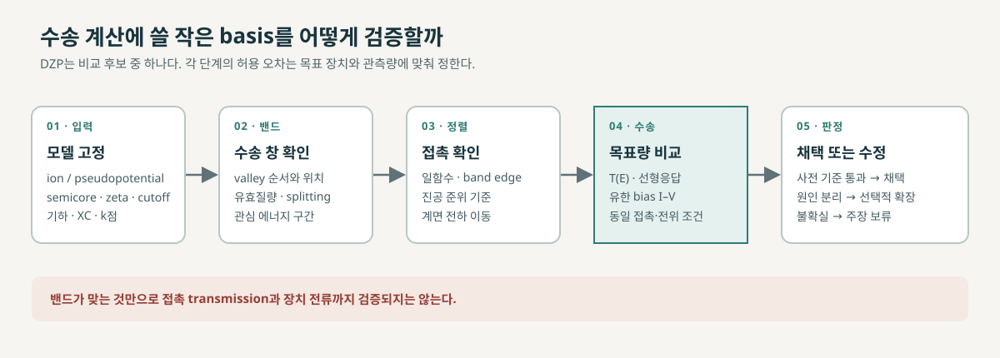

# 국소 원자궤도 기저 선택과 수송 검증

국소 원자궤도 기저는 계산 비용과 전자 상태를 얼마나 잘 표현하는지에 영향을 준다. 수송 계산에 작은 기저를 쓸 때는 특정 큰 기저로 계산한 결과를 무조건 재현하기보다, 목표 밴드·접촉 정렬·전송·전류가 허용 오차 안에서 유지되는지를 확인한다. DZP는 유용한 비교 후보지만 자동으로 정답이 되는 기준은 아니다. [1, Basis sets; 2, §§II–III]

<figure markdown="span">

  

  <figcaption markdown="1">
  이 위키의 기저 검증 흐름도. 작은 basis 후보를 관심 밴드뿐 아니라 에너지 정렬·접촉 결합·transmission과 목표 device 관측량으로 평가한다. 기준 계산과 허용오차는 사용 목적에 따라 정한다.
  </figcaption>
</figure>

## 1. Semicore 처리와 basis 크기의 구분

### (1) 궤도와 overlap 행렬

원자 \(A\)를 중심으로 하는 국소 원자궤도는 반지름 성분과 구면조화함수의 곱 \(\phi_{A\zeta lm}(\mathbf r)=R_{A\zeta l}(|\mathbf r-\mathbf R_A|)Y_{lm}(\widehat{\mathbf r-\mathbf R_A})\)으로 나타낼 수 있다. \(l,m\)은 각운동량 채널이며 \(\zeta\)는 같은 채널에서의 서로 다른 방사 함수를 구별한다. SIESTA의 유한 범위 원자궤도는 cutoff 반경 밖에서 0이다. 반경이 떨어진 두 함수가 겹치지 않으면 그 overlap 원소는 0이다. [1, “Basis sets”; 7, §§III–V]

파동함수 \(\psi_i=\sum_\mu c_{\mu i}\phi_\mu\)를 변분하면

\[
Hc_i=\epsilon_iSc_i,\qquad
H_{\mu\nu}=\langle\phi_\mu|\hat H|\phi_\nu\rangle,\quad
S_{\mu\nu}=\langle\phi_\mu|\phi_\nu\rangle
\]

라는 일반화 고유값 문제가 된다. 서로 다른 원자 위 궤도도 겹치므로 일반적으로 \(S\ne I\)다. 계수 밀도행렬을 \(P=\sum_i f_i c_ic_i^\dagger\), \(c_i^\dagger Sc_j=\delta_{ij}\)로 정의하면 전자수는 \(N_e=\mathrm{Tr}(PS)\)다. 비직교 기저에서 대각합 \(\mathrm{Tr}(P)\)만으로 전자수를 읽지 않는다. [7, §§III–V; 8, Eqs. (6), (10)–(12), (32)]

양의 정부호 \(S\)의 대칭 역제곱근을 구할 수 있다면 \(\bar H=S^{-1/2}HS^{-1/2}\)의 표준 고유값 문제로 바꿀 수 있다. 이는 **같은 유한 기저공간**을 좌표 변환하는 것이며, 처음부터 다른 함수와 cutoff를 선택한 기저를 자동으로 같은 정확도로 만들어 주지 않는다. 직교화 행렬은 일반적으로 원래의 엄격한 국소성·희소성을 보존하지 않을 수도 있다. 이러한 overlap은 [Hamiltonian 블록 확장과 RGF](../../computational-materials-science/quantum-transport/hamiltonian-block-stitching.md)와 [비직교 KPM](../../computational-materials-science/quantum-transport/nonorthogonal-kpm.md)에도 들어간다. [7, §§III–VI; 8, §§2–3]

???+ example "겹침이 큰 두 기저의 수치 조건"

    정규화된 두 함수의 overlap이 실수 \(s\)이면 \(S=\bigl(\begin{smallmatrix}1&s\\s&1\end{smallmatrix}\bigr)\)이고 고유값은 \(1\pm s\)다. \(|s|=0.9\)이면 조건수는 \((1+|s|)/(1-|s|)=19\)다. \(|s|\to1\)에서 선형 종속에 가까워져 역행렬과 일반화 고유값 계산이 민감해진다. 이는 행렬의 가상 예시이며 실제 기저의 수렴 결과가 아니다.

### (2) Semicore와 zeta는 무엇을 바꾸는가

| 선택 | 정하는 내용 | 확인할 정보 |
|---|---|---|
| Pseudopotential의 semicore | 어떤 전자를 core에 두고 어떤 전자를 명시적 valence에 포함하는가 | ion/PSML 파일의 valence 설정, 전자 수, semicore 채널 |
| SZ·DZ·TZ | 각 원자궤도 채널을 방사 방향으로 몇 개의 zeta 함수로 표현하는가 | 원소·각운동량 채널별 함수 수와 cutoff |
| P | 원래 valence 채널보다 높은 각운동량 성분을 추가해 편극 자유도를 주는가 | 추가된 polarization 채널 |

따라서 semicore를 포함한 SZP도 가능하고, semicore를 포함한 DZP도 가능하다. semicore 포함 여부와 zeta/polarization은 각각 따로 정해야 한다. 또한 약어는 코드와 basis 계열에 따라 의미가 달라진다. CP2K의 MOLOPT DZVP·SZV와 SIESTA의 DZP·SZP를 이름만 보고 같은 basis 크기나 정확도로 대응시키면 안 된다. [1, Basis generation and basis size; 3, PSML format]

특정 ion 파일의 이름만으로 semicore나 basis 크기를 추정하지 말고, valence 전자 수와 각 채널의 zeta·polarization 설정을 직접 확인한다. 입력 파일의 설정과 실제 밴드·수송 검증은 구분한다. [1, Basis generation and basis size; 3, PSML format]

## 2. 목표 물리량에 따른 비교 기준

빠른 소자 수송이 목적이라면, DZP 밴드의 재현도보다 관심 에너지와 장치 조건에서 수송 결과가 얼마나 유지되는지를 기준으로 삼는다. 기준 Hamiltonian은 더 큰 원자궤도 basis, plane-wave DFT, 또는 검증된 Wannier 표현일 수 있다. 기준이 바뀌면 pseudopotential, 교환-상관 함수, 구조, k점, smearing과 전하 조건의 차이도 함께 기록한다. [2, §§II–III; 5, §II]

## 3. 단계별 검증 절차

1. **계산 모델을 고정한다.** pseudopotential과 ion 파일, valence·semicore, 원소별 zeta/polarization 채널, cutoff를 기록한다. basis만 비교하려면 나머지 모델 설정과 구조를 가능한 한 고정한다.
2. **수송 에너지 창의 밴드를 비교한다.** VBM·CBM만이 아니라 실제 바이어스 창에 들어오는 valley 순서와 상대 에너지, 곡률·유효질량, 층간 splitting 등을 본다. 전체 밴드 RMS는 필요한 구간의 오차를 가릴 수 있다.
3. **접촉의 에너지 정렬을 확인한다.** 금속 일함수, 반도체 band edge, 진공 기준 정렬과 접촉부 전하 이동을 비교한다. 밴드 모양이 비슷해도 접촉 주입 장벽은 달라질 수 있다.
4. **대표 접촉 또는 장치에서 수송을 비교한다.** VSD=0에서 전류는 0이므로 T(E) 또는 선형응답 conductance를 비교한다. 유한 바이어스가 목표라면 I(VG,VSD)를 같은 전극·전위·수렴 조건에서 확인한다. 밴드 일치만으로 계면 결합이나 transmission의 일치를 보장할 수 없다. [4, §III; 6, Figs. 2, 4]
5. **오차 기준을 먼저 정한다.** 관심 관측량과 에너지 창에 맞춰 허용할 valley 이동, 장벽 차이, T(E) 편차 또는 전류 차이를 비교 전에 정한다. 모든 재료와 수송 조건에 적용되는 보편적 허용 오차는 없다.

어느 단계에서 차이가 생기는지 분리하면, basis를 원소별로 키울지, pseudopotential이나 정렬을 다시 확인할지, 접촉 모델을 바꿀지를 판단할 수 있다. 더 큰 basis 하나와의 차이만으로 원인을 basis 오차라고 단정하지 않는다.

## 4. 함께 보기

- [전자구조 대규모 solver의 역할](electronic-structure-solvers.md)
- [Order-N DFT](order-n-dft.md)
- [Hamiltonian 블록 확장과 RGF](../../computational-materials-science/quantum-transport/hamiltonian-block-stitching.md)
- [기저 크기 검증을 보고한 수송 사례](../../computational-materials-science/quantum-transport/basis-set-validation-cases.md)

## 5. 참고 자료

1. SIESTA developers, [SIESTA 5.4 reference manual](https://docs.siesta-project.org/projects/siesta/en/5.4/reference/siesta.html), “Basis sets,” “Basis generation,” and “Basis size.”
2. A. Afzalian et al., “Advanced DFT-NEGF transport techniques for realistic nanoelectronic devices,” [arXiv:2106.07248](https://arxiv.org/abs/2106.07248), §§II–III.
3. The PSML consortium, [PSML specification](https://psml.readthedocs.io/en/latest/), valence configuration and semicore metadata.
4. J. Quhe et al., “A sub-10 nm monolayer ReS₂ transistor for low-power applications,” *J. Mater. Chem. C* **7**, 1108 (2019), [Supporting Information, p. 1, Fig. S1](https://www.rsc.org/suppdata/c8/tc/c8tc05863f/c8tc05863f1.pdf).
5. M. Szabó et al., “Electron transport through metal/MoS₂ interfaces,” *Nano Letters* **19**, 3647 (2019), [arXiv:1912.04847](https://arxiv.org/abs/1912.04847), §§II–III.
6. S. Ducry et al., “A Hybrid Mode-Space/Real-Space Scheme for DFT+NEGF Device Simulations,” *SISPAD* (2019), [pp. 70–72, Figs. 2 and 4](https://in4.iue.tuwien.ac.at/pdfs/sispad2019/SISPAD_4.1.pdf).
7. J. M. Soler et al., “The SIESTA method for ab initio order-N materials simulation,” *J. Phys.: Condens. Matter* **14**, 2745 (2002), [§§III–VI](https://arxiv.org/html/cond-mat/0111138).
8. L. Lin et al., “Accelerating atomic orbital-based electronic structure calculation via pole expansion and selected inversion,” *J. Phys.: Condens. Matter* **25**, 295501 (2013), [§§2–3](https://arxiv.org/html/1202.2159).
