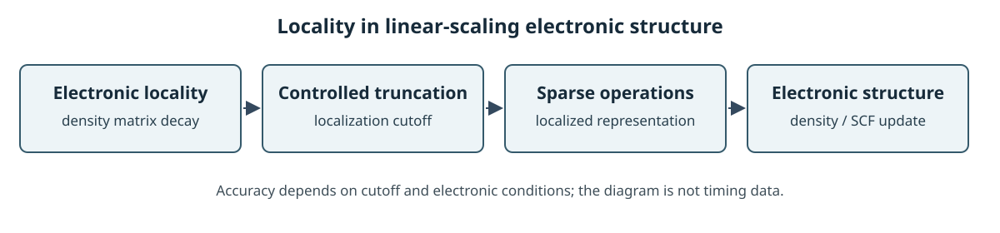
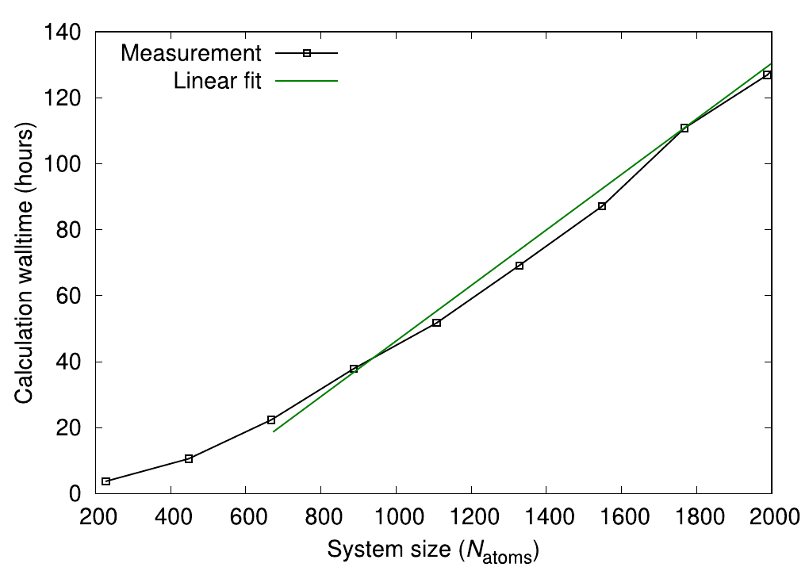

# Order-N DFT

Order-N 또는 \(O(N)\) DFT는 원자 수나 기저함수 수가 커질 때 계산 시간과 메모리가 계 크기에 선형으로 비례하도록 설계한 전자구조 방법을 가리킨다. 여기서 \(N\)은 문헌과 코드에 따라 원자 수 또는 기저함수 수를 뜻한다. 원자당 기저함수 수가 일정할 때 두 크기는 비례하지만, 단면·기저 크기를 함께 키우면 실제 계산량은 단순한 \(O(N)\) 법칙을 따르지 않을 수 있다. [1, Abstract and §XIII; 2, “Calculation of the electronic structure”]

<figure markdown="span">
  
  <figcaption markdown="1">전자 국소성을 선형 스케일링 전자구조 계산에 이용하는 위키 자체 도식이다. 절단 오차는 국소화 범위와 전자 상태 조건에 의존한다. 선형 스케일링은 절단 범위와 연결 수가 고정되고 나머지 계산 비용도 적절히 제어되는 조건에서 기대한다. [1, §§VI, XIII; 4, §§4, 8][도식 크게 보기](images/order-n-locality.svg)</figcaption>
</figure>

## 1. 밀도행렬의 국소성과 선형 스케일링

표준 Kohn–Sham DFT는 일반적으로 일반화 고유값 문제를 풀고 점유 상태를 합산한다. 기저함수 수를 \(M\)이라 할 때 밀집 행렬 대각화는 대표적으로 \(O(M^3)\) 비용을 가지므로 큰 계에서 병목이 된다. 선형 스케일링 방법은 국소 기저의 희소성, 밀도행렬의 공간적 감쇠, 또는 국소화된 점유 궤도 등을 이용해 먼 비대각 행렬 성분이나 국소 상태의 범위를 제한하고 연산 수를 줄인다. 이는 장거리 Coulomb 또는 Poisson 항이 저절로 사라진다는 뜻은 아니다. [1, §§III, VI, XIII; 2, “Calculation of the electronic structure”; 3, Abstract; 4, §1]

한 전자 밀도행렬의 실공간 표현은

\[
\rho(\mathbf r,\mathbf r')=
\sum_n f_n\psi_n(\mathbf r)\psi_n^*(\mathbf r')
\]

이다. 적절한 절연체·온도 조건에서는 \(\lvert\mathbf r-\mathbf r'\rvert\)가 커질수록 밀도행렬의 비대각 성분이 감쇠해, 충분히 먼 항을 잘라도 작은 오차로 근사할 수 있다. 이 국소성은 개별 Kohn–Sham 고유상태가 항상 국소화되어 있다는 뜻은 아니다. 금속의 영온도 극한이나 작은 gap, 낮은 온도에서는 감쇠가 느려져 유한한 절단 반경으로 목표 정확도를 얻기 어려울 수 있다. [3, Abstract; 4, §§4, 8, 10, 12]

### (1) 비직교 기저의 밀도행렬과 점유

국소 기저에서 \(Hc_i=\epsilon_iSc_i\), \(c_i^\dagger Sc_j=\delta_{ij}\)이고 스핀 한 채널의 점유수를 \(0\le f_i\le1\)로 정하면, 계수 밀도행렬은 \(P=\sum_i f_i c_ic_i^\dagger\)다. 이때 전자수는 \(\mathrm{Tr}(PS)=\sum_i f_i\)다. 정확한 0 K 정수 점유에서는 \(PSP=P\)가 되지만, 유한 온도에서 부분 점유가 있거나 국소 절단 근사를 적용한 경우 이 관계가 정확히 성립할 필요는 없다. 스핀을 합한 행렬에 같은 계수를 그대로 적용하지 않도록 점유 convention을 먼저 확인한다. [1, §§VI, XIII; 4, §§2–4]

밀도행렬을 직접 근사할 때는 충분히 먼 원자 사이 성분을 잘라도 관심 관측량의 오차가 목표보다 작은지 확인한다. 절단 반경을 고정했을 때 원자당 연결 수가 제한되고 기저의 원자당 크기도 일정하면, 저장하는 비영 행렬 원소 수가 계의 원자 수에 비례할 수 있다. 실제 solver 전체의 실행 시간에는 행렬곱의 fill-in, 화학퍼텐셜 탐색, Hartree 항, 병렬 통신과 SCF 반복도 영향을 준다. 따라서 밀도행렬만 희소하다고 모든 계산이 자동으로 \(O(N)\)이 되는 것은 아니다. [1, §§VI, XIII; 4, §§4, 10, 12]

???+ example "희소 저장의 크기"

    기저함수 \(N=10{,}000\)개이고 각 행에 평균 50개의 비영 원소만 남는 가상 행렬은 약 50만 개 원소를 저장한다. 같은 크기의 밀집 행렬은 \(10^8\)개 원소이므로 개수로는 200배 차이다. 이는 정해진 희소 패턴의 저장량 비교이며 행렬곱의 fill-in이나 전체 실행 시간의 측정값이 아니다.

유한 cutoff가 적합한지와 온도·작은 gap의 효과는 별도로 확인해야 한다. 비직교 기저에서 다항식으로 스펙트럼 정보를 얻는 다른 접근은 [비직교 KPM](../../computational-materials-science/quantum-transport/nonorthogonal-kpm.md)에, 밀도행렬을 만드는 다른 solver는 [전자구조 solver](electronic-structure-solvers.md)에 정리되어 있다. [4, §§4, 8, 10, 12; 2, “SolverCheSS”]

## 2. SIESTA의 역사적 Order-N functional

SIESTA의 전통적인 `SolutionMethod OrderN` 경로는 큰 구조에 대한 전자상태를 새로 최적화한다. 원자가전자 수에 따라 각 원자에 여러 개의 국소 Wannier-like trial function (LWF)을 둔다. 각 LWF는 반지름 \(R_c\)의 localization sphere 안에 중심을 둔 기저 궤도함수로 전개하고, 그 계수를 최적화해 에너지 functional을 최소화한다. 기저 궤도함수 자체의 cutoff 때문에 실제 LWF의 공간 범위는 최대 \(R_c+r_{c,\max}\)까지 이어질 수 있다. 이렇게 밀도행렬과 전하를 계산한다. 따라서 작은 셀에서 이미 구한 Hamiltonian 블록을 채널 방향으로 복제하는 방법과 목적이 다르다. [1, §XIII, pp. 2767–2768; 2, “SolverON”]

Kim–Mauri–Galli (KMG) 방식에서 비자성, 이중 점유 상태를 가정한 band-energy functional은

\[
E^{\mathrm{KMG}}=
2\sum_{ij}(2\delta_{ji}-S_{ji})(H_{ij}-\eta S_{ij})
\]

로 쓸 수 있다. 여기의 \(i,j\)는 국소화된 trial state를 가리키며, \(H_{ij}=\langle\psi_i|\hat H_{\mathrm{KS}}|\psi_j\rangle\), \(S_{ij}=\langle\psi_i|\psi_j\rangle\)다. \(\eta\)는 gap 안에서 정해 전자 수를 맞추는 화학퍼텐셜 역할의 매개변수다. 이 식은 **KMG 에너지 functional 안에서** \(H-\eta S\)라는 행렬 조합을 쓴다는 뜻이다. 이를 실공간 채널 블록 반복이나 Chebyshev 다항식 Hamiltonian 전개와 같은 방법으로 부르지 않는다. [1, §XIII, Eqs. (86)–(88); 2, “ON.eta”; 5]

유한 \(R_c\)에서는 LWF의 직교성이 정확히 성립하지 않을 수 있어, 제한하지 않은 Kohn–Sham 해보다 에너지가 조금 높아진다. 저자들은 절연체와 반도체에서 \(R_c\)를 늘리면 이 에너지 초과가 빠르게 감소하는 예를 제시한다. 그러므로 cutoff 수렴을 확인해야 하며, \(O(N)\) 표시 자체가 완전 대각화와 같은 정확도를 보장하지 않는다. [1, §XIII; 2, “ON.RcLWF”]

## 3. \(O(N)\) 주장의 조건과 SIESTA 5.4 경계

실제 선형 스케일링에는 원자당 기저함수 수가 일정하고, 행렬 연결 범위와 국소화 반경이 계 크기와 함께 무한히 늘지 않는 조건이 필요하다. 작은 계산에서는 행렬 구축 외의 solver·통신 비용이 우세할 수 있어 asymptotic \(O(N)\) 이점이 아직 나타나지 않을 수 있다. [1, §§VI, XIII; 2, “Calculation of the electronic structure”]

ONETEP 논문은 hybrid 교환-상관 함수를 사용한 네 가닥 고분자 사슬에서 원자 수에 따른 계산 시간을 보고한다. 그림의 선형 회귀는 작은 두 계를 제외하며, 표기된 기울기는 해당 구조·계산 설정·하드웨어에서 얻은 결과다. [6, §IV.B.1.b, Fig. 7]

<figure markdown="span">
  
  <figcaption markdown="1">J. C. A. Prentice et al., “The ONETEP linear-scaling density functional theory program,” *J. Chem. Phys.* 152, 174111 (2020), Fig. 7, [DOI](https://doi.org/10.1063/5.0004445), [CC BY 4.0](https://creativecommons.org/licenses/by/4.0/). 네 가닥 고분자 사슬을 32개 계산 노드에서 계산한 시간이며, 선형 회귀는 가장 작은 두 계를 제외한다. 원문 PDF에서 그림 영역을 잘랐고 데이터·축·범례는 수정하지 않았다.</figcaption>
</figure>

OMM·PEXSI·ELSI·CheSS의 알고리즘과 코드별 역할은 [전자구조 대규모 solver 문서](electronic-structure-solvers.md)에서 따로 비교한다.

현재 SIESTA 5.4 문서는 historical `SolverON`이 점유·비점유 상태가 명확히 분리된 계에만 작동하며, 사용과 안정성 측면에서 취약하다고 경고한다. 같은 문서는 별도의 OMM, PEXSI, ELSI 및 CheSS solver도 소개한다. 따라서 논문 속 \(O(N)\) 원리와 현재 코드에서 특정 solver가 안정적·효율적으로 작동한다는 주장은 따로 확인해야 한다. [2, “Calculation of the electronic structure,” “SolverON,” “SolverOMM,” “SolverPEXSI,” “SolverCheSS”]

CheSS는 이 문맥에서 해밀토니안 행렬 자체의 Chebyshev 전개가 아니다. SIESTA 문서는 CheSS를 \(H\), \(S\)의 희소성을 활용해 밀도행렬을 Chebyshev 다항식으로 계산하는 별도 solver라고 설명하고, 유한 HOMO–LUMO gap과 작은 spectral width에서 잘 작동하며 기능이 실험적이라고 밝힌다. 또 `ON.ChemicalPotential`의 Chebyshev Fermi 함수 전개는 화학퍼텐셜의 \(O(N)\) 추정용 옵션이다. 두 옵션을 historical KMG functional과 동일한 알고리즘으로 취급하지 않는다. [2, “ON.ChemicalPotential,” “SolverCheSS”]

## 4. Hamiltonian 확장 및 수송과의 차이

Order-N DFT는 큰 구조 전체의 전자구조와 전하를 직접 구하려는 방법이다. 반면 [Hamiltonian 블록 확장과 RGF](../../computational-materials-science/quantum-transport/hamiltonian-block-stitching.md)는 이미 얻은 국소 행렬 블록을 이어 만든 장치 모형으로 열린 경계 수송을 계산한다. 전자는 수송 계산이 아니며, 후자는 새 구조의 DFT 자기일관 계산이 자동으로 포함되지 않는다. [1, §§XIII–XIV; 2, “SolverON” and “NEGF equations”]

## 5. 참고 자료

1. J. M. Soler et al., “The SIESTA method for ab initio order-\(N\) materials simulation,” *J. Phys.: Condens. Matter* **14**, 2745 (2002), [§§VI, XIII, Eqs. (32)–(35), (86)–(88)](https://doi.org/10.1088/0953-8984/14/11/302).
2. SIESTA developers, [SIESTA 5.4 reference manual](https://docs.siesta-project.org/projects/siesta/en/5.4/reference/siesta.html), “Calculation of the electronic structure,” “SolverON,” “ON.ChemicalPotential,” and “SolverCheSS.”
3. W. Kohn, “Density Functional and Density Matrix Method Scaling Linearly with the Number of Atoms,” *Phys. Rev. Lett.* **76**, 3168 (1996), [Nearsightedness of electronic matter](https://doi.org/10.1103/PhysRevLett.76.3168).
4. M. Benzi, P. Boito, N. Razouk, “Decay properties of spectral projectors with applications to electronic structure,” *SIAM Review* **55**, 3–64 (2013), https://doi.org/10.1137/100814019.
5. J. Kim, F. Mauri, and G. Galli, “Total-energy global optimizations using nonorthogonal localized orbitals,” *Phys. Rev. B* **52**, 1640 (1995), [abstract and orbital-based energy functional](https://doi.org/10.1103/PhysRevB.52.1640).
6. J. C. A. Prentice et al., “The ONETEP linear-scaling density functional theory program,” *J. Chem. Phys.* **152**, 174111 (2020), [§IV.B.1.b, Fig. 7](https://doi.org/10.1063/5.0004445).
