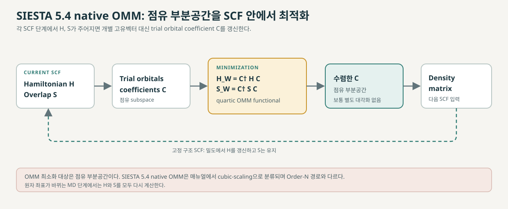
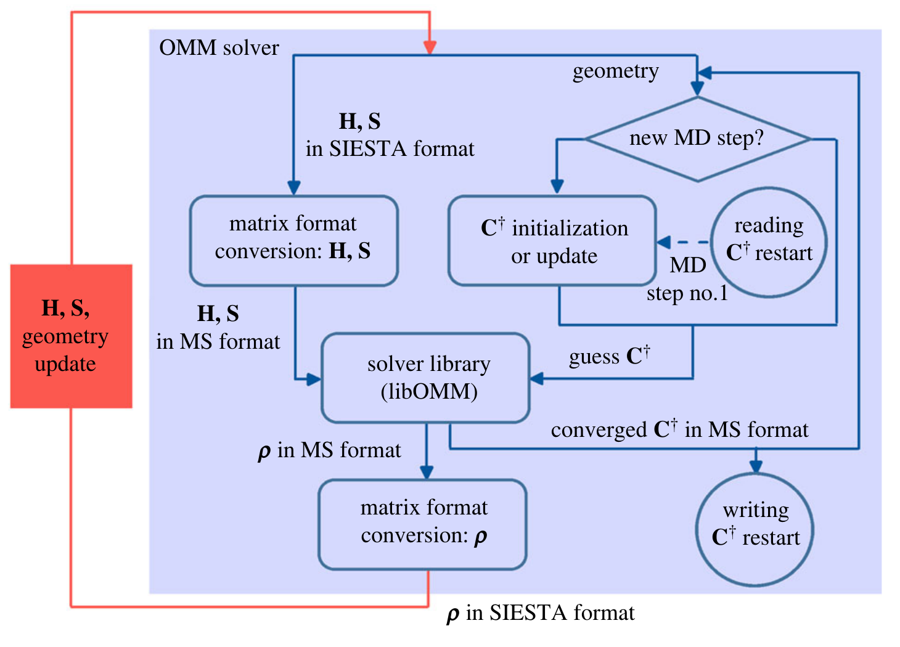

# SIESTA 5.4의 Orbital Minimization Method

SIESTA 5.4의 native Orbital Minimization Method (OMM)는 Kohn–Sham 행렬을 직접 대각화하는 대신, 점유 상태들이 이루는 부분공간을 trial-orbital 계수로 나타내고 그 부분공간의 에너지를 최소화한다. SIESTA 매뉴얼은 이 구현을 cubic-scaling solver로 분류한다. SCF와 분자동역학(MD) 단계 사이에서 앞 단계의 계수를 다음 minimization의 초기값으로 재사용할 수 있어, 여러 번 반복하는 계산에서는 초기 단계보다 이후 단계의 minimization이 빨라질 수 있다. [1, “Calculation of the electronic structure,” “SolverOMM”; 2, §§2.1, 2.5.2]

<figure markdown="span">

  

  <figcaption markdown="1">
  이 위키가 직접 작성한 개념도. SIESTA 5.4 native OMM의 점유 부분공간 최소화와 SCF 되먹임을 나타낸다. quartic functional은 비자성 이중 점유의 단순한 표기이며 전체 유도와 전제는 본문에 둔다. 논문 원그림을 복제하지 않았다.
  </figcaption>
</figure>

2023년 modular libOMM 구현 논문의 Figure 2는 SIESTA 계열 코드에 libOMM을 연동하면서 행렬 형식을 변환하고 밀도행렬을 반환하는 흐름을 보여준다. 이는 SIESTA 5.4 native OMM의 내부 구현이 아니라 후속 modular solver 사례다. [3, Fig. 2, p. 6]

<figure markdown="span">

  

  <figcaption markdown="1">
  **원 논문 Fig. 2.** I. V. Lebedeva, A. García, E. Artacho, and P. Ordejón, “Modular implementation of the linear- and cubic-scaling orbital minimization methods in electronic structure codes using atomic orbitals,” *Royal Society Open Science* 10, 230063 (2023), [DOI](https://doi.org/10.1098/rsos.230063), [CC BY 4.0](https://creativecommons.org/licenses/by/4.0/). [논문 PDF p. 6](https://www.nanogune.eu/en/publications/download/4935)에서 도판 영역만 잘라 수록했으며 도식 요소는 수정하지 않았다.
  </figcaption>
</figure>

## 1. OMM이 구하는 대상

한 SCF 단계에서 유효 Hamiltonian과 overlap matrix는 각각 \(H\), \(S\)다. 이 기저와 overlap의 정의는 [국소 원자궤도 기저](localized-basis-sets.md)에서 설명한다. \(m\)개의 비직교 원자 궤도 기저에서 표준 Kohn–Sham 문제는

\[
H\mathbf c_i=\varepsilon_i S\mathbf c_i
\]

로 쓸 수 있다. 대각화는 고유값과 고유벡터를 구한 뒤 점유 상태로 밀도행렬을 만든다. OMM은 개별 고유값을 기본 출력으로 구하지 않고, 점유 부분공간을 기술하는 trial 궤도함수의 선형결합 계수 \(C\)를 직접 최적화한다. [2, §2.1, Eqs. (1)–(6)]

비자성, 이중 점유 상태의 간단한 경우를 두면, 점유 궤도함수 \(\chi_i\)는

\[
|\chi_i\rangle=\sum_{\mu=1}^{m}C_{\mu i}|\phi_\mu\rangle,
\qquad i=1,\ldots,n
\]

로 쓸 수 있다. 여기서 \(n=N_e/2\)는 점유 상태 수이고 \(N_e\)는 전자 수다. 이 궤도들이 만드는 부분공간의 Hamiltonian과 중첩행렬은

\[
H_W=C^\dagger H C,
\qquad
S_W=C^\dagger S C
\]

이다. trial 궤도함수가 서로 직교하지 않으므로 일반적으로 \(S_W\ne I\)다. 실제 구현의 스핀 분극 계산은 이 단순한 이중 점유 표기와 구별해 스핀별 점유 수를 다룬다. [2, §2.1, Eqs. (4)–(6); 1, “SolverOMM”]

## 2. 에너지 functional과 밀도행렬

0 K의 정수 점유에서, trial 궤도함수가 만드는 점유 부분공간의 band energy는

\[
E[C]=2\operatorname{Tr}\left(S_W^{-1}H_W\right)
\tag{1}
\]

이다. 계수 2는 여기서 가정한 스핀 축퇴 상태에 해당한다. 식 (1)은 \(S_W^{-1}\)를 포함하므로, trial 궤도함수가 바뀔 때마다 역행렬을 다시 계산해야 한다. [2, §2.1, Eq. (7)]

OMM은 이 inverse를 직접 사용하는 대신, \(S_W\)가 항등행렬에 가까울 때

\[
S_W^{-1}\approx I+(I-S_W)
\]

라는 1차 전개를 이용해 다음 functional을 최소화한다.

\[
\begin{aligned}
\widetilde E[C]
&=2\operatorname{Tr}\left(\left[I+(I-S_W)\right]H_W\right)\\
&=4\operatorname{Tr}(H_W)-2\operatorname{Tr}(S_WH_W).
\end{aligned}
\tag{2}
\]

이 식을 쓰면 각 최적화 단계에서 중첩행렬의 역행렬을 계산하지 않아도 되며, \(C\)에 대한 quartic functional이다. OMM은 \(C\)를 conjugate-gradient 방식으로 갱신한다. 올바른 점유 해에서 \(S_W=I\)가 되면 식 (2)는 식 (1)의 점유 band energy와 일치한다. 따라서 목적은 궤도 하나하나의 특정 모양을 정하는 것이 아니라, 점유 부분공간을 찾는 것이다. [2, §§2.1, 2.3, Eqs. (7)–(8), (12)–(13); 3, §2, Eqs. (2.2)–(2.5)]

식 (2)가 모든 임의의 초기값에서 바닥상태를 보장한다는 뜻은 아니다. Corsetti는 OMM functional의 정지점이 올바른 최소점이 되려면 점유 eigenvalue가 음수여야 한다고 설명한다. 이를 위해 SIESTA는 \(H\to H-\eta S\) 형태로 고유값 스펙트럼을 이동시킨다. 공식 5.4 설명은 \(\eta\)를 HOMO보다 높게 두고, 기본 \(\texttt{ON.eta}=0\,\mathrm{eV}\) 때문에 수렴이 비정상적으로 느리거나 불안정하면 몇 eV 높이는 방법을 안내한다. 논문은 전체 스펙트럼을 음수로 옮기지 않은 경우 목표점이 전역 최소가 아니라 국소 최소가 될 수 있다고도 지적한다. 따라서 입력의 \(\eta\)가 맞는지와 minimization 수렴을 확인해야 하며, functional의 형태만으로 해의 정확성을 단정할 수 없다. [1, “SolverOMM,” “ON.eta”; 2, §2.2, Eqs. (9)–(11)]

spin-degenerate 표기에서 수렴한 \(C\)가 \(S_W=I\)를 만족하면, 계수 기저에서 밀도행렬은

\[
D=2CC^\dagger,
\qquad
\operatorname{Tr}(DS)=2n
\tag{3}
\]

로 쓸 수 있다. 식 (3)은 이중 점유 가정 아래 최적화된 점유 부분공간을 나타내는 projector다. 비자성, 이중 점유 표기를 벗어나는 경우에는 스핀별 행렬과 점유 수를 따로 고려해야 한다. 후속 일반 OMM 구현 논문은 수렴 전 밀도행렬 구성에 \(2C(2I-S_W)C^\dagger\) 형태를 제시하지만, 이 식은 해당 논문의 일반화·모듈화 구현 설명이지 5.4 manual이 명시한 SIESTA 5.4 기본 구현의 입력 규약으로 볼 수는 없다. [3, §2, Eqs. (2.1), (2.5); 1, “SolverOMM”]

## 3. SCF·MD 반복에서의 사용과 스케일링

OMM은 SCF 반복 안에서 전자상태를 구하는 solver다. PEXSI·CheSS와 ELSI의 역할은 [전자구조 solver 비교](electronic-structure-solvers.md)에서 함께 살펴볼 수 있다. 각 SCF 단계에서 주어진 \(H\), \(S\)로 점유 부분공간을 minimization하고, 그로부터 얻은 density matrix를 사용해 다음 Hamiltonian을 구성한다. MD의 새 원자 배치에서는 \(H\), \(S\)가 변하지만 앞 단계의 orbital coefficients를 초기 추정값으로 재사용할 수 있다. 공식 manual은 첫 MD step의 처음 몇 SCF cycle은 대각화보다 느릴 수 있으며, 그 이후에는 계수 재사용으로 계산 시간이 줄 수 있다고 설명한다. 이는 반복 계산에서의 가능성이지 모든 시스템에 대한 보장된 속도 향상은 아니다. [1, “SolverOMM”; 2, §2.5.2, Eq. (18), §3]

SIESTA의 유한 범위 원자궤도 기저에서는 \(H\)와 \(S\)가 희소할 수 있다. \(\texttt{OMM.UseSparse}\)를 사용하면 일부 희소행렬–밀집행렬 곱셈 비용을 밀집행렬 곱셈의 \(O(m^3)\)에서 \(O(m^2)\)로 낮출 수 있다. 그러나 이 최적화가 native OMM 전체를 선형 스케일링으로 바꾸지는 않는다. Corsetti의 분석은 전처리 행렬이 일반적으로 희소하지 않고, 촐레스키 분해도 희소성을 없앨 수 있어 전체 solver의 스케일링은 여전히 \(O(m^3)\)이라고 명시한다. [1, “OMM.UseSparse”; 2, §2.6]

이를 국소화 제약을 사용하는 OMM 계열 또는 SIESTA의 historical Order-N 경로와 구분해야 한다. 선형 스케일링에는 Hamiltonian 기저의 희소성만으로 충분하지 않으며, trial 궤도함수 계수에도 공간 국소화 제약을 두어야 한다. 그러면 cutoff에 따른 근사가 생기며, 결과는 국소화 반경과 계의 전자 국소성에 의존한다. SIESTA 매뉴얼은 historical OrderN이 취급하기 까다롭고, 점유·비점유 상태가 명확히 분리된 시스템에만 적용된다고 경고한다. 세부 개념은 [Order-N DFT](order-n-dft.md)를 참고한다. [1, “Calculation of the electronic structure,” “SolverON”; 3, §2, pp. 5–6]

## 4. SIESTA 5.4 native OMM 입력

기본 선택은 다음과 같다.

```fdf
SolutionMethod OMM
```

나머지 OMM 옵션은 필요할 때만 조정한다. 아래 기본값과 제약은 SIESTA 5.4 reference manual의 SolverOMM 설명을 따른다. [1, “SolutionMethod,” “SolverOMM”]

| FDF 옵션 | 5.4 기본값 | 의미와 주의점 |
|---|---:|---|
| `OMM.UseCholesky` | `true` | 일반화 eigenproblem을 Cholesky factorization으로 표준형으로 바꾼다. overlap을 제거하지만 Hamiltonian의 희소성을 없앨 수 있다. |
| `OMM.Use2D` | `true` | 병렬 계산에서 행렬을 2D로 분산한다. 많은 MPI process에서는 보통 더 나은 scaling을 준다. |
| `OMM.UseSparse` | `false` | 가능한 matrix multiplication에서 \(H\), \(S\)의 희소성을 이용한다. 해당 연산 비용을 \(O(N^3)\)에서 \(O(N^2)\)로 줄일 수 있으나, 전체 OMM의 스케일링을 선형으로 만들지는 않는다. `UseCholesky`, `Use2D`, 비-Γ점 계산과 호환되지 않는다. |
| `OMM.Precon` | `-1` | overlap 및 kinetic-energy 행렬을 쓰는 preconditioning을 적용할 SCF step 수다. 음수면 항상 적용한다. Cholesky를 쓸 때는 preconditioning이 필요 없고 이 옵션을 함께 사용할 수 없다. |
| `OMM.PreconFirstStep` | `OMM.Precon` 값 | 첫 MD step에만 적용할 SCF step 수를 별도로 지정한다. |
| `OMM.Diagon` | `0` | OMM으로 바꾸기 전에 대각화를 쓸 SCF step 수다. 0이면 처음부터 OMM을 쓴다. 음수면 계속 대각화해 사실상 `SolutionMethod diagon`처럼 동작한다. |
| `OMM.DiagonFirstStep` | `OMM.Diagon` 값 | 첫 MD step에만 대각화 step 수를 별도로 지정한다. |
| `OMM.BlockSize` | `BlockSize` 값 | trial-orbital 차원(각 k점·스핀의 점유 상태 수)을 MPI process에 분산한다. basis-orbital 차원에는 `BlockSize`를 쓴다. |
| `OMM.TPreconScale` | \(10\,\mathrm{Ry}\) | kinetic-energy 전처리의 scale이다. 값이 작을수록 전처리가 강하다. 너무 강하면 성능과 정확도에 나쁠 수 있다. |
| `OMM.RelTol` | \(10^{-9}\) | band-energy conjugate-gradient minimization의 relative tolerance다. |
| `OMM.Eigenvalues` | `false` | 각 MD 단계 끝에 고유값을 얻기 위한 대각화를 추가할지 정한다. |
| `OMM.WriteCoeffs` / `OMM.ReadCoeffs` | `false` / `false` | 해의 orbital coefficients를 저장하거나 다음 계산 시작 시 읽는다. restart에는 동일한 MPI 프로세스 수와 `OMM.Use2D`, `OMM.BlockSize`, `BlockSize`가 필요하다. |
| `OMM.LongOutput` | `false` | 각 SCF 단계의 켤레기울기 최소화 세부 출력을 켠다. |

특히 기본값은 `OMM.UseCholesky true`, `OMM.UseSparse false`, `OMM.Use2D true`다. 희소행렬 곱셈을 쓰려면 Cholesky와 2D 분산을 끄고 Γ점 계산을 해야 한다. Cholesky를 켜면 `OMM.Precon`은 효과가 없으며 함께 사용할 수 없다. 옵션을 바꿀 때 이 제약을 함께 확인한다. [1, “OMM.UseCholesky,” “OMM.Use2D,” “OMM.UseSparse,” “OMM.Precon”]

## 5. 지원 제약과 비슷한 이름의 경로 구분

기본 OMM은 고유값을 계산하지 않고, 각 k점·스핀에서 고정된 정수 전자 수를 사용한다. spin-polarized 계산에는 `Spin.Fix`가 필요하며 `Spin.Total`을 맞춰야 한다. 비-Γ점 계산은 모든 k점에서 같은 수의 전자를 사용하고, non-collinear 계산은 지원하지 않는다. OMM에서 개별 고유값이 필요하면 `OMM.Eigenvalues true`로 MD step 끝에 별도 대각화를 요청할 수 있다. Corsetti의 구현 논문도 당시 구현은 Fermi-level smearing을 지원하지 않는다고 기록한다. [1, “SolverOMM”; 2, §2.7]

| 이름 | 선택 방법 | 5.4 문서에서의 의미 |
|---|---|---|
| **native OMM** | `SolutionMethod OMM` | 이 문서의 대상. trial-orbital coefficient를 minimization하고, manual은 이를 cubic-scaling으로 설명한다. |
| **historical OrderN** | `SolutionMethod OrderN` | 국소화된 wavefunction/LWF와 Order-N functional을 사용하는 별도 경로다. `ON.functional`, `ON.RcLWF`, `ON.eta` 등은 이 문맥의 입력이다. |
| **ELSI OMM** | `SolutionMethod ELSI`, `ELSI.Solver omm` | ELSI interface에서 선택하는 OMM backend다. SIESTA 매뉴얼은 ELSI가 OMM, PEXSI, 대각화 등 여러 solver를 연결한다고 설명한다. 기본 OMM과 입력 및 지원 제한이 같다고 일반화하지 않는다. |
| **BLOMM** | 2023 논문에서는 `SolutionMethod BLOMM` | libOMM/MatrixSwitch와 sparse·dense block matrix를 사용한 후속 modular 구현 논문에서 설명한다. 논문은 당시 개발 브랜치 `orderN`에 해당 구현이 있었음을 기술한다. SIESTA 5.4 매뉴얼의 `SolutionMethod` 목록에는 `BLOMM`이 없으므로 이 문서는 이를 5.4 기능으로 다루지 않는다. |

ELSI는 알고리즘 이름이 아니라 여러 electronic-structure solver를 host code에 연결하는 interface family다. 매뉴얼은 ELSI 경로로 sparse \(H\), \(S\)를 넘기고 희소 밀도행렬과 에너지 밀도행렬을 받는다고 설명하며, ELSI interface 차원에서 k점과 collinear spin을 지원한다고 명시한다. 그렇다고 각 backend가 같은 제약을 공유한다고 볼 수는 없다. [1, “SolverELSI,” “ELSI.Solver”]

PEXSI와 CheSS 역시 OMM의 옵션이 아니다. PEXSI는 Fermi 함수의 pole expansion과 selected inversion으로 density matrix를 계산하고, native SIESTA PEXSI interface는 Γ점으로 제한된다고 매뉴얼에 적혀 있다. CheSS는 희소 \(H\), \(S\)를 활용해 Chebyshev 전개로 밀도행렬을 계산하며, 유한 HOMO–LUMO gap과 작은 spectral width에서 잘 작동하는 실험적 기능으로 설명된다. 다른 대규모 solver의 역할은 [전자구조 solver 개요](electronic-structure-solvers.md)를 참고한다. [1, “SolverPEXSI,” “SolverCheSS”]

## 6. 적용 범위와 참고 자료

입력 옵션과 지원 제약은 SIESTA 5.4 매뉴얼이 설명하는 native OMM에 한정한다. 알고리즘 유도와 계산 범위는 OMM 구현 논문과 함께 읽어야 하며, 후속 modular OMM 논문은 SIESTA 5.4에 포함되지 않은 BLOMM을 구분하는 데 사용한다. 다른 버전이나 ELSI backend의 동작은 해당 버전의 문서를 따로 확인해야 한다. [1–4]

1. SIESTA developers, [SIESTA 5.4 reference manual](https://docs.siesta-project.org/projects/siesta/en/5.4/reference/siesta.html), “Calculation of the electronic structure,” “SolverOMM,” “SolverON,” “SolutionMethod,” “OMM.UseCholesky,” “OMM.Use2D,” “OMM.UseSparse,” “OMM.Precon,” “OMM.RelTol,” “OMM.Eigenvalues,” “OMM.ReadCoeffs,” “SolverELSI,” “SolverPEXSI,” and “SolverCheSS.” Official documentation landing page identifies the 5.4.2 manual: [SIESTA documentation](https://siesta-project.org/siesta/Documentation/).
2. F. Corsetti, “The orbital minimization method for electronic structure calculations with finite-range atomic basis sets,” *Computer Physics Communications* **185**, 873–883 (2014), [arXiv:1312.1549](https://arxiv.org/abs/1312.1549). 관련 내용: §2.1, Eqs. (1)–(8); §2.2, Eqs. (9)–(11); §2.3, Eq. (12) and line search; §2.5.2, Eq. (18); §§2.6–2.7; §§3–4.
3. I. V. Lebedeva, A. Garcia, E. Artacho, and P. Ordejon, “Modular implementation of the linear and cubic-scaling orbital minimization methods in electronic structure codes using atomic orbitals,” *Royal Society Open Science* **10**, 230063 (2023), [DOI: 10.1098/rsos.230063](https://doi.org/10.1098/rsos.230063). 관련 내용: §2, pp. 4–6, Eqs. (2.1)–(2.6); §3.6 and Table 1, pp. 9–10; code availability statement. 이 논문은 후속 modular OMM 구현을 다루며, BLOMM은 SIESTA 5.4 매뉴얼에 문서화된 입력이 아니다.
4. SIESTA developers, [SIESTA 5.4.0 release notes](https://siesta-project.org/siesta/Documentation/Release_Notes/SIESTA-5.4.0_release_notes.html), [5.4.1 release notes](https://siesta-project.org/siesta/Documentation/Release_Notes/SIESTA-5.4.1_release_notes.html), and [5.4.2 release notes](https://siesta-project.org/siesta/Documentation/Release_Notes/SIESTA-5.4.2_release_notes.html). 각 버전의 OMM 변경 내역은 해당 release notes를 참고한다.
