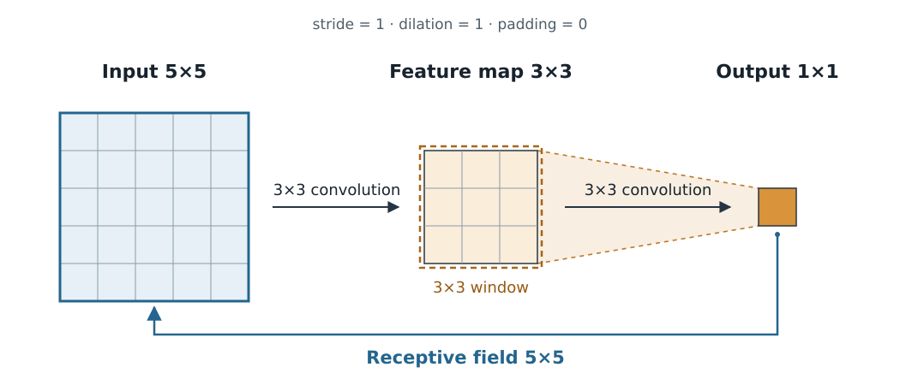

# CNN의 Kernel과 Receptive Field

합성곱 신경망(convolutional neural network, CNN)은 격자 형태 자료에서 국소적인 가중합을 반복해 특징을 계산한다. 논문에 나오는 kernel size, channel, receptive field를 이해하려면 각 크기를 **어느 층의 어떤 좌표에서 측정하는지** 확인하면 된다. 영상의 높이·너비를 예로 들되, 같은 원리는 1차원 시계열이나 3차원 격자에도 적용된다. [1, §§9.1–9.2; 2, Problem setup]

## 1. Kernel, filter, channel, feature map

**Kernel(커널)**은 국소 가중합에 사용하는 가중치 배열을 가리킨다. **Filter(필터)**도 관련 문헌과 구현에서 이 가중치에 쓰이는 이름이다. 용어와 함께 배열 shape를 확인하면 연결 관계를 알 수 있다. 일반적인 2차원 convolution에서 출력 채널 하나를 계산하는 가중치는 \(C_{\mathrm{in}}\times k_h\times k_w\)개다. 여기서 \(C_{\mathrm{in}}\)은 입력 채널 수, \(k_h,k_w\)는 공간 방향의 kernel size다. [1, §9.5; 3, Variables; 4, 연산 설명]

**Channel(채널)**은 같은 공간 위치의 성분을 구분하는 축이다. RGB 영상의 세 성분과 중간 층에서 학습한 여러 특징 채널이 여기에 해당한다. **Feature map(특징 맵)**은 공간 좌표에 특징 값을 배열한 출력이다. 채널 하나의 \(H\times W\) 배열을 가리키거나 전체 \(H\times W\times C\) 출력을 가리키는 문맥이 있으므로, shape를 함께 읽는다. [2, Problem setup; 4, 입력·출력 정의]

### (1) 가중치와 출력의 크기

`Conv2d(in_channels=3, out_channels=16, kernel_size=3, groups=1)`을 예로 들면, PyTorch 가중치 shape는 \((16,3,3,3)\)이다. 출력 채널 하나가 입력 채널 세 개의 \(3\times3\) 영역을 함께 사용한다. Bias를 포함한 학습 매개변수 수는 \(16\times3\times3\times3+16=448\)개다. 공간 위치마다 같은 가중치를 공유한다. 이는 공식 연산 정의에 대입한 자체 예제다. [1, §9.2; 3, 연산식 and Variables]

일반적인 convolution 구현은 kernel 원소를 뒤집지 않는 교차상관(cross-correlation)을 사용한다. Stride 1, dilation 1, padding 0인 경우 한 출력 원소는 다음과 같다. [1, §9.1; 3, 연산식]

\[
y_{o,u,v}=b_o+\sum_{c=1}^{C_{\mathrm{in}}}
\sum_{a=0}^{k_h-1}\sum_{b=0}^{k_w-1}
W_{o,c,a,b}\,x_{c,u+a,v+b}.
\]

\(o,c\)는 출력·입력 채널, \(u,v\)는 출력의 공간 인덱스다. 이 식에서 \(x\)는 **해당 층의 입력 feature map**이다. 첫 층에서는 원 입력 영상이고, 다음 층에서는 앞 층이 계산한 특징 값이다. 그룹 convolution에서는 그룹에 속한 입력 채널들끼리 연결하므로 가중치 shape도 함께 확인한다. [3, groups; 4, patch 추출 설명]

## 2. Stride, padding, dilation

| 용어 | 정의 | 읽는 예 |
|---|---|---|
| Stride \(s\) | 출력 위치를 한 칸 옮길 때 해당 층 입력 격자에서 window를 이동하는 간격 | \(s=2\)이면 두 칸씩 이동한다. |
| Padding \(p\) | 경계를 확장하는 처리 | Zero padding은 경계 밖에 0을 둔다. 대칭 padding \(p=1\)이면 양쪽에 한 칸씩 추가한다. |
| Dilation \(d\) | 이웃 kernel 원소가 참조하는 해당 층 입력 격자점 사이 간격 | \(d=2\)이면 한 칸을 건너뛰며 참조한다. |

세 매개변수의 공간 단위는 해당 층 입력 격자의 한 칸이다. 한 축에서 \(k\)개 kernel 원소가 차지하는 폭은 \(k_{\mathrm{eff}}=d(k-1)+1\)이다. 이를 kernel의 effective size라고 부를 수 있으며, 뒤에서 설명할 effective receptive field와는 정의가 다르다. [2, Other network operations; 3, Parameters and Shape]

입력 길이 \(n_{\mathrm{in}}\), 양쪽 대칭 padding \(p\)에 대해 출력 길이는

\[
n_{\mathrm{out}}=
\left\lfloor\frac{n_{\mathrm{in}}+2p-d(k-1)-1}{s}+1\right\rfloor
\]

이다. 예를 들어 \(n_{\mathrm{in}}=7,k=3,s=2,p=1,d=1\)이면 출력 길이는 4다. 2차원에서는 높이·너비에 각각 적용한다. 비대칭 padding을 쓰면 \(2p\) 대신 양쪽 padding의 합을 사용한다. [2, Problem setup; 3, Shape; 자체 대입 예제]

## 3. Receptive field

**Receptive field(RF, 수용영역)**는 어떤 출력 원소까지 이어지는 계산 경로를 원 입력으로 추적했을 때 연결되는 입력 영역이다. **Theoretical receptive field(이론적 수용영역)**의 크기는 층의 연결, kernel, stride, dilation을 이용해 구한다. 크기를 폭으로 표현할 때는 그 범위에 실제로 참조되지 않는 격자점이 포함될 수 있다. [2, Computing receptive field size; 5, §2]

<figure markdown="span">
  
  <figcaption markdown="1">Kernel size \(3\times3\), stride 1, dilation 1, padding 0인 두 층을 보여 주는 위키 자체 도식이다. 마지막 층의 \(3\times3\) window는 첫 특징 맵에 놓이고, 원 입력으로 추적한 receptive field는 \(5\times5\)다. 설명용 격자이며 실제 학습 결과를 사용하지 않았다. [2, Single-path networks] [크게 보기](images/cnn-receptive-field.svg)</figcaption>
</figure>

### (1) 크기를 누적하는 식

단일 경로의 국소 convolution·pooling 층을 가정한다. 원 입력에서 잰 RF 폭을 \(R_\ell\), 이웃 출력 원소의 원 입력 기준 간격을 \(J_\ell\)로 두면 초기값과 점화식은 다음과 같다. [2, Single-path networks의 식을 순방향으로 정리]

\[
R_0=J_0=1,\qquad
R_\ell=R_{\ell-1}+d_\ell(k_\ell-1)J_{\ell-1},\qquad
J_\ell=s_\ell J_{\ell-1}.
\]

새 층은 이전 층의 특징을 여러 위치에서 모으므로 \(d_\ell(k_\ell-1)\)개의 위치 간격만큼 입력 범위가 늘어난다. 그 위치 간격을 원 입력 좌표로 바꾼 값이 \(J_{\ell-1}\)다. 국소 연산의 연결을 합성해 얻는 관계이며, 가지가 있는 구조에서는 경로별 범위와 정렬을 함께 추적한다. [2, Single-path networks and Arbitrary computation graphs]

### (2) 작은 계산 예제

모든 kernel이 \(3\times3\), dilation이 1이고 각 축의 stride를 아래처럼 선택했다고 가정한다. 표의 값은 위 점화식으로 계산한 자체 예제다.

| 위치 | Stride | 원 입력 기준 RF 폭 \(R\) | 간격 \(J\) |
|---|---|---|---|
| 입력 | — | 1 | 1 |
| Conv 1 | 1 | 3 | 1 |
| Conv 2 | 2 | 5 | 2 |
| Conv 3 | 1 | 9 | 2 |

Conv 3는 직전 특징 맵의 \(3\times3\) 영역을 사용하고 원 입력 기준 RF 폭은 \(9\times9\)다. 세 번째 층의 dilation만 2로 바꾸면 \(R_3=5+2(3-1)\times2=13\)이 된다. Padding은 RF의 위치와 원 입력에 실제로 겹치는 영역에 영향을 준다. 경계에서는 패딩으로 채운 위치와 실제 입력 위치를 함께 구분한다. [2, Computing receptive field region and Dilated convolution]

## 4. Effective receptive field

**Effective receptive field(ERF, 유효 수용영역)**는 출력에 상당한 영향을 주는 입력 영역을 다룬다. Luo 등은 입력 위치 \((i,j)\)의 영향량을 출력 \(y_{0,0}\)의 입력 \(x_{i,j}\)에 대한 기울기 \(\partial y_{0,0}/\partial x_{i,j}\)로 분석했다. 연결 구조로 정해지는 범위 안에서도 영향의 크기는 위치마다 달라질 수 있다. 이 연구는 분석한 조건에서 중심에 영향이 집중되는 형태를 유도하고 관찰했다. [5, §§2–3; 2, Discussion]

ERF를 수치로 비교할 때는 기울기의 절댓값·제곱 등 어떤 영향량을 집계했는지, 어떤 입력과 학습된 가중치를 사용했는지, 영역을 정하는 기준이 무엇인지 확인한다. 정의와 측정 방식에 따라 보고되는 크기를 해석한다. [5, §§2 and 3.1]

## 5. 관련 용어와 자료

Fidelity를 포함한 다른 용어는 용어 찾아보기에서 검색할 수 있다. [머신러닝 용어 찾아보기](glossary.md)

1. I. Goodfellow, Y. Bengio, A. Courville, *Deep Learning*, Chapter 9 (2016). [공식 본문](https://www.deeplearningbook.org/contents/convnets.html)
2. A. Araujo, W. Norris, J. Sim, “Computing Receptive Fields of Convolutional Neural Networks,” *Distill* (2019). [원문과 상호작용 예제](https://distill.pub/2019/computing-receptive-fields/)
3. PyTorch, `torch.nn.Conv2d`, 연산식·Parameters·Variables·Shape. [공식 문서](https://docs.pytorch.org/docs/stable/generated/torch.nn.Conv2d.html)
4. TensorFlow, `tf.nn.conv2d`, patch 추출과 filter shape. [공식 문서](https://www.tensorflow.org/api_docs/python/tf/nn/conv2d)
5. W. Luo et al., “Understanding the Effective Receptive Field in Deep Convolutional Neural Networks,” *NIPS 29* (2016), §§2–3. [원문](https://proceedings.neurips.cc/paper_files/paper/2016/file/c8067ad1937f728f51288b3eb986afaa-Paper.pdf)
