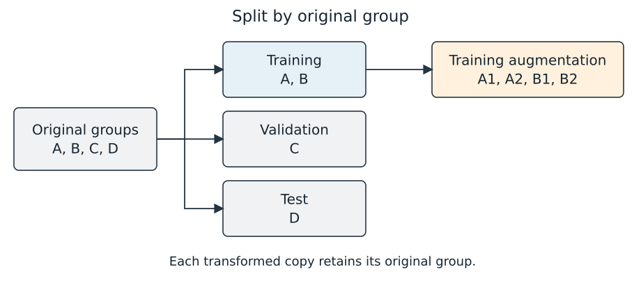

# Data augmentation

**Data augmentation(데이터 증강)**은 기존 자료에서 변환한 입력과 그에 맞는 표적을 만들어 학습에 사용하는 방법이다. 입력의 회전·이동, 관측 잡음, 혼합 등 변환의 종류에 따라 필요한 가정이 달라진다. 어떤 변화에 대해 모델이 같은 답을 내거나 정해진 방식으로 답을 바꾸어야 하는지부터 정한다. [1, §§1,3.1; 2, Data augmentation techniques]

## 1. 변환과 학습 목적함수

학습 자료를 \(D=\{(x_i,y_i)\}_{i=1}^N\), 모델을 \(f_\theta\), 손실 함수를 \(\ell\)로 두자. 입력 변환 \(T\)와 대응하는 표적 변환 \(\tau_T\)를 정하고, 선택한 변환 분포 \(\mathcal A\)에서 \(T\)를 뽑으면 증강 학습을 다음과 같이 표현할 수 있다. [1, §3.1, Eqs. (1)–(5)의 변환 평균을 표적 변환까지 명시한 표현; 2, geometric transformations]

\[
\widehat R_{\mathrm{aug}}(\theta)
=\frac1N\sum_{i=1}^N
\mathbb E_{T\sim\mathcal A}
\left[\ell\!\left(f_\theta(Tx_i),\tau_Ty_i\right)\right].
\]

\(\theta\)는 학습 매개변수다. 기대값은 변환들을 평균한다는 뜻이며, 실제 학습에서는 무작위 변환을 샘플링해 근사할 수 있다. 저장한 증강 자료를 사용하는 방식과 학습 중에 변환하는 online augmentation 모두 가능하다. [1, §3.1; 2, online and offline augmentation]

**Label-preserving augmentation(표적 보존 증강)**에서는 \(\tau_Ty=y\)다. 숫자 분류 영상의 회전처럼 변환 후 클래스가 유지되는지 자체적으로 확인해야 한다. 방향에 따라 의미가 바뀌는 표적에는 그에 맞는 변환이나 다른 학습 조건이 필요하다. [1, §3.1의 분포 불변 가정; 2, rotation의 label-preservation 논의]

**Equivariant target transformation(등변 표적 변환)**은 입력이 변할 때 벡터·텐서 등의 표적도 규칙에 따라 바꾸는 경우다. 변환의 수학적 정의는 대칭성 문서에서 살펴본다. [3, §4.2; 4, Results “Equivariance”] [불변성과 공변성](representation-and-symmetry.md#invariance-equivariance)

## 2. 원자론적 자료의 예제

### (1) 회전과 이동

외부 방향을 정하는 장이나 경계조건이 없는 고립된 원자계의 전체 구조를 회전·이동시키는 예를 생각하자. 위치 \(\mathbf r_i\)에 proper rotation \(Q\), 이동 \(\mathbf t\)를 적용하면

\[
\mathbf r_i'=Q\mathbf r_i+\mathbf t,\qquad
E'=E,\qquad
\mathbf F_i'=Q\mathbf F_i
\]

이다. \(E\)는 스칼라 에너지, \(\mathbf F_i\)는 Cartesian 힘 벡터다. 회전 행렬은 \(Q^TQ=I\), \(\det Q=1\)을 만족한다. 에너지의 불변성과 그 미분으로 얻는 힘의 등변성에 근거한 표적 변환이다. [3, §4.2, Eq. (4); 4, Results “Equivariance”, Eqs. (1)–(3)]

예를 들어 \(z\)축으로 90° 능동 회전시키는 행렬과 힘이

\[
Q=\begin{pmatrix}0&-1&0\\1&0&0\\0&0&1\end{pmatrix},\qquad
\mathbf F=(1,2,0)\ \mathrm{eV/\mathring A}
\]

이면 \(Q\mathbf F=(-2,1,0)\ \mathrm{eV/\mathring A}\)다. 힘의 크기는 \(\sqrt5\ \mathrm{eV/\mathring A}\)로 유지된다. 이는 위 식을 대입한 자체 예제다.

주기계의 좌표 표현을 회전할 때는 셀 벡터도 같은 변환을 적용한다. 전기장이나 구속 방향이 물리 문제에 포함되면 해당 조건까지 어떻게 변환하는지 정한다. 원자 순서를 바꾸는 경우에는 원자종과 원자별 표적의 순서를 함께 맞춘다. 셀과 원자의 동시 회전은 같은 기하를 유지하기 위한 좌표 변환의 자체 적용이며, 원자별 표적의 재정렬은 해당 원자에 값을 대응시키는 규약이다. [4, Results “Equivariance” and “Neural equivariant interatomic potentials”]

### (2) 밀도장과 격자 표현

전자 밀도 \(\rho(\mathbf r)\)를 스칼라장으로 다루는 좌표 변환은

\[
\rho'(\mathbf r)=\rho\!\left(Q^T(\mathbf r-\mathbf t)\right)
\]

로 표현할 수 있다. 여기서 입력과 출력 격자의 원점·간격·셀 및 좌표계를 함께 정한다. 연속 좌표에서의 변환을 유한 격자에 적용할 때는 보간 오차와 경계 처리를 확인하고, 전자수 \(\int\rho(\mathbf r)\,d\mathbf r\) 같은 보존량도 점검한다. 이 식은 스칼라장의 좌표 변환 법칙을 밀도장에 적용한 것이다. [5, §4.4, Eq. (4)의 inverse action에 의한 자체 유도; 3, scalar invariant 전제] [밀도와 전하의 자기일관 계산](../atomistic-simulation/dftb-large-scale.md)

## 3. Noise augmentation과 mixup

**Noise augmentation(잡음 증강)**은 선택한 잡음 모형으로 입력을 섭동하는 방법이다. 관측 잡음에 대해 같은 정답을 유지한다는 가정과, 원자 변위로 실제 에너지·힘이 변하는 상황을 각각 정의한다. 원자 변위 자료를 만들 때에는 새 구조의 표적을 계산하거나 그 표적을 정당화할 모형을 제시한다. 잡음의 단위와 크기도 원 입력의 물리 단위에 맞춘다. [2, noise injection; 3, energy–force relation]

**Mixup**은 두 학습 쌍 \((x_i,y_i),(x_j,y_j)\)를 계수 \(\lambda\in[0,1]\)로 섞는 학습 방법이다. 원 논문은 [6, §2의 혼합 입력·표적 식]

\[
\tilde x=\lambda x_i+(1-\lambda)x_j,\qquad
\tilde y=\lambda y_i+(1-\lambda)y_j
\]

를 사용한다. 분류의 one-hot label도 연속적인 soft label로 섞는다. 예를 들어 \(\lambda=0.25\), label이 \((1,0)\)과 \((0,1)\)이면 혼합 label은 \((0.25,0.75)\)다. 이 수치는 정의를 적용한 자체 예제다. 원자 좌표나 물리장을 섞을 때는 원자종 대응·기하학과 새 표적의 의미를 함께 확인해야 한다. [6, §2; 2, mixing images]

## 4. 자료 분할과 증강

증강본은 원본과 정보를 공유한다. 새 원본에 대한 성능을 평가하려면 원본 식별자나 물리적으로 독립적인 그룹을 기준으로 먼저 분할하고, 학습 자료에 증강을 적용할 수 있다. 시간 궤적에서는 인접 프레임의 상관관계와 실제 평가 시간 구간도 고려한다. 전처리의 평균·분산 등 학습되는 값은 학습 부분에서 추정한다. [7, L1.2 and L3; 8, §12.2; 9, Grouped data and time series]

<figure markdown="span">
  
  <figcaption markdown="1">새 원본 그룹의 예측 성능을 평가하는 분할을 표현한 위키 자체 도식이다. A–D는 실제 연구 자료가 아닌 원본 그룹 식별자다. 같은 원본의 변환본은 해당 그룹 안에 둔다. [7, L1.2 and L3; 8, §12.2; 9, Grouped data] [크게 보기](images/augmentation-split.svg)</figcaption>
</figure>

증강 개수, 변환 강도, 적용 확률은 학습 조건이다. 비교할 때는 독립 시험 자료와 지표를 고정하고, 원본 수·증강 방식·학습 중 샘플링 수와 update 수를 기록한다. 같은 epoch 수라도 자료를 저장해 늘린 경우와 online 변환을 사용한 경우의 update 수가 달라질 수 있다. [1, empirical risk averaging; 2, online/offline augmentation; 9, evaluation split] [Epoch와 batch](training-and-optimization.md#epoch-and-batch), [평가와 전이 가능성](evaluation-and-transferability.md)

## 5. 관련 이론과 참고 자료

- [표현과 대칭성](representation-and-symmetry.md)
- [일반화·자료 누출·전이 가능성](evaluation-and-transferability.md)
- [CNN kernel과 수용영역](cnn-kernel-receptive-field.md)
- [Born 유효전하의 머신러닝](../../computational-materials-science/dielectric-response/ml-born-effective-charge.md)

1. S. Chen, E. Dobriban, J. H. Lee, “A Group-Theoretic Framework for Data Augmentation,” *JMLR* **21**, 245 (2020). [원문](https://www.jmlr.org/papers/volume21/20-163/20-163.pdf)
2. C. Shorten, T. M. Khoshgoftaar, “A survey on Image Data Augmentation for Deep Learning,” *J. Big Data* **6**, 60 (2019). [원문](https://doi.org/10.1186/s40537-019-0197-0)
3. K. T. Schütt et al., “SchNet: A continuous-filter convolutional neural network for modeling quantum interactions,” *NIPS* (2017). [원문](https://arxiv.org/pdf/1706.08566)
4. S. Batzner et al., “E(3)-Equivariant Graph Neural Networks for Data-Efficient and Accurate Interatomic Potentials,” *Nat. Commun.* **13**, 2453 (2022). [원문](https://arxiv.org/pdf/2101.03164)
5. T. S. Cohen, M. Welling, “Group Equivariant Convolutional Networks,” *ICML* (2016), §4.4, Eq. (4). [원문](https://proceedings.mlr.press/v48/cohenc16.pdf)
6. H. Zhang et al., “mixup: Beyond Empirical Risk Minimization,” *ICLR* (2018). [원문](https://arxiv.org/pdf/1710.09412)
7. S. Kapoor, A. Narayanan, “Leakage and the reproducibility crisis in machine-learning-based science,” *Patterns* **4**, 100804 (2023). [원문](https://pmc.ncbi.nlm.nih.gov/articles/PMC10499856/)
8. scikit-learn, “Common pitfalls”, §12.2. [공식 문서](https://scikit-learn.org/stable/common_pitfalls.html#data-leakage)
9. scikit-learn, “Cross-validation”. [공식 문서](https://scikit-learn.org/stable/modules/cross_validation.html)
