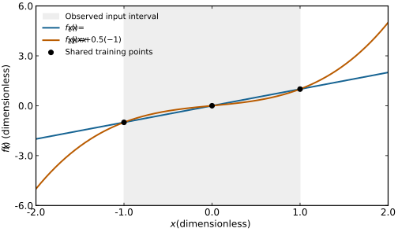

# Evaluation and transferability

학습한 모델의 성능은 어떤 자료에서 어떤 출력을 비교했는지에 따라 해석한다. 이 문서는 회귀 오차 지표를 정의한 뒤, 학습·검증·시험 자료와 일반화, 외삽 및 전이 가능성을 연결한다. 모델을 갱신하는 목적함수와 계산 과정은 별도 문서에서 설명한다. [1, §5.2; 2, Regression metrics] [학습과 최적화](training-and-optimization.md)

## 1. MAE, MSE, RMSE

Mean absolute error (MAE)는 평균 절대 오차, mean squared error (MSE)는 평균 제곱 오차, root mean squared error (RMSE)는 평균 제곱 오차의 제곱근이다.

평가 기준값 \(y_i\), 예측 \(\hat y_i\), 오차 \(e_i=\hat y_i-y_i\), 평가 자료 수 \(N\)에 대해, 단일 스칼라 출력의 동일 가중치 지표는 다음과 같다. [2, Mean absolute error and Mean squared error; 3, §§2–3]

\[
\mathrm{MAE}=\frac1N\sum_{i=1}^N|e_i|,\qquad
\mathrm{MSE}=\frac1N\sum_{i=1}^Ne_i^2,\qquad
\mathrm{RMSE}=\sqrt{\frac1N\sum_{i=1}^Ne_i^2}.
\]

MAE와 RMSE의 단위는 출력과 같고, MSE는 출력 단위의 제곱이다. RMSE는 큰 오차를 제곱해 평균하므로 오차 분포의 큰 값에 더 민감하다. 같은 표본과 동일 가중치를 쓰면 \(\mathrm{RMSE}\ge\mathrm{MAE}\)다. [2, Regression metrics; 3, §§2–3]

### (1) 작은 계산 예제

오차가 \([0,0,3]\) eV인 세 예측을 가정하면 MAE는 1 eV, MSE는 3 eV\(^2\), RMSE는 \(\sqrt3\simeq1.732\) eV다. 오차가 모두 1 eV이면 MAE와 RMSE가 모두 1 eV다. 이는 두 지표가 같은 평균 크기에서도 오차의 분포를 다르게 반영함을 보여 주는 자체 예제다. [2, 3의 정의를 적용한 계산]

### (2) 원자론적 출력의 집계

힘처럼 구조마다 원자 수가 다른 벡터 출력을 평가할 때는 어떤 원소를 평균하는지 명시한다. 예를 들어 모든 원자·Cartesian 성분의 MAE와 구조별 MAE를 먼저 구한 뒤 구조를 동일 가중하는 값은 각기 다른 집계다. 에너지에서도 eV와 eV/atom을 구분한다. 이는 다중 출력과 가중치가 있는 오차 지표를 적용한 조건이다. [2, Multioutput and Regression metrics; 4, §4.2, Eq. (5)의 에너지·힘 loss]

## 2. Generalization과 자료 분할

**Generalization(일반화)**은 학습한 규칙이 새로운 입력에서도 성능을 내는 성질이다. 평가 대상 분포 \(P(x,y)\), 고정된 모델 \(f\), 손실 함수 \(\ell\)를 지정하면 기대 위험도는

\[
R_P(f)=\mathbb E_{(x,y)\sim P}\,[\ell(f(x),y)]
\]

로 표현된다. 유한 시험 자료에서 계산한 평균 손실은 이를 추정하는 값이다. 새로운 입력의 분포, 자료의 독립성 및 표본 추출 방법이 추정의 해석에 포함된다. [1, §5.2; 5, §4.2의 population risk 정의]

**Training set(학습 자료)**는 매개변수 학습에 사용하고, **validation set(검증 자료)**는 모델 선택과 하이퍼파라미터 선택에 사용한다. **Test set(시험 자료)**는 선택된 절차의 평가에 사용한다. 교차검증에서는 각 fold에서 전처리와 학습을 해당 학습 부분에 맞추어 수행한다. [1, §5.3; 6, Cross-validation and data transformation]

### (1) Overfitting

**Overfitting(과적합)**은 학습 자료에 맞춘 정도에 비해 같은 목표 분포의 새로운 자료에서 성능이 떨어지는 현상이다. 예를 들어 학습 MSE가 감소하는 동안 검증 MSE가 증가하면, 선택한 자료 분할에서 추가 학습이 검증 성능을 악화시키는 양상이다. 학습 곡선은 동일한 평가 지표와 전처리 조건으로 읽는다. [1, §5.2; 7, §3.5.1]

정규화와 데이터 증강은 일반화 오차를 줄이기 위해 사용하는 방법들이다. 각 방법의 효과는 실제 평가 자료와 조건에서 비교한다. [8, §§7.1,7.4,7.8; 9, Introduction and augmentation techniques] [정규화](training-and-optimization.md#regularization), [데이터 증강](data-augmentation.md)

### (2) Data leakage

**Data leakage(데이터 누출)**는 평가 시 사용할 수 없는 정보가 모델 구성 과정에 유입되는 문제다. 시험 자료를 포함해 평균·분산을 계산하거나, 같은 원본에서 만든 증강 자료가 학습과 시험에 나뉘는 경우에는 평가가 의도한 새 자료의 성능보다 낙관적으로 나타날 수 있다. 전처리 매개변수는 학습 자료로 추정하고, 실제로 새롭다고 주장할 단위에 맞추어 분할한다. [10, Leakage taxonomy; 11, §12.2]

예를 들어 분자 A의 회전본 20개를 무작위 분할하면 두 집합에 같은 분자의 정보가 남을 수 있다. 새로운 분자로의 일반화를 평가하려면 분자 식별자를 기준으로 나눈 뒤 학습 쪽을 증강하는 구성을 사용할 수 있다. 같은 분자의 새 배치를 평가하려는 질문에는 그에 맞는 다른 분할을 정의한다. 이는 원본 중복과 비독립 자료에 대한 문헌 원칙을 적용한 자체 예제다. [10, L1.2 and L3; 6, Grouped data] [증강과 자료 분할](data-augmentation.md#split-and-augmentation)

## 3. Interpolation, extrapolation, distribution shift

**Interpolation(보간)**은 정한 입력 표현과 학습 범위 안에서 값을 추정하는 것이고, **extrapolation(외삽)**은 그 범위를 넘어선 입력에서 값을 추정하는 것이다. 1차원에서는 관측 입력의 최솟값과 최댓값이 단순한 경계가 된다. 고차원 원자 환경에서는 조성, 구조, 온도, 국소 descriptor 등 어떤 표현의 범위를 기준으로 삼았는지 함께 명시한다. [1, §5.11.2; 12, §II.D]

**Distribution shift(분포 변화)**는 학습과 사용 시의 자료 분포가 달라지는 것을 가리킨다. **Out-of-distribution (OOD, 분포 밖)** 평가에서는 어떤 조건을 학습에서 제외했는지 구체적으로 정한다. 조성·구조군·온도 구간을 제외한 시험과 같은 모집단의 무작위 분할 시험은 각기 다른 일반화 질문에 대응한다. 입력과 표적의 관계까지 달라질 수 있으므로 변화시킨 조건과 평가 출력을 함께 기록한다. [1, §5.2의 동일 분포 가정; 10, L3; 13, §2; 12, §II.D]

### (1) 같은 학습점에서 다른 함수

아래 두 함수를 생각하자.

\[
f_1(x)=x,\qquad f_2(x)=x+\tfrac12x(x^2-1).
\]

\(x=-1,0,1\)에서는 두 함수의 값이 모두 같다. \(x=0.5\)에서는 각각 0.5와 0.3125이고, \(x=2\)에서는 2와 5다. 학습점 세 개에 맞춘 두 함수를 이용한 자체 수학 예제다. 미관측 입력에서 두 함수가 줄 수 있는 값의 차이를 보여 준다. 실제 학습 모델이나 재료 데이터는 사용하지 않았다.

<figure markdown="span">
  
  <figcaption markdown="1">본문의 $f_1,f_2$를 직접 그린 위키 수학 예시다. 회색 범위는 관측 입력 구간 $[-1,1]$이고 점 세 개는 공통 학습점이다. 축은 무차원이다. 실제 훈련 결과가 아니며, 구간 안팎의 오차가 커지는 보편적 비율을 주장하지 않는다. [크게 보기](images/interpolation-extrapolation.svg)</figcaption>
</figure>

## 4. Transferability와 transfer learning

**Transferability(전이 가능성)**은 학습된 특징이나 모델을 지정한 새 대상에 적용했을 때 유용한 성능을 유지하는 정도를 가리킨다. 특징 전이 연구에서는 source task에서 얻은 특징을 target task에 옮긴 뒤 목표 성능을 비교한다. 원자론적 모델에서는 새로운 구조·화학 환경 등 적용 범위를 명시해 평가한다. 하나의 보편적 숫자로 고정하기보다 출발 자료, 목표 자료, 재학습 조건 및 평가 지표로 사용 맥락을 정한다. [13, §2; 14, Introduction and Experimental setup; 4, Introduction and benchmarks]

**Transfer learning(전이학습)**은 기존 과제·도메인에서 얻은 지식을 목표 과제·도메인에 활용하는 학습 접근이다. **Fine-tuning(미세조정)**은 사전학습한 매개변수의 일부 또는 전체를 목표 자료로 다시 갱신하는 절차다. 특징을 고정한 평가와 미세조정 후의 평가는 목표 자료로 갱신한 범위를 함께 기록한다. [13, §2; 14, Experimental setup]

### (1) 목표 자료의 위험도와 비교 예제

출발 자료에서 학습한 모델을 \(f_S\), 목표 자료의 분포를 \(P_T\)라 하면, 모델을 고정한 전이 평가는 앞의 기대 위험도 \(R_{P_T}(f_S)\)를 대상으로 한다. 미세조정을 했다면 갱신한 모델과 사용한 목표 학습 자료도 명시한다. 목표 자료로 처음부터 학습한 기준과 비교할 때는 목표 학습·검증·시험 자료 및 선택 조건을 맞춘다. 이는 source/target task와 특징 고정·미세조정 실험을 평가 위험도로 표현한 것이다. [13, §2; 14, Experimental setup]

다음은 같은 목표 시험점 세 개에서 얻었다고 가정한 오차의 자체 예제다. 단위는 eV이고, 각 행의 MAE는 세 절대 오차를 평균해 계산했다.

| 비교하는 모델 | 시험 오차 세 개 (eV) | MAE (eV) |
|---|---|---|
| 출발 모델을 고정 | 0.1, −0.1, 0.2 | 0.1333 |
| 같은 목표 학습 자료로 미세조정 | 0.05, −0.05, 0.1 | 0.0667 |
| 목표 학습 자료로 처음부터 학습 | 0.2, −0.2, 0.2 | 0.2000 |

이 표는 고정한 모델의 적용과 목표 자료로 갱신한 모델의 평가를 설명하는 숫자 예제다. 실제 전이 효과를 해석할 때는 해당 목표 시험 분포, 비교 자료와 학습 조건을 함께 보고한다. [13, §2; 14, Experimental setup]

### (2) 과학 머신러닝에서 적용 범위를 정하는 예

| 바꾸는 조건 | 정의할 시험 자료 | 함께 확인할 출력 |
|---|---|---|
| 구조·분자군 | 학습에서 제외한 원본 구조군 | 에너지·힘 또는 지정 표적 |
| 온도·strain | 제외한 조건과 구조 분포 | 평균·최대 오차, 해당 물성 |
| 채널 길이 | 짧은 구조와 독립적인 긴 구조 | 밴드, \(T(E)\), 전류 등 |
| 계산 수준·표적 | 목표 수준의 독립 자료 | 목표 수준에 대한 오차 |

이 표는 문헌의 일반화와 전이 개념을 원자론적 연구에 적용한 평가 예시다. 목표 모델과 자료를 고정한 뒤 오차와 적용 범위를 해석한다. 구조·힘의 예는 SchNet, 길이가 다른 수송의 예는 DeePTB 문서에서 이어서 볼 수 있다. [4, benchmarks; 14, transfer evaluation] [DeePTB와 NEGF 수송](../../computational-materials-science/quantum-transport/deeptb-negf.md), [다중 충실도 학습](fidelity.md)

## 5. 참고 자료

1. I. Goodfellow, Y. Bengio, A. Courville, *Deep Learning*, Chapter 5 (2016). [공식 본문](https://www.deeplearningbook.org/contents/ml.html)
2. scikit-learn, “Metrics and scoring”, Regression metrics. [공식 문서](https://scikit-learn.org/stable/modules/model_evaluation.html#regression-metrics)
3. T. Chai, R. R. Draxler, “Root mean square error (RMSE) or mean absolute error (MAE)? Arguments against avoiding RMSE in the literature,” *Geosci. Model Dev.* **7**, 1247–1250 (2014). [원문](https://gmd.copernicus.org/articles/7/1247/2014/)
4. K. T. Schütt et al., “SchNet: A continuous-filter convolutional neural network for modeling quantum interactions,” *NIPS* (2017). [원문](https://arxiv.org/pdf/1706.08566)
5. S. Chen, E. Dobriban, J. H. Lee, “A Group-Theoretic Framework for Data Augmentation” (2020), §4.2. [원문](https://jmlr.org/papers/volume21/20-163/20-163.pdf)
6. scikit-learn, “Cross-validation”, Grouped data and data transformation. [공식 문서](https://scikit-learn.org/stable/modules/cross_validation.html)
7. scikit-learn, “Validation curves”, §3.5.1. [공식 문서](https://scikit-learn.org/stable/modules/learning_curve.html)
8. I. Goodfellow et al., *Deep Learning*, Chapter 7 (2016). [공식 본문](https://www.deeplearningbook.org/contents/regularization.html)
9. C. Shorten, T. M. Khoshgoftaar, “A survey on Image Data Augmentation for Deep Learning” (2019). [원문](https://doi.org/10.1186/s40537-019-0197-0)
10. S. Kapoor, A. Narayanan, “Leakage and the reproducibility crisis in machine-learning-based science,” *Patterns* **4**, 100804 (2023). [원문](https://pmc.ncbi.nlm.nih.gov/articles/PMC10499856/)
11. scikit-learn, “Common pitfalls”, §12.2. [공식 문서](https://scikit-learn.org/stable/common_pitfalls.html#data-leakage)
12. K. Li et al., “Probing out-of-distribution generalization in machine learning for materials” (2024), §II.D. [원문](https://arxiv.org/pdf/2406.06489)
13. S. J. Pan, Q. Yang, “A Survey on Transfer Learning,” *IEEE TKDE* **22**, 1345–1359 (2010). [DOI](https://doi.org/10.1109/TKDE.2009.191), [저자 공개 원문](https://www.cse.cuhk.edu.hk/~sinnopan/publications/TLsurvey_0822.pdf)
14. J. Yosinski et al., “How transferable are features in deep neural networks?”, *NIPS* (2014). [원문](https://arxiv.org/pdf/1411.1792)
