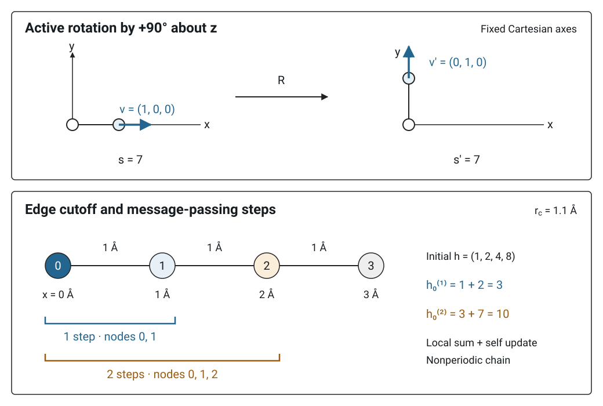

# Representations and symmetry

원자 구조를 학습 모델에 넣으려면 원자 종류와 좌표를 계산에 사용할 특징으로 표현해야 한다. 이때 **무슨 정보를 담는지**, **구조를 변환하면 특징과 출력이 어떻게 바뀌는지**, **어느 원자까지 정보가 전달되는지**를 함께 정한다. Descriptor와 embedding은 표현을 구성하는 말이고, attention과 message passing은 여러 표현을 결합하고 갱신하는 연산이다. 원자 환경의 표현과 그래프 학습의 정의를 연결해 읽으면 Hamiltonian과 응답 텐서 모델의 구조를 따라갈 수 있다. [1, §§I–III][2, §4.1][3, §2]

## 1. Descriptor와 원자 환경

**Descriptor(기술자)**는 입력의 구조적·화학적 특징을 수치로 나타낸 표현이다. 원자 모델에서는 중심 원자 주변의 원자 종류, 거리, 각도 등을 담는 함수나 그 함수값을 가리킨다. **Fingerprint(지문)**도 이 문맥에서 사용한다. 고정된 수학 함수로 구성할 수도 있고, 신경망으로 학습한 함수를 포함할 수도 있다. 실제 논문에서 어떤 입력을 어떤 연산으로 변환했는지 확인하면 된다. [1, §§I–III][4, pp. 146401-2–3][5, Fig. 1 및 Eqs. (6)–(7)]

중심 원자 \(i\)의 국소 환경을 다음처럼 나타낼 수 있다.

\[
\mathcal D_i=
\mathcal D\!\left(Z_i,
\{(Z_j,\mathbf r_j-\mathbf r_i)\mid
j\ne i,\ |\mathbf r_j-\mathbf r_i|<r_c\}\right).
\]

\(Z_i,Z_j\)는 원자 종류를 나타내는 원자번호, \(\mathbf r_i,\mathbf r_j\)는 위치 벡터, \(r_c\)는 이웃을 포함하는 cutoff 거리다. 중괄호는 이웃 집합을 나타낸다. 상대좌표는 전체 병진 이동을 제거하며, 회전과 같은 종 원자의 순서에 대한 처리는 \(\mathcal D\)의 구체적인 구성으로 정한다. 이 식은 국소 descriptor의 일반적인 입력 관계를 정리한 것이다. [1, §§II–III][4, Eqs. (3)–(5)]

### (1) 거리와 각도를 담은 작은 예제

중심 원자 주변에 같은 종의 이웃이 정확히 두 개 있다고 가정한다. 예제용 무차원 descriptor를

\[
\mathbf d_i=
\left(\frac{r_{i1}+r_{i2}}{r_0},\cos\theta_{1i2}\right)
\]

로 정의한다. \(r_{i1},r_{i2}\)는 중심에서 이웃까지의 거리, \(r_0=1\,\text{Å}\)는 정규화 길이, \(\theta_{1i2}\)는 중심에서 두 결합이 이루는 각이다. \(r_{i1}=r_{i2}=1\,\text{Å}\)이면 직각 배치의 표현은 \((2,0)\), 일직선으로 반대쪽에 놓인 배치의 표현은 \((2,-1)\)이다. 전체를 회전하거나 병진 이동해도 두 값은 각각 유지된다. 두 이웃의 번호를 서로 바꾸어도 값이 같다. 거리·각도 기반 표현의 성질을 보여 주기 위해 직접 정의하고 계산한 예제다. [1, §III][4, Eqs. (4)–(5)]

첫 성분만 저장하면 이 두 배치는 같은 값 2를 가진다. 여러 환경이 같은 표현으로 겹치면 뒤의 예측 함수는 그 표현만으로 서로 다른 출력을 배정할 수 없다. 따라서 대칭성에 맞는지와 함께 관심 환경을 구별할 정보가 남는지도 확인한다. [1, §I 및 §V.1][4, p. 146401-2]

Bartók 등은 원자 환경을 대칭 변환까지 허용하여 유일하게 결정할 수 있는 descriptor의 성질을 **completeness(완전성)**로 정의했다. [1, §I]

## 2. Embedding과 학습된 특징

**Embedding(임베딩)**은 원자 종류나 입력 특징을 계산에 사용할 벡터 표현으로 매핑하는 연산 또는 그 결과다. 범주별 학습 벡터를 표에서 꺼내 쓰는 방식과 연속적인 거리를 신경망에 통과시키는 방식이 모두 쓰인다. 벡터의 차원과 매핑 함수, 학습되는 매개변수를 함께 읽는다. [2, §4.1 “Molecular representation”][6, §3.4][5, Fig. 1 및 Eq. (7)]

원자 종류를 세 범주 H, C, O로 제한하고 학습 가능한 표를 \(W_E\in\mathbb R^{3\times2}\)로 두었다고 가정한다.

\[
W_E=
\begin{pmatrix}
0.2&-0.1\\
0.7&0.3\\
-0.4&0.8
\end{pmatrix},\qquad
\mathbf h_i^{(0)}=(W_E)_{c_i}.
\]

여기서 \(c_i\in\{1,2,3\}\)는 H, C, O에 대응시킨 범주 인덱스이고, \(\mathbf h_i^{(0)}\)는 원자 \(i\)의 초기 특징이다. 탄소 원자의 초기 embedding은 \((0.7,0.3)\)이며, 학습 전후로 표의 원소가 갱신될 수 있다. 같은 종은 같은 초기 벡터를 받고, 이후 이웃과 상호작용하는 층에서 환경에 따른 표현으로 갱신된다. 수치는 임의로 정한 설명용 값이다. SchNet은 원자 종류별 학습 embedding을 초기 표현으로 사용하는 실제 사례다. [2, Eq. (3) 및 §4.1][3, §2]

이 예제의 두 성분은 학습 특징 축이다. 물리 공간의 \(x,y\)축으로 해석하려면 해당 특징에 별도의 회전 변환 법칙을 부여해야 한다. 등변 모델에서는 스칼라·벡터·고차 텐서처럼 변환 법칙이 정해진 특징들을 사용한다. [7, §3][8, pp. 1–2]

## 3. Attention과 가중합

**Attention(어텐션)**은 입력에 따라 계산한 가중치로 여러 값의 표현을 결합하는 연산이다. Query는 현재 출력에 사용할 참조 표현, key는 각 후보와의 점수를 계산할 표현, value는 그 점수로 가중합할 내용에 해당한다. Bahdanau 등의 모델은 정렬 점수에 softmax를 적용해 입력 표현을 가중합하며, Vaswani 등은 query와 key의 내적을 사용하는 형식을 제시했다. [6, §3.2][9, §3.1, Eqs. (5)–(6)]

### (1) Scaled dot-product attention의 식과 shape

Vaswani 등의 **scaled dot-product attention**은 다음과 같이 정의한다. 여기서는 batch와 head 축을 생략하고, mask와 dropout을 적용하지 않는 한 head의 계산을 쓴다. [6, §3.2.1, Eq. (1)][10, 연산 정의와 참고 구현]

\[
S=\frac{QK^{\mathsf T}}{\sqrt{d_k}},\qquad
A_{ab}=\frac{\exp(S_{ab})}{\sum_{j=1}^{n_k}\exp(S_{aj})},\qquad
O=AV.
\]

| 기호 | Shape | 의미 |
|---|---|---|
| \(Q\) | \(n_q\times d_k\) | Query \(n_q\)개를 행으로 쌓은 행렬 |
| \(K\) | \(n_k\times d_k\) | Key \(n_k\)개를 행으로 쌓은 행렬 |
| \(V\) | \(n_k\times d_v\) | Key와 짝을 이루는 value 행렬 |
| \(S,A\) | \(n_q\times n_k\) | Query–key 점수와 행별 softmax 가중치 |
| \(O\) | \(n_q\times d_v\) | Query별 가중합 출력 |

\(d_k\)는 내적에 쓰는 query·key의 특징 차원, \(d_v\)는 value의 특징 차원이다. \(a,b,j\)는 행·항목 인덱스이고, \(\mathsf T\)는 전치다. \(A\)의 각 행은 양수이며 합이 1이다. 입력 특징과 학습 선형 투영으로 \(Q,K,V\)를 구성하는 경우가 많다. 분모의 \(\sqrt{d_k}\)는 내적 점수의 크기를 조절한다. [6, §§3.2.1–3.2.2][10, 참고 구현]

### (2) Query 하나와 value 두 개

모든 성분을 무차원으로 두고 다음과 같이 선택한다.

\[
Q=\begin{pmatrix}\sqrt2&0\end{pmatrix},\qquad
K=\begin{pmatrix}1&0\\0&1\end{pmatrix},\qquad
V=\begin{pmatrix}2&0\\0&4\end{pmatrix}.
\]

\(n_q=1,n_k=2,d_k=d_v=2\)다. 행렬곱 \(QK^{\mathsf T}\)의 shape는 \(1\times2\)이고 값은 \((\sqrt2,0)\)이다. \(\sqrt{d_k}=\sqrt2\)로 나누면 \(S=(1,0)\)을 얻는다. 행별 softmax를 계산하면

\[
A=\left(\frac{\mathrm e}{\mathrm e+1},\frac{1}{\mathrm e+1}\right)
\simeq(0.731059,0.268941),
\]

\[
O=0.731059(2,0)+0.268941(0,4)
\simeq(1.462117,1.075766)
\]

이다. \(\mathrm e=\exp(1)\)은 자연상수다. 최종 출력의 shape는 \(1\times2\)다. 첫 key와의 점수가 더 높으므로 첫 value에 더 큰 가중치가 주어진다. 원문 연산식에 임의 입력을 대입한 자체 계산이다. [6, Eq. (1)][10, 참고 구현]

### (3) Self-attention과 multi-head attention

**Self-attention(자기 어텐션)**에서는 query·key·value가 같은 입력 표현 집합에서 만들어진다. **Multi-head attention(다중 헤드 어텐션)**은 서로 다른 학습 투영으로 여러 attention을 계산하고 결과를 이어 붙인 뒤 다시 투영한다. 한 head가 계산하는 가중합은 위 예제와 같고, head마다 사용하는 투영이 달라질 수 있다. 이 정의는 Transformer 원문에 따른다. [6, §§3.2.2–3.2.3]

## 4. Invariance와 equivariance

**Invariance(불변성)**는 입력을 정해진 대칭 변환으로 바꾸어도 출력이 유지되는 성질이다. **Equivariance(등변성)**는 입력의 변환에 맞추어 출력도 정해진 법칙으로 변하는 성질이다. 입력 \(x\)에 대한 변환을 \(g\), 출력 공간의 변환을 \(D_{\mathrm{out}}(g)\)로 쓰면

\[
f(g\cdot x)=D_{\mathrm{out}}(g)f(x)
\]

가 등변성 조건이다. \(f\)는 예측 함수이고, \(g\cdot x\)는 변환된 입력이다. 출력 변환 \(D_{\mathrm{out}}(g)\)가 항등변환이면 불변성이 된다. 원자별 출력은 입력의 원자 순서를 바꾸었을 때 대응하는 순서로 재배열되고, 전체 에너지처럼 집계한 출력은 순서 변환에 대해 불변으로 구성할 수 있다. [7, §3 및 §3.1][8, pp. 1–2][3, §2]

### (1) 스칼라, 벡터, 2차 텐서

고정된 Cartesian 축에서 물리계를 능동적으로 회전한다고 정한다. 회전행렬 \(R\)은 \(R^{\mathsf T}R=I\)와 \(\det R=1\)을 만족한다. 외부장이나 주기 셀이 포함되면 그 조건도 함께 회전한 동일 물리계를 비교한다. 스칼라 \(s\), 극벡터 \(\mathbf v\), Cartesian 2차 텐서 \(T\)의 변환은

\[
s'=s,\qquad
\mathbf v'=R\mathbf v,\qquad
T'=RTR^{\mathsf T}
\]

이다. 프라임은 회전 후 성분, \(I\)는 단위행렬이다. 에너지는 스칼라, 힘은 극벡터의 예다. 2차 텐서의 두 인덱스는 각각 회전행렬 하나로 변환한다. 여기서 텐서의 **rank 2**는 Cartesian 인덱스가 두 개라는 뜻이다. [2, §§4–4.2][7, §§3.3, 5.2][8, pp. 1–2]

### (2) \(z\)축 주위 90° 회전 예제

오른손 좌표계에서 \(+z\)축 주위로 \(+90^\circ\) 회전하면 다음 행렬을 사용한다.

\[
R=\begin{pmatrix}0&-1&0\\1&0&0\\0&0&1\end{pmatrix}.
\]

무차원 값 \(s=7\), \(\mathbf v=(1,0,0)^{\mathsf T}\)와

\[
T=\begin{pmatrix}1&2&0\\3&4&0\\0&0&5\end{pmatrix}
\]

를 택하면

\[
s'=7,\qquad
\mathbf v'=\begin{pmatrix}0\\1\\0\end{pmatrix},\qquad
T'=\begin{pmatrix}4&-3&0\\-2&1&0\\0&0&5\end{pmatrix}
\]

를 얻는다. 벡터의 방향과 텐서 성분이 함께 변하며 \(\operatorname{tr}T=\operatorname{tr}T'=10\)은 유지된다. 위 변환식의 자체 행렬곱 예제이며 특정 물질의 계산값을 사용하지 않았다. [7, §3.3][8, pp. 1–2]

<figure markdown="span">
  
  <figcaption markdown="1">회전 변환과 국소 그래프의 정보 전달 범위를 설명하기 위해 새로 그린 위키 자체 도식이다. 위 패널은 고정된 Cartesian 축에서 $z$축 주위 $+90^\circ$ 능동 회전을 적용하며 스칼라 $s=7$과 벡터 $\mathbf v=(1,0,0)^{\mathsf T}$를 사용한다. 아래 패널은 주기 경계가 없는 네 원자 사슬, 간격 1 Å, cutoff 1.1 Å를 가정한다. 선은 직접 연결 edge, 괄호는 중심 원자 0에서 추적한 의존 범위다. 본문의 변환식과 message-passing 정의를 직접 정한 설명용 원자 배치로 시각화했다. [7, §3][3, §2][11, Fig. 1] [크게 보기](images/ml-symmetry-message-passing.svg)</figcaption>
</figure>

### (3) 반사와 물리적 출력의 조건

회전만 다루는 \(SO(3)\), 반사까지 포함하는 \(O(3)\), 병진 이동도 포함하는 \(E(3)\)는 서로 다른 변환 집합이다. \(O(3)\)에는 \(\det R=-1\)인 직교행렬도 들어가며, 특징에는 공간 반전 \(\mathbf r\mapsto-\mathbf r\)에 대한 부호인 parity도 지정할 수 있다. 따라서 논문의 “equivariant”를 읽을 때는 어떤 변환 집합과 어떤 출력 표현을 사용했는지 확인한다. [7, §§3.2–3.3][8, Eq. (8)][11, Results “Equivariance” 및 Eq. (7)]

원자구조와 출력이 만족할 대칭 관계는 모델 설계와 [데이터 증강](data-augmentation.md)에 함께 쓰인다. 실제 예측 오차와 학습 범위 밖 구조에 대한 성능은 [평가와 전이성](evaluation-and-transferability.md)에서 다룬다.

## 5. Locality와 cutoff

**Locality(국소성)**는 모델이 어느 범위의 입력에 의존하도록 구성되었는지를 나타낸다. 원자 모델의 **cutoff(차단 거리)** \(r_c\)는 직접 이웃을 정하는 거리 조건이다. 예를 들어 원자 \(i\)의 이웃 집합을

\[
\mathcal N(i)=\{j\ne i\mid r_{ij}<r_c\},\qquad
r_{ij}=|\mathbf r_j-\mathbf r_i|
\]

로 정의한다. \(r_{ij}\)와 \(r_c\)는 Å처럼 같은 길이 단위를 사용한다. 경계에서의 연산을 부드럽게 만들기 위해 거리 가중치에 매끄러운 cutoff 함수를 곱할 수 있다. 주기 구조에서는 셀과 이웃 이미지의 상대벡터도 지정해야 한다. [4, Eq. (3)][11, Eq. (6) 및 그 아래 주기 이웃 설명]

Cutoff는 모델의 입력 범위에 관한 선택이다. 장거리 전하·전위·분산 등의 기여를 포함하는 모델에서는 그 항과 정보 전달 경로를 추가로 정의한다. Behler–Parrinello의 2007년 구현은 cutoff 밖 장거리 항을 별도 항으로 확장할 가능성을 설명하며, DeePTB의 환경 표현도 명시한 원자 이웃 범위에서 구성된다. [4, p. 146401-4][5, Eqs. (6)–(7)]

## 6. Message passing과 hop

**Message passing(메시지 전달)**은 그래프의 이웃에서 메시지를 모아 각 원자의 특징을 갱신하는 과정이다. 원자를 node, 연결을 edge라 하고, 한 단계의 연산을

\[
\mathbf m_i^{(\ell+1)}=
\sum_{j\in\mathcal N(i)}
M_\ell(\mathbf h_i^{(\ell)},\mathbf h_j^{(\ell)},\mathbf e_{ij}),\qquad
\mathbf h_i^{(\ell+1)}=
U_\ell(\mathbf h_i^{(\ell)},\mathbf m_i^{(\ell+1)})
\]

로 나타낼 수 있다. \(\ell\)은 층 또는 전달 단계, \(\mathbf h_i^{(\ell)}\)는 원자 특징, \(\mathbf e_{ij}\)는 거리·방향 등의 edge 특징이다. \(M_\ell\)은 메시지 함수, \(U_\ell\)은 갱신 함수, \(\mathbf m_i^{(\ell+1)}\)는 집계한 메시지다. 특징과 메시지의 차원은 모델이 정한다. 합처럼 순서에 무관한 집계를 사용하면 이웃을 나열한 순서에 대한 일관성을 구성할 수 있다. [3, §2, Eqs. (1)–(3)][2, §3 Eq. (2) 및 §4.1]

**Hop(홉)**은 그래프 edge를 한 번 건너는 이동을 센다. 초기 원자 특징이 자기 원자의 정보만 포함하고, 매 단계가 위의 직접 이웃 갱신만 수행하면 \(L\)단계 후 원자 특징은 최대 \(L\)개 edge로 이어진 초기 특징에 의존한다. 각 edge의 길이가 \(r_c\)보다 작으면 \(L\ge1\)일 때 경로의 끝점 간 Euclidean 거리는 삼각부등식에 의해 \(Lr_c\)보다 작다. 실제 도달 원자는 edge의 연결로 정해진다. 이는 message-passing 식의 의존 관계를 단계별로 추적한 자체 유도다. [3, §2][11, Introduction 및 Eq. (6)]

### (1) Cutoff 1.1 Å인 사슬의 계산

주기 경계가 없는 네 원자를 \(x=(0,1,2,3)\,\text{Å}\)에 놓고 \(r_c=1.1\,\text{Å}\)로 정한다. 직접 이웃은 인접 원자들이다. 무차원 초기 특징을 \(h^{(0)}=(1,2,4,8)\)로 두고, 설명용 갱신을

\[
h_i^{(\ell+1)}=h_i^{(\ell)}+
\sum_{j\in\mathcal N(i)}h_j^{(\ell)}
\]

로 정하면 \(h^{(1)}=(3,7,14,12)\), \(h^{(2)}=(10,24,33,26)\)이다. 원자 0의 첫 갱신 \(h_0^{(1)}=1+2=3\)은 원자 0과 1에 의존한다. 다음 갱신 \(h_0^{(2)}=3+7=10\)은 원자 1의 갱신값을 통해 원자 2의 초기 특징 4에도 의존한다. 직접 edge의 cutoff를 유지하면서 정보가 두 hop까지 전달된 설명용 특징 갱신이다. [3, Eqs. (1)–(2)에 따른 자체 예제]

### (2) 출력별 의존 범위

위 hop 범위는 **원자 특징**에 관한 설명이다. 모든 원자의 출력을 더하는 전체 에너지 readout은 구조 전체의 특징을 집계한다. 그 에너지를 좌표로 미분한 힘의 의존 범위는 에너지 항들의 좌표 의존성을 따라 다시 확인해야 한다. 초기 특징에 이미 주변 정보를 넣거나 global attention·전역 상태 갱신을 추가하면 계산 경로에도 그 연산이 들어간다. 논문에서 locality를 비교할 때는 직접 edge cutoff, 전달 단계 수, 초기 특징, readout과 최종 물리량을 함께 기록한다. [3, §2 및 §5.2][2, §4.1 및 Eq. (4)][6, §3.2.3]

convolutional neural network (CNN)에서 원 입력까지 연결을 추적하는 원리는 그래프에서도 같은 질문으로 이어진다. 격자에서 kernel·stride·dilation으로 범위를 누적하는 예는 [CNN의 receptive field](cnn-kernel-receptive-field.md#receptive-field)에서 볼 수 있다.

## 7. 관련 이론과 실제 논문에서 읽을 부분

| 연구 문서 | 표현과 대칭을 읽는 지점 |
|---|---|
| [DeePTB와 NEGF 수송](../../computational-materials-science/quantum-transport/deeptb-negf.md) | 2024년 DeePTB 논문은 embedding network로 거리 정보를 변환하고, 회전·병진·순열에 불변인 환경 descriptor를 구성해 Slater–Koster 매개변수를 보정한다. [5, Fig. 1, Eqs. (5)–(7)] |
| [HamGNN-NEGF](../../computational-materials-science/quantum-transport/hamgnn-negf.md) | 2026년 수송 프리프린트는 \(E(3)\)-equivariant HamGNN으로 작은 구조의 Hamiltonian 자료를 학습하고 큰 장치의 Hamiltonian을 예측한다고 보고한다. [12, Abstract 및 Results, pp. 3–4] |
| [Born 유효전하의 머신러닝](../../computational-materials-science/dielectric-response/ml-born-effective-charge.md) | SevenNet-Polar 논문은 원자별 \(3\times3\) Born 유효전하를 자취·반대칭·대칭 무자취 성분으로 분해해 등변 출력을 구성한다. [13, §4.4] |

위 항목은 각 논문이 사용한 모델 구성을 요약한 것이다. 학습 변수와 손실의 연결은 [학습과 최적화](training-and-optimization.md), 용어별 탐색은 [머신러닝 용어 찾아보기](glossary.md)에서 이어진다.

## 8. 참고 자료

1. A. P. Bartók, R. Kondor, G. Csányi, “On representing chemical environments,” *Physical Review B* **87**, 184115 (2013). [원문](https://arxiv.org/html/1209.3140v3)
2. K. T. Schütt et al., “SchNet: A continuous-filter convolutional neural network for modeling quantum interactions,” *Advances in Neural Information Processing Systems* **30** (2017). [원문](https://arxiv.org/html/1706.08566v5)
3. J. Gilmer et al., “Neural Message Passing for Quantum Chemistry,” *Proceedings of Machine Learning Research* **70**, 1263–1272 (2017). [원문](https://proceedings.mlr.press/v70/gilmer17a/gilmer17a.pdf)
4. J. Behler, M. Parrinello, “Generalized Neural-Network Representation of High-Dimensional Potential-Energy Surfaces,” *Physical Review Letters* **98**, 146401 (2007). [논문](https://doi.org/10.1103/PhysRevLett.98.146401), [원문 PDF](https://aiichironakano.github.io/cs653/Behler-NNPES-PRL07.pdf)
5. Q. Gu et al., “Deep learning tight-binding approach for large-scale electronic simulations at finite temperatures with ab initio accuracy,” *Nature Communications* **15**, 6772 (2024). [원문](https://pmc.ncbi.nlm.nih.gov/articles/PMC11310461/)
6. A. Vaswani et al., “Attention Is All You Need,” *Advances in Neural Information Processing Systems* **30** (2017). [원문](https://arxiv.org/html/1706.03762v7)
7. N. Thomas et al., “Tensor field networks: Rotation- and translation-equivariant neural networks for 3D point clouds,” arXiv:1802.08219v3 (2018). [원문](https://arxiv.org/html/1802.08219v3)
8. A. Grisafi, D. M. Wilkins, G. Csányi, M. Ceriotti, “Symmetry-Adapted Machine Learning for Tensorial Properties of Atomistic Systems,” *Physical Review Letters* **120**, 036002 (2018). [원문](https://arxiv.org/pdf/1709.06757)
9. D. Bahdanau, K. Cho, Y. Bengio, “Neural Machine Translation by Jointly Learning to Align and Translate,” *ICLR* (2015). [원문](https://arxiv.org/html/1409.0473v7)
10. PyTorch, `torch.nn.functional.scaled_dot_product_attention`, 연산 정의·행렬 shape·참고 구현. [공식 문서](https://docs.pytorch.org/docs/2.15/generated/torch.nn.functional.scaled_dot_product_attention.html)
11. S. Batzner et al., “E(3)-equivariant graph neural networks for data-efficient and accurate interatomic potentials,” *Nature Communications* **13**, 2453 (2022). [원문](https://arxiv.org/pdf/2101.03164)
12. B. Liu et al., “Linear-Scaling Quantum Transport from Machine-Learning Density Functional Theory Hamiltonians,” arXiv:2609.37058v1 (2026). [원문](https://arxiv.org/pdf/2609.37058v1)
13. A. K. A. Lu et al., “SevenNet-Polar for MultiTask Prediction of Energy, Forces, Stress, and Born Effective Charges: Development and Application to ZrO\(_2\), Li\(_3\)PO\(_4\), and Perovskites,” arXiv:2607.14827v3 (2026). [원문](https://arxiv.org/html/2607.14827v3)
