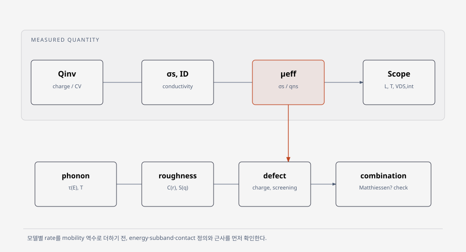

# Device physics

<figure markdown="span">

  

  <figcaption markdown="1">
  이 위키가 작성한 개요도. 반전층의 전하와 전도도로부터 이동도를 정의하고, 포논·계면 거칠기·결함 산란 모델을 연결한다. 이동도 결합식의 가정은 [Matthiessen 법칙](mobility/matthiessens-rule.md)에서 설명한다.
  </figcaption>
</figure>

- [이동도와 산란](mobility/index.md)
