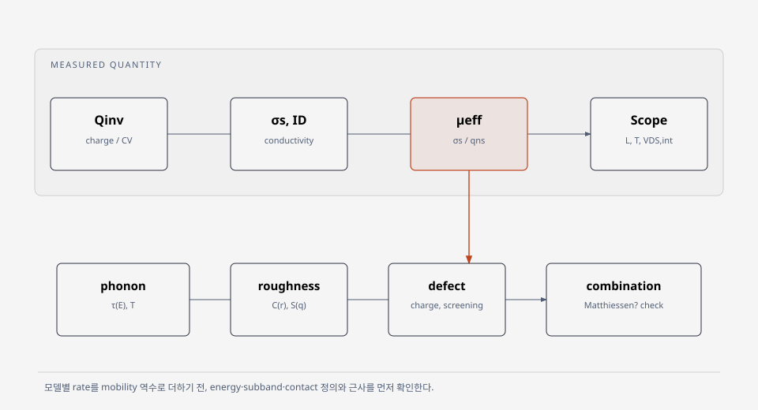

# Device physics

## Mobility

- [Inversion-layer mobility](mobility/inversion-layer-mobility.md)
- [Matthiessen's rule](mobility/matthiessens-rule.md)
- [Surface-roughness scattering model](mobility/surface-roughness-scattering.md)
- [Defect scattering model](mobility/defect-scattering.md)
