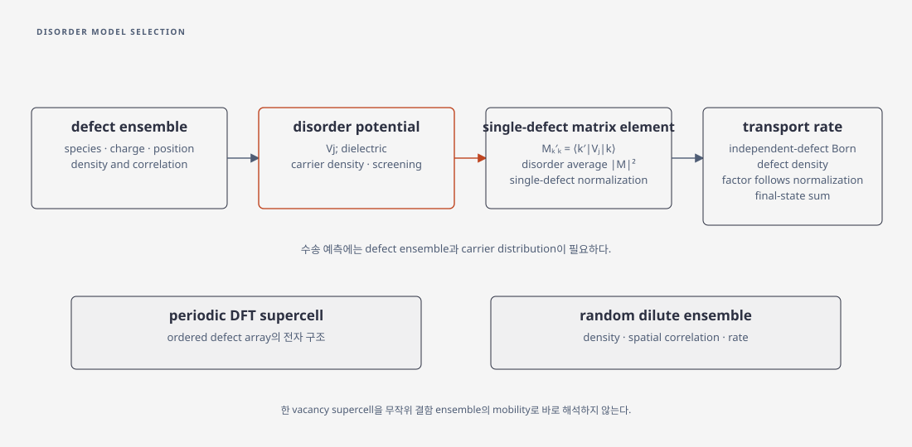

# Defect scattering model

## 1. 결함 종류와 산란 퍼텐셜

수송에서 defect model은 보통 \(H=H_0+\sum_jV_j\)의 disorder potential \(V_j\)와 결함 ensemble을 지정한다. charged impurity, neutral vacancy, substitutional defect, trapped charge는 같은 defect density라는 말로 묶을 수 없다. 전하 상태, 위치·분포, dielectric environment, carrier density와 screening이 달라지면 같은 구조 결함도 다른 scattering potential을 만든다. [Hwang–Das Sarma, p. 2, Eq. (1)](https://arxiv.org/pdf/cond-mat/0608645), [Kaasbjerg–Low–Jauho, §II.A–B](https://arxiv.org/pdf/1612.00469)

## 2. 약한 disorder의 수송률

독립 결함과 Born 근사에서는 Fermi golden rule로 단일-defect matrix element의 disorder average와 final-state sum을 사용해 transition 및 momentum-relaxation rate를 만든다. 이때 결함 밀도를 포함하는 방식은 \(V_{kk'}\)의 finite-area 또는 single-defect normalization에 따라 달라지므로, \(n_d|V_{kk'}|^2\)만의 식을 문맥 없이 보편식으로 쓰면 단위와 계수를 잃는다. charged impurity의 경우 결함 plane과 channel 사이 거리와 screening function이 결과를 바꾸므로, carrier density를 모른 채 \(n_d\)만 조정하는 것은 물리적으로 불충분하다. [Hwang–Das Sarma, p. 2, Eq. (1)](https://arxiv.org/pdf/cond-mat/0608645), [Kaasbjerg–Low–Jauho, §II.B, 식 (10)–(13)](https://arxiv.org/pdf/1612.00469)

### (1) 2차원 등방 밴드에서의 예

단일 결함 퍼텐셜 \(u(\mathbf r)\)의 Fourier 변환을 \(u(\mathbf q)=\int d^2r\,u(\mathbf r)e^{-i\mathbf q\cdot\mathbf r}\)로 잡는다. 원점에 놓인 결함에 대해 면적 \(A\)에서 정규화된 평면파 사이의 단일 결함 행렬원소는 \(u(\mathbf k'-\mathbf k)/A\)다. 독립적으로 무작위 배치된 결함의 면밀도를 \(n_d\)라고 하면, 등방 포물선 밴드의 탄성 단일 밴드 산란에서 수송 완화율은

\[
\frac1{\tau_{\rm tr}(k)}=\frac{2\pi n_d}{\hbar}
\int\frac{d^2k'}{(2\pi)^2}|u(\mathbf k'-\mathbf k)|^2
(1-\cos\theta)\,\delta(E_{\mathbf k'}-E_{\mathbf k})
\]

로 쓸 수 있다. 이 규약에서 \(u(\mathbf q)\)의 단위는 에너지×면적이고 \(n_d\)의 단위는 면적의 역수다. \(\theta\)는 입사·출사 운동량 사이의 각도이며 \(1-\cos\theta\)는 운동량 방향 완화에 대한 가중치다. 양자 수명에 쓰는 총 전이율에는 이 가중치를 같은 방식으로 넣지 않는다. 다중 밴드·valley·spinor overlap이나 비등방 밴드는 해당 상태 및 속도를 명시해 확장해야 한다. [Hwang–Das Sarma, p.2, Eq. (1)](https://arxiv.org/pdf/cond-mat/0608645), [Kaasbjerg–Low–Jauho, §II.A, Eqs. (2)–(3)](https://arxiv.org/pdf/1612.00469)

### (2) 전하 결함의 거리와 차폐

두 매질이 동일한 상대 유전율 \(\kappa\)를 갖는 균일 환경, 두께가 없는 2D 전자층, 전하 \(Z_de\)인 결함이 층에서 거리 \(d\)에 있다는 이상화에서 screened 산란 에너지의 크기는

\[
|u(q)|=\frac{|Z_d|e^2}{2\varepsilon_0\kappa q\,\epsilon(q)}e^{-qd}
\]

로 쓸 수 있다. \(\epsilon(q)\)는 캐리어 차폐를 나타내는 무차원 함수이며 배경 유전율 \(\kappa\)와 구분한다. 예를 들어 모델 차폐를 \(\epsilon(q)=1+q_s/q\)로 택하면 분모는 \(q+q_s\)가 된다. 실제 interface의 서로 다른 유전율·유한 두께 form factor·gate에 의한 영상전하는 이 이상화에 포함되지 않는다. [Hwang–Das Sarma, p. 2, Eq. (1)](https://arxiv.org/pdf/cond-mat/0608645), [Kaasbjerg–Low–Jauho, §II.C, Eqs. (14)–(16)](https://arxiv.org/pdf/1612.00469), [Jang et al., Eq. (3)](https://doi.org/10.1126/sciadv.abn3181)

### (3) 강한 결함과 T-matrix

단일 결함의 반복 산란은 이상적인 기준 Hamiltonian의 retarded Green 함수 \(G_0^r(E)\)를 사용해

\[
T^r(E)=V+V G_0^r(E)T^r(E)
\]

로 쓴다. 첫 항 \(T\simeq V\)만 쓰면 Born 근사이며, 강한 짧은 범위 결함이나 공명 부근에서는 뒤 항들이 중요할 수 있다. Kaasbjerg 등의 MoS\(_2\) vacancy 연구는 그 모형에서 Born과 T-matrix 산란률에 큰 차이가 날 수 있음을 보고한다. 단일 결함에서의 반복 산란을 모두 다룬다고 해서 서로 다른 결함 사이의 간섭과 높은 농도 효과까지 자동으로 포함하는 것은 아니다. [Kaasbjerg–Low–Jauho, §II.A–B, Eqs. (6)–(13)](https://arxiv.org/pdf/1612.00469), [Ferreira et al., §III.A, Eqs. (45)–(49)](https://arxiv.org/abs/1010.4026)

결함을 포함한 소자의 전송 계산은 [NEGF](../../computational-materials-science/quantum-transport/negf.md), 산란률을 유효 이동도로 평균하는 조건은 [Matthiessen 법칙](matthiessens-rule.md)과 [반전층 이동도](inversion-layer-mobility.md)에서 연결한다.

## 3. 재료별 결함 산란 모형

주기적 DFT supercell의 한 vacancy는 ordered array의 전자 구조를 주며, 무작위 dilute defect ensemble의 mobility를 바로 주지 않는다. 수송 예측에는 결함 생성 에너지·전하 상태와 별도로, 실제 농도, spatial correlation, scattering matrix element, carrier distribution을 연결해야 한다. Si(111) surface charged-impurity 모형과 MoS\(_2\) vacancy 모형은 위 일반 관계는 공유하지만 parameter를 서로 이전할 수 없다. [Hwang–Das Sarma](https://arxiv.org/pdf/cond-mat/0608645), [Kaasbjerg–Low–Jauho](https://arxiv.org/pdf/1612.00469)

<figure markdown="span">

  

  <figcaption markdown="1">
  이 위키가 작성한 유도 흐름도. 단일 결함 행렬원소와 disorder 평균을 정의한 뒤, 독립 결함·Born 근사 아래 결함 밀도와 final-state sum을 포함한 산란률로 연결한다.
  </figcaption>
</figure>

## 4. 참고 문헌

1. E. H. Hwang, S. Das Sarma, *Transport properties of two-dimensional electron systems on silicon (111) surfaces* (2006), pp. 1–2, https://arxiv.org/pdf/cond-mat/0608645.
2. K. Kaasbjerg, T. Low, A.-P. Jauho, *Electron and hole transport in disordered monolayer MoS2: atomic vacancy-induced short-range and Coulomb disorder scattering*, *Physical Review B* **100**, 115409 (2019), §II, https://arxiv.org/pdf/1612.00469.
3. K. Kaasbjerg, “Atomistic T-matrix theory of disordered two-dimensional materials,” *Physical Review B* **101**, 045433 (2020), [§III](https://arxiv.org/abs/1911.00530).
4. A. Ferreira et al., “Unified description of the dc conductivity of monolayer and bilayer graphene at finite densities based on resonant scatterers,” *Physical Review B* **83**, 165402 (2011), [§III.A, Eqs. (45)–(49)](https://arxiv.org/abs/1010.4026).
5. J. Jang et al., “Reduced dopant-induced scattering in remote charge-transfer-doped MoS₂ field-effect transistors,” *Science Advances* **8**, eabn3181 (2022), [Eq. (3)](https://doi.org/10.1126/sciadv.abn3181).
