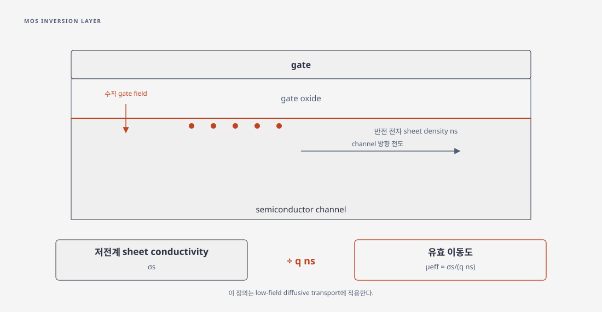

# Inversion-layer mobility

## 1. 이동도 정의와 관측량

Inversion layer mobility는 gate 전계로 형성된 반전층의 횡방향 전도도를 전하 밀도로 나눈 유효 수송 계수다. 낮은 drain 전계, 국소 평형, 확산 수송이라는 기준 모형에서 sheet conductivity \(\sigma_s\)와 sheet electron density \(n_s\)에 대해

\[
\mu_{\mathrm{eff}}=\frac{\sigma_s}{q n_s}
\]

로 정의한다. 여기서 \(q>0\)이고 \(\sigma_s\)의 단위는 S, \(n_s\)는 m\(^{-2}\)이므로 \(\mu_{\mathrm{eff}}\)의 단위는 m\(^2\) V\(^{-1}\) s\(^{-1}\)이다. 이 정의는 channel의 전도도를 표현하는 것이며, ballistic 또는 quasi-ballistic 소자에서 얻는 apparent mobility와 자동으로 같지 않다. [Lundstrom–Sun, §2–3, 식 (4), (13)–(16)](https://arxiv.org/pdf/1603.03132), [Yeh–Guo, §IV.A, 식 (16)–(18)](https://ir.lib.nycu.edu.tw/server/api/core/bitstreams/a0ea6421-70c5-4a1b-a274-35599989b584/content)

## 2. 선형영역 추출과 전하의 선택

접촉 전압 강하를 뺀 채널 전압 \(V_{DS,\mathrm{int}}\)가 작고 \(Q_{\mathrm{inv}}=-q n_s\)를 독립적으로 알면,

\[
I_D \simeq \frac{W}{L}\mu_{\mathrm{eff}}\lvert Q_{\mathrm{inv}}\rvert V_{DS,\mathrm{int}}
\]

에서 \(\mu_{\mathrm{eff}}\)를 얻는다. \(W,L\)은 유효 channel 폭·길이이다. \(\lvert Q_{\mathrm{inv}}\rvert\)의 산출법과 \(V_{DS,\mathrm{int}}\)의 접촉 보정은 추출식의 정의와 일치해야 한다. split-CV는 \(Q_{\mathrm{inv}}\)를 직접 정하는 한 방법이며, contact/series resistance 보정은 그 저항 모형과 부호 convention을 함께 쓸 때 적용한다. [Yeh–Guo, §IV.A, 식 (16)–(18)](https://ir.lib.nycu.edu.tw/server/api/core/bitstreams/a0ea6421-70c5-4a1b-a274-35599989b584/content), [Lundstrom–Sun, §2–3](https://arxiv.org/pdf/1603.03132)

<figure markdown="span">

  

  <figcaption markdown="1">
  이 위키의 개념도. gate 전계로 형성된 반전층 sheet density와 채널 방향 전도도에서 저전계 유효 이동도를 정의한다. 기호와 추출 조건은 본문에 설명했다.
  </figcaption>
</figure>

### (1) 직렬 저항이 추출값에 미치는 영향

작은 전압에서 채널과 접촉·접근부의 저항이 직렬로 더해지는 모형을 택하자. 양쪽 접촉과 접근부를 합친 저항을 \(R_s\), 측정한 두 단자 저항을 \(R_{\rm tot}\)이라 하면

\[
R_{\rm tot}=R_s+R_{\rm ch},\qquad
R_{\rm ch}=\frac{L}{Wq n_s\mu_{\rm eff}},\qquad
\mu_{\rm eff}=\frac{L}{Wq n_s(R_{\rm tot}-R_s)}.
\]

이는 동일한 채널 전하와 일정한 선형 저항을 가정한 단순화다. 접촉 저항이 gate 전압에 따라 바뀌거나 비선형이면 단일 상수 \(R_s\)로 보정할 수 없다. 저항을 보정하지 않으면 같은 \(n_s\)에서 작은 이동도를 얻는다. [Yeh–Guo, §IV.A, 식 (16)–(18)](https://ir.lib.nycu.edu.tw/server/api/core/bitstreams/a0ea6421-70c5-4a1b-a274-35599989b584/content), [Kong–Yeow–Yao, §II, Eqs. (1)–(3)](https://doi.org/10.1109/16.974720)

???+ example "직렬 저항 보정의 산술 예시"

    \(W/L=10\), \(n_s=10^{12}\,\mathrm{cm^{-2}}=10^{16}\,\mathrm{m^{-2}}\), \(\mu_{\rm eff}=0.05\,\mathrm{m^2/(V\,s)}=500\,\mathrm{cm^2/(V\,s)}\)를 가정한다. \(q=1.602\times10^{-19}\,\mathrm C\)이면 \(G_{\rm ch}\simeq0.801\) mS, \(R_{\rm ch}\simeq1248\,\Omega\)다. 양쪽을 합친 \(R_s=250\,\Omega\)가 추가되면 \(R_{\rm tot}\simeq1498\,\Omega\)이며, 이를 보정하지 않고 추출한 값은 약 \(417\,\mathrm{cm^2/(V\,s)}\)다. 임의로 정한 수치에 대한 산술 예시다.

### (2) 저전계 이동도와 apparent mobility

채널이 짧아지면 경계와 접촉이 전송에 기여하므로 두 단자 conductance를 곧바로 길이에 비례하는 diffusive channel 저항으로 해석하기 어렵다. Landauer 형태에서 \(T(E)\)와 모드 수를 이용해 계산한 conductance를 \(\sigma_{\rm app}=GL/W\)로 바꾸고 다시 \(qn_s\)로 나누면 길이 의존적인 apparent mobility를 정의할 수 있다. 이 수는 같은 장치에 대한 관측량으로 유용하지만 bulk 산란만의 고유 이동도라는 보장은 없다. [Lundstrom–Sun, §§2–3, Eqs. (3)–(15)](https://arxiv.org/pdf/1603.03132), [Lin et al., §§I, IV](https://doi.org/10.1109/TED.2016.2532604)

관측량의 열린 경계 해석은 [Landauer 수송](../../computational-materials-science/quantum-transport/landauer-transmission.md)과 [양자 접촉 저항](../../computational-materials-science/quantum-transport/quantum-contact-resistance.md)을 참조한다.

## 3. 전계와 산란의 역할

\(\mu_{\mathrm{eff}}\) 하나는 특정 산란률을 직접 측정한 값이 아니다. 전계 의존성을 해석하려면 \(n_s\), 온도, vertical field, channel 방향, 접촉 보정과 사용하는 산란 모형을 함께 고정해야 한다. 여러 산란률을 한 mobility로 결합하는 근사의 조건은 [Matthiessen's rule](matthiessens-rule.md)에서 따로 다룬다. [Lundstrom–Sun, §2–3](https://arxiv.org/pdf/1603.03132), [Yeh–Guo, §IV.A](https://ir.lib.nycu.edu.tw/server/api/core/bitstreams/a0ea6421-70c5-4a1b-a274-35599989b584/content)

## 4. 적용 한계와 보고 기준

1절에서 정의한 유효 이동도 추출식은 low-field, diffusive channel을 기준으로 한다. 2절의 apparent mobility는 짧은 채널의 경계 효과까지 포함할 수 있으므로 두 값을 비교할 때 추출법을 밝혀야 한다. 보고할 때는 \(Q_{\mathrm{inv}}\) 산출법, 적용한 series-resistance 보정, \(V_{DS,\mathrm{int}}\), 온도와 추출 구간을 함께 제시해야 한다. [Lundstrom–Sun, §2–3](https://arxiv.org/pdf/1603.03132), [Yeh–Guo, §IV.A](https://ir.lib.nycu.edu.tw/server/api/core/bitstreams/a0ea6421-70c5-4a1b-a274-35599989b584/content)

## 5. 참고 문헌

1. M. Lundstrom, X. Sun, *Some Useful Relations for Analyzing Nanoscale MOSFETs Operating in the Linear Region* (2016), §2–3, §6, https://arxiv.org/pdf/1603.03132.
2. K.-L. Yeh, J.-C. Guo, *A New Method for Layout-Dependent Parasitic Capacitance Analysis and Effective Mobility Extraction in Nanoscale Multifinger MOSFETs* (2011), §IV.A, https://ir.lib.nycu.edu.tw/server/api/core/bitstreams/a0ea6421-70c5-4a1b-a274-35599989b584/content.
3. F. C. J. Kong, Y. T. Yeow, and Z. Q. Yao, “Extraction of MOSFET Threshold Voltage, Series Resistance, Effective Channel Length, and Inversion Layer Mobility From Small-Signal Channel Conductance Measurement,” *IEEE Transactions on Electron Devices* **48**, 2870–2874 (2001), [§II, Eqs. (1)–(3)](https://doi.org/10.1109/16.974720).
4. J. Lin et al., “Analysis of Resistance and Mobility in InGaAs Quantum-Well MOSFETs From Ballistic to Diffusive Regimes,” *IEEE Transactions on Electron Devices* **63**, 1464–1470 (2016), [DOI](https://doi.org/10.1109/TED.2016.2532604).
