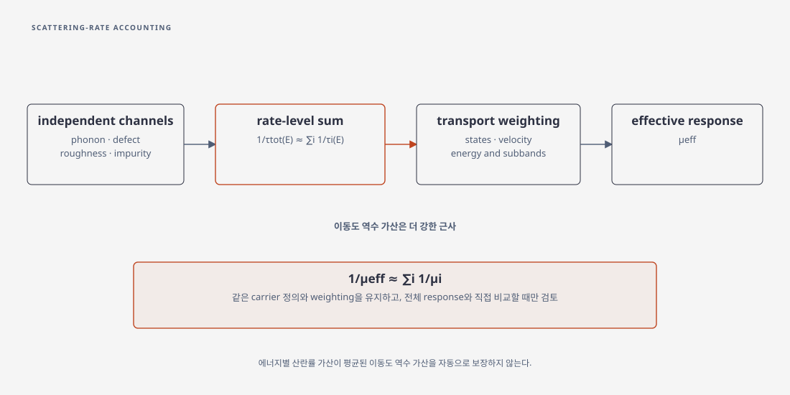

# Matthiessen's rule

## 1. 에너지별 산란률과 이동도 역수

Matthiessen's rule은 독립 산란 메커니즘의 momentum-relaxation rate가 더해진다는 근사

\[
\frac{1}{\tau_{\mathrm{tot}}(E)}\simeq\sum_i\frac{1}{\tau_i(E)}
\]

를 가리킨다. 여기서 \(i\)는 phonon, charged impurity, roughness 같은 산란 채널이다. 이 관계는 독립 산란체와 relaxation-time 근사를 가정하며, 같은 운반자 상태를 기준으로 각 산란률을 정의할 수 있을 때 적용된다. 실험 또는 소자에서 얻는 유효 이동도에 대해 \(1/\mu\simeq\sum_i1/\mu_i\)를 쓰는 것은 위 식을 energy·subband·공간 분포에 대해 평균한 뒤에도 가산이 유지된다는 더 강한 가정이다. [Wettstein, Appendix A.1, pp. 105–107](https://iis-people.ee.ethz.ch/~schenk/theses/wettstein.pdf), [Lundstrom–Sun, §6, 식 (31)](https://arxiv.org/pdf/1603.03132)

## 2. 평균 이동도 역수 가산의 조건

선형 응답 전도도는 상태 밀도, 속도, \(\tau_{\mathrm{tot}}(E)\), distribution의 energy weighting을 포함한 적분이다. 따라서 rate-level 가산을 energy-averaged mobility의 역수 가산으로 바꾸는 단계는 별도의 근사다. 이 문서는 그 근사가 성립한다고 가정하지 않으며, 사용한 수송 모형에서 total response와 직접 비교해야 한다. [Wettstein, Appendix A.1, pp. 105–107](https://iis-people.ee.ethz.ch/~schenk/theses/wettstein.pdf), [Lundstrom–Sun, §6](https://arxiv.org/pdf/1603.03132)

<figure markdown="span">

  

  <figcaption markdown="1">
  이 위키가 작성한 산란률 관계도. 특정 근사에서 에너지별 역완화시간을 더한 뒤 수송 가중을 거쳐 유효 이동도를 구하며, 이동도 역수의 가산에는 별도 가정이 필요하다.
  </figcaption>
</figure>

### (1) 전도도에서 사용하는 에너지 평균

한 개의 등방적인 2차원 포물선 밴드와 유효질량 \(m^*\)를 가정하면, 전하 \(q>0\)에 대한 이동도는

\[
\mu=\frac{q}{m^*}\langle\tau\rangle,\qquad
\langle\tau\rangle=\frac{\displaystyle\int_0^\infty E\,\tau(E)\left(-\frac{\partial f_0}{\partial E}\right)dE}
{\displaystyle\int_0^\infty E\left(-\frac{\partial f_0}{\partial E}\right)dE}.
\]

\(E\)는 밴드 바닥에서 잰 에너지, \(f_0\)는 평형 Fermi 분포다. 2D 포물선 밴드의 상수 상태밀도와 속도 제곱이 이 가중치에 반영되어 있다. 이 식은 여러 subband·비등방 질량·비탄성 충돌의 일반식은 아니다. 채널별 \(\tau_i(E)\)를 먼저 역수로 더하고 결과를 평균하는 순서를 지켜야 한다. [Kaasbjerg–Low–Jauho, §II.A, Eqs. (2)–(3)](https://arxiv.org/pdf/1612.00469), [Hwang–Das Sarma, p. 2, Eq. (1)](https://arxiv.org/pdf/cond-mat/0608645)

### (2) 왜 평균한 뒤에는 달라지는가

두 산란 시간이 모든 에너지에서 \(\tau_i(E)=a_i\tau_0(E)\)로 같은 에너지 의존성을 공유하고 가중치도 동일하면, \(\tau_{\rm tot}(E)=\tau_0(E)/(\sum_i a_i^{-1})\)이므로 이동도 역수도 더할 수 있다. 에너지 의존성이 서로 다르면 일반적으로 이 조건이 깨진다. 각각의 \(\mu_i\)는 동일한 밴드, 입자 밀도와 평형 분포에서 다른 채널을 꺼 놓고 정의해야 한다. [Kaasbjerg–Low–Jauho, §II.A](https://arxiv.org/pdf/1612.00469), [Wettstein, Appendix A.1](https://iis-people.ee.ethz.ch/~schenk/theses/wettstein.pdf)

???+ example "두 에너지 구간으로 보는 반례"

    두 에너지 구간의 전도도 가중치가 각각 \(1/2\)라고 가정하자. 임의의 같은 시간 단위로 \((\tau_1(E_a),\tau_1(E_b))=(1,4)\), \((\tau_2(E_a),\tau_2(E_b))=(4,1)\)이면 각 구간에서 역시간을 더한 결과는 모두 \(\tau_{\rm tot}=0.8\)이다. 따라서 직접 평균은 \(0.8\)이다. 반면 각각을 먼저 평균하면 \(\langle\tau_1\rangle=\langle\tau_2\rangle=2.5\)이고, 그 역수를 더하면 \(1.25\)가 된다. \(q/m^*\)를 공통 인자로 두면 두 값의 차이는 이동도에도 그대로 나타난다. 실제 물질의 계산값이 아닌 산술 예시다.

접촉 저항까지 포함한 짧은 소자의 apparent mobility는 별도의 경계 효과를 포함하므로 같은 절차에 자동으로 넣을 수 없다. [반전층 이동도](inversion-layer-mobility.md)와 [Landauer 수송](../../computational-materials-science/quantum-transport/landauer-transmission.md)을 함께 참조한다.

## 3. 사용할 때의 최소 검증

역수 가산을 사용한다면 각 \(\mu_i\)의 전하 밀도·온도·field·subband 정의를 일치시켜야 한다. 합산값이 전체 계산 또는 측정과 맞는지 확인하고, 맞지 않으면 scattering correlation, screening 변화, nonparabolicity, nonequilibrium distribution 중 무엇을 생략했는지 검토한다. 일치는 각 산란 모형이 유일하게 옳다는 증거가 아니며, 불일치는 어느 하나의 rate만 바꾸어 해결할 수 있다고 가정할 근거도 아니다.

## 4. 참고 문헌

1. A. Wettstein, *Quantum Effects in MOS Devices* (2000), Appendix A.1, pp. 105–107, https://iis-people.ee.ethz.ch/~schenk/theses/wettstein.pdf.
2. M. Lundstrom, X. Sun, *Some Useful Relations for Analyzing Nanoscale MOSFETs Operating in the Linear Region* (2016), §6, https://arxiv.org/pdf/1603.03132.

3. K. Kaasbjerg, T. Low, A.-P. Jauho, “Electron and hole transport in disordered monolayer MoS₂,” *Phys. Rev. B* **100**, 115409 (2019), [§II.A, Eqs. (2)–(3)](https://arxiv.org/pdf/1612.00469).
4. E. H. Hwang, S. Das Sarma, “Transport properties of two-dimensional electron systems on silicon (111) surfaces,” [p. 2, Eq. (1)](https://arxiv.org/pdf/cond-mat/0608645).
