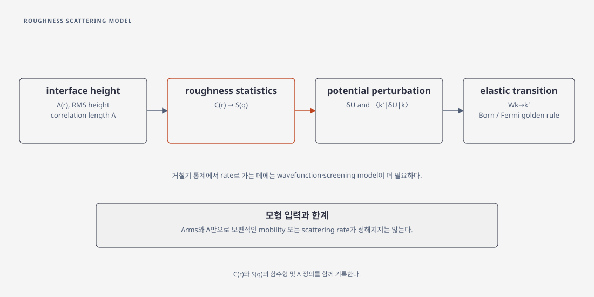

# Surface-roughness scattering model

## 1. 계면 높이의 통계적 기술

평균 계면에서의 높이 편차를 \(\Delta(\mathbf r)\)라 두면, 이 문서의 통계적 surface-roughness model은 autocorrelation \(C(\mathbf r)=\langle\Delta(\mathbf r)\Delta(\mathbf0)\rangle\)와 Fourier spectrum \(S(\mathbf q)\)를 정한다. 예를 들어 exponential 모형은

\[
C(r)=\Delta_{\mathrm{rms}}^2\exp\!\left(-\frac{\sqrt2 r}{\Lambda}\right)
\]

처럼 쓸 수 있다. \(\Delta_{\mathrm{rms}}\)는 RMS height, \(\Lambda\)는 이 정의에서의 correlation length다. Gaussian과 exponential은 서로 다른 correlation 함수 모형이고, \(\exp(-r/\Lambda)\)와 \(\exp(-\sqrt2r/\Lambda)\)는 같은 exponential 모형에서도 length convention이 다르다. [Badami, Ch. 2 §2.2.2, 식 (2.24)–(2.26)](https://air.uniud.it/retrieve/e27ce0c5-bae9-055e-e053-6605fe0a7873/Badami_PhDThesisUploaded.pdf), [Sano, §II.A, 식 (3)–(5)](https://arxiv.org/html/2604.22155)

### (1) 상관함수의 2차원 스펙트럼

평균이 0인 병진 불변·등방적 계면에서 2차원 Fourier 변환을 \(S(\mathbf q)=\int d^2r\,C(\mathbf r)e^{-i\mathbf q\cdot\mathbf r}\)로 정의하자. 위 지수형과 같은 \(\Delta_{\rm rms}\), \(\Lambda\)를 갖는 Gaussian형 \(C_G(r)=\Delta_{\rm rms}^2e^{-r^2/\Lambda^2}\)의 변환은 각각

\[
S_{\rm exp}(q)=\frac{\pi\Delta_{\rm rms}^2\Lambda^2}
{(1+q^2\Lambda^2/2)^{3/2}},\qquad
S_G(q)=\pi\Delta_{\rm rms}^2\Lambda^2e^{-q^2\Lambda^2/4}
\]

이다. 여기서 \(q=|\mathbf k'-\mathbf k|\)이고, 위 변환 규약에서 \(S\)의 단위는 길이의 네제곱이다. 역변환에는 \((2\pi)^{-2}\)가 들어가며 \(C(0)=\int d^2q\,S(q)/(2\pi)^2=\Delta_{\rm rms}^2\)다. 이 식은 위 상관함수를 직접 2D 변환한 결과다. 문헌이 다른 Fourier 정규화나 상관 길이를 쓰면 앞 계수와 \(\Lambda\)가 달라진다. [Sano, §II.A, Eqs. (3)–(5)](https://arxiv.org/html/2604.22155), [Badami, Ch. 2 §2.2.2](https://air.uniud.it/retrieve/e27ce0c5-bae9-055e-e053-6605fe0a7873/Badami_PhDThesisUploaded.pdf)

두 모형은 같은 RMS 높이와 \(\Lambda\)를 써도 \(q\)별 산란 성분이 다르다. 예를 들어 \(q\Lambda=2\)에서 \(S_{\rm exp}(q)/S_{\rm exp}(0)=3^{-3/2}\approx0.192\), \(S_G(q)/S_G(0)=e^{-1}\approx0.368\)이다. 이것은 함수 정의를 비교한 산술 예시다. 어느 모형이 특정 소자의 이동도를 더 낮춘다고 말하려면 실제로 가중되는 \(q\)와 전자 파동함수를 함께 알아야 한다.

## 2. 통계에서 산란률로 가는 추가 가정

rough interface가 confinement potential을 \(\delta U\)만큼 바꾸면 상태 \(\lvert k\rangle\) 사이의 elastic transition rate는 Born 또는 Fermi golden-rule 근사에서

\[
W_{k\rightarrow k'}=\frac{2\pi}{\hbar}\left|\langle k'\lvert\delta U\rvert k\rangle\right|^2\delta(E_{k'}-E_k)
\]

로 쓴다. ensemble-averaged \(\lvert M_{kk'}\rvert^2\)에는 roughness autocorrelation의 Fourier spectrum \(S(\mathbf q)\)와 wavefunction overlap·경계 전위 변조가 반영된다. screening은 선택한 모형에서 추가될 수 있다. 따라서 \(\Delta_{\mathrm{rms}}\)와 \(\Lambda\)만으로 보편적인 mobility나 scattering rate를 정할 수 없다. [Sano, §II.C, 식 (11)](https://arxiv.org/html/2604.22155), [Badami, Ch. 2 §2.1, 식 (2.1)–(2.2)](https://air.uniud.it/retrieve/e27ce0c5-bae9-055e-e053-6605fe0a7873/Badami_PhDThesisUploaded.pdf)

<figure markdown="span">

  

  <figcaption markdown="1">
  이 위키의 계산 개념도. 계면 높이 상관함수와 Fourier spectrum에서 전위 섭동과 상태 간 행렬원소를 거쳐 산란률로 이어지는 과정을 요약한다.
  </figcaption>
</figure>

### (1) 밴드 가장자리 변화와 전계

계면이 \(\Delta(\mathbf r)\)만큼 이동할 때 구속 에너지나 경계 퍼텐셜이 선형으로 바뀐다고 가정하면 \(\delta U(\mathbf r)\)는 \(\Delta(\mathbf r)\)에 비례한다. 따라서 약한 거칠기에서 그 행렬원소의 제곱은 거칠기 spectrum에 비례하지만, 비례 계수는 subband 파동함수와 confinement potential에 따라 바뀐다. 전계가 파동함수 분포와 경계 민감도를 바꾸므로 같은 roughness 통계라도 산란 효과가 달라진다. 선형화가 적절하지 않으면 원자 규모의 단차나 비선형 전위 변화를 다루는 모형이 필요하다. [Sano, §II.A–C, Eqs. (1)–(2), (11)](https://arxiv.org/html/2604.22155), [Badami, Ch. 2 §2.1–2.2](https://air.uniud.it/retrieve/e27ce0c5-bae9-055e-e053-6605fe0a7873/Badami_PhDThesisUploaded.pdf)

이 rate를 실제 관측 이동도로 연결하는 에너지 평균과 다른 산란 채널의 합산 조건은 [반전층 이동도](inversion-layer-mobility.md)와 [Matthiessen 법칙](matthiessens-rule.md)을 참조한다.

## 3. 보고해야 할 항목

모형을 제시할 때에는 \(C(r)\) 또는 \(S(q)\)의 함수형과 \(\Lambda\) convention, \(\Delta_{\mathrm{rms}}\), 계면별 correlation, wavefunction·screening 계산법, Born 근사의 사용 여부를 함께 적는다. 실험 AFM의 거칠기와 전자에 유효한 buried interface spectrum은 같다고 가정하지 말고, 필요한 경우 독립적으로 calibration한다.

## 4. 참고 문헌

1. C. Alexander, A. Asenov, *Statistical MOSFET Current Variation Due to Variation in Surface Roughness Scattering* (2011), §II.A, https://in4.iue.tuwien.ac.at/pdfs/sispad2011/pdf/10-1.pdf.
2. O. Badami, PhD thesis (2017), Ch. 2, https://air.uniud.it/retrieve/e27ce0c5-bae9-055e-e053-6605fe0a7873/Badami_PhDThesisUploaded.pdf.
3. N. Sano, *Microscopic Modeling of Surface Roughness Scattering in Inversion Layers of MOSFETs Based on Ando’s Linear Model* (2026 preprint), §II–III, https://arxiv.org/html/2604.22155.
